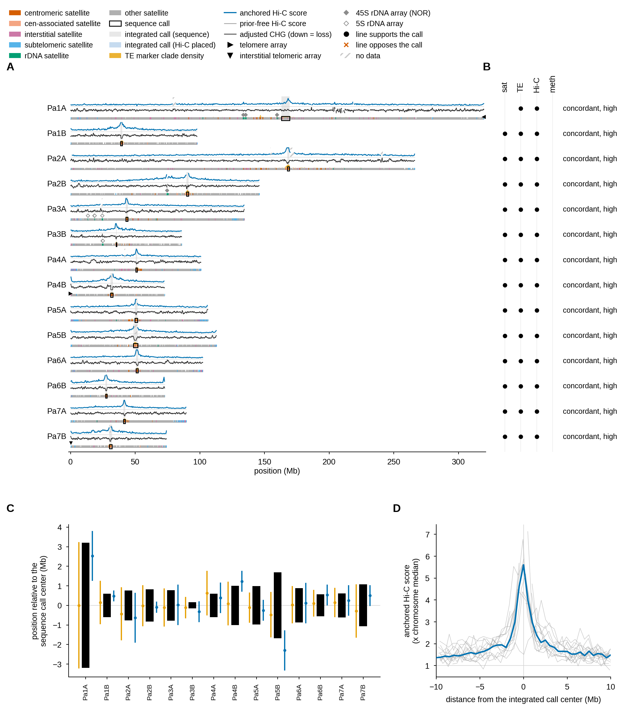

# cenfuse

Finds the centromere of every chromosome in a genome assembly. It combines satellite repeats, LTR
retrotransposons, Hi-C and DNA methylation, lets them check each other, and says when it is unsure. Only the FASTA
is required.



*Poa annua, all four inputs, a fresh run of cenfuse 0.8.0 ([PDF with legends](docs/img/example_overview.pdf)). **A** one row per chromosome:
Hi-C score (blue), CHG methylation (black), satellite arrays by role, TE density; black box = sequence call, gray
band = final call; ▶ ▼ = telomere arrays at the ends and inside; ◆ ◇ = 45S and 5S rDNA arrays. **B** lines that
support (●) or oppose (×) each call. **C** each line's call relative to the sequence call. **D** Hi-C score around
each call.*

## At a glance

| | |
|---|---|
| **Needs** | a chromosome-level FASTA. Optional: LTR retrotransposons, Hi-C, methylation (CpG from ONT or PacBio HiFi; CHG from ONT), genes |
| **Gives** | one centromere per chromosome, with a confidence and the evidence for and against it, also in words (what the call stands on, why it may be wrong, which input would decide); with CpG methylation, the kinetochore inside it; each chromosome's morphology (centromeric index, Levan class) and completeness (telomeres at both ends, assembly gaps); telomeres (also interstitial ones), 45S and 5S rDNA arrays, knobs and other repeat blocks on the same map; a report that reads it all out |
| **Priority** | right > uncertain > wrong. `low` means "uncertain", and cenfuse uses it rather than guess |
| **Runtime** | the satellite search dominates and grows with satellite content (on a shared server: T2T mammals, 2.6-3.6 Gb: 1-10 h at 12 threads, median 4.3 h; mouse, ~6% satellite: 9 h at 16; maize, 2.2 Gb: 50 min at 16; *Ae. tauschii*, 4.1 Gb: 2 h at 16); Hi-C and fusion take minutes; reruns resume. The log reports the search every 10% of its work with the time left (an estimate) and names the costliest families; the family models are built in parallel, with the same output (families stage of *Panax japonicus* at 16 threads: 674 s against 2,290 s for 0.8 at 16, 3.4x; Col-CC 130 s and rice 87 s at 16 threads against 230 s and 138 s for 0.8 at 8 and 12); a FasTAN crash on a piece of a chromosome is recovered by splitting the piece ([Options](#options)) |
| **Memory** | peak of a whole run: 8-74 GB for T2T mammals at 12 threads (rhesus 74 GB, horse 59 GB, giraffe 18 GB), chicken 42 GB at 16, *Arabidopsis* 5 GB at 8; the satellite search holds about one search workspace (≤ ~2.4 GB) per thread |
| **Reproducible** | on Linux, fresh runs give identical results apart from the dates and commands in file headers (FasTAN runs with address-space randomization off, `setarch -R`: two fresh moss runs, 307 files) and two kinds of work files: `satellite/work/annotate/<genome>.search_cost.tsv`, whose CPU times differ between runs, and the families stage's BLAST scratch under `satellite/work/families/fam*/frame*/` and `replay*/`, which depends on which accepted families a concurrent build saw; the family models and every results file are exact. Without `setarch` (e.g. macOS) cenfuse warns, and ~1% of FasTAN's array cuts can differ between runs; reruns resume from checkpoints |

## How well it works

Right = the call overlaps the CENP-A/CENH3 domain (mammals) or lies within 4 Hi-C bins of it (plants).
Figures (mammals and Hi-C; plants and LTR retrotransposons; CpG kinetochores), details and every failure:
[`docs/benchmark.md`](docs/benchmark.md). Every genome's overview plot:
[`docs/gallery.md`](docs/gallery.md).

| genomes | truth | inputs | chromosomes | right | confidently wrong | wrong but `low`, or no call |
|---|---|---|---|---|---|---|
| 9 T2T mammals (human, great apes, macaque, pig, horse) | CENP-A | FASTA only | 157 | 143 | 1 | 13 (pig's 6 acrocentrics among them: `low`, see below) |
| same | CENP-A | + genes + Hi-C | 157 | 148 | 4 | 5 |
| rice | CENH3 | FASTA + Hi-C (+ `tes/`, + genes: unchanged, all `high`) | 12 | 12 | 0 | 0 |
| barley | CENH3 | FASTA + Hi-C (+ `tes/`: unchanged) | 7 | 6 | 0 | 1 |
| barley | CENH3 | FASTA + `tes/` | 7 | 4 | 1 | 2 |
| potato | CENH3 | FASTA + Hi-C | 11 | 2 | 2 | 7 |
| potato | CENH3 | FASTA + `tes/` (+ genes, + Hi-C: unchanged) | 11 | 6 | 2 | 3 |
| horse (EquCab3) | CENP-A | FASTA + Hi-C | 5 | 3 (all `low`) | 0 | 2 |
| *Arabidopsis* (Col-CC) | CENH3 | FASTA (+ `tes/`, + ONT methylation) | 5 | 5 (all `high`) | 0 | 0 |
| chicken (GGswu, 40 chromosomes) | CENP-A windows | FASTA (+ Hi-C: unchanged) | 33 | 28 (all `low`) | 0 | 5 |
| maize (Mo17 T2T, knobs) | CENH3 | FASTA (+ `tes/`, + genes: unchanged) | 10 | 9 (all `high`; 7 overlap) | 1 | 0 |
| mouse (mhaESC T2T, all acrocentric) | minor-satellite (CENP-A) array | FASTA only | 20 | 1 (`low`; all 20 at the centromeric end, the minor satellite the reported alternative on 20) | 0 | 19 |
| moss (*Physcomitrium* V6; Copia-cluster centromeres, no satellite) | CENH3 | FASTA (+ Hi-C: unchanged; + `tes/`) | 26 | 16 (`low`; with `tes/` 11 of them `high`/`medium`) | 0 | 10 |
| same | CENH3 | FASTA + `tes/` + Hi-C | 26 | 22 (all `high`/`medium`) | 0 | 4 |
| *Chlamydomonas* (UL-1690; LINE-cluster centromeres) | CENH3 | FASTA (+ `tes/`: unchanged) | 17 | 6 (all `low`) | 0 | 11 |
| *Brachypodium distachyon* Bd21 | CENH3 (3 of 5 chromosomes) | FASTA (+ `tes/`: unchanged) | 3 | 3 (all `high`) | 0 | 0 |
| *Brassica rapa*, 11 T2T accessions (Ma 2026) | CENH3, same line (9); published centromeres (2 with too weak a ChIP) | FASTA | 110 | 109 (CX1 A05 `low` 2.8 Mb off) | 0 | 1 |
| same, 4 accessions | CENH3 | FASTA + `tes/` | 40 | 40 (39 `high`/`medium`) | 0 | 0 |
| soybean X26 | CENH3 | FASTA | 20 | 20 (18 `high`) | 0 | 0 |
| same | CENH3 | FASTA + `tes/` | 20 | 19 | 1 | 0 |
| sorghum BTx623 T2T | CENH3 (ChIP of line V9) | FASTA (+ `tes/`: unchanged) | 10 | 10 (all `high`) | 0 | 0 |
| *Aegilops tauschii* AL8/78 (4.1 Gb) | CENH3 | FASTA | 7 | 1 | 4 | 2 |
| same | CENH3 | FASTA + `tes/` | 7 | 5 (CRM cores; all `high`/`medium`) | 2 | 0 |
| *Chlorella sorokiniana* NS4-2 (Copia-cluster centromeres) | CENH3 | FASTA | 10 | 0 | 0 | 10 |
| same | CENH3 | FASTA + `tes/` | 10 | 8 (all `low`) | 0 | 2 |
| tomato Heinz 1706 (satellite-free centromeres) | CENH3 (SCAU) | FASTA (+ `tes/`, + Hi-C: unchanged) | 12 | 1 | 7 | 4 |

Controls: on randomized Hi-C (33 runs, 4 of them on genomes whose calls are all `low`) the Hi-C test never passed and no
call changed. Siamang without genes (all calls `low`): Hi-C now validates 20 calls (`medium`; 18/20 match the genes + Hi-C
run).

**Kinetochores from CpG methylation** (public ONT tracks; the CpG line refines calls, never changes them):

| genomes | truth | kinetochores | on truth | width |
|---|---|---|---|---|
| 5 great apes | DiMeLo-seq CENP-A | 39 | 35 within 50 kb (29 overlap); CENP-A signal higher inside on 39/39 | median 45 kb, calls 3.9 Mb (all 133 kinetochores with truth, 6 primates: 55 kb, 5.1 Mb) |
| same + human | curated CDRs | 63 | 62 | |
| crab-eating macaque | CENP-A ChIP of another animal | 21 (15 with truth) | 12/15 inside its domain | |
| rhesus (R10, held out) | none | 21 of 22 | | |
| HG002 (diploid T2T), ONT and PacBio HiFi | CenSat active arrays | ONT 40, PacBio 43 | all inside the active array; ONT vs PacBio within 50 kb on 31/39 | median 38 kb (ONT), 25 kb (PacBio) |

The CpG test passed in 6/7 primates with truth (not in chimpanzee) and in 0/8 runs on misplaced (rotated) methylation.

**Holocentric controls** (any single confident centromere is wrong): *C. elegans*, *Bombyx mori* (no CenH3),
*Rhynchospora breviuscula* (Tyba holocentromeres): 0 confident calls in 40 chromosomes (24 `low`, 16 none).

| strong | weak |
|---|---|
| Satellite centromeres from the FASTA alone (mammals 143/157, rice 12/12, *B. rapa* 109/110, soybean 20/20, sorghum 10/10) | Satellite-free centromeres without `tes/` (potato 2/11; horse chr11 has no call) |
| `high` is reliable: 112/113 `high` calls on CENP-A truth were right | Confidence is conservative: many `medium`/`low` calls are right too (horse T2T: all 17 `medium` calls with CENP-A truth) |
| CpG kinetochores at low coverage: calls are pooled per bin (rhesus at 1/16 of its reads, ~1 call per CpG strand: 21/21 kinetochores within 50 kb of full depth) | Hi-C tests flip near their threshold: both orangutans lost the gate at half depth (35 M pairs), barley its fold rescue (9.2 M -> 4.6 M pairs); no call became confidently wrong in mammals |
| Hi-C, satellites and TEs are tested against each other, not trusted on their own word | When a small array is the active one and a large array of the same satellite sits elsewhere, the large one is called, confidently (one orangutan chromosome) |
| Hi-C must pass a test in each genome before it can act; it never passed on randomized Hi-C | Without CpG methylation, calls span the array (median 0.8-5.6 Mb), not the 0.1-0.5 Mb kinetochore |
| CpG methylation places the kinetochore inside the array (median 55 kb in 6 primates; 35/39 within 50 kb of CENP-A) | The CpG line refines a call but cannot fix a wrong one; its test failed on older chimpanzee data |
| No confident call on holocentric genomes (0/40 chromosomes), or on point, regional and AT-rich centromeres (yeasts, *Plasmodium*, *Neurospora*, *Cryptococcus*) | CENH3 on satellite-free DNA beside the satellite array can be missed confidently (maize chr5, 2 Mb from CentC) |
| Knobs are not taken for centromeres (maize: 23.6 Mb of knob repeat, none in a call) | Chicken: right calls stay `low`; its Hi-C is dominated by telomere clustering and cannot validate them |
| In grasses, Hi-C can overrule a wrong satellite line (barley 0 → 6/7) | Hi-C failed its test in 6/14 mammals (pig, horse, rhesus, sheep, goat, giraffe) and then only reports |
| Rejects interspersed repeats and finds the centromeric end of acrocentric karyotypes without annotation (goat 30/30 on the satellome locus; mouse 20/20 at the right end) | Acrocentric detection needs ≥ ~16 chromosomes. Where a larger pericentric satellite shares that end (mouse), the call is `low` on it and the CENP-A satellite is the reported alternative |
| With `tes/`, CRM retrotransposon cores sit on CENH3 (rice 8/8, potato 6/7, maize 10/10) and place satellite-free centromeres (potato 2 → 6/11 right) | Only CRM may decide: another centromeric lineage only flags (moss Bryco cores on CENH3 25/26, calls 16/26; with Hi-C 22/26), and REXdb gives fungal elements no lineage (*Cryptococcus*: no call) |
| With `tes/`, centromeres made of a few TE insertions count (the floor is 3 independent insertion sites: *Chlorella* 0 → 8/10), and a CRM core overrules a confident satellite call elsewhere, or a non-weak one beside it, only where it holds significantly more CRM elements than the call (`low` and weak calls it replaces anyway) (*B. rapa* 9/10 → 10/10 in 3 accessions, soybean 17/20 → 19/20, *Ae. tauschii* 3/7 → 5/7) | Satellite-free centromeres beside a genome-wide dominant pericentromeric satellite are called confidently wrong, and neither Hi-C nor TEs fix it (tomato 1/12, 7 confidently wrong); *Ae. tauschii* from the FASTA alone 1/7 (4 confidently wrong) |
| Satellite families founded on two-copy duplications are not modeled, which cuts the search where retrotransposon units dominate it (sheep about 12x, siamang 2x) without changing a call | Which satellite becomes dominant can depend on how a run splits a satellite into families: pig's acrocentrics were right in an earlier run, now `low` and 0.6-2.0 Mb off (the honesty cap holds: 1 confident error in 157 mammal chromosomes) |
| Morphology from the integrated call: acrocentric vs bi-armed as in the literature karyotype on 117/118 right calls (mouse 20/20, goat 30/30, horse 29/29, pig 13/13, sheep 25/26); assembly gaps counted exactly (4,084 in 3 assemblies) | Morphology is by sequence length, not cytogenetic appearance: CHM13's acrocentric chr21 and chr22 come out submetacentric/subtelocentric (their T2T p arms, rDNA included, are 11-15 Mb); a wrong call gives a wrong class (`low` calls stay out of the karyotype) |

## Install

```bash
git clone https://github.com/cwb14/cenfuse.git && cd cenfuse
mamba env create -f environment.yml && mamba activate cenfuse
pip install --no-deps .
pytest -q -n 8          # optional: 704 tests, ~2 min
```

## Quick start

```bash
mkdir mygenome && cp asm.fa mygenome/ && samtools faidx mygenome/asm.fa
cenfuse run mygenome -t 32
```

Read `mygenome/cenfuse/cenfuse_report.md` (what was found, in words), `asm.centromeres.tsv` (one row per chromosome)
and `cenfuse_overview.pdf`.

## Inputs

One folder per genome. Every file uses the FASTA's name (`asm`):

```
mygenome/
├── asm.fa + asm.fa.fai    required: chromosome-level assembly (unplaced scaffolds are skipped, below)
├── asm.chromosomes.txt    the chromosomes to analyze, one name per line (replaces the length rule, below)
├── tes/asm.gff3           LTR retrotransposons    strongly recommended for plants; needed for CHG methylation (or .gff)
├── hic/asm.pairs.gz       Hi-C contacts           (or .cool/.mcool; a Juicer .hic converts, below)
├── meth/asm.tsv           ONT methylation samples table
└── genes/asm.gff3         gene annotation         (or .gff/.gtf)
```

| input | adds |
|---|---|
| FASTA | satellite families found de novo, each array's role, telomeres, rDNA, one sequence call per chromosome |
| `asm.chromosomes.txt` | the chromosomes you name, where the length rule below picks scaffolds or misses a small chromosome |
| `tes/` | CRM retrotransposon cores, which mark grass centromeres (without them, satellite calls were wrong on barley 7/7 and potato 9/11) |
| `hic/` | a functional test of every call; validated Hi-C can move a call |
| `meth/` | CG: the kinetochore inside each call, where CpG dips are shown to mark centromeres (primates); CHG (with `tes/`): a second functional line and per-plant verdicts (plants) |
| `genes/` | gene density at every locus; helps reject gene-rich and subtelomeric repeats |

**Chromosome set.** The chromosomes are the sequences above the first tenfold drop in length between neighbors
(looked for only after half the assembly is counted; all sequences when there is none), except that a gradual scaffold
tail is cut off: take the first sequence after half the assembly that is shorter than a tenth of the median length of
those before it; if the sequences from it down to that drop span a tenfold range or more, the set ends before it. The
log and the report's Notes say when this cut fires, how many sequences it left out and the shortest one kept.
`--classify-from` targets keep the 0.8 rule, which has no tail test. Limits shared with 0.8: a small chromosome that
stands alone after a tenfold gap is dropped (*D. melanogaster* without its Y loses the 1.35-Mb chromosome 4; with the
3.7-Mb Y it is kept), and large unplaced scaffolds can stay in. Limits of the tail cut, where 0.8 kept the
chromosomes: dot chromosomes followed by a gradual scaffold tail are cut with the tail (a bird-like karyotype of 37
chromosomes plus 300 scaffolds tapering from 0.4 Mb: 0.8 keeps all 337 sequences, 0.9 keeps 31 and drops six
0.5-1.4-Mb dot chromosomes; with a clean gap before the scaffolds both keep 37), and small chromosomes that themselves
span a tenfold range are cut as a tail.
When the rule fails, name the chromosomes in `asm.chromosomes.txt` (the FASTA's name): one sequence name per line, a
line starting with `#` is a comment (a `#` inside a name, as in `HG002#1#chr1`, is part of it), and blank lines, CRLF
line ends, trailing spaces and a UTF-8 byte-order mark are accepted. The list replaces the rule, also for
`--classify-from` targets; an unknown name, a duplicate or an empty list stops the run, and a list that matches no
genome logs a warning. List every chromosome: the methylation line sets its expected domain size from the number
listed, so a partial list inflates it. The log and the report's Notes say what set the chromosomes.

Several FASTAs in one folder are analyzed together and share satellite family names.

<details>
<summary><b>Recipes: making each input</b> (click)</summary>

**LTR retrotransposons** with [LTRquest](https://github.com/cwb14/LTRquest):

```bash
ltrquest --genome asm.fa --proteins related.pep.fa --threads 32 --detect-args ltr-timeout=300   # --proteins optional
mkdir -p mygenome/tes && cp asm_LTRs_all_depth_LTR_cleaned.gff3 mygenome/tes/asm.gff3
```
`ltr-timeout=300` caps LTRharvest and LTR_FINDER at 5 min per 500-kb chunk, and LTRquest's FastLTR then searches the
capped chunks. Centromeric satellite chunks are the ones that stall (rice cen3: > 20 min uncapped), so the cap is
faster and keeps the centromeres annotated (rice: CRM cores on 8 vs 7 chromosomes uncapped; same calls). Set
`--mutation-rate` for your organism (default 3e-8, plants).

cenfuse is developed and benchmarked with LTRquest only; other annotators' files are still read as below, but get no
further work ([Development](#development)). Any GFF3 works if each element's type contains `LTR_retrotransposon` and
it carries `clade=` (e.g. EDTA + TEsorter). A [DANTE_LTR](https://github.com/kavonrtep/dante_ltr) GFF3 works as it
is: each `transposable_element` takes its REXdb lineage from `Final_Classification` (elements without LTRs, rank D,
are not counted: in potato they placed CRM cores up to 15 Mb from CENH3). A file whose elements carry no lineage (EDTA
alone: superfamily only), or sit on other sequence names, is reported with the reason and the LTR line is off. The
line needs a sensitive annotation: CRM must concentrate on most chromosomes to decide, and with DANTE_LTR, EDTA's
intact set or half of LTRquest's elements, rice's CRM concentrated on only 3-5 of 12 (those cores are still used,
flags only) and potato lost its gain from `tes/` (6 -> 2 of 11 right). LTRquest found the most CRM elements in rice,
potato and maize.

**Hi-C** to uniquely mapped, deduplicated pairs (~100 M read pairs is enough; map to this exact assembly):

```bash
bwa-mem2 index asm.fa && cut -f1,2 asm.fa.fai > asm.chrom.sizes && mkdir -p mygenome/hic
bwa-mem2 mem -5SP -T0 -t 32 asm.fa hic_R1.fq.gz hic_R2.fq.gz \
  | pairtools parse --min-mapq 30 --walks-policy 5unique --max-inter-align-gap 30 \
      --add-columns mapq --drop-sam --drop-seq -c asm.chrom.sizes \
  | pairtools sort --nproc 8 --memory 16G --tmpdir . | pairtools dedup \
  | pairtools select '(pair_type=="UU") or (pair_type=="UR") or (pair_type=="RU")' -o mygenome/hic/asm.pairs.gz
```
A Juicer/YaHS `.hic` of this assembly converts with [hictk](https://github.com/paulsengroup/hictk): `hictk convert asm.hic
mygenome/hic/asm.mcool` (rice: the same calls as from the pairs, on every column). cenfuse stops with this recipe
when it finds `hic/asm.hic`, or a BAM, instead of skipping Hi-C.
Pairs from another pipeline work too. Kept at MAPQ >= 1 (pairtools' default) they changed no Hi-C test and made no
call confidently wrong in five genomes; keep their `mapq1`/`mapq2` columns and cenfuse applies MAPQ >= 30 itself.

**Methylation** from ONT reads, one sample per plant (CHG needs `tes/` too; CG alone needs nothing else):

```bash
dorado basecaller sup pod5/ --modified-bases 5mC_5hmC --min-qscore 10 > plant1.ubam     # not the CpG-only model
samtools fastq -T MM,ML,MN plant1.ubam | minimap2 -t 32 -ax lr:hq -y asm.fa - \
  | samtools view -u -q 20 -F 0x904 - | samtools sort -@ 8 -o plant1.bam && samtools index plant1.bam
M=mygenome/meth; mkdir -p $M
for ctx in CHG CHH; do                                  # no --combine-strands for CHG: strands are read separately
  modkit pileup plant1.bam - --ref asm.fa --modified-bases 5mC 5hmC --motif $ctx 0 -t 32 \
    | awk -F'\t' '$4=="m"' | bgzip > $M/plant1.$ctx.bed.gz && tabix -p bed $M/plant1.$ctx.bed.gz
done
modkit pileup plant1.bam - --ref asm.fa --modified-bases 5mC 5hmC --motif CG 0 --combine-strands -t 32 \
  | awk -F'\t' '$4=="m"' | bgzip > $M/plant1.CG.bed.gz && tabix -p bed $M/plant1.CG.bed.gz
printf 'sample\tCHG\tCG\tCHH\nplant1\tplant1.CHG.bed.gz\tplant1.CG.bed.gz\tplant1.CHH.bed.gz\n' > $M/asm.tsv
```
CpG only (animals; e.g. Dorado `5mCG_5hmCG` calls): one CG file per sample. A public strand-combined CpG bigWig works as
a bedGraph of methylated fraction (0-1 or 0-100), converted with `bigWigToBedGraph`, sorted, bgzipped and tabixed.
PacBio HiFi 5mC works the same way: a bigWig or bed of CpG scores (pb-CpG-tools, or modkit on HiFi reads) as a
bedGraph (HG002: the same gate result as ONT, kinetochores within 50 kb of ONT's on 31/39 chromosomes). Prefer a
bedMethyl with read counts when you have one: cenfuse pools the calls of each 5-kb bin, so low coverage works (rhesus
MMU8 thinned to 1/16 of its reads, about one call per CpG strand: the gate passes and 21/21 kinetochores stay within 50
kb of full depth); a bedGraph has no counts, so every CpG weighs the same. An ENCODE-style bedMethyl (11 columns:
coverage and percent methylated, e.g. from a bisulfite pipeline) is read as counts too (MFA8 and MMU8 rewritten that
way: the same calls, kinetochores within 50 kb on 21/21) and checked against the assembly like any table. CHG files
must be modkit bedMethyl: the provenance test reads modkit's counts of failed and differing calls.
```bash
modkit pileup sample1.bam - --ref asm.fa --cpg --combine-strands -t 32 \
  | awk -F'\t' '$4=="m"' | bgzip > $M/sample1.CG.bed.gz && tabix -p bed $M/sample1.CG.bed.gz
printf 'sample\tCG\nsample1\tsample1.CG.bed.gz\n' > $M/asm.tsv
```
Optional `meth/asm.exclude.bed`: regions the methylation line ignores (column 4 = a sample name, or empty for all; the CpG kinetochore line does not read it).

**Genes:** any GFF3 or GTF of this assembly: `gene` lines (protein-coding by `gene_biotype`, `biotype` or GENCODE's
`gene_type`), or, in a file without them, one locus per transcript's `Parent` (Spud DB potato). Sequence names must
be the FASTA's (RefSeq `NC_` vs GenBank `CM`/`CP` accessions, `chr1` vs `chr01`): cenfuse warns when no gene, or no
gene on some chromosomes, matches them.

</details>

## Outputs (`mygenome/cenfuse/`)

| file | content |
|---|---|
| **`asm.centromeres.tsv`** (+ `.bed`, `.gff3`) | **the answer**: per chromosome, the call, `relation`, `confidence`, supporting and opposing lines, each line's own call, the array a TE core replaced (`seq_overruled_start`/`seq_overruled_end`), the CpG kinetochore (`cpg_kt_start`/`cpg_kt_end`; GFF3 `regional_centromere_central_core`, Name=kinetochore), the call in words (`basis`, `caveat`), and the chromosome's morphology and completeness |
| **`cenfuse_report.md`** | per genome, in words: what each line found and whether it passed its test, what the centromeres are made of, the calls that are not `high` and what would settle them, morphology and completeness, the other features and their 3D association |
| `cenfuse_overview.pdf`, `asm.overview.png` | the figure above; its first page at 300 dpi |
| `cenfuse_summary.tsv` | per genome: what each line found, how many chromosomes pass the Hi-C and CpG tests (`hic_gate_pass`, `cpg_gate_pass`), `fold_gate`, `hic_sequence_conflict`; warnings are in the log and the report |
| `asm.loci.tsv`, `asm.features.gff3` | every other feature (telomeres, interstitial telomeric arrays, 45S and 5S rDNA arrays, knobs, subtelomeric blocks, Hi-C hubs, LTR cores, former centromeres) with each line's value there. GFF3 types are Sequence Ontology terms (`gt gff3validator -typecheck so` passes); cenfuse's kind is the `kind=` attribute; each member names its locus (`locus=`) and type (`member=`) |
| `asm.feature_signatures.tsv`, `asm.feature_contacts.tsv` | per kind of feature, each line's median signal; with Hi-C, each kind's 3D self-association |
| `asm.hic_anchored.bedgraph` | the Hi-C centromere score per bin, for a browser |
| `asm.provenance.tsv` | which plant each input comes from (genotype and karyotype verdicts) |
| `asm.plants.tsv`, `asm.plant_sites.tsv` | with several plants: each plant's centromere; each plant at each site ([plants.md](docs/plants.md)) |
| `satellite/`, `hic/`, `methylation/` | each line's detailed outputs |

## Reading a call

| `relation` | meaning |
|---|---|
| `concordant` | Hi-C or methylation agrees with the satellite/TE call (best case) |
| `offset` | validated Hi-C (with a second line for a high call) moved the call; the old one is kept in `seq_start`/`seq_end` |
| `contested` | a validated line points elsewhere without enough support to move: call kept, one level lower |
| `functional_only` | no satellite/TE call; Hi-C placed it |
| `sequence_only` | only the satellite/TE call was usable (no Hi-C, Hi-C failed its test, or its peak was weak) |
| `none` | no call |

**`confidence`**: `high`, `medium`, or `low` = uncertain (the best candidate, but another place is not excluded).
Agreeing independent lines raise a kept call (at most two levels); an opposing line lowers it one. A call that Hi-C
moved or placed is `medium` (`high` with a second line).

Fusion flags are in `flags`; the satellite engine's are in `seq_flags`, with its evidence in `seq_evidence` (`satellite`, `weak_satellite`, `long_unit_tandem`, `retrotransposon`).

`seq_overruled_start`/`seq_overruled_end` (1-based; `.` = none; the satellite summary also has its family,
`overruled_family`) hold every call that a TE core took the place of: a satellite or weak-satellite call that a
decisive CRM core replaced (flagged `satellite_away_from_core`, `satellite_beside_core` or
`weak_satellite_beside_core`), a long-unit call beside a decisive core (`weak_satellite_beside_core`), and a long-unit
call away from the core, which a core of any clade replaces, decisive or not (no flag). A long-unit call is made only
on a chromosome without a satellite call, and with a core there the long-unit scan covers the core and 500 kb on each
side. The caveat names the overruled array. It is never written to `seq_alt_start`/`seq_alt_end`, which validated
Hi-C can move a call to. A `.` on a chromosome flagged `satellite_away_from_core`, `satellite_beside_core` or
`weak_satellite_beside_core` means the satellite output predates 0.9 (its centromeres stage was not rerun).

| flag | meaning |
|---|---|
| `competing_cluster` | a second satellite cluster at least half the size, or a second satellite that also marks the acrocentric end; call is `low`, the other is in `seq_alt_start`/`seq_alt_end` |
| `hic_chose_alt` | validated Hi-C picked the competing cluster |
| `acrocentric` | the family sits at one end of most chromosomes (acrocentric karyotype) |
| `fold_pair` | Hi-C's centromere cluster and the chromosome's arm fold agree here, away from the satellite call: the call moved |
| `fold_offset`, `hic_denovo_offset` | the arm fold / Hi-C's prior-free peak points elsewhere (one level lower each) |
| `hic_medium_peak` | no sequence call; a clean medium Hi-C peak placed a `low` call |
| `moved_with_te`, `_meth`, `_fold` | a high call moved: a second line (TE core, methylation, arm fold) agreed with Hi-C |
| `near_end`, `low_satellite`, `diffuse`, `no_dominant_satellite` | why the satellite engine lowered its confidence |
| `te_concordant`, `te_discordant` | the LTR marker's core agrees with the call / lies elsewhere; with a decisive (CRM) core the call is raised to at least `medium` / lowered one level (other clades only flag) |
| `satellite_away_from_core`, `satellite_beside_core`, `weak_satellite_beside_core` | a decisive CRM core replaced the satellite call (kept in `seq_overruled_start`/`seq_overruled_end`): one elsewhere that was `low` on its own or holds significantly fewer CRM elements; one beside the core that holds significantly fewer; a weak one beside it |
| `hic_offset`, `hic_disagrees_weak`, `hic_near` | strong validated Hi-C points elsewhere but cannot move a `high` call without a second line (`contested`); a validated peak elsewhere too weak to oppose; a peak near the call but not on it (within Hi-C's resolution: no effect) |
| `te_derived`, `gene_rich`, `gaps:N`, `contig_end` | flags only: the main family lies mostly inside LTR retrotransposons; the call is more gene-dense than its chromosome; N assembly gaps in the call; the call reaches a contig end (`--classify-from`) |

Per-genome tests, given per chromosome in `*.centromeres.tsv` and counted in `cenfuse_summary.tsv` (`hic_gate_pass`, `hic_gate_untested`, `cpg_gate_pass`): `hic_gate` (`pass`/`fail`/`untested`: does Hi-C
find the other chromosomes' centromeres? `hic_gate_refs`: `reference` = tested against the confident calls, `low` =
no confident call anywhere, so against the `low` calls at clean peaks), `fold_gate` (does the arm fold agree with Hi-C's own peaks?) and
`cpg_gate` (do CpG dips sit at the other chromosomes' calls more often than methylation from elsewhere would put them?).

| CpG column | meaning |
|---|---|
| `cpg_kt_start`, `cpg_kt_end` | the kinetochore: the call's CpG dip (half-depth run of its most prominent valley), shown where `cpg_gate` passes and the dip is significant. It refines the call; it does not check it (an inactive array has dips too) |
| `cpg_dip_p` | the dip is longer than in the call's own 5-kb bins shuffled |
| `cpg_pos_p` | the dip is longer than methylation from elsewhere on the chromosome makes on the same bins (the gate counts these) |
| `cpg_kt_meth`, `cpg_array_meth` | mean methylation in the kinetochore and median over the array |

| column | meaning |
|---|---|
| `basis` | what the call stands on, in words: the satellite family and its unit, the centromeric satellite in the call, a CRM core and the interval of the satellite call it replaced, a move or placement and its second line, each agreeing line, the kinetochore |
| `caveat` | why the call may be wrong: the array a TE core overruled (with where it lies), each flag that lowered it, each opposing line (with where it points), gaps in the call; after `->`, the input that would decide, where cenfuse's tests say one can (two arrays of one satellite: CENP-A/CENH3 data; neither Hi-C nor CpG methylation chooses between them). `.` = nothing known against the call |
| `cen_point`, `short_arm`, `ci`, `arm_ratio`, `morphology` | the arms, measured from the CpG kinetochore's midpoint where there is one, else the call's: centromeric index (short arm / length), arm ratio (long / short), Levan class (metacentric <= 1.7 < submetacentric <= 3 < subtelocentric <= 7 < acrocentric; two classes when the call spans both); `short_arm` = the sequence end nearer the centromere (`.` when the call spans the middle) |
| `telomeres`, `gaps`, `call_gaps`, `t2t` | telomere arrays at `both` ends, one (`start`, `end`) or `none`; assembly gaps (runs of >= 10 N) on the chromosome and inside the call; `t2t` = `yes` with telomere arrays at both ends and no gap |

`cenfuse_summary.tsv` adds `karyotype` (Levan classes of the `high` and `medium` calls; `low` calls and chromosomes
without a call counted apart), `t2t_chromosomes`, `calls_with_gaps` and `short_arm_at_end` (`high`/`medium` calls, not
metacentric, short arm last: the cytogenetic convention puts it first).

## Options

| option | meaning |
|---|---|
| `-o DIR` | output folder [`GENOME_DIR/cenfuse`] |
| `-t N` | threads [8] |
| `--satellite-dir DIR` | reuse the `satellite/` folder of an earlier run |
| `--seed-engine fastan\|trf` | tandem-repeat finder for satellite seeds [fastan] |
| `--seed-cache DIR` | share tandem-repeat results between runs |
| `--classify-from T=S` | genome T (e.g. a contig assembly) takes its satellite families from genome S |
| `--force STAGE` | recompute a stage: `satellite` (the whole satellite engine), `telomere` ... `cpg`, or one satellite-engine stage (`seeds` ... `plot`) with every later one. Needed after an upgrade (the run stops and names the stage), after adding or changing `genes/` or `tes/` in an earlier run's folder (`--force classify`), and when the chromosome set changed (below): the satellite engine's checkpoints track code, parameters and the chromosome set, not input files |
| `-v` | per-step progress |

There are no tuning knobs: every threshold is a fixed constant with its reason in a `params.py` or at the top of the module that uses it.

**Old output folders.** The satellite engine's seeds, families and calls stand on the chromosome set, which
`satellite/work/chromosome_set.json` records ({genome: sorted names}, written before the engine runs). A rerun in a
folder whose set changed (a genome added or removed, a new or edited `chromosomes.txt`, or the 0.9 rule on an assembly
with a gradual scaffold tail) stops, names the genomes and their chromosome counts, and says to rerun with
`--force satellite`. A folder made before 0.9 has no record: each current genome's set is compared with the set the
0.8 rule gives, so a genome added or removed since is detected only once a record exists. A folder whose set is
unchanged resumes, folders from 0.8 included: the satellite engine's checkpoints are kept, and cenfuse's own stages,
whose keys carry cenfuse's version, are computed once more. The satellite engine keeps its version (0.9.0) and its
stage versions, so nothing forces a rerun, although its summary and region tables gained the `overruled_*` columns;
the standalone methylation engine (`python -m cenfuse.meth`, 0.1.0) now counts chromosomes with the 0.9 rule.
`--satellite-dir` takes an earlier run's satellite outputs as they are and only warns when their chromosomes differ
from the set.

**The log** (INFO, without `-v`). The genome-wide search logs `annotate: <genome>: N% of the work done in X; about Y
left (estimate)` at each 10% of its work (chunk length x model length, counted as searches finish) and after an hour
without a line (checked as each search finishes). The estimate assumes the rest costs per unit what the done part did,
so it is rough (*Arabidopsis* Col-CC, 8 threads: the line at 90% said about 46 s left, and the last tenth took 5 min).
Seed clustering logs each round and the seeds left. When the search ends, the log names the three families that took
most CPU, and the output stage names them again with their final role (a dispersed family that cost much and decided
nothing shows here). `satellite/work/annotate/<genome>.search_cost.tsv` lists every family: `model_len`, `searches`,
`cpu_h`, `cpu_share`, `wall_h` (the threads' busy time, not elapsed time), `hits_reported` and `monomers_kept`.

**FasTAN crashes.** FasTAN can abort on a large satellite array (SIGABRT, `malloc(): corrupted top size`). A piece of
the seed search on which it dies by a crash signal (SIGABRT, SIGSEGV, SIGBUS, SIGFPE, SIGILL) is split into two halves
that overlap by 10 kb, and each half is retried, recursively; a piece of at most 20 kb that still crashes is skipped
with a warning. If no piece of a chunk longer than 20 kb could be searched (FasTAN crashed on every one, down to 20
kb), the run stops: FasTAN's known crash is local to one array (*Oryza minuta* lost 0 bp after 4 splits), so a whole
chunk failing means FasTAN itself is failing, and going on would give a satellite-free result. The error names the
chunk and the crash table and suggests `--seed-engine trf`. A kill (SIGKILL, such as the OOM killer; SIGTERM; SIGINT)
still stops the run. The crashed intervals (0-based) are in `<seed cache file>.fastan_crashes.tsv` beside the cached
seeds, so a shared `--seed-cache` keeps them, linked as `satellite/work/seeds/<genome>.fastan_crashes.tsv`; the
genome's summary line in the log counts them. The seeds of a piece that does not crash are those cenfuse 0.8 gave.

## Several plants

Methylation and Hi-C often come from plants other than the assembled one, whose centromeres can sit elsewhere. Give
one row per plant (`meth/asm.tsv`; `hic/asm.tsv` with columns `sample`, `file`); the same `sample` name means the
same plant. cenfuse genotypes each input, lets only the assembled plant's (or unknown) inputs decide the calls, and
scores every plant on its own (`shared` or `shifted`). Details: [`docs/plants.md`](docs/plants.md).

## Limitations

- **Satellite-free centromeres** need `tes/` (CRM cores) or validated Hi-C; the satellite line alone misses them.
- **A genome-wide wrong satellite line** can be overruled by Hi-C only through the arm fold, which needs Rabl nuclei
  (grasses). Elsewhere `cenfuse_summary.tsv` flags `hic_sequence_conflict`; add `tes/` or methylation.
- **Resolution**: Hi-C locates the unmappable array, not the kinetochore inside it. CpG methylation does, where its
  gate passes (primates); it never chooses the array, so a wrong call gets a kinetochore inside the wrong array.
- **CpG gate** needs positional dips at more centromeres than chance: it failed in chimpanzee and siamang (older R9
  CpG tracks), and five chromosomes (Arabidopsis) give it too few references. Small arrays that are hypomethylated as a
  whole are not refined.
- **One wrong Hi-C peak** in a genome where Hi-C mostly works passes the test; only high calls need a second line to move.
- **Centromeres near chromosome ends**: a Hi-C peak within 8 bins of an end may support a call but never moves one,
  since chromosome ends cluster in 3D whatever the centromere (all 10 such peaks in rice, barley, human and orangutan
  were wrong). Moss has 11 of 26 CENH3 domains within 2 Mb of an end: Hi-C acts there only with `tes/`, and 4 calls
  stay wrong (`low`) although Hi-C and the Bryco core both sit on CENH3.
- **CHG methylation** needs ONT CHG calls and `tes/`; plants below ~4x often lack data at centromeres. In Arabidopsis
  (Mb-wide CEN180 arrays) it found no signature: its expected domain size comes from genome size (315 kb there).
- **Hi-C provenance**: pairs or cool files cannot be genotyped, so their plant of origin is usually `unknown`.
- **Hi-C depth**: give at least ~70 M uniquely mapped pairs to a 3-Gb genome. At half that, the gate failed in both
  orangutans and barley's arm fold failed (its 9.2 M pairs were just enough); a failed test only reverts the calls to
  the sequence line.
- **LTR annotation depth**: the decisive CRM test needs CRM to concentrate on most chromosomes; DANTE_LTR, EDTA's intact
  set or half of LTRquest's elements were not enough in rice and potato (potato lost its gain from `tes/`).
- **Chromosome set**: the length rule drops a small chromosome that stands alone after a tenfold gap (*D. melanogaster*
  without its Y), and can keep large unplaced scaffolds (31 extra sequences, 1.5-117 Mb, in 12 of 121 polyploid
  assemblies, against 5,614 in 0.8). Its tail cut, new in 0.9, also drops chromosomes 0.8 kept: dot chromosomes
  followed by a gradual scaffold tail (a bird-like karyotype with 300 scaffolds tapering from 0.4 Mb loses six
  0.5-1.4-Mb dot chromosomes) and small chromosomes that themselves span a tenfold range. For any of these, name the
  chromosomes in `asm.chromosomes.txt` (all of them: the methylation line's domain size divides by the number listed).

## Documentation

| file | read it for |
|---|---|
| [`docs/benchmark.md`](docs/benchmark.md) | all results as a figure and tables: per genome, per line, controls, failures |
| [`docs/gallery.md`](docs/gallery.md) | cenfuse's overview plot for every benchmark genome |
| [`docs/design.md`](docs/design.md) | how each line works, the fusion rules, constants, and alternatives that were rejected |
| [`docs/plants.md`](docs/plants.md) | provenance and per-plant scoring |
| [`docs/future.md`](docs/future.md) | open problems, each with its evidence, a proposed approach and the check it needs |

## Development

LTR retrotransposon support is developed and benchmarked with [LTRquest](https://github.com/cwb14/LTRquest) only.
The readers for DANTE_LTR and EDTA + TEsorter files stay as they are, with their tests, but get no further work: no
new rules, workarounds or benchmark arms for them. Work on the LTR line assumes LTRquest input
([`docs/design.md`](docs/design.md#principles)).

## License

MIT (see `LICENSE`).
