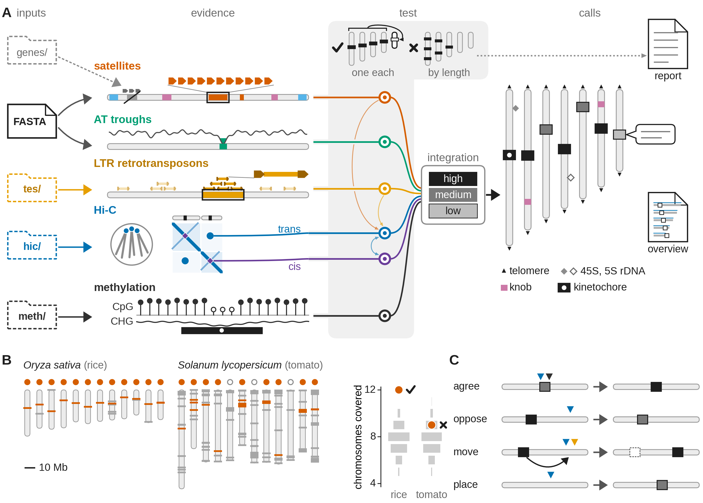

# cenfuse

cenfuse finds the centromere of every chromosome in a genome assembly. It needs only the FASTA. LTR retrotransposon
annotations, Hi-C and DNA methylation make it better. Each kind of evidence must first show, in your genome, that it
finds centromeres before it may confirm or move a call. Every call comes with a confidence (`high`, `medium` or `low`)
and a sentence that says what supports it, what speaks against it and which data would settle it.


*The overview page cenfuse draws for each genome (here* Poa annua*, all four inputs;
[PDF with legends](docs/img/example_overview.pdf)). **A** one row per chromosome: Hi-C score (blue), CHG methylation
(black), satellite arrays colored by role, retrotransposon density (orange); black box = the sequence call, gray band =
the final call; ▶ ▼ telomere arrays; ◆ ◇ 45S and 5S rDNA arrays. **B** the evidence for (●) and against (×) each call.
**C** where each kind of evidence puts the centromere. **D** the Hi-C score around each call.*

## How it works



*How cenfuse works ([PDF with legends](docs/img/workflow.pdf)). **A** each line of evidence must mark one place on
each of the other chromosomes before it may act; lines that pass are combined into one call per chromosome, graded
high, medium or low. **B** the test on real satellites: rice passes, tomato fails. **C** how tested lines change a
call.*

A chromosome has one centromere. So whatever marks centromeres in a genome falls once on each chromosome, while other
repeats fall roughly in proportion to chromosome length. cenfuse uses this to test each kind of evidence in your genome
before trusting it.

1. **Satellites** (from the FASTA). cenfuse finds the genome's tandem-repeat families from scratch, gives each a role
   (centromeric, subtelomeric, knob-like, rDNA, dispersed) and calls the main array of the centromeric family on each
   chromosome. If the largest arrays do not fall one per chromosome (tomato, potato, barley), those calls stay `low`.
2. **AT troughs** (from the FASTA). Many fungal and protist centromeres sit on the most AT-rich stretch of their
   chromosome. If the deepest troughs fall one per chromosome, they place calls where nothing else does and choose
   between the two candidate arrays of a `low` call (mouse: the CENP-A minor satellite on 17 of 20 chromosomes).
3. **LTR retrotransposons** (`tes/`). cenfuse learns which retrotransposon families pile up once per chromosome in
   this genome (CRM in grasses, Tekay in tomato, Bryco in moss) and finds their densest cluster on each chromosome. A
   strong signature can replace a satellite call.
4. **Hi-C** (`hic/`). Centromeres touch each other in the nucleus. Before Hi-C may act, it must find the *other*
   chromosomes' centromeres in your library (or the LTR cores, or pass its own internal checks). It can then confirm
   or move a call, or place one where the sequence gives none (yeasts and other fungi; untested Hi-C alone gives only
   `low` calls).
5. **Methylation** (`meth/`). In primates, a dip in CpG methylation marks the kinetochore inside the call. In plants,
   CHG methylation can be a second line of evidence.
6. **Integration.** The sequence call stands unless tested evidence moves it. Agreement raises the confidence,
   disagreement lowers it, and moving a `high` call takes two tested lines. cenfuse prefers an honest `low` to a
   confident error.

More: [docs/design.md](docs/design.md).

## What to give it for your species

| your genome | its centromeres are usually | give cenfuse | from the benchmark |
|---|---|---|---|
| mammals, birds; plants with a centromeric satellite (rice, *Brassica*, soybean, maize, *Arabidopsis*) | satellite arrays | the FASTA; Hi-C and genes add a check | right on most chromosomes from the FASTA alone |
| plants without a dominant centromeric satellite (barley, *Aegilops*, potato, tomato), moss, green algae | clusters of LTR retrotransposons, or no repeat | the FASTA + `tes/`; add Hi-C if you have it | with `tes/`: barley 0 → 7/7, potato 2 → 10/11; with Hi-C: tomato 1 → 10/12 |
| yeasts, other fungi, *Plasmodium* | point, regional or AT-rich | the FASTA + Hi-C | AT-rich ones from the FASTA alone; the rest need Hi-C |
| primates, to place the kinetochore | alpha-satellite arrays | + CpG methylation (ONT or PacBio HiFi) | kinetochore within 50 kb of CENP-A on 35 of 39 |
| holocentric species (nematodes, moths, *Rhynchospora*) | no single centromere | anything | no confident call (0 in 46 chromosomes) |

Adding inputs is safe: Hi-C or methylation that fails its test in your genome is reported but changes no call.

## How well it works

Calls were scored against centromeres mapped by CENP-A/CENH3 ChIP (or CUT&Tag, DiMeLo-seq) on the same assembly. A
call is right when it overlaps the CENP-A domain (mammals), lies within about 1 Mb of the CENH3 domain (plants; 100 kb
for moss and algae) or within one Hi-C bin (fungi, *Plasmodium*). *Confident* = `high` or `medium`. Numbers are from
cenfuse 0.15.0. Every genome, control and failure: [docs/benchmark.md](docs/benchmark.md); every genome's overview
page: [docs/gallery.md](docs/gallery.md).

| genomes | centromeres made of | FASTA only: right, confidently wrong | more inputs: right, confidently wrong |
|---|---|---|---|
| 9 T2T mammals (human, great apes, crab-eating macaque, pig, horse) | satellites | 143/157, 1 | + genes + Hi-C: 148/157, 4 |
| HG002, diploid human T2T | alpha satellite | 46/46, 0 | + CpG: a kinetochore on 40, all in the active array |
| rice | CentO satellite | 12/12, 0 | + Hi-C, `tes/`, genes: 12/12, 0 |
| *Brassica rapa*, 11 accessions | satellite | 110/110, 0 | + `tes/`: 110/110, 0 |
| soybean | satellite | 20/20, 0 | + Hi-C: 20/20, 0; + `tes/`: 19/20, 1 |
| sorghum, *Brachypodium*, *Arabidopsis* | satellite | 18/18, 0 | + `tes/`, Hi-C, methylation: 18/18, 0 |
| grape | satellite | 18/18, 0 | + `tes/`: 18/18, 0; + Hi-C: 18/18, 0; + both: 18/18, 0 |
| maize (Mo17), with knobs | CentC satellite | 9/10, 1 | + `tes/`, genes: 9/10, 1 |
| chicken | chromosome-specific satellites | 27/33, 0 (all `low`) | + Hi-C: 27/33, 0 (all `low`) |
| mouse, all acrocentric | minor satellite beside the major satellite | 18/20, 0 (all `low`) | + Hi-C: unchanged |
| barley | CRM retrotransposons | 0/7, 0 | + `tes/`: 7/7, 0; + Hi-C: 6/7, 0; both: 7/7, 0 |
| potato | satellite on half, none on half | 2/11, 0 | + `tes/`: 10/11, 1; + Hi-C too: 9/11, 1 |
| *Aegilops tauschii* | CRM beside satellites | 1/7, 0 | + `tes/`: 5/7, 2 |
| moss (*Physcomitrium*) | Copia (Bryco) retrotransposon clusters | 16/26, 0 (all `low`) | + `tes/`: 26/26, 0; + Hi-C: 21/26, 0; both: 26/26, 0 |
| *Chlorella sorokiniana* | 2-7 Copia (Osser) insertions | 0/10, 0 | + `tes/`: 9/10, 0 |
| *Chlamydomonas* | LINE clusters | 6/17, 0 (all `low`) | + `tes/`: unchanged |
| tomato | no repeat, beside a dominant satellite | 1/12, 0 | + Hi-C: 10/12, 0; + `tes/`: 8/12, 2; both: 10/12, 0 |
| horse EquCab3 (older assembly) | satellites; chr11 none | 3/5, 0 (all `low`) | + Hi-C: unchanged |
| budding and fission yeast, *Plasmodium*, *Neurospora* | point, regional, AT-rich | 20/40, 0 | + Hi-C: 40/40, 0 |
| 5 more fungi (6 Hi-C libraries) | regional | 16/72, 0 | + Hi-C: 66/72, 0 |
| 4 holocentric genomes (any confident call is wrong) | no single centromere | 0 confident in 46 | + Hi-C: 0 confident |

- **Confidence is calibrated.** Over the 47 genomes with truth, each with all its inputs, `high` calls were right 406
  of 410 times, `medium` 64 of 69 and `low` 118 of 145.
- **Evidence that fails its test changes nothing.** On randomized Hi-C (57 runs) and misplaced methylation (8
  primates) no test passed and no call changed. Shuffled LTR positions give no centromeric signature; shuffled GC
  blocks pass the AT test 3.9% of the time, under its 5% level. On holocentric genomes no call is confident.
- **Satellite-free centromeres are harder.** In 13 tomato genomes with `tes/`, 115 of 156 chromosomes are right, but
  14 of the 72 confident calls are wrong: treat a `medium` call from a Tekay core with caution. The allotetraploid
  *Ae. geniculata*: 13 of 14 right with `tes/` (1 confidently wrong); the wild potato *S. verrucosum*: 8 of 12.
- **Kinetochores from CpG methylation** (5 great apes with DiMeLo-seq CENP-A): a median 45 kb wide inside calls of
  3.9 Mb; 35 of 39 lie within 50 kb of CENP-A.

**Where it is weak**
- An LTR core beside the centromere can look like the right one, and a call at one edge of a wide core counts as
  agreeing with it.
- Hi-C helps only where nuclei cluster their centromeres, fold their arms or mark them in cis, and only with enough
  reads (about 70 M pairs for a 3-Gb genome). Its cis signal works in some plants and fungi but in no mammal.
- A small active array beside a large inactive one of the same satellite is called on the large one (one orangutan
  chromosome).
- Right calls are often left `low` (chicken 27 of 33, *Z. tritici* 19 of 21).
- In allopolyploids, a family that looks like a satellite can be a chain of partial retrotransposon copies. Such calls
  are flagged (`partial_chain`) and held to `medium` at most, a choice no genome with truth has tested yet.

## Install

```bash
git clone https://github.com/cwb14/cenfuse.git && cd cenfuse
mamba env create -f environment.yml && mamba activate cenfuse
pip install --no-deps .
pytest -q -n 8          # optional: about 1,180 tests on tiny synthetic genomes, a few minutes
```

On linux-64, `mamba create -n cenfuse --file environment.lock.txt` gives the benchmark's exact environment.

## Quick start

```bash
mkdir mygenome && cp asm.fa mygenome/ && samtools faidx mygenome/asm.fa
cenfuse run mygenome -t 32
```

Then read, in `mygenome/cenfuse/`: `cenfuse_report.md` (what was found, in words), `asm.centromeres.tsv` (one row per
chromosome) and `cenfuse_overview.pdf`. To add `tes/` or Hi-C later, put the files in place and run the same command:
it reuses the finished work.

**Time and memory.** The satellite search takes most of the time and grows with satellite content more than genome
size. From the FASTA: a 0.7-Gb wild potato 16 min at 16 threads; 13 tomato genomes (0.8-1.2 Gb) 13-50 min at 16
threads and 7-46 GB; the 7.9-Gb allotetraploid *Ae. geniculata* 64 min at 32 threads and 17.5 GB; T2T mammals
(2.6-3.6 Gb) 1-10 h at 12 threads and up to 74 GB. Adding `tes/` to a finished run takes 1-12 min; Hi-C and the
integration take minutes.

## Inputs

One folder per genome. Every file is named after the FASTA (`asm`):

```
mygenome/
├── asm.fa + asm.fa.fai    required: a chromosome-level assembly
├── asm.chromosomes.txt    optional: the chromosomes to analyze, one name per line
├── tes/asm.gff3           LTR retrotransposons (LTRquest)     strongly recommended for plants
├── hic/asm.pairs.gz       Hi-C contacts (or .cool/.mcool, HiC-Pro .allValidPairs, Juicer merged_nodups)
├── meth/asm.tsv           methylation samples (ONT or PacBio HiFi)
└── genes/asm.gff3         gene annotation (or .gff/.gtf)
```

| input | what it adds |
|---|---|
| FASTA | satellite families and their roles, telomeres, rDNA arrays, AT troughs, one sequence call per chromosome |
| `tes/` | the retrotransposon families that mark centromeres in this genome, learned from it; essential where centromeres have no satellite |
| `hic/` | a test of every call; tested Hi-C can move a call, or place one where the sequence gives none |
| `meth/` | CpG: the kinetochore inside each call (primates); CHG: a second line of evidence in plants (needs `tes/`) |
| `genes/` | gene density at every locus; rules out gene-rich repeats as centromeres |

**Which sequences are chromosomes.** cenfuse keeps the sequences above the first tenfold drop in length and leaves out
the tail of unplaced scaffolds. If that picks the wrong set (a tiny dot chromosome, large unplaced scaffolds), list the
chromosomes in `asm.chromosomes.txt` ([details](docs/outputs.md#which-sequences-are-analyzed)). Several FASTAs in one
folder are analyzed together and share satellite family names.

**Inputs from other plants.** Hi-C and methylation often come from a plant other than the assembled one, whose
centromeres can sit elsewhere. cenfuse tells which plant each input comes from and lets only the assembled plant's
inputs decide ([docs/plants.md](docs/plants.md)).

<details>
<summary><b>Recipes: making each input</b> (click)</summary>

**LTR retrotransposons** with [LTRquest](https://github.com/cwb14/LTRquest), the annotator cenfuse is developed and
benchmarked with:

```bash
ltrquest --genome asm.fa --max-rounds 1 --threads 32 \
  --detect-args "ltr-timeout=300" --run-sdust --no-plots --reboundary
mkdir -p mygenome/tes && cp asm_LTRs_all_depth_LTR_cleaned.gff3 mygenome/tes/asm.gff3
```

`--max-rounds 1` is how every benchmark annotation was made; `ltr-timeout=300` stops the slowest detectors from
stalling on centromeric satellites. `--proteins related.pep.fa` (genes of this or a related species, masked during
detection) is allowed but untested with cenfuse. The LTR line needs a sensitive annotation: with less sensitive ones
(DANTE_LTR, EDTA's intact set) it lost its gains in rice and potato. cenfuse reads LTRquest's `family=` labels; other
GFF3 files work if each element's type contains `LTR_retrotransposon` and carries `clade=` (e.g. EDTA + TEsorter), or
if they are DANTE_LTR output as is.

**Hi-C** as uniquely mapped, deduplicated pairs (about 100 M read pairs; map to this exact assembly):

```bash
bwa-mem2 index asm.fa && cut -f1,2 asm.fa.fai > asm.chrom.sizes && mkdir -p mygenome/hic
bwa-mem2 mem -5SP -T0 -t 32 asm.fa hic_R1.fq.gz hic_R2.fq.gz \
  | pairtools parse --min-mapq 30 --walks-policy 5unique --max-inter-align-gap 30 \
      --add-columns mapq --drop-sam --drop-seq -c asm.chrom.sizes \
  | pairtools sort --nproc 8 --memory 16G --tmpdir . | pairtools dedup \
  | pairtools select '(pair_type=="UU") or (pair_type=="UR") or (pair_type=="RU")' -o mygenome/hic/asm.pairs.gz
```

Omni-C, Micro-C and Arima libraries take the same recipe. Give at least ~70 M pairs for a 3-Gb genome: below that,
Hi-C's tests can fail and the calls fall back to the sequence evidence. HiC-Pro `asm.allValidPairs[.gz]` and Juicer
`asm.merged_nodups.txt[.gz]` files are read as they are. Convert a `.hic` file with
[hictk](https://github.com/paulsengroup/hictk): `hictk convert asm.hic mygenome/hic/asm.mcool`.

**Methylation** from ONT reads, one sample per plant (CHG needs `tes/` too; CpG alone needs nothing else):

```bash
dorado basecaller sup pod5/ --modified-bases 5mC_5hmC --min-qscore 10 > plant1.ubam     # not the CpG-only model
samtools fastq -T MM,ML,MN plant1.ubam | minimap2 -t 32 -ax lr:hq -y asm.fa - \
  | samtools view -u -q 20 -F 0x904 - | samtools sort -@ 8 -o plant1.bam && samtools index plant1.bam
M=mygenome/meth; mkdir -p $M
for ctx in CHG CHH; do                                  # no --combine-strands for CHG: strands are read separately
  modkit pileup plant1.bam - --ref asm.fa --modified-bases 5mC 5hmC --motif $ctx 0 -t 32 \
    | awk -F'\t' '$4=="m"' | bgzip > $M/plant1.$ctx.bed.gz && tabix -p bed $M/plant1.$ctx.bed.gz
done
modkit pileup plant1.bam - --ref asm.fa --modified-bases 5mC 5hmC --motif CG 0 --combine-strands -t 32 \
  | awk -F'\t' '$4=="m"' | bgzip > $M/plant1.CG.bed.gz && tabix -p bed $M/plant1.CG.bed.gz
printf 'sample\tCHG\tCG\tCHH\nplant1\tplant1.CHG.bed.gz\tplant1.CG.bed.gz\tplant1.CHH.bed.gz\n' > $M/asm.tsv
```

For CpG only (animals; Dorado `5mCG_5hmCG` calls), one CG file per sample:

```bash
modkit pileup sample1.bam - --ref asm.fa --cpg --combine-strands -t 32 \
  | awk -F'\t' '$4=="m"' | bgzip > $M/sample1.CG.bed.gz && tabix -p bed $M/sample1.CG.bed.gz
printf 'sample\tCG\nsample1\tsample1.CG.bed.gz\n' > $M/asm.tsv
```

A CG file can also be an ENCODE-style bedMethyl (e.g. from bisulfite sequencing) or a bedGraph of methylated fraction
(a public bigWig through `bigWigToBedGraph`, or PacBio HiFi scores from pb-CpG-tools), sorted, bgzipped and tabixed.
cenfuse pools calls in 5-kb bins, so low coverage works. CHG files must be modkit bedMethyl.

**Genes:** any GFF3 or GTF of this assembly, with sequence names as in the FASTA.

</details>

## Outputs (`mygenome/cenfuse/`)

| file | content |
|---|---|
| **`cenfuse_report.md`** | **start here**: in words, what each kind of evidence found and whether it passed its test, what the centromeres are made of, the uncertain calls and what would settle them, the karyotype |
| **`asm.centromeres.tsv`** (+ `.bed`, `.gff3`) | **the calls**: one row per chromosome with its confidence, the evidence for and against it, the call in words (`basis`, `caveat`), the kinetochore (CpG), the chromosome's morphology and completeness |
| `cenfuse_overview.pdf`, `asm.overview.png` | the figure above, with legends |
| `asm.loci.tsv`, `asm.features.gff3` | every other feature: telomeres, 45S and 5S rDNA arrays, knobs, subtelomeric blocks, retrotransposon cores, Hi-C hubs |
| `asm.te_signature.tsv` | with `tes/`: the centromeric retrotransposon families and their core on each chromosome |
| `asm.hic_anchored.bedgraph` | the Hi-C centromere score along the genome, for a genome browser |
| `cenfuse_summary.tsv`, `run_info.json` | one row per genome; the run's versions, inputs and cost |
| `satellite/`, `hic/`, `methylation/` | each line's detailed outputs |

Every file and column: [docs/outputs.md](docs/outputs.md).

## Reading the results

**`confidence`.** `high` and `medium` are confident calls (right 99% and 93% of the time in the benchmark). `low`
means unsure: the best candidate (right 81% of the time), but another place is not excluded. Holocentric genomes get
no confident call.

**`basis` and `caveat`** say, in words, what the call stands on and why it may be wrong. Where cenfuse can tell, a
caveat ends with the data that would settle it (`-> Hi-C or an LTR core (tes/; plants) would confirm`). Read these for
any call you rely on.

**`relation`** says how the final call relates to the sequence call:

| `relation` | meaning |
|---|---|
| `concordant` | Hi-C or methylation agrees with the sequence call |
| `offset` | tested evidence moved the call (the sequence call is kept in `seq_start`/`seq_end`) |
| `contested` | tested evidence points elsewhere but could not move the call: kept, one level lower |
| `functional_only` | no sequence call; Hi-C placed it |
| `sequence_only` | only the sequence evidence was usable |
| `none` | no call |

`flags` lists the rules that acted ([all flags](docs/outputs.md#flags)). A competing cluster (`seq_alt_start`,
`seq_alt_end`) is the next-best place, worth checking for `low` calls.

## Options

| option | meaning |
|---|---|
| `-o DIR` | output folder [`GENOME_DIR/cenfuse`] |
| `-t N` | threads [8] |
| `--satellite-dir DIR` | reuse the `satellite/` folder of an earlier run |
| `--seed-engine fastan\|trf` | tandem-repeat finder for the satellite search [fastan]; try `trf` if FasTAN keeps crashing |
| `--seed-cache DIR` | share tandem-repeat results between runs |
| `--classify-from T=S` | genome T (e.g. a contig assembly) takes its satellite families from genome S |
| `--force STAGE` | recompute a stage (`all`: every stage) |
| `-v` | per-step progress |

There are no thresholds to tune: every one is a fixed constant with a stated reason
([docs/design.md](docs/design.md#constants)). `cenfuse control` writes randomized inputs (Hi-C, GC, LTR positions) to
check that no test passes on them ([docs/outputs.md](docs/outputs.md#negative-controls-cenfuse-control)).

## Documentation

| file | read it for |
|---|---|
| [`docs/outputs.md`](docs/outputs.md) | every output file, column and flag; options; resuming and reproducibility |
| [`docs/benchmark.md`](docs/benchmark.md) | results per genome and per input, the controls, every failure |
| [`docs/gallery.md`](docs/gallery.md) | cenfuse's overview page for every benchmark genome |
| [`docs/design.md`](docs/design.md) | how each kind of evidence is tested and combined |
| [`docs/plants.md`](docs/plants.md) | inputs from several plants |

For developers: [`docs/future.md`](docs/future.md) (open problems), [`docs/constants.md`](docs/constants.md) (every
constant, generated from the code), [`benchmark/`](benchmark/README.md) (the truth manifest, scorer and doc tables).

## License

MIT (see `LICENSE`).
