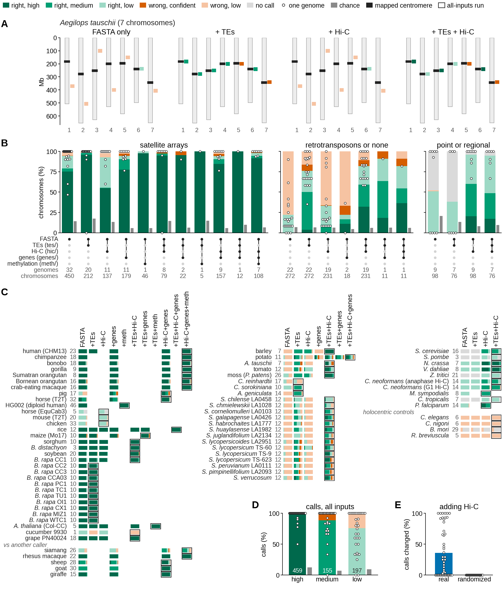

# cenfuse

cenfuse finds the centromere of every chromosome in a genome assembly. It needs only the FASTA; an LTR
retrotransposon annotation, Hi-C and DNA methylation make it better. Each kind of evidence must first pass a test in
your genome (does it mark one place on each chromosome?) before it may confirm or move a call; untested evidence offers
at most a `low` best candidate. Every call comes with a confidence (`high`, `medium` or `low`) and a sentence saying
what supports it and what would settle it.


*How cenfuse works ([PDF with legend](docs/img/workflow.pdf)). **A** six lines of evidence, three of them from the
FASTA alone, each tested in your genome before it may confirm or move a call; lines that pass are combined into one
call per chromosome, graded high, medium or low. **B** the test on real satellites: rice passes, tomato fails. **C** how
tested lines change a call.*

## What you give it

One folder per genome, every file named after the FASTA (`asm`). Only the FASTA is required.

```
mygenome/
├── asm.fa + asm.fa.fai    a chromosome-level assembly
├── tes/asm.gff3           LTR retrotransposons (LTRquest)        strongly recommended for plants
├── hic/asm.pairs.gz       Hi-C contacts (also .cool/.mcool, HiC-Pro, Juicer)
├── meth/asm.tsv           methylation samples (ONT or PacBio HiFi)
└── genes/asm.gff3         gene annotation
```

| your genome | its centromeres are usually | give cenfuse |
|---|---|---|
| mammals, birds; plants with a centromeric satellite (rice, *Brassica*, soybean, maize, *Arabidopsis*) | satellite arrays | the FASTA |
| plants without one (barley, *Aegilops*, potato, tomato), moss, green algae | clusters of LTR retrotransposons, or no repeat | the FASTA + `tes/`; Hi-C if you have it |
| yeasts, other fungi, *Plasmodium* | point, regional or AT-rich | the FASTA + Hi-C |
| primates, to place the kinetochore inside the array | alpha-satellite arrays | + CpG methylation |
| holocentric species (nematodes, moths, *Rhynchospora*) | no single centromere | anything: expect no confident call |

Hi-C or methylation that fails its test in your genome is reported but changes no call. How to make each input
(LTRquest, Hi-C pairs, methylation), which sequences count as chromosomes, and inputs from several plants:
[docs/inputs.md](docs/inputs.md).

## What you get

In `mygenome/cenfuse/`:

- **`cenfuse_report.md`**: start here. In words: what each kind of evidence found and whether it passed its test,
  what the centromeres are made of, the uncertain calls and the data that would settle them.
- **`asm.centromeres.tsv`** (also `.bed`, `.gff3`): one row per chromosome with the call, its `confidence`, the evidence
  for and against it, and in words what it stands on (`basis`) and why it may be wrong (`caveat`).
- **`cenfuse_overview.pdf`**: one page per genome (below), plus telomeres, rDNA arrays and other features in
  `asm.loci.tsv`.

`high` and `medium` calls are confident; `low` is the best candidate, with another place not excluded. Read the
`caveat` of any call you rely on. Every file and column: [docs/outputs.md](docs/outputs.md).


*The overview page for* Poa annua *with all four inputs ([PDF with legend](docs/img/example_overview.pdf)): **A**
each chromosome with its Hi-C score (blue), CHG methylation (black), satellite arrays and retrotransposon density, the
sequence call (box) and the final call (gray band); **B** the evidence for (●) and against (×) each call; **C** where
each kind of evidence puts the centromere; **D** the Hi-C score around the calls.*

## How good it is

Numbers are from cenfuse 0.16.1 on every genome benchmarked so far, scored against centromeres mapped on the same
assembly by CENP-A/CENH3 ChIP, CUT&Tag or DiMeLo-seq.

- **Satellite centromeres** (mammals, birds, most crops): from the FASTA alone, right on 425 of 450 chromosomes in 32
  genomes, 2 of them confidently wrong.
- **Retrotransposon or satellite-free centromeres** (barley, *Aegilops*, potato, 14 tomato genomes, moss, green
  algae): the FASTA alone finds 60 of 272; with `tes/` 207 of 272 (22 genomes), with `tes/` and Hi-C 189 of 231 (19
  genomes). Most confident errors are here (21 with `tes/`): treat a `medium` call that rests on an LTR core alone
  with caution.
- **Fungi and *Plasmodium*** (9 genomes): 50 of 98 chromosomes from the FASTA alone (AT-rich and transposon-rich
  centromeres), 94 of 98 with Hi-C.
- **Confidence means what it says.** Over all 63 genomes, each with its fullest set of inputs, `high` calls were right
  453 of 459 times (99%), `medium` 137 of 155 (88%), `low` 149 of 197 (76%).
- **Controls stay silent.** Randomized Hi-C changed no call (55 runs); holocentric genomes got no confident call (0 of
  46 chromosomes, with any input).

Right means overlapping the mapped domain in mammals, within 1 Mb of it in plants (8 Mb in barley), within 100 kb in
moss and algae, and within one Hi-C bin in fungi (250 kb without Hi-C, a lenient rule); every rule:
[benchmark/README.md](benchmark/README.md#scoring-rules). These genomes are not an independent test: cenfuse's rules
were developed while looking at them.



*How often cenfuse finds the centromere, by the data it was given (every benchmark genome;
[PDF with legend](docs/img/performance.pdf)). **A** one genome with each set of inputs: calls, colored by outcome,
beside the mapped centromeres (black). **B** every chromosome with a mapped centromere, by inputs (dots beneath) and
centromere type; gray bars: chance; circles: single genomes. **C** every genome and every input set it was run with.
**D** how often `high`, `medium` and `low` calls were right. **E** Hi-C changes calls only when it carries real signal.*

Every genome, control and failure: [docs/benchmark.md](docs/benchmark.md); every genome's overview page:
[docs/gallery.md](docs/gallery.md); every result, one row per chromosome: [benchmark/results.tsv](benchmark/results.tsv).

## Install

```bash
git clone https://github.com/cwb14/cenfuse.git && cd cenfuse
mamba env create -f environment.yml && mamba activate cenfuse
pip install --no-deps .
python -m pytest -q -n 8      # optional: ~1,300 tests on tiny synthetic genomes, a few minutes
```

On linux-64, `mamba create -n cenfuse --file environment.lock.txt` gives the benchmark's exact environment. The tools
that make the optional inputs (LTRquest, bwa-mem2, pairtools, dorado, modkit) are installed separately.

## Run

```bash
mkdir mygenome && cp asm.fa mygenome/ && samtools faidx mygenome/asm.fa
cenfuse run mygenome -t 32
```

To add `tes/`, Hi-C or methylation later, put the files in place and run the same command: it reuses the finished
work. From the FASTA, a 1-Gb plant genome takes 13-50 min at 16 threads and up to 46 GB of memory, a 3-Gb T2T mammal
1-10 h at 12 threads and up to 74 GB; adding an input to a finished run takes minutes.

| option | meaning |
|---|---|
| `-t N` | threads [8] |
| `-o DIR` | output folder [`mygenome/cenfuse`] |
| `--force STAGE` | recompute a stage (`all`: every stage) |
| `-v` | per-step progress |

There are no thresholds to tune: each is a fixed constant with a stated reason. All options, resuming and negative
controls (`cenfuse control`): [docs/outputs.md](docs/outputs.md#options).

## More

[docs/design.md](docs/design.md) how each kind of evidence is tested and combined ·
[CHANGELOG.md](CHANGELOG.md) what changed in each version · [docs/future.md](docs/future.md) open problems ·
[benchmark/](benchmark/README.md) truth, scorer and results · License: MIT
