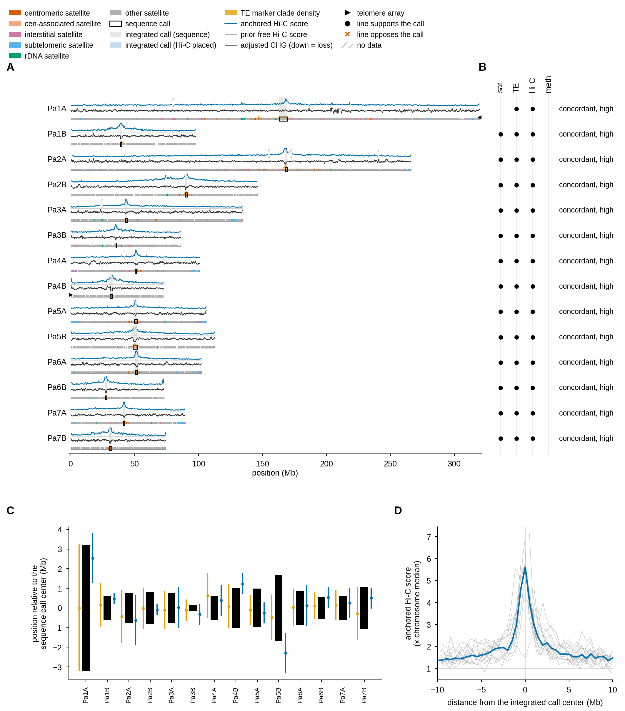

# cenfuse

Find the centromere of every chromosome in a genome assembly. cenfuse combines up to four kinds of evidence:
satellite repeats, LTR retrotransposons, Hi-C and DNA methylation. Only the FASTA is required. Each extra input
adds a line of evidence that can confirm, contest or move a call. cenfuse also maps telomeres, rDNA, knobs and
other satellite blocks on the same coordinates.



*Example output: the* Poa annua *assembly with all four inputs (full PDF with legends:
[`docs/img/example_overview.pdf`](docs/img/example_overview.pdf)). **A**, one row per chromosome: anchored Hi-C
score (blue), CHG methylation (black, down = loss), satellite arrays colored by role, retrotransposon (TE) density;
black box = sequence call, gray band = final call (blue when Hi-C placed it). **B**, which lines support (●) or oppose (×) each call. **C**,
each line's call relative to the sequence call. **D**, Hi-C score around every call. All 14 calls are `concordant` and `high`: satellites,
retrotransposons and Hi-C agree (Pa1A has no centromeric satellite; the retrotransposons place it). The
methylation comes from five other plants, so it is drawn but does not vote (empty `meth` column in B).*

## Why combine evidence?

A satellite array is not always the centromere. The functional centromere can sit beside the array, far from it,
or on no satellite at all (potato, horse chr11). Each kind of evidence fails in its own way:

| evidence | fails when |
|---|---|
| satellite arrays | the array is pericentromeric, inactive or a knob; the centromere has no satellite |
| LTR retrotransposons (CRM clade) | the CRM cluster flanks the centromere instead of marking it (some Solanaceae) |
| Hi-C | another cluster of loci dominates the nucleus (Hi-C alone is wrong on all 12 rice chromosomes) |
| methylation | used alone: false dips are as deep as true ones |

Because they fail independently, they can check each other:
- **Hi-C tests the other lines.** For each chromosome, cenfuse measures how strongly each place contacts the
  centromeres of the *other* chromosomes, as their sequence calls place them. Hi-C may move a call only if, on the
  other chromosomes, it agrees with the sequence calls more often than chance (P <= 0.01).
- **Methylation is calibrated on the other chromosomes' calls** and never moves a call by itself.

## Install

```bash
git clone https://github.com/cwb14/cenfuse.git && cd cenfuse
mamba env create -f environment.yml && mamba activate cenfuse
pip install --no-deps .
pytest -q -n 8          # optional: 452 tests, about 2 min
```

## Quick start

```bash
mkdir mygenome && cp asm.fa mygenome/ && samtools faidx mygenome/asm.fa
cenfuse run mygenome -t 32
```

Results go to `mygenome/cenfuse/`. Open `cenfuse_overview.pdf`, then `asm.centromeres.tsv` (one row per
chromosome). A rerun resumes where the last one stopped.

## Inputs

Put everything for one genome in one folder. `asm` is the FASTA's name without its extension, and every other file
must use the same name:

```
mygenome/
├── asm.fa + asm.fa.fai    required: chromosome-level assembly
├── tes/asm.gff3           LTR retrotransposons    (strongly recommended for plants; needed for methylation)
├── hic/asm.pairs.gz       Hi-C contacts
├── meth/asm.tsv           ONT methylation samples table
└── genes/asm.gff3         gene annotation
```

| input | what it adds |
|---|---|
| FASTA | satellite families found de novo, every array and its role, telomeres, rDNA, one sequence call per chromosome |
| `tes/` | CRM-clade retrotransposon cores, which mark grass centromeres. Without them, satellite-only calls were wrong on barley (7/7) and potato (9/11) |
| `hic/` | a functional test of every call; validated Hi-C can move a call |
| `meth/` | a second functional line; per-plant checks when samples come from several plants |
| `genes/` | gene density at every locus; gene class for methylation |

Unplaced scaffolds are dropped automatically. Several FASTAs in one folder are analyzed together and share one set
of satellite family names.

## Making the input files

Each recipe uses tools outside cenfuse; install them in their own environment. Replace `asm.fa`, read files and
thread counts with yours.

### Genome (required)

```bash
samtools faidx asm.fa                    # or compressed: bgzip -@ 8 asm.fa && samtools faidx asm.fa.gz
```

### LTR retrotransposons: `tes/asm.gff3`

Use [LTRquest](https://github.com/cwb14/LTRquest):

```bash
git clone https://github.com/cwb14/LTRquest.git && cd LTRquest      # once
mamba env create -n ltrquest -f environment.yml && mamba activate ltrquest && pip install . && cd ..

ltrquest --genome asm.fa --proteins related.pep.fa --threads 32
mkdir -p mygenome/tes && cp asm_LTRs_all_depth_LTR_cleaned.gff3 mygenome/tes/asm.gff3
```

- Give LTRquest the uncompressed FASTA. `--proteins` (the proteome of any related species) is optional but
  recommended.
- Use `*_all_depth_LTR_cleaned.gff3`, not the `*_protein_*` file.
- The default `--mutation-rate` (3e-8) is for plants; set your organism's.
- Other annotations also work if each element is a feature whose type contains `LTR_retrotransposon`, with a
  `clade=` attribute (for example EDTA elements classified by TEsorter).

### Hi-C: `hic/asm.pairs.gz`

From raw Hi-C (or Omni-C) FASTQ to deduplicated, uniquely mapped pairs (4DN format):

```bash
mamba create -n hic -c conda-forge -c bioconda bwa-mem2 pairtools && mamba activate hic   # once

bwa-mem2 index asm.fa
cut -f1,2 asm.fa.fai > asm.chrom.sizes
mkdir -p mygenome/hic
bwa-mem2 mem -5SP -T0 -t 32 asm.fa hic_R1.fq.gz hic_R2.fq.gz \
  | pairtools parse --min-mapq 30 --walks-policy 5unique --max-inter-align-gap 30 \
      --add-columns mapq --drop-sam --drop-seq -c asm.chrom.sizes \
  | pairtools sort --nproc 8 --memory 16G --tmpdir . \
  | pairtools dedup \
  | pairtools select '(pair_type=="UU") or (pair_type=="UR") or (pair_type=="RU")' \
      -o mygenome/hic/asm.pairs.gz
```

- `-5SP` maps the two reads separately and keeps each read's 5' piece (the Hi-C standard).
- `--min-mapq 30` and `select` keep only pairs whose two ends map uniquely. This matters because centromeres are
  repeats.
- `dedup` removes PCR duplicates.
- About 100 M read pairs are enough; the benchmark used 100 M.
- Map to this exact assembly. A `.cool` or `.mcool` made on it also works (`hic/asm.mcool`).

### Methylation: `meth/asm.tsv`

From ONT reads, one sample per plant. CHG is required; CG and CHH are optional. `tes/` is also needed.

```bash
mamba create -n ont -c conda-forge -c bioconda ont-modkit=0.6.4 minimap2 samtools htslib && mamba activate ont
# once; dorado: https://github.com/nanoporetech/dorado

# 1. basecall with the all-context model (5mC_5hmC); the CpG-only 5mCG_5hmCG model gives no CHG
dorado basecaller sup pod5/ --modified-bases 5mC_5hmC --min-qscore 10 > plant1.ubam

# 2. align, keeping the methylation tags; keep primary alignments with MAPQ >= 20
samtools fastq -T MM,ML,MN plant1.ubam \
  | minimap2 -t 32 -ax lr:hq -y asm.fa - \
  | samtools view -u -q 20 -F 0x904 - | samtools sort -@ 8 -o plant1.bam
samtools index plant1.bam

# 3. one bedMethyl per context, bgzipped and indexed
M=mygenome/meth; mkdir -p $M
for ctx in CHG CHH; do
  modkit pileup plant1.bam - --ref asm.fa --modified-bases 5mC 5hmC --motif $ctx 0 -t 32 \
    | awk -F'\t' '$4=="m"' | bgzip > $M/plant1.$ctx.bed.gz
  tabix -p bed $M/plant1.$ctx.bed.gz
done
modkit pileup plant1.bam - --ref asm.fa --modified-bases 5mC 5hmC --motif CG 0 --combine-strands -t 32 \
  | awk -F'\t' '$4=="m"' | bgzip > $M/plant1.CG.bed.gz
tabix -p bed $M/plant1.CG.bed.gz

# 4. the samples table: tab-separated, one row per plant, paths relative to meth/
printf 'sample\tCHG\tCG\tCHH\nplant1\tplant1.CHG.bed.gz\tplant1.CG.bed.gz\tplant1.CHH.bed.gz\n' > $M/asm.tsv
```

- Do **not** use `--combine-strands` for CHG: cenfuse reads the two strands separately to tell plants apart.
- Optional `meth/asm.exclude.bed`: regions to ignore (column 4 = a sample name, or empty for all samples).

### Genes: `genes/asm.gff3`

Any GFF3 of this assembly with `gene` lines, such as the annotation released with the genome. Only gene positions
are used.

## Outputs (`mygenome/cenfuse/`)

| file | content |
|---|---|
| **`asm.centromeres.tsv`** (+ `.bed`, `.gff3`) | **the answer.** One row per chromosome: the final call, its `relation` and `confidence`, the lines that support or oppose it, and each line's own call |
| `cenfuse_overview.pdf`, `asm.overview.png` | the figure above, with short and long legend pages |
| `cenfuse_summary.tsv` | one row per genome: what each line found, whether Hi-C passed its test, warnings (`hic_sequence_conflict`) |
| `asm.loci.tsv`, `asm.features.gff3` | every other feature (telomeres, rDNA, knob-like interstitial blocks, subtelomeric blocks, Hi-C hubs, LTR cores, former centromeres), each with every line's value there |
| `asm.feature_signatures.tsv` | per feature kind: the median signal of every line |
| `asm.feature_contacts.tsv` | per feature kind: do its members contact each other in the nucleus more than random places do (fold, P)? |
| `asm.hic_anchored.bedgraph` | the anchored Hi-C score per bin, for a genome browser |
| `asm.provenance.tsv`, `asm.plants.tsv`, `asm.plant_sites.tsv`, `asm.plants.png` | with several plants: which plant each input comes from, and each plant's centromere, chromosome by chromosome |
| `satellite/`, `hic/`, `methylation/` | each line's detailed outputs: satellite families and arrays, Hi-C peaks and tracks, methylation tracks and candidates |

## Reading a call

| `relation` | meaning |
|---|---|
| `concordant` | Hi-C or methylation agrees with the satellite/TE call: the best case |
| `offset` | Hi-C, with a second line where needed, puts the centromere elsewhere. The old call stays in `loci.tsv` as `sequence_centromere` |
| `contested` | Hi-C points elsewhere but nothing else agrees. The call stays, one confidence level lower |
| `functional_only` | no satellite or TE call; Hi-C places it |
| `sequence_only` | only the satellite/TE call could be used: no Hi-C or methylation, Hi-C failed its test, or its peak was weak or at a hub, NOR or chromosome end |
| `none` | no call |

`confidence` is `low`, `medium` or `high`. Each independent line that agrees raises a kept call one level (at
most two); a contest lowers it one. **Read `low` as "uncertain":** the call is the best candidate, but the lines
cannot exclude another place. When two satellite clusters compete, the call is `low` and the other one is in
`seq_alt_start`/`seq_alt_end`; validated Hi-C may choose between them (flag `hic_chose_alt`).

Flags worth knowing:

| flag | meaning |
|---|---|
| `competing_cluster` | a second centromeric-satellite cluster at least half the size of the called one (`seq_alt_*`) |
| `acrocentric` | the call is on a family that ends most chromosomes at one end only (an acrocentric karyotype) |
| `hic_chose_alt` | validated Hi-C agreed with the competing cluster, not the larger one |
| `hic_medium_peak` | no sequence call; a clean medium-level anchored Hi-C peak placed a low-confidence call |
| `near_end`, `low_satellite`, `diffuse`, `no_dominant_satellite` | the satellite engine's reasons for a lower level |

The Hi-C gate (`hic_gate`) is `pass`, `fail` or `untested` (fewer than 3 chromosomes with a reference-grade call).

## Options

| option | meaning |
|---|---|
| `-o DIR` | output folder [`GENOME_DIR/cenfuse`] |
| `-t N` | threads [8] |
| `--satellite-dir DIR` | reuse the `satellite/` folder of an earlier run instead of recomputing it |
| `--seed-engine fastan\|trf` | tandem-repeat finder for satellite seeds [fastan] |
| `--seed-cache DIR` | tandem-repeat results shared between runs |
| `--classify-from T=S` | genome T (e.g. a contig assembly) takes its satellite families from genome S |
| `--force STAGE` | recompute one stage |
| `-v` | per-step progress |

Every threshold is a fixed constant with its reason, in `cenfuse/params.py` and the `params.py` of `cenfuse/sat`,
`hic` and `meth`. None is an option.

## Several plants

Methylation samples and Hi-C libraries often come from plants other than the assembled one, and their centromeres
can sit elsewhere. Give one row per plant. The same `sample` name in both tables means the same plant:

```
meth/asm.tsv                                  hic/asm.tsv   (only for several Hi-C libraries)
sample  CHG                CG                 sample  file
ref     ref.CHG.bed.gz     ref.CG.bed.gz      ref     ref.pairs.gz
plantB  plantB.CHG.bed.gz  plantB.CG.bed.gz   plantB  plantB.pairs.gz
```

cenfuse genotypes every methylation sample against the assembly. Only inputs from the assembled plant, or of
unknown origin, decide the reference calls. Every plant is then scored on its own: is its centromere at the
reference call (`shared`) or elsewhere (`shifted`)? Details: `docs/plants.md`.

## Does it work?

**T2T mammals** (14 genomes, CENP-A truth on 157 chromosomes in 9 of them; criteria fixed before any run):
- FASTA only: 148/157 on the CENP-A domain, 5 confident misses (genome-wide interspersed repeats and acrocentric
  karyotypes are handled without annotation).
- With genes and Hi-C: 149/157, 4 confident misses (pig against other-animal ChIP, one orangutan centromere 14 Mb
  from any satellite).
- Hi-C passes its test in 7 of 14 genomes and never on randomized Hi-C. It finds the array, not the kinetochore:
  calls are 0.8-5.6 Mb wide.

**Plants** (13 genomes; `docs/benchmark.md`): Truth: CENH3/CENP-A for rice,
potato, barley, horse and CHM13; the satellome for the other apes and giraffe; earlier analyses for *Poa*.

- **Never worse than satellites alone.** In every genome, the final calls are right at least as often as the
  satellite calls: rice 12/12, CHM13 23/24, chimpanzee 25/25, gorilla 25/25, siamang 22/26, horse 3/4, potato
  2/11, barley 0/7.
- **Hi-C is used only where it earns it.** Its test passed in the genomes where anchored Hi-C was right on 67-85%
  of chromosomes (CHM13, chimpanzee, siamang, rice, *Poa*). It failed where anchored Hi-C was right on 0-33%
  (orangutans, gorilla, giraffe, potato, barley), and on permuted Hi-C. Hi-C never changed a call in a genome where
  it was misleading.
- **A real offset found.** *Poa annua* chromosome Pa1A: starting from satellite-only calls, Hi-C plus the CRM cores
  moved the call 20.2 Mb, from the satellite array to the functional centromere.
- **Known misses.** Potato and barley without `tes/` (the satellite line is wrong there); horse chr11 (no
  satellite, missed by every line); CHM13 chr14 and chr22 (Hi-C peaks on the rDNA arm contest correct calls).

## Limitations

- Hi-C is checked against the satellite/TE calls. If those are wrong genome-wide (barley without `tes/`), Hi-C
  cannot fix them, even when it is right. `cenfuse_summary.tsv` then flags `hic_sequence_conflict`; add `tes/` or
  methylation as a third line.
- One wrong Hi-C peak, in a genome where Hi-C mostly works, passes the test. The second-line rule protects only
  high-confidence calls.
- Hi-C resolution is one *mappable* bin. In complete assemblies the centromeric array itself is unmappable (T2T
  mammals: the CENP-A domain lay in unmappable blocks of 2.5-19 Mb median), so Hi-C locates the array, not the
  kinetochore inside it. cenfuse counts Hi-C distances in mappable bins, so a peak at the array's edge supports a
  call inside the array.
- Without genes or TEs, a satellite is told from an interspersed repeat by tandem structure alone: a family must
  lie mostly in tandem repeats, or be hit as whole units, or be concentrated at one locus per chromosome.
- The acrocentric test needs about 16 or more chromosomes; smaller all-acrocentric karyotypes still have their
  terminal satellites called subtelomeric.
- Methylation needs ONT CHG calls and `tes/`. Plants below ~4x often lack data at centromeres, and per-plant
  methylation verdicts are weak evidence.
- Hi-C given as pairs or cool cannot be genotyped, so its plant of origin is usually `unknown`.
- Telomeres are reported only where the assembly holds them.
- The 3D contact test does not match compartments: heterochromatic classes can look clustered through the B
  compartment alone.

## More

| path | content |
|---|---|
| `docs/design.md` | how each line works and why; every rule and threshold |
| `docs/plants.md` | provenance and per-plant scoring |
| `docs/benchmark.md` | pre-registered criteria and all results, failures included |
| `cenfuse/` | `pipeline.py` (stages), `fuse.py` (integration rules), `hicfuse.py`, `methfuse.py`, `loci.py`, `plot.py`; the satellite, Hi-C and methylation engines in `sat/`, `hic/`, `meth/` |

## License

MIT (see `LICENSE`).
