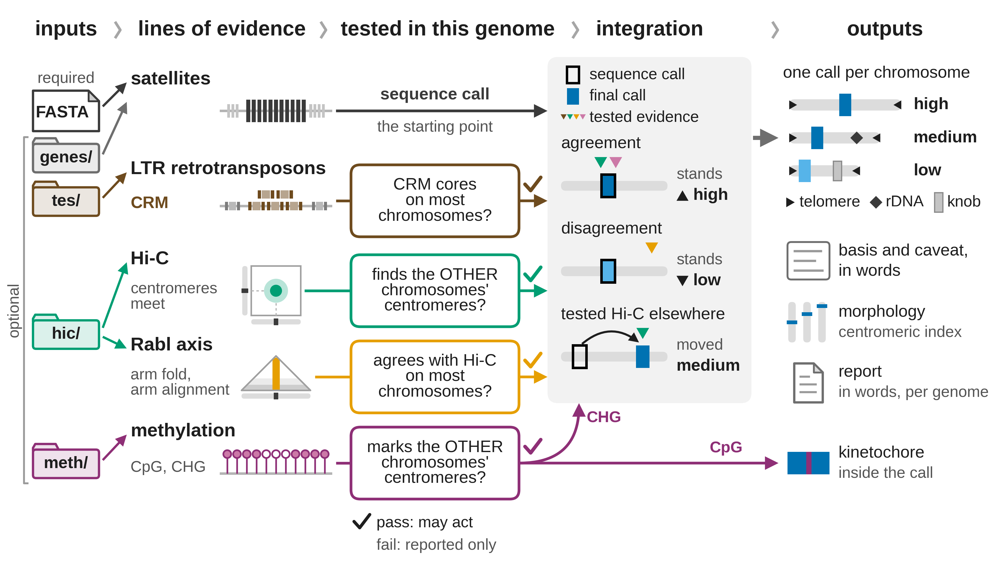

# cenfuse

cenfuse finds the centromere of every chromosome in a genome assembly. It needs only the FASTA; LTR
retrotransposons, Hi-C, DNA methylation and genes make it better. Each kind of evidence calls the centromere on its
own, and cenfuse tests, in your genome, whether that evidence can be trusted before it may confirm or move a call.
Every call comes with a confidence and, in words, what speaks for and against it.


*cenfuse's overview of the* Poa annua *assembly, from all four inputs ([PDF with legends](docs/img/example_overview.pdf)).
**A** one row per chromosome: Hi-C score (blue), CHG methylation (black), satellite arrays colored by role,
retrotransposon density (orange); black box = the sequence call, gray band = the final call; ▶ ▼ telomere arrays at
the ends and inside; ◆ ◇ 45S and 5S rDNA arrays. **B** the evidence that supports (●) or opposes (×) each call.
**C** where each kind of evidence puts the centromere. **D** the Hi-C score around each call.*

## How it works



1. **Satellites** (always). cenfuse finds the genome's tandem-repeat families from scratch and gives each a role
   (centromeric, subtelomeric, knob-like, dispersed, rDNA) from where and how often it occurs across the
   chromosomes. Its call is the main array of the centromeric family on each chromosome.
2. **LTR retrotransposons** (`tes/`). Clusters of the centromeric lineage (CRM in grasses and many other plants)
   mark centromeres with or without a satellite. Only CRM may overrule a satellite call; other lineages are reported.
3. **Hi-C** (`hic/`). Centromeres meet in the nucleus. Before Hi-C may act on a chromosome, it has to find the
   centromeres of the *other* chromosomes in your library. Where nuclei hold their centromeres at one pole (a Rabl
   configuration), the way chromosome arms fold and align tests Hi-C instead. In genomes whose centromeres carry no
   repeat (point, regional, AT-rich), Hi-C places the calls itself: `medium` where the arms confirm them, else `low`.
4. **Methylation** (`meth/`). In primates, CpG methylation dips where the kinetochore sits: where cenfuse shows that
   the dips mark centromeres in your genome, it places the kinetochore inside each call. In plants, CHG methylation
   can be a second line of evidence, though it [changed no call](docs/future.md#16-the-chg-line-has-changed-no-call)
   in the benchmark.
5. **Integration.** The sequence call stands unless tested evidence moves it. Agreement raises its confidence,
   disagreement lowers it. `low` means "unsure": cenfuse prefers right, then uncertain, over wrong.

Details: [docs/design.md](docs/design.md).

## How well it works

Calls were scored against centromeres mapped by CENP-A/CENH3 ChIP (or CUT&Tag, DiMeLo-seq) on the same assembly.
A call is right when it overlaps the CENP-A domain (mammals), lies within 4 Hi-C bins of the CENH3 domain (plants:
about 1 Mb; moss and algae: 100 kb), or within 1 Hi-C bin (fungi, *Plasmodium*); *confident* = `high` or `medium`.
Every number is from cenfuse 0.10.1. Per genome, the controls and every failure are in
[docs/benchmark.md](docs/benchmark.md); every genome's overview page is in the [gallery](docs/gallery.md).

| genomes | centromeres made of | FASTA only: right, confidently wrong | more inputs: right, confidently wrong |
|---|---|---|---|
| 9 T2T mammals (human, great apes, crab-eating macaque, pig, horse) | satellites | 143/157, 1 | + genes + Hi-C: 148/157, 4 |
| HG002, diploid human T2T | alpha satellite | 46/46, 0 | + CpG: a kinetochore on 40, all in the active array |
| rice | CentO satellite | 12/12, 0 | + Hi-C, `tes/`, genes: 12/12, 0 |
| *Brassica rapa*, 11 accessions | satellite | 109/110, 0 | + `tes/` (4 accessions): 40/40, 0 |
| soybean | satellite | 20/20, 0 | + Hi-C: 20/20, 0; + `tes/`: 19/20, 1 |
| sorghum, *Brachypodium*, *Arabidopsis* | satellite | 18/18, 0 | + `tes/`, Hi-C, methylation: 18/18, 0 |
| maize (Mo17), with knobs | CentC satellite | 9/10, 1 | + `tes/`, genes: 9/10, 1 |
| chicken | chromosome-specific satellites | 28/33 (all `low`), 0 | + Hi-C: unchanged |
| mouse, all acrocentric | minor satellite beside the major satellite | 1/20 (all 20 at the right end, `low`), 0 | + Hi-C: unchanged |
| barley | CRM retrotransposons | 0/7, 3 | + Hi-C: 6/7, 0; + `tes/`: 4/7, 1 |
| potato | satellite on half, none on half | 2/11, 2 | + `tes/`: 6/11, 2 |
| *Aegilops tauschii* | CRM beside satellites | 1/7, 4 | + `tes/`: 5/7, 2 |
| moss (*Physcomitrium*) | Copia retrotransposon clusters | 16/26 (all `low`), 0 | + `tes/` + Hi-C: 25/26, 0 |
| *Chlorella sorokiniana* | 2-7 Copia insertions | 0/10, 0 | + `tes/`: 8/10 (`low`), 0 |
| *Chlamydomonas* | LINE clusters | 6/17 (all `low`), 0 | + `tes/`: unchanged |
| tomato | no repeat, beside a dominant satellite | 1/12, 7 | + `tes/`, Hi-C: unchanged (a failure) |
| horse EquCab3 (older assembly) | satellites; chr11 none | 3/5 (`low`), 0 | + Hi-C: unchanged |
| budding and fission yeast, *Plasmodium*, *Neurospora* | point, regional, AT-rich | 1/40, 0 | + Hi-C: 39/40, 0 |
| 5 more fungi, held out (6 Hi-C libraries) | regional | 0/72, 0 | + Hi-C: 43/72, 0 |
| 4 holocentric genomes (any confident call is wrong) | no single centromere | 0 confident in 46 | + Hi-C: 0 confident |

- **Confidence means something.** Over the 47 genomes with truth, each with all its inputs, `high` calls were right
  329 of 343 times, `medium` 102/105, `low` 101/155. Half of the wrong `high` calls are tomato's.
- **Controls.** On randomized Hi-C (47 runs) and misplaced methylation (8 primates), no test ever passed and no call
  changed. Five more mammals without CENP-A data agree with an independent satellite caller on 114/121 chromosomes.
- **Kinetochores from CpG methylation** (5 great apes with DiMeLo-seq CENP-A): 39 kinetochores, a median of 45 kb
  wide inside calls of 3.9 Mb; 35 within 50 kb of CENP-A. With human, 62 of 63 lie on curated CENP-A domains.

**Where it is strong:** satellite centromeres from the FASTA alone; satellite-free centromeres from centromeric
retrotransposons (CRM in potato and *Ae. tauschii*, Copia lineages in moss and *Chlorella*); point, regional and
AT-rich centromeres from Hi-C (yeasts, *Plasmodium*, fungi); no confident call on holocentric chromosomes; knobs and
other large satellites were not mistaken for centromeres, though in maize
[only a size floor](docs/future.md#17-knobs-kept-out-only-by-a-size-floor) keeps the knob out.

**Where it is weak:** satellite-free centromeres beside a dominant satellite (tomato); a small active array beside a
large inactive one of the same satellite is called confidently on the large one (one orangutan chromosome, whose
truth is under revision); right calls are often left `low` (chicken 28/33, *Z. tritici* 19/21); Hi-C helps only
where nuclei cluster their centromeres and with enough reads.

## Install

```bash
git clone https://github.com/cwb14/cenfuse.git && cd cenfuse
mamba env create -f environment.yml && mamba activate cenfuse
pip install --no-deps .
pytest -q -n 8          # optional: 774 tests, ~3 min
```

## Quick start

```bash
mkdir mygenome && cp asm.fa mygenome/ && samtools faidx mygenome/asm.fa
cenfuse run mygenome -t 32
```

Then read `mygenome/cenfuse/cenfuse_report.md` (what was found, in words), `asm.centromeres.tsv` (one row per
chromosome) and `cenfuse_overview.pdf`.

**Runtime and memory.** The satellite search takes most of the time and grows with satellite content: T2T mammals
(2.6-3.6 Gb) 1-10 h at 12 threads, mouse 9 h at 16, maize 50 min at 16, *Arabidopsis* 15 min at 8. Hi-C and the
integration take minutes. Peak memory: 8-74 GB for T2T mammals at 12 threads, 5 GB for *Arabidopsis*. A rerun
resumes where it stopped, and fresh runs give identical results (Linux).

## Inputs

One folder per genome. Every file is named after the FASTA (`asm`):

```
mygenome/
├── asm.fa + asm.fa.fai    required: a chromosome-level assembly
├── asm.chromosomes.txt    optional: the chromosomes to analyze, one name per line
├── tes/asm.gff3           LTR retrotransposons    strongly recommended for plants
├── hic/asm.pairs.gz       Hi-C contacts           (or .cool/.mcool, HiC-Pro .allValidPairs, Juicer merged_nodups)
├── meth/asm.tsv           methylation samples     (ONT or PacBio HiFi)
└── genes/asm.gff3         gene annotation         (or .gff/.gtf)
```

| input | what it adds |
|---|---|
| FASTA | satellite families and their roles, telomeres, rDNA arrays, one sequence call per chromosome |
| `tes/` | CRM retrotransposon cores, which mark many plant centromeres (without them, satellite calls were wrong on barley 7/7 and potato 9/11) |
| `hic/` | a test of every call; tested Hi-C can move a call, and where the FASTA gives no call (point, regional, AT-rich centromeres) it places one |
| `meth/` | CpG: the kinetochore inside each call (primates); CHG (with `tes/`): a possible second line of evidence in plants |
| `genes/` | gene density at every locus; rejects gene-rich repeats as centromeres |

**Which sequences are chromosomes.** cenfuse keeps the sequences above the first tenfold drop in length and leaves
out a tapering tail of unplaced scaffolds. If that picks the wrong set (a tiny dot chromosome, large unplaced
scaffolds), list every chromosome in `asm.chromosomes.txt` ([details](docs/outputs.md#which-sequences-are-analyzed)).
Several FASTAs in one folder are analyzed together and share satellite family names.

<details>
<summary><b>Recipes: making each input</b> (click)</summary>

**LTR retrotransposons** with [LTRquest](https://github.com/cwb14/LTRquest), the annotator cenfuse is developed and
benchmarked with:

```bash
ltrquest --genome asm.fa --proteins related.pep.fa --threads 32 --detect-args ltr-timeout=300   # --proteins optional
mkdir -p mygenome/tes && cp asm_LTRs_all_depth_LTR_cleaned.gff3 mygenome/tes/asm.gff3
```

`ltr-timeout=300` caps the slowest detectors at 5 min per 500-kb chunk, which stall on centromeric satellites; set
`--mutation-rate` for your organism (default 3e-8, plants). The CRM line needs a sensitive annotation: with less
sensitive ones (DANTE_LTR, EDTA's intact set, half of LTRquest's elements) CRM concentrated on too few rice
chromosomes to decide, and potato lost its gain from `tes/`. Other GFF3 files are read too: each element's type must
contain `LTR_retrotransposon` and carry `clade=` (e.g. EDTA + TEsorter), or be a DANTE_LTR GFF3 as it is. A file
without lineages, or on other sequence names, is reported and the LTR line is left out.

**Hi-C** to uniquely mapped, deduplicated pairs (about 100 M read pairs; map to this exact assembly):

```bash
bwa-mem2 index asm.fa && cut -f1,2 asm.fa.fai > asm.chrom.sizes && mkdir -p mygenome/hic
bwa-mem2 mem -5SP -T0 -t 32 asm.fa hic_R1.fq.gz hic_R2.fq.gz \
  | pairtools parse --min-mapq 30 --walks-policy 5unique --max-inter-align-gap 30 \
      --add-columns mapq --drop-sam --drop-seq -c asm.chrom.sizes \
  | pairtools sort --nproc 8 --memory 16G --tmpdir . | pairtools dedup \
  | pairtools select '(pair_type=="UU") or (pair_type=="UR") or (pair_type=="RU")' -o mygenome/hic/asm.pairs.gz
```

Omni-C, Micro-C and Arima libraries take the same recipe. Give at least ~70 M pairs for a 3-Gb genome: below that,
Hi-C's tests can fail and the calls fall back to the sequence evidence. HiC-Pro `asm.allValidPairs[.gz]` and Juicer
`asm.merged_nodups.txt[.gz]` files are read as they are. Convert a `.hic` file with
[hictk](https://github.com/paulsengroup/hictk): `hictk convert asm.hic mygenome/hic/asm.mcool`.

**Methylation** from ONT reads, one sample per plant (CHG needs `tes/` too; CpG alone needs nothing else):

```bash
dorado basecaller sup pod5/ --modified-bases 5mC_5hmC --min-qscore 10 > plant1.ubam     # not the CpG-only model
samtools fastq -T MM,ML,MN plant1.ubam | minimap2 -t 32 -ax lr:hq -y asm.fa - \
  | samtools view -u -q 20 -F 0x904 - | samtools sort -@ 8 -o plant1.bam && samtools index plant1.bam
M=mygenome/meth; mkdir -p $M
for ctx in CHG CHH; do                                  # no --combine-strands for CHG: strands are read separately
  modkit pileup plant1.bam - --ref asm.fa --modified-bases 5mC 5hmC --motif $ctx 0 -t 32 \
    | awk -F'\t' '$4=="m"' | bgzip > $M/plant1.$ctx.bed.gz && tabix -p bed $M/plant1.$ctx.bed.gz
done
modkit pileup plant1.bam - --ref asm.fa --modified-bases 5mC 5hmC --motif CG 0 --combine-strands -t 32 \
  | awk -F'\t' '$4=="m"' | bgzip > $M/plant1.CG.bed.gz && tabix -p bed $M/plant1.CG.bed.gz
printf 'sample\tCHG\tCG\tCHH\nplant1\tplant1.CHG.bed.gz\tplant1.CG.bed.gz\tplant1.CHH.bed.gz\n' > $M/asm.tsv
```

For CpG only (animals; Dorado `5mCG_5hmCG` calls), one CG file per sample:

```bash
modkit pileup sample1.bam - --ref asm.fa --cpg --combine-strands -t 32 \
  | awk -F'\t' '$4=="m"' | bgzip > $M/sample1.CG.bed.gz && tabix -p bed $M/sample1.CG.bed.gz
printf 'sample\tCG\nsample1\tsample1.CG.bed.gz\n' > $M/asm.tsv
```

A CG file can also be an ENCODE-style bedMethyl (e.g. from bisulfite sequencing) or a bedGraph of methylated fraction
(a public bigWig through `bigWigToBedGraph`, or PacBio HiFi scores from pb-CpG-tools), sorted, bgzipped and tabixed.
Prefer files with read counts: cenfuse pools the calls in 5-kb bins, so low coverage works. CHG files must be modkit
bedMethyl. An optional `meth/asm.exclude.bed` lists regions the CHG line ignores (column 4: a sample, or empty for all).

**Genes:** any GFF3 or GTF of this assembly, with sequence names as in the FASTA (cenfuse warns when they do not
match).

</details>

## Outputs (`mygenome/cenfuse/`)

| file | content |
|---|---|
| **`asm.centromeres.tsv`** (+ `.bed`, `.gff3`) | **the answer**: per chromosome, the call, its `confidence` and `relation`, the evidence for and against it, the call in words (`basis`, `caveat`), the CpG kinetochore, the chromosome's morphology (centromeric index, Levan class) and completeness (telomeres, gaps) |
| **`cenfuse_report.md`** | per genome, in words: what each kind of evidence found and whether it passed its test, what the centromeres are made of, the uncertain calls and what would settle them, the karyotype, the other features |
| `cenfuse_overview.pdf`, `asm.overview.png` | the figure above, with its legends; the first page as a PNG |
| `cenfuse_summary.tsv` | per genome: counts of calls, test results, the nucleus's 3D organization |
| `asm.loci.tsv`, `asm.features.gff3` | every other feature: telomeres (also inside chromosomes), 45S and 5S rDNA arrays, knobs, subtelomeric blocks, retrotransposon cores, Hi-C hubs |
| `asm.hic_anchored.bedgraph` | the Hi-C centromere score along the genome, for a genome browser |
| `asm.provenance.tsv`, `asm.plants.tsv` | which plant each input comes from; with several plants, each plant's centromeres ([plants.md](docs/plants.md)) |
| `satellite/`, `hic/`, `methylation/` | each line's detailed outputs |

Every column, flag and option: [docs/outputs.md](docs/outputs.md).

## Reading a call

**`confidence`**: `high`, `medium`, or `low` = unsure (the best candidate, but another place is not excluded).

**`relation`**: how the final call relates to the sequence call.

| `relation` | meaning |
|---|---|
| `concordant` | Hi-C or methylation agrees with the sequence call |
| `offset` | tested Hi-C moved the call (the sequence call is kept in `seq_start`/`seq_end`) |
| `contested` | tested evidence points elsewhere but could not move the call: kept, one level lower |
| `functional_only` | no sequence call; Hi-C placed it |
| `sequence_only` | only the sequence call was usable |
| `none` | no call |

`basis` says what the call stands on and `caveat` why it may be wrong, ending with the input that would settle it.
`flags` lists the rules that acted ([all flags](docs/outputs.md#flags)).

**Several plants.** Methylation and Hi-C often come from plants other than the assembled one, whose centromeres can
sit elsewhere. Give one row per plant (`meth/asm.tsv`; `hic/asm.tsv` with columns `sample`, `file`); the same
`sample` name means the same plant, and several Hi-C rows of one plant are summed. cenfuse tells which plant each
input comes from, lets only the assembled plant's inputs (or those of unknown origin) decide, and scores every plant
on its own ([docs/plants.md](docs/plants.md)).

## Options

| option | meaning |
|---|---|
| `-o DIR` | output folder [`GENOME_DIR/cenfuse`] |
| `-t N` | threads [8] |
| `--satellite-dir DIR` | reuse the `satellite/` folder of an earlier run |
| `--seed-engine fastan\|trf` | tandem-repeat finder for the satellite search [fastan] |
| `--seed-cache DIR` | share tandem-repeat results between runs |
| `--classify-from T=S` | genome T (e.g. a contig assembly) takes its satellite families from genome S |
| `--force STAGE` | recompute a stage and every later one; needed after adding `tes/` or `genes/` to an earlier run (`--force classify`) |
| `-v` | per-step progress |

There are no tuning knobs: every threshold is a fixed constant with its reason ([docs/design.md](docs/design.md#constants)).

## Documentation

| file | read it for |
|---|---|
| [`docs/design.md`](docs/design.md) | how each kind of evidence is tested and combined, the constants, the alternatives that were rejected |
| [`docs/benchmark.md`](docs/benchmark.md) | every result: per genome, per input, the controls, every failure |
| [`docs/gallery.md`](docs/gallery.md) | cenfuse's overview page for every benchmark genome |
| [`docs/outputs.md`](docs/outputs.md) | every output column and flag, the options, running and resuming |
| [`docs/plants.md`](docs/plants.md) | inputs from several plants: provenance and per-plant scoring |
| [`docs/future.md`](docs/future.md) | open problems, each with its evidence and the check it needs |
| [`docs/img/slides/`](docs/img/slides/README.md) | figures for a talk on cenfuse |

## License

MIT (see `LICENSE`).
