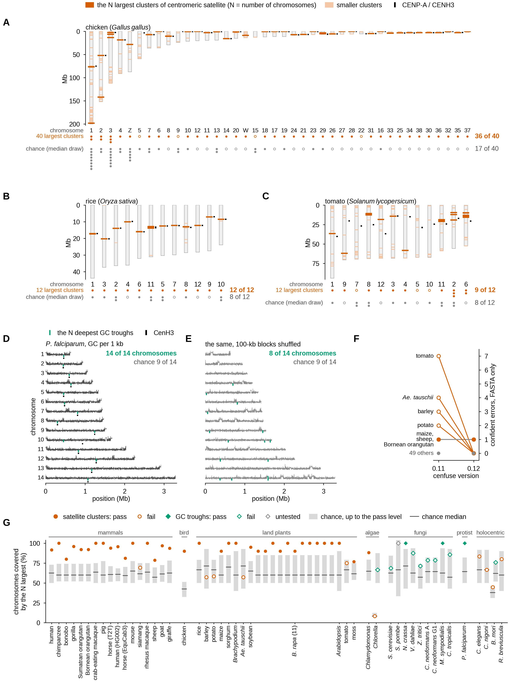
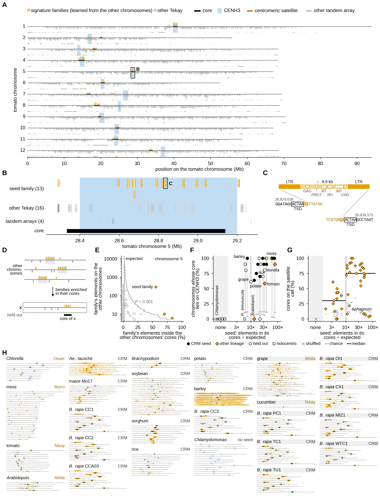
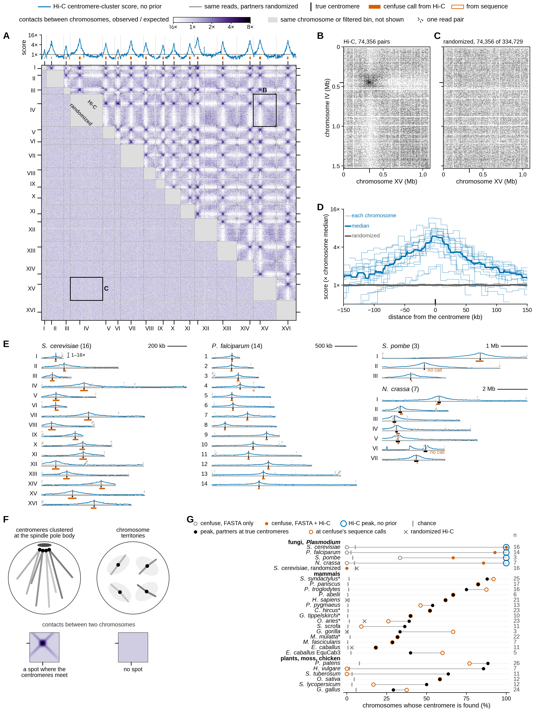
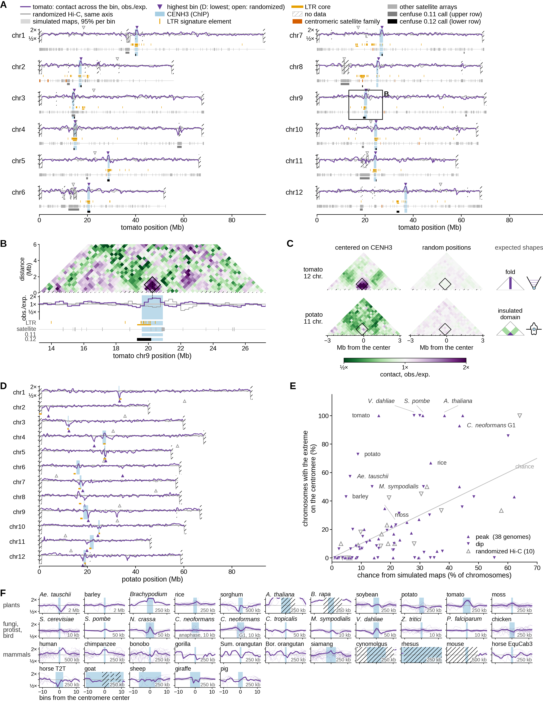
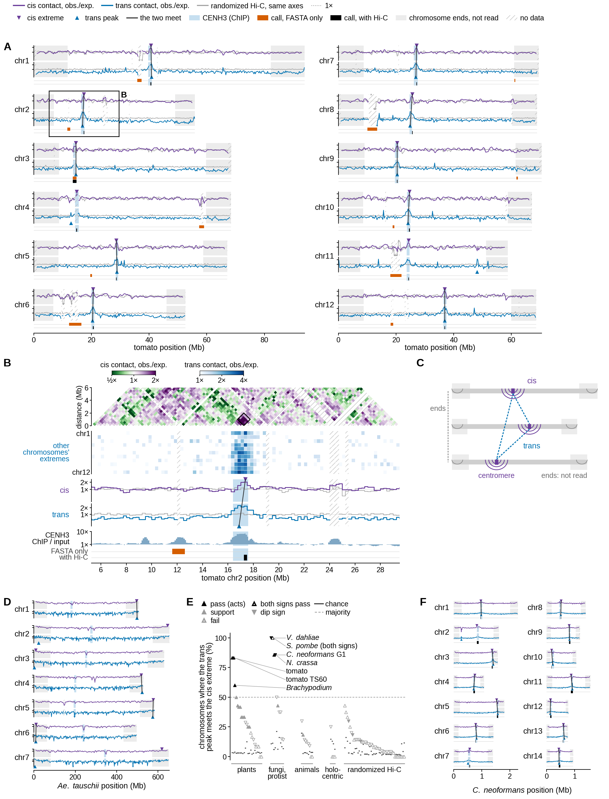
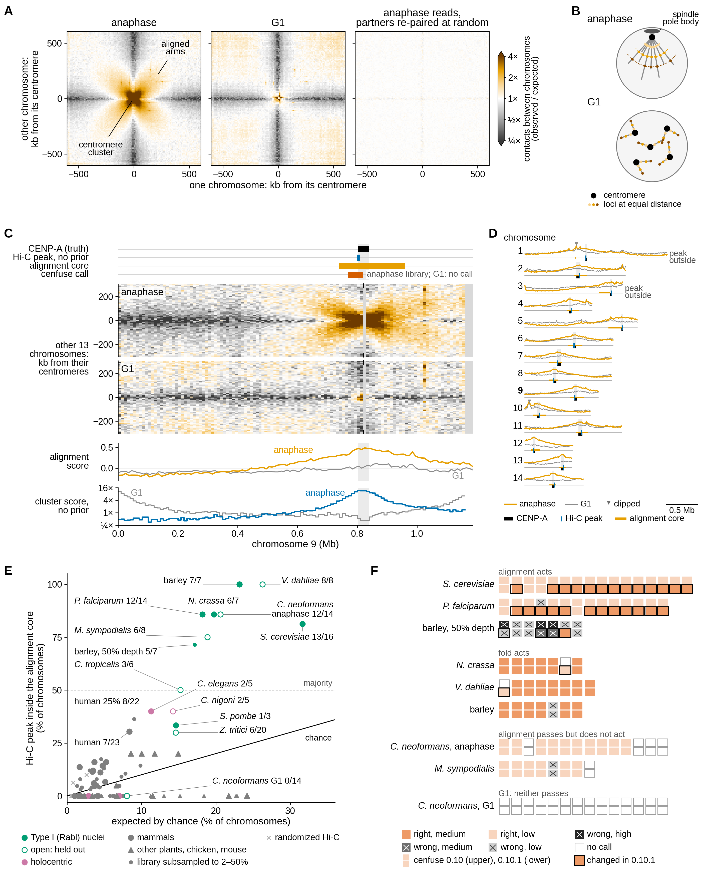
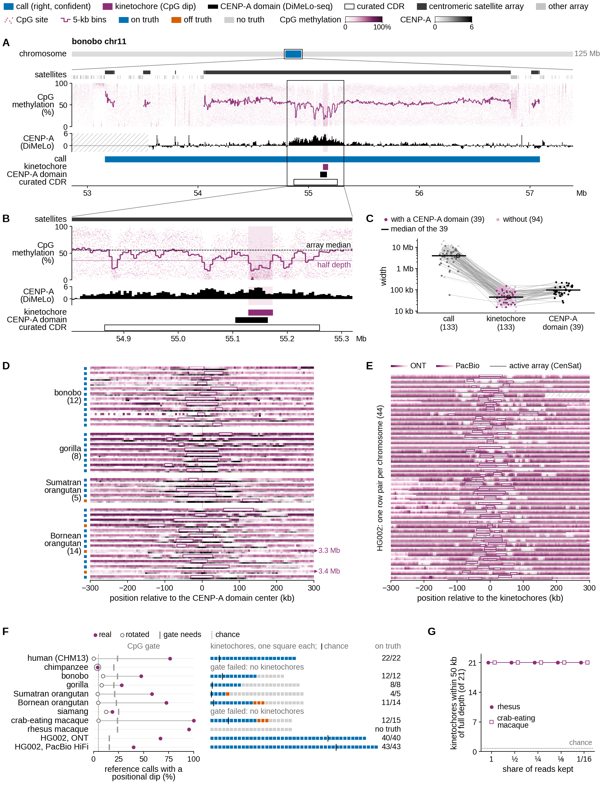

# Benchmarks

How well cenfuse 0.15.0 finds centromeres, scored against centromeres mapped on the same assembly. Every result table
comes from one run of the release (290 runs, 2026-11-08). A few checks of parts the release did not change (the Hi-C
depth series, CpG kinetochore details, telomeres and rDNA, T2T mammal runtimes) come from earlier runs, and one table
from an early form of the LTR line; each says so.

- **72 assemblies.** 63 have a mapped centromere: 12 mammals, chicken, 39 plants (13 of them tomatoes), 2 green algae,
  8 fungi and *Plasmodium falciparum*. 5 more mammals are compared with another satellite caller, and 4 holocentric
  genomes are controls. *Poa annua* and *P. infirma* (no ChIP) show the several-plants mode.
- **Each genome with each input set it has:** the FASTA alone, gene annotation, an LTR annotation (`tes/`), Hi-C,
  methylation, and randomized Hi-C as a control. The runs reuse each genome's stored satellite search and compute
  everything after it (fresh runs of two genomes from the FASTA give the same tables).
- **Development data.** No genome is held out: the rules were made with these results in view
  ([how the benchmark was run](#how-the-benchmark-was-run)).
- Scorer, truth manifest and table scripts: [benchmark/](../benchmark/README.md). Every genome's overview:
  [gallery](gallery.md). How each rule works: [design.md](design.md).

## How calls are scored

- **Truth.** CENP-A CDRs (Logsdon et al. 2024: CHM13 and five great apes); CENP-A ChIP (crab-eating macaque; pig and
  horse, from other animals); CENH3 ChIP-seq of the assembled line (most plants, moss, *Chlorella*) or of a related
  line (sorghum, *Arabidopsis*); CUT&Tag (*Chlamydomonas*); the authors' published CENH3 centromeres (two *B. rapa*
  accessions with weak ChIP, *Ae. geniculata*, 11 of the 13 tomatoes); the CenSat active arrays of HG002; CENP-A
  windows (chicken); the CENP-A minor-satellite array (mouse); CEN/CENP-A/CenH3 coordinates (fungi, *Plasmodium*).
- **ChIP domains** come from one frozen rule: 100-kb bins, ChIP over input, the half-maximum run around the maximum, at
  least 4-fold. The outcomes do not hang on its two numbers. In the 18 genomes whose truth it made (60 runs), 3-fold,
  5-fold or 50-kb bins change no outcome on the 604-624 chromosome-runs both rules give truth; they add or drop
  chromosomes whose ChIP sits near 4-fold (3-fold: 26 more, 21 right; 5-fold: 20 fewer, 16 of them right).
- **Right**, as the frozen scorer rules it ([benchmark/score.py](../benchmark/score.py),
  [benchmark/truth.tsv](../benchmark/truth.tsv)):
  - mammals with CENP-A, *Arabidopsis*, HG002: the call overlaps the domain;
  - chicken, mouse: overlap or touch;
  - rice, potato, barley, horse EquCab3: within 4 Hi-C bins, or 1 Mb without Hi-C (barley 8 Mb);
  - the other CENH3 truths: within 1 Mb;
  - moss, *Chlamydomonas*, *Chlorella*: within 100 kb;
  - fungi, *Plasmodium*: within 1 Hi-C bin (10-50 kb), or 250 kb without Hi-C, which is lenient for centromeres of
    1-100 kb ([future.md #37](future.md#37-scoring-rules-and-controls-to-tighten));
  - mammals without CENP-A data: overlap with another caller's satellite locus (agreement, not truth);
  - holocentric genomes: any confident call is wrong.
- **Confident** = `high` or `medium`. `low` = cenfuse says it is unsure.
- **Chance** of a right call by luck, per chromosome: (call + truth + 2 × tolerance) / chromosome length. P is the
  Poisson-binomial tail of the right count.

### How close a right call is

A call is right however wide it is, so here is every right call against its domain
([benchmark/precision.py](../benchmark/precision.py)). In animals a call is the satellite array, about ten times wider
than the CENP-A domain inside it: it says where the centromere is, not which part of the array holds the kinetochore.
The [CpG line](#kinetochores-from-cpg-methylation) says that where it passes.

| truth | calls | right calls | median call width | median domain width | median midpoint distance (90th percentile) | midpoint inside the domain | median share of the call on the domain |
|---|---|---|---|---|---|---|---|
| animals: CENP-A, CenSat active array, minor satellite | all right | 802 | 3.44 Mb | 0.34 Mb | 0.40 Mb (1.66 Mb) | 46% | 17% |
| animals: CENP-A, CenSat active array, minor satellite | `high`, `medium` | 672 | 3.89 Mb | 0.30 Mb | 0.49 Mb (1.73 Mb) | 39% | 11% |
| plants and algae: CENH3 | all right | 815 | 2.39 Mb | 0.90 Mb | 0.35 Mb (1.56 Mb) | 53% | 26% |
| plants and algae: CENH3 | `high`, `medium` | 735 | 2.83 Mb | 0.90 Mb | 0.39 Mb (1.58 Mb) | 53% | 26% |
| fungi and *Plasmodium*: mapped centromeres | all right | 241 | 40 kb | 12 kb | 4 kb (26 kb) | 69% | 50% |
| fungi and *Plasmodium*: mapped centromeres | `high`, `medium` | 92 | 60 kb | 5 kb | 2 kb (21 kb) | 62% | 51% |

## How far to trust each confidence level

47 genomes, each with all its inputs: 633 chromosomes with truth, 588 right (92.9%), 9 confidently wrong.

| confidence | calls | right | wrong | share right |
|---|---|---|---|---|
| `high` | 410 | 406 | 4 | 99.0% |
| `medium` | 69 | 64 | 5 | 92.8% |
| `low` | 145 | 118 | 27 | 81.4% |
| no call | 9 | | | |

- **Satellite centromeres** (apes, macaques, rice, *B. rapa*, soybean, sorghum, *Arabidopsis*, grape): right on nearly
  every chromosome from the FASTA alone, mostly `high`. 9 T2T mammals with CENP-A: 143 of 157 from the FASTA, 148 with
  genes and Hi-C; 11 *B. rapa*: 110 of 110.
- **Satellites beside the centromere, or none at it** (barley, potato, tomatoes, *Aegilops*): the FASTA alone gives
  `low` calls, mostly wrong. `tes/` places most: barley 0 → 7 of 7, potato 2 → 10 of 11, *Ae. geniculata* 0 → 13 of
  14, 13 tomatoes 20 → 115 of 156. Confident calls from an LTR core are less reliable than the table above: in the 13
  tomatoes `medium` is right 54 of 67 times (81%) and `high` 4 of 5.
- **Point and regional centromeres** (fungi, *Plasmodium*): AT troughs place them from the FASTA in AT-rich genomes
  (*P. falciparum* 13 of 14, *N. crassa* 7 of 7, *V. dahliae* and *M. sympodialis* 8 of 8, all `low`). Hi-C finds most
  others (yeast 16 of 16, *Z. tritici* 19 of 21, *C. neoformans* 13 of 14, *C. tropicalis* 6 of 7).
- **Holocentric genomes:** no confident call in 196 chromosome-runs.
- **Failures:** [every confident miss](#every-confident-miss).

## Every genome

Right / chromosomes with truth (confidently wrong in brackets), per input set. "All inputs" names the richest set
where it differs from the columns before it. Chance: right calls expected by luck from the FASTA. Where `tes/` forms no
deciding signature (CHM13, fungi, holocentric genomes), its calls equal those from the FASTA. Grape, cucumber,
*Ae. geniculata*, *S. verrucosum* and the 13 tomatoes have their own sections.

| genome | truth | FASTA only | + genes | + `tes/` | + Hi-C | all inputs | chance (FASTA only) |
|---|---|---|---|---|---|---|---|
| **mammals** | | | | | | | |
| human (CHM13) | CENP-A | 23/23 | 23/23 | 23/23 |  | 23/23 (genes, Hi-C) | 0.8 |
| chimpanzee | CENP-A | 18/18 | 18/18 |  |  | 18/18 (genes, Hi-C) | 0.5 |
| bonobo | CENP-A | 17/18 | 17/18 |  |  | 17/18 (genes, Hi-C) | 0.3 |
| gorilla | CENP-A | 9/9 | 9/9 |  |  | 9/9 (genes, Hi-C) | 0.3 |
| Sumatran orangutan | CENP-A | 8/8 | 8/8 |  |  | 8/8 (genes, Hi-C) | 0.3 |
| Bornean orangutan | CENP-A | 15/16 (1) | 15/16 (1) |  |  | 15/16 (1) (genes, Hi-C) | 0.7 |
| crab-eating macaque | CENP-A | 16/16 | 16/16 |  |  | 16/16 (genes, Hi-C) | 1.8 |
| pig | CENP-A | 8/17 | 13/17 (3) |  |  | 13/17 (3) (genes, Hi-C) | 1.8 |
| horse (T2T) | CENP-A | 29/32 | 29/32 |  |  | 29/32 (genes, Hi-C) | 4.0 |
| HG002 (diploid human) | CenSat active array | 46/46 |  |  |  | 46/46 (ONT CpG methylation) | 2.6 |
| horse (EquCab3) | CENP-A | 3/5 |  |  | 3/5 |  | 0.1 |
| mouse (T2T) | minor-satellite array | 18/20 |  |  | 18/20 |  | 0.4 |
| **mammals (no CENP-A data)** | | | | | | | |
| siamang | none (satellome locus) | 18/26 | 19/26 |  |  | 20/26 (2) (genes, Hi-C) | 1.0 |
| rhesus macaque | none (satellome locus) | 22/22 | 22/22 |  |  | 22/22 (genes, Hi-C) | 4.2 |
| sheep | none (satellome locus) | 26/28 (1) | 26/28 (1) |  |  | 26/28 (1) (genes, Hi-C) | 3.0 |
| goat | none (satellome locus) | 30/30 | 30/30 |  |  | 30/30 (genes, Hi-C) | 4.2 |
| giraffe | none (satellome locus) | 15/15 | 15/15 |  |  | 15/15 (genes, Hi-C) | 0.3 |
| **birds** | | | | | | | |
| chicken | CENP-A windows | 27/33 |  |  | 27/33 |  | 6.4 |
| **plants** | | | | | | | |
| rice | CENH3 | 12/12 | 12/12 | 12/12 | 12/12 | 12/12 (`tes/`, genes, Hi-C) | 1.2 |
| barley | CENH3 | 0/7 | 0/7 | 7/7 | 6/7 | 7/7 (`tes/`, Hi-C) | 0.2 |
| potato | CENH3 | 2/11 | 4/11 (2) | 10/11 (1) | 2/11 | 9/11 (1) (`tes/`, genes, Hi-C) | 0.6 |
| maize (Mo17) | CENH3 | 9/10 (1) | 9/10 (1) | 9/10 (1) |  | 9/10 (1) (`tes/`, genes) | 0.2 |
| sorghum | CENH3 | 10/10 |  | 10/10 | 10/10 | 10/10 (`tes/`, Hi-C) | 1.4 |
| *Brachypodium distachyon* | CENH3 | 3/3 |  | 3/3 | 3/3 | 3/3 (`tes/`, Hi-C) | 0.2 |
| *Aegilops tauschii* | CENH3 | 1/7 |  | 5/7 (2) | 1/7 | 5/7 (2) (`tes/`, Hi-C) | 0.1 |
| soybean | CENH3 | 20/20 |  | 19/20 (1) | 20/20 | 19/20 (1) (`tes/`, Hi-C) | 2.2 |
| *Brassica rapa* CC1 | CENH3 | 10/10 |  | 10/10 | 10/10 | 10/10 (`tes/`, Hi-C) | 2.4 |
| *Brassica rapa* CC2 | CENH3 | 10/10 |  | 10/10 |  |  | 2.4 |
| *Brassica rapa* CC3 | CENH3 | 10/10 |  | 10/10 |  |  | 2.5 |
| *Brassica rapa* CCA03 | CENH3 | 10/10 |  | 10/10 |  |  | 2.5 |
| *Brassica rapa* PC1 | CENH3 | 10/10 |  | 10/10 |  |  | 2.4 |
| *Brassica rapa* TC1 | CENH3 | 10/10 |  | 10/10 |  |  | 2.6 |
| *Brassica rapa* TU1 | CENH3 (published domains) | 10/10 |  | 10/10 |  |  | 2.3 |
| *Brassica rapa* OI1 | CENH3 | 10/10 |  | 10/10 |  |  | 2.5 |
| *Brassica rapa* CX1 | CENH3 (published domains) | 10/10 |  | 10/10 |  |  | 2.4 |
| *Brassica rapa* MIZ1 | CENH3 | 10/10 |  | 10/10 |  |  | 2.5 |
| *Brassica rapa* WTC1 | CENH3 | 10/10 |  | 10/10 |  |  | 2.3 |
| *Arabidopsis thaliana* (Col-CC) | CENH3 | 5/5 |  | 5/5 | 5/5 | 5/5 (`tes/`, ONT methylation) | 0.8 |
| tomato | CENH3 | 1/12 |  | 8/12 (2) | 10/12 | 10/12 (`tes/`, Hi-C) | 0.9 |
| moss (*Physcomitrium patens*) | CENH3 | 16/26 |  | 26/26 | 21/26 | 26/26 (`tes/`, Hi-C) | 1.4 |
| **algae** | | | | | | | |
| *Chlamydomonas reinhardtii* | CENH3 | 6/17 |  | 6/17 |  |  | 2.6 |
| *Chlorella sorokiniana* | CENH3 | 0/10 |  | 9/10 |  |  | 0.2 |
| **fungi** | | | | | | | |
| *Saccharomyces cerevisiae* | CEN / CENP-A / CenH3 | 0/16 |  | 0/16 | 16/16 |  | 0.0 |
| *Schizosaccharomyces pombe* | CEN / CENP-A / CenH3 | 0/3 |  | 0/3 | 3/3 |  | 0.0 |
| *Neurospora crassa* | CEN / CENP-A / CenH3 | 7/7 |  | 7/7 | 7/7 |  | 1.7 |
| *Verticillium dahliae* | CEN / CENP-A / CenH3 | 8/8 |  | 8/8 | 8/8 |  | 1.8 |
| *Zymoseptoria tritici* | CEN / CENP-A / CenH3 | 0/21 |  | 0/21 | 19/21 |  | 0.0 |
| *Cryptococcus neoformans* (anaphase Hi-C) | CEN / CENP-A / CenH3 | 0/14 |  | 0/14 | 13/14 |  | 0.0 |
| *Cryptococcus neoformans* (G1 Hi-C) | CEN / CENP-A / CenH3 | 0/14 |  | 0/14 | 12/14 |  | 0.0 |
| *Malassezia sympodialis* | CEN / CENP-A / CenH3 | 8/8 |  |  | 8/8 |  | 5.0 |
| *Candida tropicalis* | CEN / CENP-A / CenH3 | 0/7 |  | 0/7 | 6/7 |  | 0.0 |
| **protists** | | | | | | | |
| *Plasmodium falciparum* | CEN / CENP-A / CenH3 | 13/14 |  |  | 14/14 |  | 5.1 |
| **nematodes (holocentric control)** | | | | | | | |
| *Caenorhabditis elegans* | none (holocentric) | 0 confident / 6 |  | 0 confident / 6 | 0 confident / 6 |  |  |
| *Caenorhabditis nigoni* | none (holocentric) | 0 confident / 6 |  | 0 confident / 6 | 0 confident / 6 |  |  |
| **insects (holocentric control)** | | | | | | | |
| *Bombyx mori* | none (holocentric) | 0 confident / 29 |  | 0 confident / 29 | 0 confident / 29 |  |  |
| **plants (holocentric control)** | | | | | | | |
| *Rhynchospora breviuscula* | none (holocentric) | 0 confident / 5 |  | 0 confident / 5 | 0 confident / 5 |  |  |

## Satellite centromeres

### T2T mammals

| genome | truth | FASTA only | + genes + Hi-C | chromosomes passing the Hi-C test |
|---|---|---|---|---|
| human (CHM13) | CENP-A | 23/23 | 23/23 | 24 |
| chimpanzee | CENP-A | 18/18 | 18/18 | 25 |
| bonobo | CENP-A | 17/18 | 17/18 | 25 |
| gorilla | CENP-A | 9/9 | 9/9 | 25 |
| Sumatran orangutan | CENP-A | 8/8 | 8/8 | 25 |
| Bornean orangutan | CENP-A | 15/16 (1) | 15/16 (1) | 25 |
| crab-eating macaque | CENP-A | 16/16 | 16/16 | 22 |
| pig | CENP-A | 8/17 | 13/17 (3) | 0 |
| horse (T2T) | CENP-A | 29/32 | 29/32 | 0 |
| siamang | none (satellome locus) | 18/26 | 20/26 (2) | 26 |
| rhesus macaque | none (satellome locus) | 22/22 | 22/22 | 0 (support tier on 22) |
| sheep | none (satellome locus) | 26/28 (1) | 26/28 (1) | 0 |
| goat | none (satellome locus) | 30/30 | 30/30 | 0 (support tier on 31) |
| giraffe | none (satellome locus) | 15/15 | 15/15 | 0 |

- **9 genomes with CENP-A, 157 chromosomes:** from the FASTA 143 right, 1 confidently wrong, 13 `low` or no call; with
  genes and Hi-C 148, 4, 5. `high` calls are right 133 of 136 times.
- **5 genomes without CENP-A data** (121 chromosomes): the calls agree with an independent satellite caller (the
  satellome locus) on 111 from the FASTA and 113 with genes and Hi-C.
- **Pig and siamang** have every FASTA-only call `low`: in pig no satellite family dominates genome-wide (5 misses sit
  0.6-2.0 Mb from CENP-A at the acrocentric ends); siamang's satellites fail the
  [one-per-chromosome test](#one-locus-per-chromosome).

| every miss (all inputs) | call | why |
|---|---|---|
| pig CM000817.6, CM000822.6, CM000828.6 | wrong, confident | The truth is weak ChIP from other pigs, with no centromeric array within 1 Mb of its maximum (5.4-5.6-fold). On all three the ChIP's second peak (3.0-4.4-fold) lies inside the call, and the published karyotype agrees with the call on two (chr11, chr17). Such second peaks also occur on 3 of the 13 right pig calls: evidence, not proof. |
| pig CM001155.3 | wrong, `low` | the same |
| Bornean orangutan CM054652.2 | wrong, `high` | CENP-A sits on 4 small alpha-satellite arrays (73 kb), 14 Mb from the 3.4-Mb array cluster cenfuse calls. Hi-C points weakly to the CENP-A site but cannot move a `high` call. The truth may be haplotype-specific: CenSat marks the called array as active. |
| bonobo CM055489.2 | wrong, `low` | the true array is the reported competing cluster |
| horse CM128059.1 (chr11) | no call | satellite-free centromere; horse Hi-C fails its test, so nothing places it |
| horse CM128050.1, CM128070.1 | wrong, `low` | |

### Plants, chicken, mouse and other satellite genomes

- **Grape** PN40024 (CENH3 ChIP on 18 of 19 chromosomes): 18 of 18, all `high`, with any input set. Its Athila
  signature (10.1-fold) only flags, since grape's satellites pass the one-per-chromosome test.
- **Cucumber** 9930: its CENH3 ChIP reaches 4-fold on 1 of 7 chromosomes only. That call is right (`low`) from the
  FASTA and with Hi-C; with `tes/` a minority LTR core replaces it, 2.1 Mb off (`low`).
- **Maize** Mo17: the 180-bp knob repeat is the most abundant satellite family (23.6 Mb) and gets the role
  `interstitial`; CentC is centromeric on all 10 chromosomes. 9 of 10 right (7 overlap CENH3). The miss, chr5 (`high`),
  has CENH3 on satellite-free DNA 2 Mb from the CentC array.
- **HG002** (diploid human, 46 chromosomes): 46 of 46 calls on the CenSat active array (45 `high`).
- **Chicken** GGswu (truth on 33 of 40 chromosomes): 27 of 33 (chance 6.4, P 4e-22), 2 more within 1 Mb. Every call
  is `low`: chicken centromeres use chromosome-specific satellites, so no family dominates (chr5, chr27 and Z have none).
- **Mouse** (T2T, all acrocentric): the pericentric major satellite (162 Mb) and the CENP-A minor satellite (16.5 Mb)
  sit side by side at each centromeric end, so the satellite line reports one as the other's competing cluster. The AT
  trough test passes (P 0.0009), and on 17 chromosomes the deepest trough picks the minor satellite (`at_chose_alt`):
  18 of 20 right, all `low`. The 2 misses lie on the major satellite, 14 bp from the minor one. Hi-C cannot choose: no
  mappable DNA separates the arrays. The trough rule rests on mouse alone
  ([future.md #70](future.md#70-the-at-trough-choosing-between-two-satellites-rests-on-one-genome)).
- **Horse EquCab3** (CENP-A ChIP on 5 chromosomes): 3 of 5 right, all `low`; chr11 and chr31 get no call.

### One locus per chromosome

*[One locus per chromosome](img/benchmark_one_per_chromosome.pdf): the N largest candidates cover nearly every
chromosome when they are centromeres. Drawn from the 0.12 release; some panel counts predate the tables here.*

A chromosome has one centromere, while other features fall roughly in proportion to chromosome length. So the N largest
clusters of the families called centromeric (N = number of chromosomes) should cover nearly every chromosome if they
are centromeres. The test reads the FASTA alone. Where it fails, satellite calls stay `low` unless an LTR core agrees.
Genomes where it fails:

| genome | chromosomes | covered by the N largest clusters | by chance | P | FASTA only |
|---|---|---|---|---|---|
| siamang | 26 | 18 | 16 | 0.2 | 18/26 |
| barley | 7 | 4 | 5 | 0.91 | 0/7 |
| potato | 12 | 7 | 8 | 0.87 | 2/11 |
| *Aegilops tauschii* | 7 | 4 | 5 | 0.91 | 1/7 |
| tomato | 12 | 9 | 8 | 0.24 | 1/12 |
| *Chlorella sorokiniana* | 12 | 1 | 1 | 1 | 0/10 |
| *Caenorhabditis elegans* | 6 | 5 | 4 | 0.24 | 0 confident / 6 |
| *Caenorhabditis nigoni* | 6 | 4 | 4 | 0.73 | 0 confident / 6 |
| *Bombyx mori* | 29 | 13 | 11 | 0.13 | 0 confident / 29 |
| *Rhynchospora breviuscula* | 5 | 4 | 3 | 0.41 | 0 confident / 5 |

It passes in 36 genomes (P 0.0001-0.038; chromosomes covered by the N largest clusters / N): human (CHM13) 22/24, chimpanzee 25/25, bonobo 20/25, gorilla 24/25, Sumatran orangutan 23/25, Bornean orangutan 23/25, crab-eating macaque 22/22, pig 20/20, horse (T2T) 31/33, HG002 (diploid human) 44/46, horse (EquCab3) 26/32, mouse (T2T) 20/20, rhesus macaque 22/22, sheep 22/28, goat 30/31, giraffe 15/16, chicken 36/40, rice 12/12, maize (Mo17) 9/10, sorghum 10/10, *Brachypodium distachyon* 5/5, soybean 19/20, *Brassica rapa* CC1 9/10, *Brassica rapa* CC2 9/10, *Brassica rapa* CC3 10/10, *Brassica rapa* CCA03 9/10, *Brassica rapa* PC1 10/10, *Brassica rapa* TC1 9/10, *Brassica rapa* TU1 10/10, *Brassica rapa* OI1 10/10, *Brassica rapa* CX1 10/10, *Brassica rapa* MIZ1 10/10, *Brassica rapa* WTC1 10/10, *Arabidopsis thaliana* (Col-CC) 5/5, moss (*Physcomitrium patens*) 20/26, *Chlamydomonas reinhardtii* 15/17. In the fungi and *P. falciparum* no family is called centromeric, so it does not run.

- **Every genome with satellite centromeres passes but the siamang**, down to chicken's chromosome-specific satellites
  and mouse's two satellites at each end. On 8 siamang chromosomes the alpha-satellite arrays form two clusters more
  than 500 kb apart.
- **Tomato, potato, barley and *Ae. tauschii* fail:** their centromeres are satellite-free or beside the satellite.
  From the FASTA alone they make no confident call. The holocentric genomes fail too, as they should.
- **Passing says little about one call:** *Chlamydomonas* and moss pass, but no family dominates, so their satellite
  calls stay `low`.
- **From the FASTA alone, 3 confident errors in all genomes** (maize, sheep, Bornean orangutan), all where the test
  passes.

## Retrotransposon centromeres (`tes/`)

*[Which LTR families mark centromeres](img/benchmark_ltr_signature.pdf): families that pile up at one locus on the other
chromosomes mark each chromosome's centromere, in any lineage. Drawn from the 0.12 release.*

`tes/` = LTRquest annotations made with `ltrquest --genome G --max-rounds 1 --threads T --detect-args
ltr-timeout=300 --run-sdust --reboundary`. cenfuse learns the signature in each genome: the most specific
centromere-concentrated family or lineage seeds it, and each chromosome's core comes from the families enriched in the
other chromosomes' cores. Right / chromosomes (confidently wrong):

| genome | signature | fold in its cores | decides? | FASTA only | + `tes/` | + `tes/` + Hi-C |
|---|---|---|---|---|---|---|
| rice | CRM | 15.8 | yes | 12/12 | 12/12 | 12/12 |
| barley | CRM | 7.4 | yes | 0/7 | 7/7 | 7/7 |
| potato | CRM | 13.3 | yes | 2/11 | 10/11 (1) | 9/11 (1) |
| maize (Mo17) | CRM | 64.9 | yes | 9/10 (1) | 9/10 (1) |  |
| sorghum | CRM | 18.2 | yes | 10/10 | 10/10 | 10/10 |
| *Brachypodium distachyon* | CRM | 27.5 | yes | 3/3 | 3/3 | 3/3 |
| *Aegilops tauschii* | CRM | 74.5 | yes | 1/7 | 5/7 (2) | 5/7 (2) |
| soybean | CRM | 21.8 | yes | 20/20 | 19/20 (1) | 19/20 (1) |
| *Brassica rapa* CC1 | CRM | 38 | yes | 10/10 | 10/10 | 10/10 |
| *Brassica rapa* CC2 | CRM | 37 | yes | 10/10 | 10/10 |  |
| *Brassica rapa* CC3 | CRM | 7.3 | yes | 10/10 | 10/10 |  |
| *Brassica rapa* CCA03 | CRM | 30.3 | yes | 10/10 | 10/10 |  |
| *Arabidopsis thaliana* (Col-CC) | Athila | 13.3 | no: a dominant satellite falls one per chromosome | 5/5 | 5/5 | 5/5 |
| tomato | Tekay | 32.7 | yes | 1/12 | 8/12 (2) | 10/12 |
| moss (*Physcomitrium patens*) | Bryco | 58.8 | yes | 16/26 | 26/26 | 26/26 |
| *Chlamydomonas reinhardtii* | . | . | none | 6/17 | 6/17 |  |
| *Chlorella sorokiniana* | Osser | 78.9 | yes | 0/10 | 9/10 |  |

- **Any lineage can mark centromeres, and one family says it better than its lineage:** moss's Bryco (58.8-fold),
  *Chlorella*'s Osser (78.9-fold) and one Tekay family in tomato (32.7-fold) decide, as CRM does in the grasses.
- ***Arabidopsis*:** Athila cores flank the CENH3 domain, 0.46-1.38 Mb away, on all 5 chromosomes. CEN180 passes the
  one-per-chromosome test, so Athila only flags and the satellite calls stand. Had Athila decided, all 5 would be wrong.
- ***Ae. tauschii*:** CRM cores hold CENH3 on all 7 chromosomes, beside the satellite arrays; 5 calls move onto them.
  Chr5 and Chr7 stay at a core's edge, 1.3 and 3.1 Mb off, and are confidently wrong.
- **Tomato with `tes/` alone:** significant cores on all 12 chromosomes, 7 overlapping CENH3; 8 of 12 calls right. Two
  misses are `medium`, and nothing in the LTR line tells them from the right ones
  ([future.md #27](future.md#27-wrong-ltr-cores-that-look-right)). With Hi-C: 10 of 12, none confidently wrong.
- **A head-to-head test protects right satellite calls:** a decisive core replaces a confident satellite call only if
  its family marks the core significantly more than the call. Here it keeps one right call, *Ae. geniculata* chr05M.
- **Fungi, CHM13 and the holocentric genomes:** no signature decides; every call equals the call without `tes/`.

**The annotation matters.** The decisive test needs a family concentrated on most chromosomes, so it needs a sensitive
annotation. Measured with an early form of the LTR line that read the lineage, not the family signature (not rerun):
right calls with each annotator, and with LTRquest's elements thinned at random.

| genome | annotation | TE line alone: right / cores | calls right (confidently wrong) |
|---|---|---|---|
| rice | LTRquest | 8/8 | 12/12 (0) |
| rice | EDTA intact + TEsorter; DANTE_LTR | 4/4; 3/8 | 12/12 (0) |
| rice | LTRquest at 50 / 25 / 10% | 3/3, 1/1, 1/1 | 12/12 (0) |
| potato | LTRquest | 6/7 | 6/11 (2) |
| potato | EDTA + TEsorter; DANTE_LTR; LTRquest at 50% | 2/2; 1/1; 3/3 | 2/11 (2) |
| maize | LTRquest, and at 50 / 25 / 10% | 10/10, 10/10, 10/10, 8/8 | 9/10 (1) |
| moss | LTRquest; at 50% | 25/25; 22/22 | 16/26 (0) |

In potato, every less sensitive annotation lost the gain from `tes/`. Every CRM core short of a majority still lay on
CENH3 (24 of 24 in rice, potato, maize and *Brachypodium*).

### An allotetraploid and a wild potato

*Aegilops geniculata* (UUMM allotetraploid, 14 chromosomes, 7.9 Gb, GCA_053567775.1; CENH3 domains of Yunusbaev et al.
2026, Table S2, at Mb resolution; cenrep, cenfuse's predecessor, used this ChIP to shape two LTR rules) and *Solanum
verrucosum* (diploid wild potato, 12 chromosomes, 0.7 Gb, GCA_031230405.1; CENH3 ChIP SRR18548893 and SRR18548892 by
the frozen rule, with WGS of another accession, SRR5349572, as input). Scored within 1 Mb.

| genome | inputs | right / chromosomes | right `high` / `medium` / `low` | confidently wrong | chance expected | P |
|---|---|---|---|---|---|---|
| *Ae. geniculata* | FASTA | 0/14 | 0 / 0 / 0 | 0 | 0.21 | 1 |
| *Ae. geniculata* | FASTA, `tes/` | 13/14 | 0 / 12 / 1 | 1 | 0.33 | 7.6e-21 |
| *S. verrucosum* | FASTA | 5/12 | 0 / 0 / 5 | 0 | 0.73 | 0.00043 |
| *S. verrucosum* | FASTA, `tes/` | 8/12 | 3 / 4 / 1 | 1 | 0.72 | 6.1e-08 |

- **From the FASTA,** both fail the one-per-chromosome test (*Ae. geniculata* P 0.67, *S. verrucosum* P 0.24), so
  every call is `low`. All 14 *Ae. geniculata* calls lie on other arrays, 6-395 Mb from CENH3.
- ***Ae. geniculata* with `tes/`:** a CRM signature (38.1-fold, significant cores on 14 of 14 chromosomes) decides and
  rejects the satellite families away from its cores. The centromeric family becomes a 1,216-bp chain of partial copies
  of a longer repeat (`partial_chain`, never `high`) in the cores: 13 of 14 right. On chr05M insertion age moves the core
  23 Mb off CENH3; the head-to-head test keeps the right call, which disagrees with its core and is `low`. The confident
  error, chr05U (2.1 Mb off), lies in the right part of a 9.3-Mb core whose left edge reaches CENH3
  ([future.md #45](future.md#45-confident-calls-at-the-edge-of-a-wide-ltr-core)).
- ***S. verrucosum* with `tes/`** (CRM, 42-fold): 8 of 12 right, 7 of them confident. The confident error, chr06 (1.4 Mb
  off), is a core that replaced a weak satellite array beside it. Thin cores of 2 and 4 elements (`weak_core`) replace
  two right satellite calls (chr10, chr12).
- **Truth caveats:** *Ae. geniculata*'s domains have Mb resolution. *S. verrucosum*'s input is another accession, and
  its chr04 has two CENH3 peaks of nearly equal height (28.4- and 27.3-fold); the frozen rule takes 23.2-23.5 Mb.

### Thirteen tomatoes

The telomere-to-telomere assemblies of Shi et al. 2026 (PRJNA1201608; 12 chromosomes each, 0.8-1.2 Gb): wild species
from every clade of the genus and three cultivated lines. Truth: their Supplementary Table 8 (11 accessions), or the
frozen ChIP rule (LA2093, TS-9). Scored within 1 Mb. One genus, so 13 tests of one lineage's centromeres, not of 13
lineages. The LTR rules of 0.15.0 were made with these genomes in view.

| accession | truth | FASTA: right | `high` / `medium` / `low` | confidently wrong | P | with `tes/`: right | `high` / `medium` / `low` | confidently wrong | P |
|---|---|---|---|---|---|---|---|---|---|
| *S. juglandifolium* LA2134 | Table 8 | 1/12 | 0 / 0 / 1 | 0 | 0.64 | 9/12 | 0 / 0 / 9 | 0 | 1.6e-08 |
| *S. lycopersicoides* LA2951 | Table 8 | 4/12 | 0 / 0 / 4 | 0 | 0.0051 | 8/12 | 1 / 5 / 2 | 3 | 8.5e-08 |
| *S. habrochaites* LA1777 | Table 8 | 0/12 | 0 / 0 / 0 | 0 | 1 | 10/12 | 0 / 4 / 6 | 1 | 6.2e-11 |
| *S. chilense* LA0458 | Table 8 | 2/12 | 0 / 0 / 2 | 0 | 0.21 | 11/12 | 1 / 0 / 10 | 0 | 8.2e-12 |
| *S. corneliomulleri* LA0103 | Table 8 | 1/12 | 0 / 0 / 1 | 0 | 0.62 | 9/12 | 0 / 5 / 4 | 0 | 1.6e-08 |
| *S. peruvianum* LA0111 | Table 8 | 1/12 | 0 / 0 / 1 | 0 | 0.5 | 8/12 | 0 / 3 / 5 | 1 | 6.4e-08 |
| *S. huaylasense* LA1982 | Table 8 | 1/12 | 0 / 0 / 1 | 0 | 0.58 | 12/12 | 0 / 7 / 5 | 0 | 5.7e-15 |
| *S. chmielewskii* LA1028 | Table 8 | 1/12 | 0 / 0 / 1 | 0 | 0.63 | 8/12 | 0 / 2 / 6 | 0 | 1.4e-07 |
| *S. galapagense* LA0426 | Table 8 | 2/12 | 0 / 0 / 2 | 0 | 0.22 | 11/12 | 0 / 6 / 5 | 1 | 1.4e-12 |
| *S. lycopersicum var. cerasiforme* TS-623 | Table 8 | 2/12 | 0 / 0 / 2 | 0 | 0.24 | 7/12 | 1 / 6 / 0 | 2 | 5.5e-06 |
| *S. lycopersicum* TS-60 | Table 8 | 1/12 | 0 / 0 / 1 | 0 | 0.62 | 8/12 | 0 / 5 / 3 | 2 | 6.5e-08 |
| *S. pimpinellifolium* LA2093 | ChIP (frozen rule) | 1/12 | 0 / 0 / 1 | 0 | 0.57 | 7/12 | 0 / 6 / 1 | 2 | 1.2e-06 |
| *S. lycopersicum* TS-9 | ChIP (frozen rule) | 3/12 | 0 / 0 / 3 | 0 | 0.048 | 7/12 | 1 / 5 / 1 | 2 | 2.1e-06 |

Pooled, from the FASTA: 13 accessions, 20 of 156 chromosomes right (0 of them `high` or `medium`), 0 confidently wrong of 0 confident calls; 156 calls; with `tes/`: 13 accessions, 115 of 156 chromosomes right (58 of them `high` or `medium`), 14 confidently wrong of 72 confident calls (19%); 156 calls.

- **From the FASTA, no confident call.** The CENH3 domains hold a median of 4.5 kb of annotated satellite, and cenfuse
  says it is unsure: 20 of 156 right against 11.3 by chance, all `low`. In *S. chilense* the one-per-chromosome test
  passes on arrays that are mostly not centromeric (P 0.045), and the calls stay `low` only because no satellite
  dominates: the two safeguards are not redundant.
- **With `tes/`, nearly six times as many right, with confident errors.** A Tekay signature decides in all 13 (18- to
  53-fold; in *S. chmielewskii* a family concentrated across the chromosomes seeds it). 14 of the 72 confident calls
  are wrong (19%), a median 4.2 Mb from CENH3, against 2 of 8 in the benchmark's own tomato. Treat a `medium` call from
  a Tekay core in this genus as a place to check.
- **What each branch did:** moving a call to a strong core is right on 35 of 41; thin cores (`weak_core`) on 7 of 15;
  cores holding under half of the signature's elements (`minority_core`) on 41 of 58, all `low`. Calls that merely
  agree with the core are the least reliable confident ones: 5 wrong of 18.

| what the LTR line did (flag) | chromosomes | right | right and confident | confidently wrong | wrong, `low` |
|---|---|---|---|---|---|
| the core replaced a satellite call far from it (`satellite_away_from_core`) | 20 | 15 | 15 | 5 | 0 |
| the core replaced a satellite call beside it (`satellite_beside_core`) | 14 | 13 | 13 | 1 | 0 |
| the core replaced a weak array beside it (`weak_satellite_beside_core`) | 7 | 7 | 7 | 0 | 0 |
| a thin core replaced a call that failed the satellite test (`weak_core`) | 15 | 7 | 0 | 0 | 8 |
| a significant core holding under half of the signature's elements replaced a low call (`minority_core`) | 58 | 41 | 0 | 0 | 17 |
| the call stands and agrees with the core (`te_concordant`) | 27 | 20 | 13 | 5 | 2 |
| the call stands against the core (`te_discordant`) | 0 | 0 | 0 | 0 | 0 |

- **Truth caveats.** LA2951: the frozen rule finds a domain >= 4x on 1 of 12 chromosomes; it overlaps Table 8's on 1 of 1, within 1 Mb on 1; LA1777: the frozen rule finds a domain >= 4x on 10 of 12 chromosomes; it overlaps Table 8's on 10 of 10, within 1 Mb on 10. *S. lycopersicoides*' ChIP is weak (at most 5.2-fold); without it the `tes/`
  arms are 107 of 144 right and 11 confidently wrong.

## Point, regional and AT-rich centromeres

*[Hi-C in small genomes](img/benchmark_hic.pdf): where nuclei cluster their centromeres, contacts between chromosomes
find them. Drawn from the 0.10.1 release; some panel counts predate the tables here.*

With no centromeric repeat the satellite line gives no call; AT troughs and Hi-C remain. Right = within 1 Hi-C bin (250
kb without Hi-C); [`high`/`medium`/`low`]:

| genome | centromeres | Hi-C bin | FASTA only | + Hi-C |
|---|---|---|---|---|
| *Saccharomyces cerevisiae* | point (125 bp) | 10 kb | 0/16 | 16/16 [0/13/3] |
| *Plasmodium falciparum* | AT-rich core | 10 kb | 13/14 | 14/14 [10/4/0] |
| *Schizosaccharomyces pombe* | regional | 50 kb | 0/3 | 3/3 [0/3/0] |
| *Neurospora crassa* | regional, RIP-mutated TE relics | 50 kb | 7/7 | 7/7 [6/1/0] |
| *Verticillium dahliae* | regional | 50 kb | 8/8 | 8/8 [7/1/0] |
| *Zymoseptoria tritici* | regional | 10 kb | 0/21 | 19/21 [0/0/19] |
| *Cryptococcus neoformans* (anaphase Hi-C) | regional, retrotransposon-rich | 10 kb | 0/14 | 13/14 [0/4/9] |
| *Cryptococcus neoformans* (G1 Hi-C) | regional, retrotransposon-rich | 10 kb | 0/14 | 12/14 [0/0/12] |
| *Malassezia sympodialis* | short regional | 10 kb | 8/8 | 8/8 [0/8/0] |
| *Candida tropicalis* | regional (3C-seq) | 50 kb | 0/7 | 6/7 [0/0/6] |

**AT troughs.** If a genome's centromeres are its deepest GC troughs, those troughs fall about one per chromosome, more
evenly than a random deal. The test asks this of the deepest class of troughs, at a window size chosen per genome:

| genome | window | P | test | FASTA only | + Hi-C | troughs vs Hi-C |
|---|---|---|---|---|---|---|
| mouse (T2T) | 200 kb | 0.0009 | pass | 18/20 | 18/20 | 0/20 fail |
| *Chlorella sorokiniana* | 200 kb | 0.979 | fail | 0/10 |  |  |
| *Saccharomyces cerevisiae* | 50 kb | 0.999 | fail | 0/16 | 16/16 | 3/16 fail |
| *Schizosaccharomyces pombe* | 5 kb | 0.557 | untested | 0/3 | 3/3 | 3/3 pass |
| *Neurospora crassa* | 200 kb | 0.0402 | pass | 7/7 | 7/7 | 7/7 pass |
| *Verticillium dahliae* | 100 kb | 0.0104 | pass | 8/8 | 8/8 | 8/8 pass |
| *Zymoseptoria tritici* | 10 kb | 0.695 | fail | 0/21 | 19/21 | 4/20 fail |
| *Cryptococcus neoformans* (anaphase Hi-C) | 10 kb | 0.361 | fail | 0/14 | 13/14 | 7/14 support |
| *Cryptococcus neoformans* (G1 Hi-C) | 10 kb | 0.361 | fail | 0/14 | 12/14 | 1/14 fail |
| *Malassezia sympodialis* | 1 kb | 0.00479 | pass | 8/8 | 8/8 | 8/8 pass |
| *Candida tropicalis* | 20 kb | 0.15 | fail | 0/7 | 6/7 | 1/6 fail |
| *Plasmodium falciparum* | 1 kb | 0.0014 | pass | 13/14 | 14/14 | 13/14 pass |
| *Bombyx mori* | 2 kb | 0.842 | fail | 0 confident / 29 | 0 confident / 29 | 2/12 fail |

- **From the FASTA alone:** *P. falciparum* 13 of 14, *N. crassa* 7 of 7, *V. dahliae* and *M. sympodialis* 8 of 8,
  all `low`. In mouse the trough picks between two satellite arrays ([mouse](#plants-chicken-mouse-and-other-satellite-genomes)).
- **With Hi-C,** where a prior-free peak agrees with the trough, the call takes the trough's interval and rises a level
  (40 calls, all right).
- **The test fails** in *Z. tritici*, *C. tropicalis*, *C. neoformans*, yeast, *Chlorella* and *Bombyx*, and cannot run
  on 3 chromosomes (*S. pombe*).

**Hi-C.** The trans arm alignment passes in yeast and *Plasmodium*, the arm fold too in *N. crassa* and *V. dahliae*
([Rabl axis](#the-rabl-axis)). Hi-C's clean prior-free peaks place what no other line places: `low` alone (*Z. tritici*
19, *C. neoformans* in anaphase 6, *C. tropicalis* 6, yeast 3), `medium` where an AT trough agrees (*M. sympodialis* 7,
*C. neoformans* in anaphase 4). *C. tropicalis* (3C-seq) passes no test; its peaks count although their null test
cannot run there. *C. neoformans* in G1 is placed by the [cis signal](#hi-cs-two-readouts-test-each-other).

## Hi-C

### The test, and Hi-C on its own

Before Hi-C may act on a chromosome, its peaks must agree with the other chromosomes' calls on most of them, beyond
chance. Each readout alone, within 4 Hi-C bins of truth:

| genomes (chromosomes) | satellite line | prior-free Hi-C | anchored Hi-C | integrated |
|---|---|---|---|---|
| 9 T2T mammals (157) | 148 | 32 | 44 | 148 |
| rice (12) | 12 | 0 | 7 | 12 |
| barley (7) | 0 | 6 | 0 | 6 |
| potato (11) | 2 | 1 | 0 | 2 |
| horse EquCab3 (5) | 3 | 3 | 3 | 3 |

- **In mammals** the anchored peak sits beside the unmappable centromeric array, often more than 4 bins from CENP-A.
  The satellite line decides and Hi-C confirms (the test passes in CHM13, the great apes, crab-eating macaque, siamang).
- **Prior-free peaks never act untested:** alone they are right on 32 of 157 mammal chromosomes, and potato's strongest
  mutual cluster is not its centromeres.
- **The support tier.** Where Hi-C finds centromeres beyond chance but not on most chromosomes, it may only support
  calls it agrees with: 28 calls, all right (moss without `tes/` 15, `medium`, 5 of them the competing cluster it
  picked; goat 8 and rhesus 5, `high`). In mouse it supports nothing: no mappable bin separates the two arrays.
- **Crops and mouse with Hi-C** (*B. rapa* CC1, soybean, sorghum, *Brachypodium*, *Ae. tauschii*, mouse): the same
  right counts as from the FASTA. Three libraries are shallower than downloaded (sorghum, *Ae. tauschii*, mouse: a mate
  file was damaged in transfer).

### Hi-C and the LTR cores

- **Better calls make better anchors.** With `tes/` the ordinary test passes in barley (7 of 7 chromosomes, none
  without) and moss (26 of 26): barley 7 of 7 right, all `high`; moss 26 of 26.
- **Hi-C anchored on the LTR cores**, used where the ordinary test fails, passes only in *Arabidopsis* (3 of 5, P
  0.0028), flagging 2 right `high` calls. It fails in *Brachypodium*, *Ae. tauschii*, potato, tomato and sorghum.
- **Ends do not count.** In *R. breviuscula* (holocentric) the Athila cores lie at the ends of 4 of 5 chromosomes, and
  its nuclei cluster their ends. The test counts only clean peaks (not at an end, hub or NOR), so it fails there (1 of
  5) and the calls equal those without `tes/`.

### The contact crossing the centromere

*[The contact crossing the centromere](img/benchmark_cis.pdf): the flanks of tomato centromeres touch; potato shows
dips; every genome with Hi-C and truth against chance. Drawn from the 0.12 release; some panel counts predate the
tables here.*

The contact between the 4 bins left and the 4 bins right of each bin, as observed over expected, has its extreme at the
centromere in many plants and fungi, and in no mammal. In tomato the two flanks of each centromere touch about twice as
often as DNA at the same distance elsewhere; in potato much less. Extreme within 4 bins of truth, chance from contact
maps simulated with the same coverage and distance decay, and the test cenfuse runs against the LTR cores:

| genome | chromosomes | peak on truth | chance | P | dip on truth | chance | P | against the LTR cores |
|---|---|---|---|---|---|---|---|---|
| *Aegilops tauschii* | 7 | 0 | 0.07 | 1 | 4 | 0.06 | 0.00041 | dip at the core on 4/7 chromosomes (P 0.00094): pass |
| barley | 7 | 0 | 0.05 | 1 | 3 | 0.05 | 0.003 | not run: Hi-C test passed |
| *Brachypodium distachyon* | 3 | 3 | 0.45 | 0.082 | 0 | 0.55 | 1 | peak at the core on 5/5 chromosomes (P 0.022): fail |
| *Cryptococcus neoformans* (G1 Hi-C) | 14 | 13 | 0.43 | 6.3e-05 | 6 | 0.48 | 0.76 |  |
| *Arabidopsis thaliana* (Col-CC) | 5 | 5 | 0.38 | 0.006 | 0 | 0.35 | 1 | peak at the core on 2/5 chromosomes (P 0.79): fail |
| *Malassezia sympodialis* | 8 | 0 | 0.14 | 1 | 4 | 0.14 | 0.014 |  |
| potato | 11 | 1 | 0.08 | 0.62 | 8 | 0.09 | 2.9e-07 | dip at the core on 7/12 chromosomes (P 1.4e-05): pass |
| moss (*Physcomitrium patens*) | 26 | 9 | 0.18 | 0.03 | 5 | 0.19 | 0.56 | not run: Hi-C test passed |
| rice | 12 | 8 | 0.34 | 0.016 | 0 | 0.34 | 1 | not run: Hi-C test passed |
| sorghum | 10 | 0 | 0.29 | 1 | 3 | 0.33 | 0.75 | dip at the core on 4/10 chromosomes (P 1): fail |
| *Schizosaccharomyces pombe* | 3 | 3 | 0.31 | 0.023 | 3 | 0.30 | 0.026 |  |
| tomato | 12 | 12 | 0.16 | 4.6e-12 | 1 | 0.15 | 0.89 | peak at the core on 8/12 chromosomes (P 2.4e-05): pass |
| *Verticillium dahliae* | 8 | 2 | 0.26 | 0.65 | 8 | 0.28 | 2.2e-05 |  |

Neither extreme lies on truth beyond chance (P > 0.05) in the other 25 genomes: *Brassica rapa* CC1, *Cryptococcus neoformans* (anaphase Hi-C), *Candida tropicalis*, chicken, soybean, horse (EquCab3), mouse (T2T), *Neurospora crassa*, *Plasmodium falciparum*, *Saccharomyces cerevisiae*, *Zymoseptoria tritici*, human (CHM13), goat, horse (T2T), crab-eating macaque, giraffe, gorilla, rhesus macaque, bonobo, chimpanzee, Sumatran orangutan, Bornean orangutan, siamang, sheep, pig.

- **Tomato:** the peak lies on CENH3 on all 12 chromosomes. Against the LTR cores it passes (8 of 12, P 2.4e-5), moves
  the `low` calls and lowers the confident calls it contradicts: 10 of 12 right, none confidently wrong.
- **Potato:** the dip, at a flank of the centromere, passes against the cores (7 of 12, P 1.4e-5): 9 of 11 right, 1
  confidently wrong.
- **Effect on calls** (tomato, potato, *Ae. tauschii*): it raises 17 calls a level, all right; moves 6 `low` calls (4
  right after); and lowers 9 confident calls it contradicts (4 right, 2 wrong, 3 still confidently wrong).

### Hi-C's two readouts test each other

*[Hi-C's two readouts test each other](img/benchmark_cis_trans.pdf): in tomato the cis and trans readouts meet on CENH3
on 10 of 12 chromosomes, a randomized library shows neither, and* C. neoformans *in G1 gives 12 of 14. Drawn from the
0.13 release.*

Without `tes/`, the library's contacts between chromosomes test the cis signal: each chromosome's trans peak, made from
the other chromosomes' cis extremes, must lie at its own extreme on most chromosomes. Terminal eighths are not read,
since chromosome ends cluster whatever the centromere. Runs where it passes or supports:

| genome (inputs) | Hi-C bin | trans peaks at the cis extreme | verdict | acts on | right |
|---|---|---|---|---|---|
| *Brachypodium distachyon* (FASTA, Hi-C) | 250 kb | peak: 3/5 (P 0.00089) | pass | 2 | 3/3 |
| *Cryptococcus neoformans* (G1 Hi-C) (FASTA, Hi-C) | 10 kb | peak: 12/14 (P 1.4e-13) | pass | 14 | 12/14 |
| *Cryptococcus neoformans* (anaphase Hi-C) (FASTA, Hi-C) | 10 kb | peak: 6/14 (P 0.00021) | support | 0 | 13/14 |
| *Neurospora crassa* (FASTA, Hi-C) | 50 kb | dip: 6/7 (P 1.7e-06) | pass | 7 | 7/7 |
| *Schizosaccharomyces pombe* (FASTA, Hi-C) | 50 kb | peak: 3/3 (P 0.0025) | ambiguous | 0 | 3/3 |
| *Verticillium dahliae* (FASTA, Hi-C) | 50 kb | dip: 8/8 (P 2.9e-08) | pass | 8 | 8/8 |
| barley (FASTA, Hi-C) | 2 Mb | peak: 3/7 (P 0.0018) | support | 0 | 6/7 |
| tomato (FASTA, Hi-C) | 250 kb | peak: 10/12 (P 1.2e-13) | pass | 12 | 10/12 |
| rhesus macaque (FASTA, genes, Hi-C) | 250 kb | peak: 4/22 (P 0.0035) | support | 0 | 22/22 |

It fails, and changes nothing, in 23 more runs: *Aegilops tauschii* (FASTA, Hi-C), *Arabidopsis thaliana* (Col-CC) (FASTA, Hi-C), *Bombyx mori* (FASTA, Hi-C), *Caenorhabditis elegans* (FASTA, Hi-C), *Caenorhabditis nigoni* (FASTA, Hi-C), *Candida tropicalis* (FASTA, Hi-C), *Malassezia sympodialis* (FASTA, Hi-C), *Plasmodium falciparum* (FASTA, Hi-C), *Rhynchospora breviuscula* (FASTA, Hi-C), *Saccharomyces cerevisiae* (FASTA, Hi-C), *Zymoseptoria tritici* (FASTA, Hi-C), chicken (FASTA, Hi-C), horse (EquCab3) (FASTA, Hi-C), moss (*Physcomitrium patens*) (FASTA, Hi-C), mouse (T2T) (FASTA, Hi-C), potato (FASTA, Hi-C), sorghum (FASTA, Hi-C), giraffe (FASTA, genes, Hi-C), goat (FASTA, genes, Hi-C), horse (T2T) (FASTA, genes, Hi-C), pig (FASTA, genes, Hi-C), sheep (FASTA, genes, Hi-C), cucumber 9930 (FASTA, Hi-C). On 46 randomized libraries (partners re-paired, coverage kept) the test never passes; it reaches support on 3 (human (CHM13) (dip on 3/23); rhesus macaque (dip on 4/22); soybean (dip on 6/20)), where it does not act.

- **Tomato** from the FASTA and Hi-C: it moves 9 `low` satellite calls onto CENH3 and raises the one it agrees with:
  10 of 12 right. The other 2 lie in a terminal eighth, where it cannot see (`cis_blind`;
  [future.md #32](future.md#32-calls-in-a-terminal-eighth-that-an-interior-line-contradicts)).
- ***C. neoformans* in G1**, where the prior-free peaks sit at the chromosome ends and every other line fails: 14 `low`
  calls, 12 right and 2 at 19-20 kb from CENP-A.
- Where the anchored test passes on most chromosomes (rice, soybean, the apes) it does not run.

### Which end

A call in a chromosome's terminal eighth sits where Hi-C's peaks cannot count. But where the anchored score is higher at
the call's end than at the other end on most such chromosomes, the call rises one level:

| genome | calls at a chromosome end | at the higher end | test | raised by it |
|---|---|---|---|---|
| Sumatran orangutan (genes, Hi-C) | 4 | 3 of 3 others | fail or not needed | 0 |
| Bornean orangutan (genes, Hi-C) | 5 | 4 of 4 others | fail or not needed | 0 |
| pig (genes, Hi-C) | 7 | 6 of 6 others | fail or not needed | 0 |
| horse (T2T) (genes, Hi-C) | 20 | 18 of 19 others | pass | 17 |
| horse (EquCab3) (Hi-C) | 8 | 7 of 7 others | fail or not needed | 0 |
| mouse (T2T) (Hi-C) | 20 | 19 of 19 others | fail or not needed | 0 |
| sheep (genes, Hi-C) | 24 | 22 of 23 others | pass | 19 |
| goat (genes, Hi-C) | 31 | 28 of 30 others | pass | 20 |
| chicken (Hi-C) | 20 | 12 of 19 others | fail or not needed | 0 |
| barley (Hi-C) | 6 | 3 of 5 others | fail or not needed | 0 |
| moss (*Physcomitrium patens*) (Hi-C) | 10 | 8 of 9 others | fail or not needed | 0 |

Of the 56 calls raised (`medium` → `high`), 54 of 55 scored are right; the other is a sheep call that disagrees with the
other satellite caller. In mouse each call has the other satellite array at the same end, so the test does not act.

### The Rabl axis

*[The Rabl axis in trans](img/benchmark_hic2.pdf): arms of different chromosomes align by distance from the centromere
where a nucleus holds its centromeres at one pole. Drawn from the 0.10.1 release; some panel counts predate the tables
here.*

In a Rabl nucleus the arms run from the centromere pole to the telomere pole. Each chromosome's map folds at its
centromere (the arm fold), and arms of different chromosomes align by distance from their centromeres (the trans arm
alignment). Either tests Hi-C without the sequence calls.

- **Barley:** the satellite calls sit near the chromosome ends (centromeric index ≤ 0.14), CENH3 at 0.35-0.48. The arm
  fold agrees with Hi-C's prior-free peaks on 6 of 7 chromosomes (P 3e-5), so 6 calls move, all onto CENH3. On 5H the
  peak sits on CENH3 but outside the fold core, and the call stays `low`.
- **123 runs with Hi-C** (randomized ones included): chromosomes whose prior-free peak lies in the alignment
  core.

| nuclei | runs | alignment passes | examples (k/n, P) |
|---|---|---|---|
| fungi and *Plasmodium* | 9 | 6 | *M. sympodialis* 6/8 (0.00041), yeast 13/16 (3.4e-05), *C. neoformans* anaphase 12/14 (1.5e-07), *Plasmodium* 12/14 (3.6e-08), *V. dahliae* 8/8 (2.1e-05), *Neurospora* 6/7 (0.00031) |
| *C. neoformans* in G1 (centromeres unclustered) | 1 | 0 | best: *C. neoformans* G1 0/14 (1) |
| barley | 2 | 2 | barley 7/7 (3.4e-05) |
| *P. annua* and *P. infirma* (no ChIP truth) | 2 | 2 | *P. annua* 10/14 (1.4e-05), *P. infirma* 5/7 (0.0005) |
| territorial mammals | 25 | 0 | best: CHM13 7/23 (0.0013) |
| other plants and algae, chicken | 23 | 0 | best: *Arabidopsis* 1/5 (0.36) |
| holocentric | 4 | 0 | best: *C. elegans* 2/5 (0.095) |
| randomized Hi-C | 57 | 0 | best: *P. annua* 1/9 (0.071) |

- **One assembly, two nuclear states:** *C. neoformans* aligns its arms in anaphase (12 of 14), not in G1, when its
  kinetochores are unclustered (Polisetty et al. 2025). Placed on the known centromeres, the G1 nucleus still aligns on 8
  of 14 (P 0.0014): the alignment weakens without the cluster rather than vanishing.

### Depth, MAPQ, other pipelines' files, replicates

**Depth.** Pairs thinned at random (nested; a series run with an earlier release). Chromosomes on which the Hi-C test
passes:

| genome | pairs | 100% | 50% | 25% | 10% | 5% | 2% |
|---|---|---|---|---|---|---|---|
| CHM13 | 71 M | 24 | 24 | 24 | 24 | 24 | 0 |
| chimpanzee | 74 M | 25 | 25 | 25 | 25 | 25 | 0 |
| gorilla | 55 M | 25 | 25 | 25 | 0 | 0 | 0 |
| Sumatran; Bornean orangutan | 71 M; 67 M | 25; 25 | 0; 0 | 0; 0 | 0; 0 | 0; 0 | 0; 0 |
| crab-eating macaque | 70 M | 22 | 22 | 22 | 22 | 22 | 22 |
| pig | 54 M | 0 | 0 | 20 | 20 | 0 | 0 |
| horse (T2T); potato | 64 M; 66 M | 0 | 0 | 0 | 0 | 0 | 0 |
| rice | 53 M | 12 | 12 | 0 | 0 | 0 | 0 |
| barley (arm fold, or the trans alignment) | 9.2 M | pass | pass (alignment) | fail | fail | fail | fail |

- Tests flip at their threshold rather than fading: both orangutans fail at half depth (34-35 M pairs). Where a test
  fails, the calls are exactly those made without Hi-C (32 of 32 runs): thinner Hi-C never made a call worse than the
  FASTA alone. **Give at least ~70 M pairs to a 3-Gb genome.**
- **MAPQ ≥ 1** (pairtools' default) instead of 30 changes no test and makes no call confidently wrong in CHM13,
  orangutan, rice, moss or barley.
- **Other pipelines:** rice's pairs as HiC-Pro `allValidPairs`, Juicer `merged_nodups`, or `.hic` converted with
  `hictk` give identical calls and tables. **Replicates:** rice's pairs split into two files give identical tables.
- **A territorial plant nucleus:** with *Arabidopsis* Col-0 leaf Hi-C (15.4 M pairs) the five calls stay right and
  `high`; the prior-free peaks lie 1-4 Mb off CENH3 (chromocenter neighbors).

## Kinetochores from CpG methylation

Inputs: public ONT CpG tracks of the assembled individuals (modkit, nanopolish, bedMethyl), with genes and Hi-C. Truth:
DiMeLo-seq CENP-A (5 apes), the curated CDRs (from the same ONT data: an implementation check), CENP-A ChIP of another
crab-eating macaque. The line was designed on these primate tracks, so this is not a blind test.

*[Kinetochores from CpG methylation](img/benchmark_cpg.pdf): the CpG dip inside each satellite call marks the
kinetochore. Drawn from the 0.10.1 release.*

| test | result |
|---|---|
| the CpG test passes on real tracks | 6 of 7 primates with truth and rhesus; not chimpanzee (positional dips at 1 of 25 calls) or siamang |
| it fails on misplaced methylation | rotated tracks 0 of 8 genomes; tracks shifted by half a chromosome rejected by the assembly check on 6 of 8 |
| kinetochore on DiMeLo-seq CENP-A (5 apes) | 35 of 39 within 50 kb (29 overlap); CENP-A higher inside the kinetochore than over the call on 39 of 39 |
| kinetochore on the curated CDR | 62 of 63 |
| crab-eating macaque kinetochore inside the ChIP domain | 12 of 15 (the other 3 lie 0.8-3.4 Mb from another animal's domain, inside the same call) |
| resolution | kinetochores a median 55 kb wide, calls 5.1 Mb (133 kinetochores, 6 primates) |
| calls changed | 0 |

- **HG002** (no CENP-A data), from ONT and from PacBio HiFi: the test passes on 46 of 46 with both. Kinetochores on 40
  (ONT, median 38 kb) and 43 (PacBio, median 25 kb), all inside the active array; where both place one (39), they lie
  within 50 kb on 31.
- **Low coverage:** rhesus thinned to 1/16 of its reads keeps 21 of 21 kinetochores within 50 kb of full depth.
- **Wrong calls get kinetochores too** (Bornean orangutan CM054652.2): the line refines a call; it cannot check it.
- ***Arabidopsis*:** the CpG test is right to fail (the strongest dips lie off CENH3 on 4 of 5).

## CHG methylation (plants)

- ***Arabidopsis*** Col-CC, same-genotype ONT (~56×): calls identical with and without methylation. The CHG line finds no
  signature: its expected domain size comes from genome size (315 kb), while CEN180 arrays span 2.2-3.5 Mb.
- ***Poa annua*** (five ONT plants, none the assembled one): methylation does not decide.

## Several plants (*Poa annua*)

*P. annua* (allotetraploid, 14 chromosomes) and its diploid progenitor *P. infirma* (7), with FASTA, `tes/`, Hi-C, and
ONT methylation of five other *P. annua* plants. No ChIP, so no truth.

- **Hi-C** passes its test on 14 of 14 and 7 of 7 chromosomes; every call is `high` and agrees with Hi-C.
- **Pa1A:** two comparable CRM peaks lie 20 Mb apart. Insertion age picks the younger (163.0-169.4 Mb) over the older
  one at the largest satellite array, and that core replaces the satellite call. Validated Hi-C peaks inside it (168.0
  Mb), where earlier analyses put the functional centromere. The family signature marks where centromeric families
  accumulated; age marks where they insert now, as recently active CRM colonize the present centromeres in maize
  ([Wolfgruber et al. 2009](https://pmc.ncbi.nlm.nih.gov/articles/PMC2776974/)).
- **With randomized Hi-C** no test passes and the calls stay in place; Pa1A and Pa4A are `medium` instead of `high`.
- **Methylation:** the five plants are recognized as other plants, and the five known missing segments are found (the
  two Pa2A losses in 3 pieces each). On 300 pure-noise genomes the between-plant test gives 5.0% of null tests at P <
  0.05 and no `shifted` verdict.

## Controls

| control | what it checks | result |
|---|---|---|
| randomized Hi-C: partners re-paired with coverage kept, or ends moved (57 runs: 14 mammals both ways, 18 other genomes, 10 genomes with `tes/`, *P. annua*) | Hi-C acts only on real 3D signal | no test passes, the support tier is never reached, no call differs from the run without Hi-C; the cis test by trans contacts reaches support on 3 of 46 libraries and does not act |
| the LTR-core Hi-C tests on randomized Hi-C (10 genomes) | they need real contacts | none passes; the closest is moss (P 0.011 against a level of 0.01), and among 20 tests (10 maps, two signs) one P this small turns up about one time in five |
| LTR element positions shuffled within chromosomes (270 shuffles of 54 genomes) | the signature needs real clustering | no candidate family, no seed |
| GC shuffled among chromosomes (3,336 genomes) | the AT trough test holds its level | 3.9% pass, for a test at 5% |
| CpG tracks rotated, or shifted by half a chromosome (8 genomes) | the CpG test needs methylation in place | rotated: 0 of 8 pass; shifted: rejected by the assembly check on 6 of 8 |
| holocentric genomes, every input set (196 chromosome-runs) | no single centromere, so no confident call | 0 confident calls |

| holocentric genome | calls (FASTA only; with 3D data) |
|---|---|
| *C. elegans* CGC1 (no centromeric satellite) | 6 `low`; with N2 Hi-C, the same |
| *C. nigoni* | 6 `low`; with Hi-C, the same |
| *Bombyx mori* (Lepidoptera lost CenH3) | 7 `low`, 22 none; with Arima Hi-C, the same |
| *Rhynchospora breviuscula* (Tyba arrays along every chromosome) | 5 `low`; with Omni-C, the same |

Used without its test, Hi-C's own peaks would make 21 confident calls on these chromosomes. Every Hi-C test fails, so
nothing changes.

## Every confident miss

Each genome with all its inputs:

| genome (inputs besides the FASTA) | chromosome | confidence | distance from truth | caveat (what would settle it) |
|---|---|---|---|---|
| Bornean orangutan (genes, Hi-C) | CM054652.2 | `high` | 14.3 Mb | Hi-C's peak lies elsewhere (25.75-26.00 Mb) but is not strong enough to oppose |
| pig (genes, Hi-C) | CM000817.6 | `high` | 73.3 Mb | . |
| pig (genes, Hi-C) | CM000822.6 | `high` | 37.4 Mb | . |
| pig (genes, Hi-C) | CM000828.6 | `medium` | 58.2 Mb | near a chromosome end; Hi-C failed its test here |
| siamang (genes, Hi-C) | CM054514.2 | `medium` | 1.0 Mb | the largest arrays of the centromeric satellites do not fall one per chromosome in this genome, so they may not be its centromeres -> an LTR core (tes/; plants) would decide |
| siamang (genes, Hi-C) | CM054529.2 | `medium` | 15.0 Mb | the largest arrays of the centromeric satellites do not fall one per chromosome in this genome, so they may not be its centromeres; near a chromosome end -> an LTR core (tes/; plants) would decide |
| sheep (genes, Hi-C) | CP162266.1 | `high` | 83.4 Mb | near a chromosome end |
| potato (`tes/`, genes, Hi-C) | chr08 | `medium` | 1.7 Mb | the cis Hi-C signal has its extreme elsewhere (18.75-19.00 Mb); Hi-C failed its test here |
| maize (Mo17) (`tes/`, genes) | CM039154.1 | `high` | 2.0 Mb | . |
| *Aegilops tauschii* (`tes/`, Hi-C) | Chr5 | `medium` | 1.3 Mb | the CRM line rejected aetAL878_sat12_44, whose array at 143.81-148.76 Mb lies away from the CRM cores on most chromosomes; the cis Hi-C signal has its extreme elsewhere (146.00-148.00 Mb); Hi-C failed its test here |
| *Aegilops tauschii* (`tes/`, Hi-C) | Chr7 | `medium` | 3.1 Mb | the CRM line rejected aetAL878_sat13_90, whose array at 406.32-406.95 Mb lies away from the CRM cores on most chromosomes; another satellite cluster (339.52-339.62 Mb) competes: the sequence cannot tell which is active; little centromeric satellite; Hi-C failed its test here -> CENP-A/CENH3 data would decide |
| soybean (`tes/`, Hi-C) | chr13 | `medium` | 1.8 Mb | the tandem array at 6.95-8.11 Mb was overruled by the CRM core; Hi-C's peak lies elsewhere (7.00-7.25 Mb) but is not strong enough to oppose |

- In the mammals without CENP-A data, 3 confident calls disagree with the satellome locus (siamang 2, sheep 1); which
  caller is right there is unknown.
- Outside this table: 14 in the [13 tomatoes](#thirteen-tomatoes), *Ae. geniculata* chr05U and *S. verrucosum* chr06
  ([an allotetraploid and a wild potato](#an-allotetraploid-and-a-wild-potato)).

## Other features

- **Telomeres.** Arrays at 687 of the 688 ends of 14 T2T mammals that hold one (≥ 500 bp of TTAGGG in the terminal 10
  kb). Short telomeres count when they reach the end (*Neurospora*, 157-207 bp). Units of 13-29 bp are tried where no
  5-12-bp unit qualifies (*C. tropicalis*' 23-bp unit). Misses: assembly ends without telomere repeat (chicken), TTAGG
  broken by retrotransposons (*Bombyx*). A unit is learned only from arrays at two ends or more, so none is found where
  the assembly's ends hold almost no telomere (potato's DM assembly has one array, 378 bp at chr11's start; *S. pombe*;
  *C. nigoni*; [future.md #56](future.md#56-telomeres-and-rdna-arrays-the-benchmark-does-not-count)). Every assembly
  where an end lacks an array, from the FASTA:

| genome | chromosomes | telomere unit | ends with an array | complete chromosomes | interstitial arrays | 45S arrays (chromosomes) |
|---|---|---|---|---|---|---|
| Bornean orangutan | 25 | AACCCT | 49/50 | 17/25 | 8 | 4 (3) |
| horse (EquCab3) | 32 | AACCCT | 29/64 | 0/32 | 7 | 0 (0) |
| chicken | 40 | AACCCT | 58/80 | 22/40 | 50 | 1 (1) |
| barley | 7 | AAACCCT | 3/14 | 0/7 | 1 | 5 (5) |
| potato | 12 | none found | 0/24 | 0/12 | 0 | 1 (1) |
| *Brachypodium distachyon* | 5 | AAACCCT | 6/10 | 3/5 | 2 | 2 (1) |
| *Aegilops tauschii* | 7 | AAACCCT | 8/14 | 0/7 | 0 | 2 (2) |
| *Arabidopsis thaliana* (Col-CC) | 5 | AAACCCT | 8/10 | 3/5 | 1 | 2 (2) |
| tomato | 12 | AAACCCT | 20/24 | 7/12 | 0 | 5 (2) |
| moss (*Physcomitrium patens*) | 26 | AAACCCT | 39/52 | 14/26 | 3 | 3 (3) |
| *Chlamydomonas reinhardtii* | 17 | AAAACCCT | 21/34 | 4/17 | 0 | 2 (2) |
| *Saccharomyces cerevisiae* | 17 | ACACCC | 7/34 | 0/17 | 0 | 0 (0) |
| *Schizosaccharomyces pombe* | 3 | none found | 0/6 | 0/3 | 0 | 0 (0) |
| *Neurospora crassa* | 7 | AACCCT | 13/14 | 0/7 | 0 | 0 (0) |
| *Verticillium dahliae* | 8 | AACCCT | 5/16 | 0/8 | 0 | 1 (1) |
| *Zymoseptoria tritici* | 21 | AACCCT | 30/42 | 9/21 | 0 | 0 (0) |
| *Cryptococcus neoformans* | 14 | AACCCCCT | 13/28 | 3/14 | 0 | 0 (0) |
| *Malassezia sympodialis* | 8 | AACACTT | 14/16 | 6/8 | 0 | 1 (1) |
| *Candida tropicalis* | 7 | AAGGATGTCACGATCATTGGTGT | 12/14 | 5/7 | 0 | 1 (1) |
| *Plasmodium falciparum* | 14 | AAACCCT | 27/28 | 13/14 | 0 | 0 (0) |
| *Caenorhabditis nigoni* | 6 | none found | 0/12 | 0/6 | 0 | 2 (2) |
| *Bombyx mori* | 29 | AACCT | 43/58 | 15/29 | 1 | 1 (1) |
| *Rhynchospora breviuscula* | 5 | AAACCCT | 3/10 | 0/5 | 0 | 2 (2) |

An array at every chromosome end in 32 assemblies: human (CHM13) (24/24 complete), chimpanzee (20/25 complete), bonobo (20/25 complete), gorilla (23/25 complete), Sumatran orangutan (15/25 complete), crab-eating macaque (22/22 complete), pig (20/20 complete), horse (T2T) (33/33 complete), HG002 (diploid human) (37/46 complete), mouse (T2T) (20/20 complete), siamang (25/26 complete), rhesus macaque (22/22 complete), sheep (28/28 complete), goat (31/31 complete), giraffe (16/16 complete), rice (12/12 complete), maize (Mo17) (10/10 complete), sorghum (10/10 complete), soybean (20/20 complete), *Brassica rapa* CC1 (10/10 complete), *Brassica rapa* CC2 (10/10 complete), *Brassica rapa* CC3 (10/10 complete), *Brassica rapa* CCA03 (10/10 complete), *Brassica rapa* PC1 (10/10 complete), *Brassica rapa* TC1 (10/10 complete), *Brassica rapa* TU1 (10/10 complete), *Brassica rapa* OI1 (10/10 complete), *Brassica rapa* CX1 (10/10 complete), *Brassica rapa* MIZ1 (10/10 complete), *Brassica rapa* WTC1 (10/10 complete), *Chlorella sorokiniana* (11/12 complete), *Caenorhabditis elegans* (6/6 complete).

- **Interstitial telomeric arrays.** CHM13: 16 arrays ≥ 300 bp, one at the 2q13 fusion site. Chicken: 50, 22 of them on
  or within 100 kb of a CENP-A window (expected 1.4; P 4e-21), holding 63% of all interstitial TTAGGG: the
  telomere-repeat centromere cores of Huang et al. 2023, genome-wide.
- **45S rDNA (NORs).** Every checkable array lies on a known NOR chromosome (human chr13/14/15/21/22, *Arabidopsis*
  chr2/chr4, chicken chr16, *C. elegans* chrI, pig chr8/chr10, horse chr1/28/31, barley 1H/2H/5H/6H/7H, mouse
  chr12/15/16/18/19). A hit counts only with nuclear sequence after the 18S motif, which removes plastid and
  mitochondrial copies (11 of 272 arrays); 5.8S genes confirm the split.
- **5S rDNA.** Every array of 100 copies or more lies on a chromosome known to carry 5S rDNA (CHM13 1q42, the HSA1
  homolog in every ape and macaque, mouse chr8, chicken chr9, *Arabidopsis* chr3/4/5, rice chr11, maize 2L, potato
  chr01, barley 2H/4H/7H). None in *S. pombe*, whose 36 5S genes are dispersed.
- **Morphology.** Acrocentric vs bi-armed agrees with the literature karyotype on 117 of 118 calls within 1 Mb of truth
  (mouse, goat, horse, pig, sheep). CHM13's acrocentric chr21 and chr22 come out submetacentric/subtelocentric: their
  T2T short arms, rDNA included, are 11-15 Mb.
- **Completeness.** Assembly gaps equal an independent scan on EquCab3, barley and potato (4,084 gaps). Every features
  GFF3 passes `gt gff3validator -typecheck so`.

## Runtime, memory and reproducibility

The satellite search takes most of the time and grows with satellite content more than genome size. Fresh runs from
the FASTA (GNU time; its memory maximum counts the largest process):

| genome | size | threads | time | peak memory |
|---|---|---|---|---|
| *S. verrucosum* | 0.7 Gb | 16 | 16 min | 3.2 GB |
| 13 tomatoes | 0.8-1.2 Gb | 16 | 13-50 min | 7-46 GB |
| *Ae. geniculata* (allotetraploid) | 7.9 Gb | 32 | 64 min | 17.5 GB |
| T2T mammals (with an earlier, slower search) | 2.6-3.6 Gb | 12 | 1-10 h (median 4.3 h) | up to 74 GB |

- **Adding `tes/` to a finished run:** 1-12 min. Hi-C and the integration take minutes. LTRquest on a tomato, 12
  threads: 1.8-4.1 h.
- **Reproducibility:** fresh runs of *V. dahliae* and *M. sympodialis* from the FASTA equal the benchmark's runs (16
  tables, 0 differ).

## How the benchmark was run

- **Criteria first.** Each benchmark's criteria were written before its runs (plants 2026-10-16/19, mammals 2026-10-21,
  then one plan per release), with dated amendments, kept beside the runs.
- **Development data.** Every genome was in view while rules were made. Each rule changed after a result was seen is
  listed below, with its reason and a recheck on other cases. A panel of 106 allotetraploids without truth checks rule
  changes by whether homoeologous chromosomes place their calls alike (now 663 of 1,103 pairs in 105 species, within
  5% of chromosome length).
- **Criteria that failed as written** (reported, not reworded):
  - Hi-C peaks within 4 bins of CENP-A wherever the test passes: in four apes they sit beside the unmappable array.
  - `high` right more often than `medium`/`low` at P ≤ 0.01: too few `high` errors to test.
  - Methylation supporting ≥ 10 of 13 *P. annua* calls: 0, since every sample is another plant.
  - Crab-eating macaque kinetochores inside the ChIP domain on ≥ 90%: 12 of 15.
  - The *Arabidopsis* CHG line supporting ≥ 3 calls: 0 of 5.
  - ≥ 15 of 20 mouse calls on the minor satellite: 1 of 20 when tested; 18 of 20 now, by a rule made on mouse.
  - ≥ 90% of the calls the Hi-C support tier raised being right: 88% when tested (28 of 28 now).
  - The Rabl axis passing in *Brachypodium* and *Ae. tauschii* (0.84 M pairs): nothing passed.
  - No confident call in a holocentric genome with `tes/`: 3 in *R. breviuscula* with Hi-C; 0 after the rule change
    below.
  - No pass on GC shuffled among chromosomes: the AT test passes at its level, as a test at 5% must.
  - A rule for calls at the edge of a wide LTR core, adopted only if none of 125 right `te_concordant` calls fell below
    `medium`: 3 would, so it was not built.

**Rules changed after a result was seen** (grouped by line):

| change | prompted by | rechecked on |
|---|---|---|
| satellite rules: the tandem test, satellite kinds, competing clusters, the acrocentric test judged per satellite kind, a `dispersed` role for dispersed-repeat families | the first mammal run; T2T mouse; chromosome-scale loci in bonobo | the plant benchmark, a 185-genome batch, 72 earlier satellite runs, a 220-genome replay (calls identical) |
| search speed: families only from seed clusters with a tandem array; low-complexity tracts of long models neutral | search time in T2T sheep, *Lespedeza*, *Panax* | siamang, barley, Bornean orangutan (calls identical); full reruns of 14 genomes (no outcome or confidence changed on 143 chromosomes with truth) |
| a long-unit array is no call without Hi-C, `tes/` or methylation behind it | 24 FASTA-only calls: 2 right, 16 wrong, 6 without truth | 204 arms: 28 wrong `low` calls gone, 8 right `low` gone, 1 wrong replaced by a right Hi-C call |
| calls on chains of partial copies at most `medium`, `low` without an overlapping CRM core | polyploid calls on such chains, in a replay (no truth) | benchmark replay: 17 calls flagged, 1 changed level, none moved |
| the period test of `classify.related` works both ways | maize's knob family counting CentC's chromosomes, kept out only by a size floor | 3,459 chromosomes and 204 arms: only *B. rapa* CX1 and 2 polyploids move |
| the one-per-chromosome test caps satellite calls | the FASTA-only confident errors of tomato, potato, barley, *Ae. tauschii* | every genome, grape, *B. rapa*, 106 polyploids (homoeolog agreement) |
| LTR cores: a floor of 3 independent insertion sites; 10-fold enrichment to overrule a confident call or reject a family; a thin core of a decisive signature takes a chromosome with no call or a failed satellite (`weak_core`); a core too weak to replace a call rejects no family | *Chlorella*; *Oryza minuta* (homoeolog agreement 12 → 8 of 12 with weak cores acting); potato chr04, chr09, chr12; a code review | crop `tes/` arms (no call changed); polyploids; 3 `weak_core` calls, all right; tomato loses one right `low` call |
| a CRM core replaces a confident satellite call, at it or beside it, only if CRM marks the core significantly more | *B. rapa* A09; *Ae. tauschii* Chr2/Chr4 | *B. rapa*, soybean, sorghum, *Ae. tauschii*, tomato; 21 `tes/` arms (only those 2 changed) |
| Hi-C opposes a call only beyond 4 bins, never from end bins | rice chr4; CHM13 | potato, barley, horse, gorilla, mammals |
| Hi-C references and tiers: `low` calls as references when no call is confident (clean peaks only); the support tier counts only significant peaks; no support where no mappable bin separates a call from its competing cluster; a peak is `telomeric` only when it cannot be told from the end | siamang without genes; randomized Sumatran orangutan; mouse (7 confident calls on the major satellite); moss centromeres near the ends | randomized Hi-C (28 controls), chicken, EquCab3; a replay (costs 3 right ape calls, `medium` → `low`); a replay of 34 runs and 13 more genomes |
| the arm fold, centered only at centromeric index ≥ 12.5%; the trans arm alignment acts only where the fold leans the same way | barley; *C. elegans* nearly passed, barley at half depth could not be rescued | rice, all mammals, randomized controls, holocentric folds |
| Hi-C against the LTR cores: partner windows stay at the cores; a peak counts only where clean (not at a chromosome end, hub or NOR) | randomized *Brachypodium* and soybean Hi-C passed with windows moved; *R. breviuscula*: 3 `medium` calls from Athila cores at clustering chromosome ends | 10 randomized controls; the 20 runs where the test runs (only those 3 calls change, back to `low`) |
| the cis profile as observed/expected, chance from simulated contact maps; within 4 bins it neither supports nor opposes, and at `pass` a confident call it contradicts loses a level | the first form passed on randomized sorghum, *Brachypodium*, moss and soybean Hi-C; potato dips 1-2 bins off; tomato's two `medium` misses | 10 randomized controls; 38 genomes surveyed; potato, *Ae. tauschii* |
| the cis signal tested by trans contacts: read outside the terminal eighths, acts only at `pass`, never on a call in a terminal eighth | whole-chromosome extremes agreed in trans only in terminal eighths (*Ae. tauschii* 4 of 7, potato 3 of 12, none on CENH3); randomized soybean Hi-C reached support | every other Hi-C library: tomato and *C. neoformans* G1 still pass; no randomized library, mammal or holocentric genome reaches `pass` |
| an AT trough places only what nothing else places, and pairs only with a Hi-C call it lies by | a code review | 40 paired calls, all right |
| the CpG line, and its positional (rotation) null | designed on the primate tracks; the rotated gorilla control passed the first null | the other rotated controls, rhesus, *Arabidopsis* |
| 45S motif hits need nuclear context; telomere units of 13-29 bp and loose stretches at ends | rice chr4, a plastid insertion called a NOR; *C. tropicalis*; soybean chr3 | 5.8S genes at kept and removed arrays (a one-base rule was rejected: it deleted a real barley 7H array); T2T assemblies: no end lost, no interstitial array gained |
| a significant LTR core holding under half of the signature's elements replaces a `low` call and stays `low` (`minority_core`) | the 13 tomatoes: 41 of 71 wrong `low` calls had a right core | polyploid panel: the homoeolog pairs it touches agree on 7 of 11, against 3 without it. Outside *Solanum* it changes one scored call, cucumber chr1, from right to wrong (`low`) |
| insertion age picks the youngest of comparable peaks of the signature's elements (`te_age_core`) | the 13 tomatoes; *P. annua* Pa1A | 31 genomes with truth and a signature: 26 cores move, 12 from wrong to right, 2 from right to wrong; polyploid panel: 32 of 62 homoeolog pairs agree with and without it |
| a family concentrated across the chromosomes may seed the signature (pooled seed) | *S. chmielewskii*, seeded by a non-centromeric SIRE lineage | 270 shuffles of LTR positions: no pooled seed |
| a non-CRM signature decides only if its median core is ≥ 10-fold enriched | *Arachis* in the polyploid panel (no truth) | no benchmark genome: every decisive non-CRM signature here has a median core fold of 12.6 or more |
| the AT trough test reads the spread of the deepest troughs (room-aware random deal) | *V. dahliae* and *C. neoformans*: right troughs, failed test | 3,336 GC-shuffled genomes: 3.9% pass; *Z. tritici*, *C. tropicalis* and the holocentric genomes fail; *C. neoformans* still fails |
| a passing AT test lets a `low` call's deepest trough choose its competing cluster (`at_chose_alt`) | T2T mouse | not rechecked: it acts only in mouse |
| a prior-free Hi-C peak held at `medium` only because its null test cannot run counts as Hi-C alone (`low`) | *C. tropicalis* | it changes calls only in *C. tropicalis* (6 of 7 right) |
