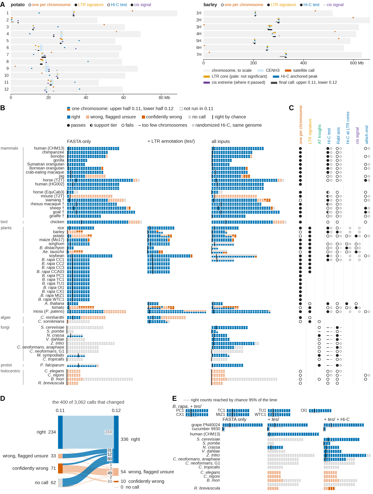
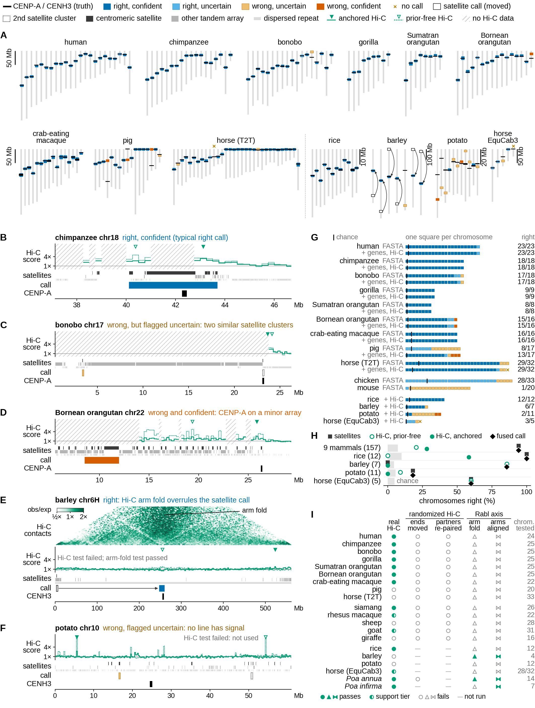
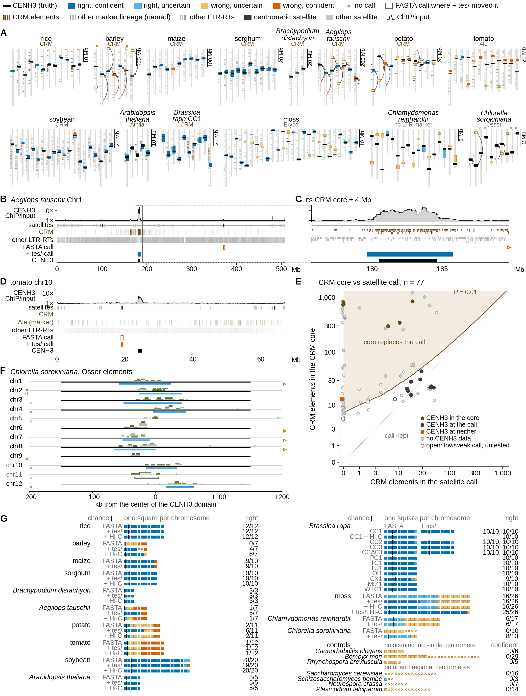

# Benchmarks

cenfuse was scored on 55 assemblies (56 genomes and libraries), from T2T mammals to fungi, against centromeres mapped
functionally on the same assembly. Every number on this page comes from one release rerun of cenfuse 0.14.0 on every
benchmark arm and on the 40 arms held out from 0.12 (260 runs, 2026-11-08), scored with the rules fixed before each benchmark
was first run; 0.14 changed no rule, and its calls equal 0.13.0's on all 260 runs ([section 13](#13-what-changed-from-013)).
Each run read a replay of the satellite engine on its arm's stored search (`--satellite-dir`); the engine's rules are
unchanged since 0.11. Two genomes whose CENH3 truth was on disk but never scored, an allotetraploid among them, are held out
from 0.14 and run in full, search included ([section 3](#held-out-from-014-an-allotetraploid-and-a-wild-potato)), and so are 13 tomatoes ([section 3](#held-out-from-014-thirteen-tomatoes)); the genomes held
out from the 0.12 rules are in [section 4](#held-out-from-the-012-rules). The scorer, the truth manifest and this page's tables are
in the repository ([benchmark/](../benchmark/README.md)). The overview pages of every genome are in the [gallery](gallery.md); how
each rule works is in [design.md](design.md).

## How calls are scored

- **Truth.** CENP-A CDRs (Logsdon et al. 2024: human CHM13 and five great apes) or CENP-A ChIP (crab-eating macaque,
  pig, horse; pig and horse from other animals); CENH3 ChIP-seq of the assembled line (rice, potato, barley, maize,
  *Brachypodium*, *Ae. tauschii*, soybean, *B. rapa*, tomato, moss, *Chlorella*) or of a related line (sorghum: line V9
  on the BTx623 assembly; *Arabidopsis*: Col-0 on Col-CC), CUT&Tag (*Chlamydomonas*), the published centromeres of two
  *B. rapa* accessions whose ChIP is too weak, the CenSat active arrays of HG002, the authors' CENP-A windows of
  chicken, the CENP-A minor-satellite array of mouse, and CEN/CENP-A/CenH3 coordinates of the fungi and *Plasmodium*.
  ChIP domains were called with one frozen rule (100-kb bins, ChIP/input, half-maximum run, ≥ 4×). The scores do not hang on
  its two numbers: on the 18 genomes whose truth it made and whose reads are on disk (60 release runs), 3× or 5× instead of 4×,
  or 50-kb bins (which move 167 of 186 domain ends), change no outcome on the chromosome-runs both rules give truth (604-624);
  they add or drop chromosomes whose ChIP sits near 4×, scored right less often (3×: 26 more chromosome-runs, 21 right; 5×: 20
  fewer, 16 of them right; v13 `bench/truth_sensitivity.py`, since 0.14).
- **Right**, as the frozen scorer rules it ([benchmark/score.py](../benchmark/score.py), manifest
  [benchmark/truth.tsv](../benchmark/truth.tsv)). Mammals with CENP-A truth, *Arabidopsis* and HG002 (a CenSat active array):
  the call overlaps the domain by at least 1 bp; the mammals without functional truth are scored by the same overlap with
  another satellite caller's locus (agreement, not truth). Chicken and mouse: overlap or touch (gap 0). Rice, potato, barley and
  EquCab3: within 4 Hi-C bins of the run, and without Hi-C 1 Mb (barley 8 Mb). Maize, *Brachypodium* and the CENH3 truths
  added since 0.8 (*B. rapa*, soybean, sorghum, *Ae. tauschii*, tomato, grape, cucumber; 0.14's *Ae. geniculata* and
  *S. verrucosum*): 1 Mb whatever the Hi-C bin (*Ae. tauschii*'s 2-Mb bins: half a bin). Moss, *Chlamydomonas*,
  *Chlorella*: 100 kb. Fungi and *Plasmodium*: 1 Hi-C bin of the run (10-50 kb), and 250 kb in an arm without Hi-C, a
  lenient rule for genomes whose centromeres span 1-100 kb ([future.md #37](future.md#37-scoring-rules-and-controls-to-tighten)).
  Holocentric genomes have no single centromere, so any confident call there is wrong.
- **Confident** = `high` or `medium`; `low` = cenfuse says it is unsure.
- **Chance.** A chromosome's chance of a right call by luck is (call + truth + 2 × tolerance) / chromosome length; P
  is the Poisson-binomial tail of the right count.
- **How close a right call is** (since 0.14, [future.md #37](future.md#37-scoring-rules-and-controls-to-tighten)). Overlap
  and tolerance rule a call right, however wide it is. Every right call of the real arms (the randomized-Hi-C controls left out),
  against its domain ([benchmark/precision.py](../benchmark/precision.py)). In the animals a call is the satellite array (or
  a large part of it), about ten times the CENP-A domain inside it: right says where the centromere is, to about half a
  megabase, not which part of the array holds the kinetochore (the CpG line's `cpg_kt_*` columns do, where it passes).

| truth | calls | right calls | median call width | median domain width | median midpoint distance (90th percentile) | midpoint inside the domain | median share of the call on the domain |
|---|---|---|---|---|---|---|---|
| animals: CENP-A, CenSat active array, minor satellite | all right | 768 | 3.65 Mb | 0.32 Mb | 0.44 Mb (1.66 Mb) | 44% | 15% |
| animals: CENP-A, CenSat active array, minor satellite | `high`, `medium` | 672 | 3.89 Mb | 0.30 Mb | 0.49 Mb (1.73 Mb) | 39% | 11% |
| plants and algae: CENH3 | all right | 815 | 2.39 Mb | 0.90 Mb | 0.34 Mb (1.56 Mb) | 53% | 26% |
| plants and algae: CENH3 | `high`, `medium` | 733 | 2.83 Mb | 0.90 Mb | 0.39 Mb (1.59 Mb) | 53% | 26% |
| fungi and *Plasmodium*: mapped centromeres | all right | 213 | 30 kb | 12 kb | 3 kb (26 kb) | 70% | 50% |
| fungi and *Plasmodium*: mapped centromeres | `high`, `medium` | 92 | 60 kb | 5 kb | 2 kb (21 kb) | 62% | 51% |

## Figures

New in 0.13 (from the 0.13 release):

- [Hi-C's two readouts test each other](img/benchmark_cis_trans.pdf) 
  *Two readouts of one Hi-C library find centromeres that no repeat marks, with no annotation. **A** tomato, all 12 chromosomes: the
  contact across each bin (purple) and the contact with the other chromosomes' cis extremes (blue) meet on CENH3 on 10 of 12, and a
  randomized library (gray) shows neither. **B** chr6: the contact map, the other chromosomes' trans contacts, CENH3 ChIP. **C** why
  chromosome ends are not read (schematic). **D** *Ae. tauschii* read with the ends kept: both readouts meet at the ends, off CENH3.
  **E** every Hi-C library against chance. **F** *C. neoformans* in G1: 12 of 14.*

New in 0.12 (from the 0.12 release):

- [The contact crossing the centromere](img/benchmark_cis.pdf) 
  *In tomato the two flanks of every centromere touch about twice as often as DNA at the same distance elsewhere. **A** all 12 tomato
  chromosomes: the cis profile, its randomized-Hi-C partner and simulated maps, CENH3, the LTR signature, the satellites and both
  releases' calls. **B** one chromosome's contact map. **C** maps piled up on CENH3 in tomato and potato, against random positions.
  **D** potato's dips. **E** every genome with Hi-C and truth against chance. **F** the profile around every centromere.*
- [One locus per chromosome](img/benchmark_one_per_chromosome.pdf) 
  *A centromere occurs once per chromosome, so the genome's N largest candidates cover nearly every chromosome when they are
  centromeres. **A-C** chicken, rice and tomato: every cluster of the centromeric families, the chance draws beside them. **D, E** GC troughs
  in *P. falciparum*, real and shuffled. **F** confident errors from the FASTA alone, 0.11 and 0.12. **G** every genome, both tests.*
- [What the tests add up to](img/benchmark_integration.pdf) 
  *When every line must pass a test in the genome at hand before it may act, more calls are right and fewer are confidently wrong.
  **A** potato and barley, every chromosome: each line's own locus, the final calls of 0.11 and 0.12, and CENH3. **B** every chromosome
  with truth, 0.11 above 0.12, for three input sets. **C** which test passes in which genome, beside its randomized-Hi-C partner. **D** the
  400 calls that changed. **E** the genomes held out from the 0.12 rules.*
- [Which LTR families mark centromeres](img/benchmark_ltr_signature.pdf) 
  *Families that pile up at one locus on the other chromosomes mark each chromosome's centromere, in any lineage: the family, not the
  lineage, is the unit of centromere targeting. **A** tomato, all 12 chromosomes: every Tekay element, the families learned from the other
  chromosomes, the cores, CENH3 and every tandem array. **B** one core, every element to size; **C** one element at base-pair scale, with
  its target-site duplication. **D** leave one chromosome out; **E** the test on chromosome 5. **F** per genome, the seed's enrichment
  against the share of cores on CENH3; **G** where the 10-fold level comes from (42 polyploids, no truth). **H** every genome with LTRs
  and truth, held-out ones included.*

From the 0.10.1 release ([what changed since](#13-what-changed-from-013) applies to these, with [0.11 to 0.12](#from-011-to-012)):

- [Mammals and Hi-C](img/benchmark_overview.pdf) 
  *9 T2T mammals with CENP-A truth; rice, barley, potato and horse EquCab3 with ChIP truth. **A** every chromosome
  with a mapped centromere: the call (box, colored by outcome) against CENP-A/CENH3 (black bar); arrows = barley calls
  moved by Hi-C. **B-F** one chromosome per kind of outcome. **G** every chromosome as one square, FASTA only vs all
  inputs. **H** each line alone vs the integrated call. **I** the Hi-C tests on real vs randomized Hi-C.*
- [Plants and algae](img/benchmark_plants.pdf) 
  *14 plant and algal species with CENH3 truth, FASTA only vs + `tes/` (+ Hi-C), and 7 genomes without a single
  centromere. **A** every chromosome run with `tes/`: CENH3, the calls, every element of the centromeric LTR lineage.
  **B, C** *Ae. tauschii* Chr1 placed by its CRM core. **D** the failure: tomato chr10. **E** every conflict between a
  CRM core and a satellite call. **F** *Chlorella*'s Osser insertions. **G** every chromosome as a square.*
- [Kinetochores from CpG methylation](img/benchmark_cpg.pdf) 
  *Primates with DiMeLo-seq CENP-A, curated CDRs or CENP-A ChIP, and HG002. **A, B** a typical bonobo centromere. **C**
  widths of call, kinetochore and CENP-A domain. **D** every ape kinetochore on its CENP-A domain. **E** HG002 from ONT
  and PacBio HiFi. **F** the CpG test on real vs rotated methylation. **G** reads thinned to 1/16.*
- [Hi-C in small genomes](img/benchmark_hic.pdf) 
  *Where nuclei cluster their centromeres, Hi-C contacts alone find every centromere. **A-D** budding yeast: contacts
  between chromosomes, real and shuffled. **E** every chromosome of four genomes with their centromeres and cenfuse's
  calls. **F** clustered centromeres vs territories. **G** chromosomes whose centromere is found.*
- [The Rabl axis in trans](img/benchmark_hic2.pdf) 
  *Where a nucleus holds its centromeres at one pole, arms of different chromosomes align by distance from the
  centromere. **A** *C. neoformans* in anaphase vs G1 vs randomized. **B** the Rabl polarity (schematic). **C, D** one
  and all 14 chromosomes. **E** every axis test of the benchmark vs chance. **F** what cenfuse does with it.*

## 1. Every genome

Right / chromosomes with truth (confidently wrong in brackets), for each input set benchmarked; "all inputs" names the
richest set where it differs from the columns before it. Chance = the right calls expected by luck (FASTA only).

| genome | truth | FASTA only | + genes | + `tes/` | + Hi-C | all inputs | chance (FASTA only) |
|---|---|---|---|---|---|---|---|
| **mammals** | | | | | | | |
| human (CHM13) | CENP-A | 23/23 | 23/23 |  |  | 23/23 (genes, Hi-C) | 0.8 |
| chimpanzee | CENP-A | 18/18 | 18/18 |  |  | 18/18 (genes, Hi-C) | 0.5 |
| bonobo | CENP-A | 17/18 | 17/18 |  |  | 17/18 (genes, Hi-C) | 0.3 |
| gorilla | CENP-A | 9/9 | 9/9 |  |  | 9/9 (genes, Hi-C) | 0.3 |
| Sumatran orangutan | CENP-A | 8/8 | 8/8 |  |  | 8/8 (genes, Hi-C) | 0.3 |
| Bornean orangutan | CENP-A | 15/16 (1) | 15/16 (1) |  |  | 15/16 (1) (genes, Hi-C) | 0.7 |
| crab-eating macaque | CENP-A | 16/16 | 16/16 |  |  | 16/16 (genes, Hi-C) | 1.8 |
| pig | CENP-A | 8/17 | 13/17 (3) |  |  | 13/17 (3) (genes, Hi-C) | 1.8 |
| horse (T2T) | CENP-A | 29/32 | 29/32 |  |  | 29/32 (genes, Hi-C) | 4.0 |
| HG002 (diploid human) | CenSat active array | 46/46 |  |  |  | 46/46 (ONT CpG methylation) | 2.6 |
| horse (EquCab3) | CENP-A | 3/5 |  |  | 3/5 |  | 0.1 |
| mouse (T2T) | minor-satellite array | 1/20 |  |  | 1/20 |  | 1.4 |
| **mammals (no CENP-A data)** | | | | | | | |
| siamang | none (satellome locus) | 18/26 | 19/26 |  |  | 20/26 (2) (genes, Hi-C) | 1.0 |
| rhesus macaque | none (satellome locus) | 22/22 | 22/22 |  |  | 22/22 (genes, Hi-C) | 4.2 |
| sheep | none (satellome locus) | 26/28 (1) | 26/28 (1) |  |  | 26/28 (1) (genes, Hi-C) | 3.0 |
| goat | none (satellome locus) | 30/30 | 30/30 |  |  | 30/30 (genes, Hi-C) | 4.2 |
| giraffe | none (satellome locus) | 15/15 | 15/15 |  |  | 15/15 (genes, Hi-C) | 0.3 |
| **birds** | | | | | | | |
| chicken | CENP-A windows | 27/33 |  |  | 27/33 |  | 6.4 |
| **plants** | | | | | | | |
| rice | CENH3 | 12/12 | 12/12 | 12/12 | 12/12 | 12/12 (`tes/`, genes, Hi-C) | 1.2 |
| barley | CENH3 | 0/7 | 0/7 | 7/7 | 6/7 | 7/7 (`tes/`, Hi-C) | 0.2 |
| potato | CENH3 | 2/11 | 4/11 (2) | 10/11 (1) | 2/11 | 9/11 (1) (`tes/`, genes, Hi-C) | 0.6 |
| maize (Mo17) | CENH3 | 9/10 (1) | 9/10 (1) | 9/10 (1) |  | 9/10 (1) (`tes/`, genes) | 0.2 |
| sorghum | CENH3 | 10/10 |  | 10/10 | 10/10 | 10/10 (`tes/`, Hi-C) | 1.4 |
| *Brachypodium distachyon* | CENH3 | 3/3 |  | 3/3 | 3/3 | 3/3 (`tes/`, Hi-C) | 0.2 |
| *Aegilops tauschii* | CENH3 | 1/7 |  | 5/7 (2) | 1/7 | 5/7 (2) (`tes/`, Hi-C) | 0.1 |
| soybean | CENH3 | 20/20 |  | 19/20 (1) | 20/20 | 19/20 (1) (`tes/`, Hi-C) | 2.2 |
| *Brassica rapa* CC1 | CENH3 | 10/10 |  | 10/10 | 10/10 | 10/10 (`tes/`, Hi-C) | 2.4 |
| *Brassica rapa* CC2 | CENH3 | 10/10 |  | 10/10 |  |  | 2.4 |
| *Brassica rapa* CC3 | CENH3 | 10/10 |  | 10/10 |  |  | 2.5 |
| *Brassica rapa* CCA03 | CENH3 | 10/10 |  | 10/10 |  |  | 2.5 |
| *Brassica rapa* PC1 | CENH3 | 10/10 |  |  |  |  | 2.4 |
| *Brassica rapa* TC1 | CENH3 | 10/10 |  |  |  |  | 2.6 |
| *Brassica rapa* TU1 | CENH3 (published domains) | 10/10 |  |  |  |  | 2.3 |
| *Brassica rapa* OI1 | CENH3 | 10/10 |  |  |  |  | 2.5 |
| *Brassica rapa* CX1 | CENH3 (published domains) | 10/10 |  |  |  |  | 2.4 |
| *Brassica rapa* MIZ1 | CENH3 | 10/10 |  |  |  |  | 2.5 |
| *Brassica rapa* WTC1 | CENH3 | 10/10 |  |  |  |  | 2.3 |
| *Arabidopsis thaliana* (Col-CC) | CENH3 | 5/5 |  | 5/5 | 5/5 | 5/5 (`tes/`, ONT methylation) | 0.8 |
| tomato | CENH3 | 1/12 |  | 6/12 (2) | 10/12 | 10/12 (`tes/`, Hi-C) | 0.9 |
| moss (*Physcomitrium patens*) | CENH3 | 16/26 |  | 26/26 | 21/26 | 26/26 (`tes/`, Hi-C) | 1.4 |
| **algae** | | | | | | | |
| *Chlamydomonas reinhardtii* | CENH3 | 6/17 |  | 6/17 |  |  | 2.6 |
| *Chlorella sorokiniana* | CENH3 | 0/10 |  | 9/10 |  |  | 0.2 |
| **fungi** | | | | | | | |
| *Saccharomyces cerevisiae* | CEN / CENP-A / CenH3 | 0/16 |  |  | 16/16 |  | 0.0 |
| *Schizosaccharomyces pombe* | CEN / CENP-A / CenH3 | 0/3 |  |  | 3/3 |  | 0.0 |
| *Neurospora crassa* | CEN / CENP-A / CenH3 | 7/7 |  |  | 7/7 |  | 1.7 |
| **fungi (held out)** | | | | | | | |
| *Verticillium dahliae* | CEN / CENP-A / CenH3 | 0/8 |  |  | 8/8 |  | 0.0 |
| *Zymoseptoria tritici* | CEN / CENP-A / CenH3 | 0/21 |  |  | 19/21 |  | 0.0 |
| *Cryptococcus neoformans* (anaphase Hi-C) | CEN / CENP-A / CenH3 | 0/14 |  |  | 13/14 |  | 0.0 |
| *Cryptococcus neoformans* (G1 Hi-C) | CEN / CENP-A / CenH3 | 0/14 |  |  | 12/14 |  | 0.0 |
| *Malassezia sympodialis* | CEN / CENP-A / CenH3 | 8/8 |  |  | 8/8 |  | 5.0 |
| *Candida tropicalis* | CEN / CENP-A / CenH3 | 0/7 |  |  | 0/7 |  | 0.0 |
| **protists** | | | | | | | |
| *Plasmodium falciparum* | CEN / CENP-A / CenH3 | 13/14 |  |  | 14/14 |  | 5.1 |
| **nematodes (holocentric control)** | | | | | | | |
| *Caenorhabditis elegans* | none (holocentric) | 0 confident / 6 |  |  | 0 confident / 6 |  |  |
| *Caenorhabditis nigoni* | none (holocentric) | 0 confident / 6 |  |  | 0 confident / 6 |  |  |
| **insects (holocentric control)** | | | | | | | |
| *Bombyx mori* | none (holocentric) | 0 confident / 29 |  |  | 0 confident / 29 |  |  |
| **plants (holocentric control)** | | | | | | | |
| *Rhynchospora breviuscula* | none (holocentric) | 0 confident / 5 |  |  | 0 confident / 5 |  |  |

## 2. Satellite centromeres

### T2T mammals

| genome | truth | FASTA only | + genes + Hi-C | chromosomes passing the Hi-C test |
|---|---|---|---|---|
| human (CHM13) | CENP-A | 23/23 | 23/23 | 24 |
| chimpanzee | CENP-A | 18/18 | 18/18 | 25 |
| bonobo | CENP-A | 17/18 | 17/18 | 25 |
| gorilla | CENP-A | 9/9 | 9/9 | 25 |
| Sumatran orangutan | CENP-A | 8/8 | 8/8 | 25 |
| Bornean orangutan | CENP-A | 15/16 (1) | 15/16 (1) | 25 |
| crab-eating macaque | CENP-A | 16/16 | 16/16 | 22 |
| pig | CENP-A | 8/17 | 13/17 (3) | 0 |
| horse (T2T) | CENP-A | 29/32 | 29/32 | 0 |
| siamang | none (satellome locus) | 18/26 | 20/26 (2) | 26 |
| rhesus macaque | none (satellome locus) | 22/22 | 22/22 | 0 (support tier on 22) |
| sheep | none (satellome locus) | 26/28 (1) | 26/28 (1) | 0 |
| goat | none (satellome locus) | 30/30 | 30/30 | 0 (support tier on 31) |
| giraffe | none (satellome locus) | 15/15 | 15/15 | 0 |

- **Totals** (9 genomes with CENP-A, 157 chromosomes): FASTA only 143 right, 1 confidently wrong, 13 `low` or no call;
  with genes and Hi-C 148, 4, 5. `high` calls were right 133 of 136 times.
- **Without functional truth** (siamang, rhesus, sheep, goat, giraffe; 121 chromosomes): the calls agree with an
  independent satellite caller (the satellome locus) on 111 from the FASTA, 113 with genes and Hi-C.
- **Pig, FASTA only (8/17):** the satellite families split so that no family dominates genome-wide, and the honesty cap
  makes every call `low`; 5 of them sit 0.6-2.0 Mb from CENP-A at the acrocentric ends. With genes and Hi-C: 13/17.

| every miss (all inputs) | call | why |
|---|---|---|
| pig CM000817.6, CM000822.6, CM000828.6 | wrong, confident | the truth is weak ChIP from other pigs, with no centromeric array within 1 Mb of its maximum (5.4-5.6×); on all three the ChIP's second peak (3.0-4.4×) lies inside the call, and the published karyotype agrees with the call on two (chr11, chr17). Second peaks ≥ 3× also occur on 3 of the 13 right pig calls, so this is evidence, not proof |
| pig CM001155.3 | wrong, `low` | the same |
| Bornean orangutan CM054652.2 | wrong, `high` | CENP-A sits on 4 small alpha-satellite arrays (73 kb in cenfuse's search), 14 Mb from the 3.4-Mb array cluster cenfuse called; Hi-C points weakly to the CENP-A site but cannot move a `high` call. The truth may be haplotype-specific: the CenSat annotation marks the called array as active, and the CDR region was redrawn in 2025 |
| bonobo CM055489.2 | wrong, `low` | the true array is the reported competing cluster |
| horse CM128059.1 (chr11) | no call | satellite-free centromere; horse Hi-C fails its test, so nothing can place it |
| horse CM128050.1, CM128070.1 | wrong, `low` | |

### Plants and other genomes with satellite centromeres

- **Rice** (T2T-NIP): 12/12 `high` from the FASTA; Hi-C passes its test on all 12 and changes nothing.
- ***B. rapa*** (11 T2T accessions): 110/110 from the FASTA. CX1 A05, the one miss until 0.11 (`low`, 2.8 Mb off), is now
  right and `high` (since 0.11).
- **Soybean** X26, **sorghum** BTx623, ***Brachypodium*** Bd21 (CENH3 truth on 3 of 5 chromosomes), ***Arabidopsis***
  Col-CC: 20/20, 10/10, 3/3, 5/5 from the FASTA.
- **Maize** Mo17 (T2T): the 180-bp knob repeat is the most abundant satellite family (23.6 Mb, 20.6 Mb on chr8) and
  gets the role `interstitial` (knobs and other blocks); CentC is centromeric on all 10 chromosomes and no call holds
  knob repeat. 9/10 right (7 overlap CENH3). The
  miss, chr5 (`high`), has CENH3 on satellite-free DNA 2 Mb from the CentC array.
- **HG002** (diploid human T2T, 46 chromosomes): 46/46 calls on the CenSat active array (45 `high`).
- **Chicken** GGswu (40 chromosomes; truth on 33): 27/33 on the CENP-A windows (chance 6.4, P 4e-22), 2 more within 1
  Mb; every call `low`, because no satellite family dominates (chicken centromeres use chromosome-specific satellites,
  and chr5, chr27 and Z have none). Confidence is conservative here: no call is confidently wrong.
- **Mouse** (T2T, all 20 chromosomes acrocentric): both the pericentric major satellite (162 Mb) and the CENP-A
  minor satellite (16.5 Mb) mark the centromeric end. All 20 calls sit there, on the major-satellite block, within
  45 kb of the minor satellite (1/20 overlapping it), all `low`, with the minor satellite reported as the alternative
  on 20/20. No mappable DNA separates the two arrays, so Hi-C cannot choose (`hic_alt_ambiguous`).
- **Horse EquCab3** (older assembly, CENP-A ChIP on 5 chromosomes): 3/5 right, all `low`; chr11 and chr31 have no call.

### One locus per chromosome

A chromosome has one centromere; anything else falls roughly in proportion to chromosome length. So the N largest clusters of the
families called centromeric (N = the number of chromosomes) should cover nearly every chromosome if they are centromeres, and far
fewer if they are not ([design.md](design.md#one-locus-per-chromosome-a-test-of-the-satellite-line-satkaryotypepy)). The test reads
the FASTA alone and asks nothing about any one locus:

| genome | chromosomes | covered by the N largest clusters | by chance | P | test | FASTA only, 0.12 | FASTA only, 0.13 |
|---|---|---|---|---|---|---|---|
| human (CHM13) | 24 | 22 | 15 | 0.0001 | pass | 23/23 | 23/23 |
| chimpanzee | 25 | 25 | 15 | 0.0001 | pass | 18/18 | 18/18 |
| bonobo | 25 | 20 | 15 | 0.0033 | pass | 17/18 | 17/18 |
| gorilla | 25 | 24 | 15 | 0.0001 | pass | 9/9 | 9/9 |
| Sumatran orangutan | 25 | 23 | 15 | 0.0001 | pass | 8/8 | 8/8 |
| Bornean orangutan | 25 | 23 | 15 | 0.0001 | pass | 15/16 (1) | 15/16 (1) |
| crab-eating macaque | 22 | 22 | 14 | 0.0001 | pass | 16/16 | 16/16 |
| pig | 20 | 20 | 12 | 0.0001 | pass | 8/17 | 8/17 |
| horse (T2T) | 33 | 31 | 20 | 0.0001 | pass | 29/32 | 29/32 |
| HG002 (diploid human) | 46 | 44 | 28 | 0.0001 | pass | 46/46 | 46/46 |
| horse (EquCab3) | 32 | 26 | 19 | 0.0002 | pass | 3/5 | 3/5 |
| mouse (T2T) | 20 | 20 | 13 | 0.0001 | pass | 1/20 | 1/20 |
| siamang | 26 | 18 | 16 | 0.2 | fail | 18/26 | 18/26 |
| rhesus macaque | 22 | 22 | 14 | 0.0001 | pass | 22/22 | 22/22 |
| sheep | 28 | 22 | 16 | 0.0015 | pass | 26/28 (1) | 26/28 (1) |
| goat | 31 | 30 | 19 | 0.0001 | pass | 30/30 | 30/30 |
| giraffe | 16 | 15 | 10 | 0.0003 | pass | 15/15 | 15/15 |
| chicken | 40 | 36 | 17 | 0.0001 | pass | 27/33 | 27/33 |
| rice | 12 | 12 | 8 | 0.0001 | pass | 12/12 | 12/12 |
| barley | 7 | 4 | 5 | 0.91 | fail | 0/7 | 0/7 |
| potato | 12 | 7 | 8 | 0.87 | fail | 2/11 | 2/11 |
| maize (Mo17) | 10 | 9 | 6 | 0.014 | pass | 9/10 (1) | 9/10 (1) |
| sorghum | 10 | 10 | 7 | 0.0003 | pass | 10/10 | 10/10 |
| *Brachypodium distachyon* | 5 | 5 | 3 | 0.03 | pass | 3/3 | 3/3 |
| *Aegilops tauschii* | 7 | 4 | 5 | 0.91 | fail | 1/7 | 1/7 |
| soybean | 20 | 19 | 13 | 0.0001 | pass | 20/20 | 20/20 |
| *Brassica rapa* CC1 | 10 | 9 | 6 | 0.013 | pass | 10/10 | 10/10 |
| *Brassica rapa* CC2 | 10 | 9 | 6 | 0.014 | pass | 10/10 | 10/10 |
| *Brassica rapa* CC3 | 10 | 10 | 6 | 0.0004 | pass | 10/10 | 10/10 |
| *Brassica rapa* CCA03 | 10 | 9 | 6 | 0.014 | pass | 10/10 | 10/10 |
| *Brassica rapa* PC1 | 10 | 10 | 6 | 0.0006 | pass | 10/10 | 10/10 |
| *Brassica rapa* TC1 | 10 | 9 | 6 | 0.014 | pass | 10/10 | 10/10 |
| *Brassica rapa* TU1 | 10 | 10 | 6 | 0.0004 | pass | 10/10 | 10/10 |
| *Brassica rapa* OI1 | 10 | 10 | 6 | 0.0004 | pass | 10/10 | 10/10 |
| *Brassica rapa* CX1 | 10 | 10 | 6 | 0.0005 | pass | 10/10 | 10/10 |
| *Brassica rapa* MIZ1 | 10 | 10 | 6 | 0.0005 | pass | 10/10 | 10/10 |
| *Brassica rapa* WTC1 | 10 | 10 | 6 | 0.0004 | pass | 10/10 | 10/10 |
| *Arabidopsis thaliana* (Col-CC) | 5 | 5 | 3 | 0.038 | pass | 5/5 | 5/5 |
| tomato | 12 | 9 | 8 | 0.24 | fail | 1/12 | 1/12 |
| moss (*Physcomitrium patens*) | 26 | 20 | 16 | 0.025 | pass | 16/26 | 16/26 |
| *Chlamydomonas reinhardtii* | 17 | 15 | 11 | 0.0006 | pass | 6/17 | 6/17 |
| *Chlorella sorokiniana* | 12 | 1 | 1 | 1 | fail | 0/10 | 0/10 |
| *Saccharomyces cerevisiae* | 17 | no centromeric family | | | none | 0/16 | 0/16 |
| *Schizosaccharomyces pombe* | 3 | no centromeric family | | | none | 0/3 | 0/3 |
| *Neurospora crassa* | 7 | no centromeric family | | | none | 7/7 | 7/7 |
| *Verticillium dahliae* | 8 | no centromeric family | | | none | 0/8 | 0/8 |
| *Zymoseptoria tritici* | 21 | no centromeric family | | | none | 0/21 | 0/21 |
| *Cryptococcus neoformans* (anaphase Hi-C) | 14 | no centromeric family | | | none | 0/14 | 0/14 |
| *Cryptococcus neoformans* (G1 Hi-C) | 14 | no centromeric family | | | none | 0/14 | 0/14 |
| *Malassezia sympodialis* | 8 | no centromeric family | | | none | 8/8 | 8/8 |
| *Candida tropicalis* | 7 | no centromeric family | | | none | 0/7 | 0/7 |
| *Plasmodium falciparum* | 14 | no centromeric family | | | none | 13/14 | 13/14 |
| *Caenorhabditis elegans* | 6 | 5 | 4 | 0.24 | fail | 0 confident / 6 | 0 confident / 6 |
| *Caenorhabditis nigoni* | 6 | 4 | 4 | 0.73 | fail | 0 confident / 6 | 0 confident / 6 |
| *Bombyx mori* | 29 | 13 | 11 | 0.13 | fail | 0 confident / 29 | 0 confident / 29 |
| *Rhynchospora breviuscula* | 5 | 4 | 3 | 0.41 | fail | 0 confident / 5 | 0 confident / 5 |

- **Every genome with satellite centromeres passes but one**, down to chicken's chromosome-specific satellites (36 of 40 chromosomes
  covered, 17 by chance) and mouse, whose two satellites both sit at each centromeric end. The exception is the siamang (18 of 26,
  P 0.2): on 8 chromosomes its alpha-satellite arrays fall into two clusters more than 500 kb apart.
- **Tomato, potato, barley and *Ae. tauschii* fail** (P 0.24-0.91): their centromeres are satellite-free or sit beside the satellite.
  These four genomes held 16 of the FASTA-only confident errors of 0.11; their satellite calls are now `low` unless an LTR core agrees
  with them, and from the FASTA alone they make none.
- **The holocentric genomes fail too** (P 0.13-0.73), as they should. The siamang's failure costs it confidence, not calls: its
  satellite calls without genes and Hi-C fall from 13 `high` to `low` (it has no CENP-A data; its calls are compared with another
  satellite caller).
- **Passing says little about a single call.** *Chlamydomonas* (LINE-cluster centromeres) and moss (Bryco clusters) pass on their
  satellites; their satellite calls stay `low`, because no family dominates.
- **Over all 56 genomes**, the FASTA-only confident errors fall from 19 to 3; the 3 left (maize, sheep, Bornean orangutan) are in genomes
  that pass.
- **Polyploids** (no truth, 106 allotetraploids): homoeologous chromosomes put their satellite calls (0.11's, stored) at the same relative position
  more often in genomes that pass (mean 0.62, 70 genomes) than in those that fail (0.43, 35; Mann-Whitney P 0.001; `bench/poly_one.py`).

## 3. Retrotransposon centromeres (`tes/`)

`tes/` = LTRquest annotations, each made with `ltrquest --genome G --max-rounds 1 --threads T --detect-args
ltr-timeout=300 --run-sdust --reboundary` (the README's recipe adds `--proteins` and `--no-plots`). cenfuse learns the signature in
each genome: the most specific centromere-concentrated family or lineage seeds it, and each chromosome's core comes from the families
enriched in the other chromosomes' cores ([design.md](design.md#ltr-retrotransposons-tes-satsignaturepy)). Right / chromosomes
(confidently wrong):

| genome | signature | fold in its cores | decides? | FASTA only | + `tes/`, 0.12 | + `tes/`, 0.13 | + `tes/` + Hi-C, 0.13 |
|---|---|---|---|---|---|---|---|
| rice | CRM | 15.8 | yes | 12/12 | 12/12 | 12/12 | 12/12 |
| barley | CRM | 7.4 | yes | 0/7 | 7/7 | 7/7 | 7/7 |
| potato | CRM | 13.3 | yes | 2/11 | 10/11 (1) | 10/11 (1) | 9/11 (1) |
| maize (Mo17) | CRM | 64.9 | yes | 9/10 (1) | 9/10 (1) | 9/10 (1) |  |
| sorghum | CRM | 18.2 | yes | 10/10 | 10/10 | 10/10 | 10/10 |
| *Brachypodium distachyon* | CRM | 27.5 | yes | 3/3 | 3/3 | 3/3 | 3/3 |
| *Aegilops tauschii* | CRM | 74.5 | yes | 1/7 | 5/7 (2) | 5/7 (2) | 5/7 (2) |
| soybean | CRM | 21.8 | yes | 20/20 | 19/20 (1) | 19/20 (1) | 19/20 (1) |
| *Brassica rapa* CC1 | CRM | 38 | yes | 10/10 | 10/10 | 10/10 | 10/10 |
| *Brassica rapa* CC2 | CRM | 37 | yes | 10/10 | 10/10 | 10/10 |  |
| *Brassica rapa* CC3 | CRM | 7.3 | yes | 10/10 | 10/10 | 10/10 |  |
| *Brassica rapa* CCA03 | CRM | 30.3 | yes | 10/10 | 10/10 | 10/10 |  |
| *Arabidopsis thaliana* (Col-CC) | Athila | 13.3 | no: a dominant satellite falls one per chromosome | 5/5 | 5/5 | 5/5 | 5/5 |
| tomato | Tekay | 32.7 | yes | 1/12 | 6/12 (2) | 6/12 (2) | 10/12 |
| moss (*Physcomitrium patens*) | Bryco | 58.8 | yes | 16/26 | 26/26 | 26/26 | 26/26 |
| *Chlamydomonas reinhardtii* | . | . | none | 6/17 | 6/17 | 6/17 |  |
| *Chlorella sorokiniana* | Osser | 78.9 | yes | 0/10 | 9/10 | 9/10 |  |

- **Any lineage can mark centromeres, and the family says it better than the lineage.** Moss's Bryco (58.8-fold), *Chlorella*'s Osser
  (78.9-fold) and a single Tekay family in tomato (32.7-fold; 308 of the lineage's 11,657 elements, 1 in 38) now decide, as CRM does in the
  grasses. With `tes/` alone: moss 16 → 26/26, barley 4 → 7/7, potato 6 → 10/11, *Chlorella* 8 → 9/10, tomato 1 → 6/12.
- ***Arabidopsis*:** Athila concentrates beside the centromeres (13.3-fold): its cores flank the CENH3 domain, 0.46-1.38 Mb away, on all
  5 chromosomes. CEN180 passes the one-per-chromosome test, so Athila only flags and the satellite calls stand (5/5); had Athila decided,
  it would have placed all 5 beside the centromere.
- ***Ae. tauschii*:** satellite arrays lie beside CRM cores that hold CENH3 on all 7 chromosomes; 5 calls move onto the cores; Chr5 and
  Chr7 stay at a core's edge, 1.3 and 3.1 Mb from CENH3, and are confidently wrong (`high` and `medium` with `tes/`; both `medium`
  with Hi-C too).
- **The head-to-head test still protects right satellite calls:** in *B. rapa* A09 and soybean chr1/chr6 the densest window of a broad
  CRM plateau lay off CENH3, which sat on the satellite.
- **Tomato** with `tes/` alone: the Tekay signature has significant cores on all 12 chromosomes, 7 on CENH3. Two of the 5 misses stay
  `medium` (CM175074.1, CM175078.1): nothing in the LTR line tells them from the right ones ([future.md](future.md#27-wrong-ltr-cores-that-look-right)).
  With Hi-C, the cis signal places 10 of 12 and none is confidently wrong (section 4).
- **Controls:** on 157 annotations with element positions shuffled within chromosomes, no family or lineage qualifies as a seed. The
  signature does not hang on its internal choices: 152-155 of 172 right cores over 1-4 recruitment rounds, P from 1e-4 to 1e-2 and
  3-10 elements.

**The annotation matters** (measured on 0.11, the CRM line alone). The decisive CRM test needs CRM to concentrate on most chromosomes.
Right calls with each annotator, and with LTRquest's elements thinned at random (TE line alone: right / cores):

| genome | annotation | TE line alone | calls right (confidently wrong) |
|---|---|---|---|
| rice | LTRquest | 8/8 | 12/12 (0) |
| rice | EDTA intact + TEsorter; DANTE_LTR | 4/4; 3/8 | 12/12 (0) |
| rice | LTRquest at 50 / 25 / 10% | 3/3, 1/1, 1/1 | 12/12 (0) |
| potato | LTRquest | 6/7 | 6/11 (2) |
| potato | EDTA + TEsorter; DANTE_LTR; LTRquest at 50% | 2/2; 1/1; 3/3 | 2/11 (2) |
| maize | LTRquest, and at 50 / 25 / 10% | 10/10, 10/10, 10/10, 8/8 | 9/10 (1) |
| moss | LTRquest; at 50% | 25/25; 22/22 | 16/26 (0) |

Potato's 214 LTRquest CRM elements give exactly a majority of chromosomes; any less sensitive annotation loses the
gain from `tes/`. Every CRM core short of a majority still lay on CENH3 (24/24 in rice, potato, maize and
*Brachypodium*).

### Held out from 0.14: an allotetraploid and a wild potato

Two genomes whose CENH3 truth was on disk but scored by no release, held out from 0.14 (its plan named them, and what it expected
of them, before any of their runs): *Aegilops geniculata* (UUMM allotetraploid, 14 chromosomes, 7.9 Gb, GCA_053567775.1; CENH3 ChIP of
Yunusbaev et al. 2026 on the same assembly, their Table S2 at Mb resolution; cenrep, cenfuse's predecessor, used it to shape two LTR
rules, so it is held out from 0.14's changes, not from cenfuse's development) and *Solanum verrucosum* (a diploid wild potato, 12
chromosomes, 0.7 Gb, GCA_031230405.1; CENH3 ChIP SRR18548893 and SRR18548892 by the frozen rule, with WGS of another accession,
SRR5349572, standing in for the input that was never deposited). Both were run in full, search included, from the FASTA; the `tes/`
arm (LTRquest annotations of the cenrep batch) reuses the FASTA arm's search. Scored within 1 Mb. 0.14's calls equal 0.13's on all
four arms (every table of the four arms is identical, cell by cell).

| genome | inputs | right / chromosomes | right `high` / `medium` / `low` | confidently wrong | chance expected | P |
|---|---|---|---|---|---|---|
| *Ae. geniculata* | FASTA | 0/14 | 0 / 0 / 0 | 0 | 0.21 | 1 |
| *Ae. geniculata* | FASTA, `tes/` | 13/14 | 0 / 13 / 0 | 1 | 0.33 | 7.6e-21 |
| *S. verrucosum* | FASTA | 5/12 | 0 / 0 / 5 | 0 | 0.73 | 0.00043 |
| *S. verrucosum* | FASTA, `tes/` | 8/12 | 3 / 4 / 1 | 1 | 0.72 | 6.1e-08 |

- ***Ae. geniculata* from the FASTA:** its centromeric satellites fail the one-per-chromosome test (9 of 14 chromosomes hold the 14
  largest clusters, null 9, P 0.67), so every call stays `low`, and all 14 are wrong: they lie on other arrays, 6-395 Mb from CENH3.
  The rule that a failed test leaves no confident call held on a genome it was not made on.
- ***Ae. geniculata* with `tes/`:** a CRM signature (38.1-fold in its cores, significant cores on 14 of 14 chromosomes) decides and
  rejects the satellite families that lie away from its cores, the FASTA arm's 86-bp family among them (away on 11 of 12). The
  centromeric family becomes a 1,216-bp family made of chains of partial copies of a longer repeat (`partial_chain`), whose arrays
  lie in the cores (`te_concordant`): 13 of 14 right, all `medium` (a chain call is never `high`). The one confident error, chr05U
  (167.1-175.2 Mb, 2.1 Mb off), lies in the right part of a 9.3-Mb CRM core (164.5-173.9 Mb) whose left edge reaches CENH3
  (160-165 Mb): the pattern of [future.md #45](future.md#45-confident-calls-at-the-edge-of-a-wide-ltr-core), on a held-out genome.
- ***S. verrucosum* from the FASTA:** the test fails too (9/12, P 0.24): 5 of 12 right, all `low`. **With `tes/`** (a CRM signature,
  42-fold, decisive): 8 of 12 right, 7 of them confident (3 `high`, 4 `medium`), and one confident error, chr06 (`medium`, 1.4 Mb
  off), where the CRM core replaced a weak satellite array beside it (`weak_satellite_beside_core`). Two right satellite calls were
  lost to thin CRM cores of 2 and 4 elements (chr10, chr12, `weak_core`, `low`): the 0.12 rule that a thin decisive core takes a
  chromosome whose satellite failed its test costs right calls on a held-out genome
  ([future.md #36](future.md#36-no-held-out-test-of-the-013-rules)).
- **Earlier.** The satellite batch of cenfuse 0.10.1 (development data there, its docs since rewritten) placed 10 of 14 *Ae. geniculata*
  centromeres and 7 of 11 *S. verrucosum* ones within 1 Mb, with its own processing of the same ChIP; 0.14 with `tes/` places 13 of 14
  and 8 of 12.
- **Truth caveats.** *Ae. geniculata*'s domains have Mb resolution. *S. verrucosum*'s input comes from another accession, and its
  chr04 holds two CENH3 peaks of nearly equal height (28.4 and 27.3-fold in 50-kb bins); the frozen rule takes the one at 23.2-23.5 Mb.
- **Cost of a fresh run** (search included; GNU time's maximum counts the largest process only): *Ae. geniculata* 64 min at 32
  threads, 17.5 GB (the search 60 min: seeds 3, families 13, annotate 38); *S. verrucosum* 16 min at 16 threads, 3.2 GB. Adding
  `tes/` to the finished run (classify onward): 12 and 1.4 min.

### Held out from 0.14: thirteen tomatoes

Thirteen tomatoes held out from 0.14, named with their truth before any of their runs: the telomere-to-telomere assemblies of Shi et al. 2026
(BioProject PRJNA1201608; 12 chromosomes each, 0.8-1.2 Gb), wild species from every clade of the genus and three cultivated lines. Truth: the CENH3
centromeres of their Supplementary Table 8 for the 11 accessions with deposited CENH3 ChIP, and for the two with ChIP but no row there (LA2093, TS-9) the
frozen ChIP rule. Left out when the set was named: Heinz 1706 (the benchmark's own tomato), six accessions whose centromeres were published without
deposited ChIP, and two without an assembly. Each was run from the FASTA, search included, and with `tes/` (LTRquest, the benchmark tomato's command).
Scored within 1 Mb. They are one genus, and three are the species of the benchmark's tomato, so they are 13 tests of one lineage's centromeres, not of 13
lineages.

| accession | truth | FASTA: right | `high` / `medium` / `low` | confidently wrong | P | with `tes/`: right | `high` / `medium` / `low` | confidently wrong | P |
|---|---|---|---|---|---|---|---|---|---|
| *S. juglandifolium* LA2134 | Table 8 | 1/12 | 0 / 0 / 1 | 0 | 0.64 | 1/12 | 0 / 0 / 1 | 0 | 0.63 |
| *S. lycopersicoides* LA2951 | Table 8 | 4/12 | 0 / 0 / 4 | 0 | 0.0051 | 8/12 | 1 / 5 / 2 | 3 | 8.5e-08 |
| *S. habrochaites* LA1777 | Table 8 | 0/12 | 0 / 0 / 0 | 0 | 1 | 6/12 | 0 / 4 / 2 | 1 | 3.7e-05 |
| *S. chilense* LA0458 | Table 8 | 2/12 | 0 / 0 / 2 | 0 | 0.21 | 2/12 | 1 / 0 / 1 | 0 | 0.21 |
| *S. corneliomulleri* LA0103 | Table 8 | 1/12 | 0 / 0 / 1 | 0 | 0.62 | 5/12 | 0 / 5 / 0 | 0 | 0.0012 |
| *S. peruvianum* LA0111 | Table 8 | 1/12 | 0 / 0 / 1 | 0 | 0.5 | 4/12 | 0 / 3 / 1 | 1 | 0.004 |
| *S. huaylasense* LA1982 | Table 8 | 1/12 | 0 / 0 / 1 | 0 | 0.58 | 8/12 | 0 / 7 / 1 | 0 | 8.8e-08 |
| *S. chmielewskii* LA1028 | Table 8 | 1/12 | 0 / 0 / 1 | 0 | 0.63 | 1/12 | 0 / 0 / 1 | 0 | 0.63 |
| *S. galapagense* LA0426 | Table 8 | 2/12 | 0 / 0 / 2 | 0 | 0.22 | 9/12 | 0 / 6 / 3 | 1 | 4.6e-09 |
| *S. lycopersicum var. cerasiforme* TS-623 | Table 8 | 2/12 | 0 / 0 / 2 | 0 | 0.24 | 7/12 | 0 / 6 / 1 | 2 | 6.2e-06 |
| *S. lycopersicum* TS-60 | Table 8 | 1/12 | 0 / 0 / 1 | 0 | 0.62 | 6/12 | 0 / 5 / 1 | 2 | 3.1e-05 |
| *S. pimpinellifolium* LA2093 | ChIP (frozen rule) | 1/12 | 0 / 0 / 1 | 0 | 0.57 | 6/12 | 0 / 6 / 0 | 3 | 2.4e-05 |
| *S. lycopersicum* TS-9 | ChIP (frozen rule) | 3/12 | 0 / 0 / 3 | 0 | 0.048 | 7/12 | 0 / 5 / 2 | 2 | 1.7e-06 |

Pooled, from the FASTA: 13 accessions, 20 of 156 chromosomes right (0 of them `high` or `medium`), 0 confidently wrong of 0 confident calls; 156 calls; with `tes/`: 13 accessions, 70 of 156 chromosomes right (54 of them `high` or `medium`), 15 confidently wrong of 69 confident calls (22%); 156 calls.

- **From the FASTA, no confident call.** The CENH3 domains hold a median of 4.5 kb of annotated satellite (0.25% of the domain; 100 kb or more on 24 of 156), and cenfuse says
  it is unsure: 20 of 156 right against 11.3 expected by chance, every call `low`. In *S. chilense* the one-per-chromosome test passes (10 of 12 chromosomes, P 0.045) on arrays that are mostly not centromeric, and
  the calls stay `low` only because no satellite dominates: the two safeguards are not redundant.
- **With `tes/`, more than three times as many right, and confident errors.** A Tekay signature decides in 12 of the 13 accessions (18- to 53-fold; *S. chmielewskii*'s
  best is SIRE at 9.5-fold, under the 10-fold level, and flags only). 54 calls are right and confident, but 15 of the 69 confident calls are wrong (22%; 12 of 60 without
  LA2951, below), as in the benchmark's own tomato (2 of 8). They lie a median 4.0 Mb from CENH3, two of them just past the 1-Mb tolerance. This is the
  held-out estimate of how far a `medium` call from a Tekay core can be trusted in this genus.
- **What each branch did** (future.md [#36](future.md#36-no-held-out-test-of-the-013-rules)): the branches that move a call to a strong core are right on 33 of 39, and the
  thin cores of `weak_core` on 3 of 8, all `low`. Calls that merely agree with the core are the worst confident ones: 6 wrong of 17.

| what the LTR line did (flag) | chromosomes | right | right and confident | confidently wrong | wrong, `low` |
|---|---|---|---|---|---|
| the core replaced a satellite call far from it (`satellite_away_from_core`) | 20 | 15 | 15 | 5 | 0 |
| the core replaced a satellite call beside it (`satellite_beside_core`) | 14 | 13 | 13 | 1 | 0 |
| the core replaced a weak array beside it (`weak_satellite_beside_core`) | 5 | 5 | 5 | 0 | 0 |
| a thin core replaced a call that failed the satellite test (`weak_core`) | 8 | 3 | 0 | 0 | 5 |
| the call stands and agrees with the core (`te_concordant`) | 22 | 15 | 11 | 6 | 1 |
| the call stands against the core (`te_discordant`) | 65 | 6 | 0 | 0 | 59 |

- **What the line leaves unused.** On 66 chromosomes the final call and the core lie more than 1 Mb apart; 65 of those calls are `low`. The call is right on 7 of them, the core on 37. 59 of these cores come from a decisive Tekay signature and hold under half of its elements on their chromosome, where a lineage other than CRM may not replace a call (`TE_MAJOR_SHARE`): of those 59, the core is right on 36 and the call on 6. That rule (a lineage other than CRM replaces a call only where its core holds most of the signature's elements on the
  chromosome) has a reason, that the signature's other elements say the locus is not unique; here it costs right calls. Seen on these genomes, it can only be a lead
  ([future.md #46](future.md#46-crm-decides-by-its-name)): no rule was changed on them.

| accession | lineage (fold in its cores) | decisive | significant cores | cores within 1 Mb of CENH3 | calls right |
|---|---|---|---|---|---|
| *S. juglandifolium* LA2134 | Tekay (18.2x) | True | 11/12 | 7/12 | 1/12 |
| *S. lycopersicoides* LA2951 | Tekay (52.5x) | True | 11/12 | 10/12 | 8/12 |
| *S. habrochaites* LA1777 | Tekay (35.0x) | True | 10/12 | 8/12 | 6/12 |
| *S. chilense* LA0458 | Tekay (19.4x) | True | 12/12 | 11/12 | 2/12 |
| *S. corneliomulleri* LA0103 | Tekay (24.2x) | True | 12/12 | 10/12 | 5/12 |
| *S. peruvianum* LA0111 | Tekay (30.7x) | True | 11/12 | 8/12 | 4/12 |
| *S. huaylasense* LA1982 | Tekay (29.8x) | True | 11/12 | 12/12 | 8/12 |
| *S. chmielewskii* LA1028 | SIRE (9.5x) | False | 7/12 | 1/7 | 1/12 |
| *S. galapagense* LA0426 | Tekay (27.3x) | True | 12/12 | 10/12 | 9/12 |
| *S. lycopersicum var. cerasiforme* TS-623 | Tekay (33.7x) | True | 12/12 | 6/12 | 7/12 |
| *S. lycopersicum* TS-60 | Tekay (34.0x) | True | 12/12 | 7/12 | 6/12 |
| *S. pimpinellifolium* LA2093 | Tekay (33.8x) | True | 10/12 | 6/12 | 6/12 |
| *S. lycopersicum* TS-9 | Tekay (34.9x) | True | 12/12 | 6/12 | 7/12 |
| all | | | 143/156 | 102/151 | 70/156 |

- **Truth caveats.** LA2951: the frozen rule finds a domain >= 4x on 1 of 12 chromosomes; it overlaps Table 8's on 1 of 1, within 1 Mb on 1; LA1777: the frozen rule finds a domain >= 4x on 10 of 12 chromosomes; it overlaps Table 8's on 10 of 10, within 1 Mb on 10. *S. lycopersicoides*' ChIP is weak by the frozen rule (at most 5.2-fold, and the rule's peak inside Table 8's interval on 5 of 12 chromosomes,
  against 12 of 12 in *S. habrochaites*); Table 8 stayed its truth, as written in advance. Without it the `tes/` arms are 62 of 144 right and 12 confidently wrong. The LTRquest annotations
  come from the environment as of 2026-11-05, later than the benchmark's (2026-10-27).
- **Cost of a fresh run** (search included, 16 threads, GNU time's maximum, the largest process only): 13-50 min and 7-46 GB (*S. lycopersicoides*, 1.2 Gb); LTRquest, 12 threads:
  1.8-4.1 h. Adding `tes/` to the finished run: 1-3 min.

## 4. Hi-C

### The test, and Hi-C on its own

Before Hi-C may act on a chromosome, its peaks must agree with the other chromosomes' calls on most of them, beyond
chance ([design.md](design.md#hi-c-cenfusehic-and-hicfusepy)). Each Hi-C readout alone, on the genomes with truth:

| genomes (chromosomes) | satellite line | prior-free Hi-C | anchored Hi-C | integrated |
|---|---|---|---|---|
| 9 T2T mammals (157) | 148 | 32 | 44 | 148 |
| rice (12) | 12 | 0 | 7 | 12 |
| barley (7) | 0 | 6 | 0 | 6 |
| potato (11) | 2 | 1 | 0 | 2 |
| horse EquCab3 (5) | 3 | 3 | 3 | 3 |

Every line scored within 4 Hi-C bins of the truth (Hi-C's resolution); the mammals' satellite line is the one with
genes (FASTA alone: 143).

- In mammals the anchored peak sits beside the unmappable centromeric array, often more than 4 bins from CENP-A in bp;
  the satellite line decides, and Hi-C confirms (the test passes in all great apes, crab-eating macaque, CHM13 and
  siamang).
- Hi-C's prior-free peaks cannot be trusted where they can be tested (the ones the engine rates `high` lie within 4 bins
  of CENP-A on 14 of 63 T2T mammal chromosomes; potato's strongest mutual cluster is not its centromeres), so they
  never act unchecked.
- **Randomized Hi-C** (partners re-paired at random with coverage kept, or ends moved): in 57 runs (14 mammals
  randomized both ways, *P. annua*, 5 small genomes, 13 held-out genomes, and 10 genomes with `tes/`), no test passed, the support
  tier was never reached, and every call equals the call made without Hi-C (56 runs; *P. annua*'s has no run without Hi-C to compare).

### Hi-C and the LTR cores

Where the Hi-C test fails on most chromosomes because the sequence calls are wrong anchors, and `tes/` gives a signature, Hi-C is tested
against the LTR cores instead ([design.md](design.md#hi-c-and-the-ltr-line-test-each-other-hicfusepy)).

- **Better calls make better anchors.** With the LTR signature, the ordinary test passes in barley on 7 of 7 chromosomes (none
  without `tes/`) and in moss on 26 of 26: barley's calls are right on 7 of 7, all `high`, and moss's 26 of 26.
- **Hi-C anchored on the cores** passes in *Brachypodium* (3 of 5, P 0.0017) and *Arabidopsis* (P 0.0028), whose calls were right
  already: it flags 5 calls that were `high` already (`te_hic_pair`; 4 with truth, all right). It fails in potato (2 of 12, P 0.12), tomato (P 0.46) and sorghum.
- **Ends do not count.** In held-out *R. breviuscula* (holocentric), the Athila signature's cores lie at the ends of 4 of 5 chromosomes,
  and its nuclei cluster their chromosome ends (2.6-fold). Under the frozen 0.12 rules Hi-C anchored on those cores passed (3/5,
  P 5e-4) and moved 3 calls onto them at `medium`, in a genome with no single centromere. The test now counts a peak only where it is
  clean, the rule the Hi-C test already applies to `low` references: *R. breviuscula* fails (1/5, P 0.18) and its calls equal those
  without `tes/`; *Brachypodium* and *Arabidopsis* pass as before; of the 210 calls in the 20 runs where the test runs, no other
  changes ([section 12](#12-how-the-benchmark-was-run)).
- **The cis signal** passes in tomato, potato and *Ae. tauschii* (next section).

### The contact crossing the centromere

The contact between the 4 bins left and the 4 bins right of each bin, as observed over expected at those distances, has its extreme at
the centromere in many plants and fungi, and in no mammal. Which extreme differs: in tomato the two flanks of each centromere touch about
twice as often as DNA at the same distance elsewhere, in potato much less. Each genome with Hi-C and truth (the extreme within 4 bins of
truth; chance from contact maps simulated with the same coverage and distance decay; not corrected for the two signs), and the test
cenfuse runs against the LTR cores where `tes/` is given and the Hi-C test fails:

| genome | chromosomes | peak on truth | chance | P | dip on truth | chance | P | against the LTR cores | by trans contacts (no `tes/`) |
|---|---|---|---|---|---|---|---|---|---|
| *Aegilops tauschii* | 7 | 0 | 0.07 | 1 | 4 | 0.06 | 0.00041 | dip at the core on 4/7 chromosomes (P 0.00094): pass | trans peaks at the cis dip on 1/7 chromosomes (P 0.38): fail, tested by trans contacts; acts on 0 |
| barley | 7 | 0 | 0.05 | 1 | 3 | 0.05 | 0.003 | not run: Hi-C test passed | trans peaks at the cis peak on 3/7 chromosomes (P 0.0018): support, tested by trans contacts; acts on 0 |
| *Brachypodium distachyon* | 3 | 3 | 0.45 | 0.082 | 0 | 0.55 | 1 | peak at the core on 5/5 chromosomes (P 0.021): fail | trans peaks at the cis peak on 3/5 chromosomes (P 0.00089): pass, tested by trans contacts; acts on 2 |
| *Brassica rapa* CC1 | 10 | 0 | 0.02 | 1 | 0 | 0.02 | 1 | not run: Hi-C test passed | not run: Hi-C test passed |
| *Cryptococcus neoformans* (anaphase Hi-C) | 14 | 7 | 0.43 | 0.41 | 5 | 0.44 | 0.84 |  | trans peaks at the cis peak on 6/14 chromosomes (P 0.00021): support, tested by trans contacts; acts on 0 |
| *Cryptococcus neoformans* (G1 Hi-C) | 14 | 13 | 0.43 | 6.3e-05 | 6 | 0.48 | 0.76 |  | trans peaks at the cis peak on 12/14 chromosomes (P 1.4e-13): pass, tested by trans contacts; acts on 14 |
| *Arabidopsis thaliana* (Col-CC) | 5 | 5 | 0.38 | 0.006 | 0 | 0.35 | 1 | peak at the core on 2/5 chromosomes (P 0.79): fail | trans peaks at the cis peak on 1/5 chromosomes (P 0.5): fail, tested by trans contacts; acts on 0 |
| *Candida tropicalis* | 6 | 0 | 0.30 | 1 | 3 | 0.31 | 0.27 |  | trans peaks at the cis dip on 3/6 chromosomes (P 0.22): fail, tested by trans contacts; acts on 0 |
| chicken | 26 | 6 | 0.22 | 0.51 | 6 | 0.22 | 0.52 |  | trans peaks at the cis dip on 9/30 chromosomes (P 0.18): fail, tested by trans contacts; acts on 0 |
| soybean | 20 | 0 | 0.21 | 1 | 2 | 0.21 | 0.96 | not run: Hi-C test passed | not run: Hi-C test passed |
| horse (EquCab3) | 5 | 0 | 0.08 | 1 | 1 | 0.07 | 0.31 |  | trans peaks at the cis peak on 0/32 chromosomes (P 1): fail, tested by trans contacts; acts on 0 |
| mouse (T2T) | 20 | 0 | 0.01 | 1 | 0 | 0.01 | 1 |  | trans peaks at the cis peak on 0/20 chromosomes (P 1): fail, tested by trans contacts; acts on 0 |
| *Malassezia sympodialis* | 8 | 0 | 0.14 | 1 | 4 | 0.14 | 0.014 |  | trans peaks at the cis dip on 3/8 chromosomes (P 0.1): fail, tested by trans contacts; acts on 0 |
| *Neurospora crassa* | 7 | 3 | 0.62 | 0.94 | 6 | 0.60 | 0.16 |  | trans peaks at the cis dip on 6/7 chromosomes (P 1.7e-06): pass, tested by trans contacts; acts on 7 |
| *Plasmodium falciparum* | 14 | 0 | 0.08 | 1 | 1 | 0.09 | 0.76 |  | trans peaks at the cis dip on 2/14 chromosomes (P 0.47): fail, tested by trans contacts; acts on 0 |
| potato | 11 | 1 | 0.08 | 0.62 | 8 | 0.09 | 2.9e-07 | dip at the core on 7/12 chromosomes (P 1.4e-05): pass | trans peaks at the cis dip on 1/12 chromosomes (P 0.74): fail, tested by trans contacts; acts on 0 |
| moss (*Physcomitrium patens*) | 26 | 9 | 0.18 | 0.03 | 5 | 0.19 | 0.56 | not run: Hi-C test passed | trans peaks at the cis dip on 7/26 chromosomes (P 0.075): fail, tested by trans contacts; acts on 0 |
| rice | 12 | 8 | 0.34 | 0.016 | 0 | 0.34 | 1 | not run: Hi-C test passed | not run: Hi-C test passed |
| sorghum | 10 | 0 | 0.29 | 1 | 3 | 0.33 | 0.75 | dip at the core on 4/10 chromosomes (P 1): fail | trans peaks at the cis dip on 1/10 chromosomes (P 0.85): fail, tested by trans contacts; acts on 0 |
| *Saccharomyces cerevisiae* | 16 | 2 | 0.23 | 0.94 | 5 | 0.23 | 0.28 |  | trans peaks at the cis dip on 6/16 chromosomes (P 0.053): fail, tested by trans contacts; acts on 0 |
| *Schizosaccharomyces pombe* | 3 | 3 | 0.31 | 0.023 | 3 | 0.30 | 0.026 |  | trans peaks at the cis peak on 3/3 chromosomes (P 0.0025): ambiguous, tested by trans contacts; acts on 0 |
| tomato | 12 | 12 | 0.16 | 4.6e-12 | 1 | 0.15 | 0.89 | peak at the core on 7/12 chromosomes (P 0.0001): pass | trans peaks at the cis peak on 10/12 chromosomes (P 1.2e-13): pass, tested by trans contacts; acts on 12 |
| *Verticillium dahliae* | 8 | 2 | 0.26 | 0.65 | 8 | 0.28 | 2.2e-05 |  | trans peaks at the cis dip on 8/8 chromosomes (P 2.9e-08): pass, tested by trans contacts; acts on 8 |
| *Zymoseptoria tritici* | 20 | 4 | 0.11 | 0.16 | 3 | 0.10 | 0.35 |  | trans peaks at the cis dip on 3/20 chromosomes (P 0.46): fail, tested by trans contacts; acts on 0 |
| human (CHM13) | 23 | 4 | 0.27 | 0.95 | 0 | 0.28 | 1 |  | not run: Hi-C test passed |
| goat | 30 | 2 | 0.10 | 0.83 | 2 | 0.10 | 0.87 |  | trans peaks at the cis dip on 4/31 chromosomes (P 0.033): fail, tested by trans contacts; acts on 0 |
| horse (T2T) | 32 | 0 | 0.06 | 1 | 2 | 0.06 | 0.7 |  | trans peaks at the cis dip on 3/33 chromosomes (P 0.33): fail, tested by trans contacts; acts on 0 |
| crab-eating macaque | 15 | 0 | 0.07 | 1 | 0 | 0.07 | 1 |  | not run: Hi-C test passed |
| giraffe | 15 | 2 | 0.16 | 0.74 | 1 | 0.16 | 0.94 |  | trans peaks at the cis peak on 2/16 chromosomes (P 0.11): fail, tested by trans contacts; acts on 0 |
| gorilla | 9 | 0 | 0.04 | 1 | 0 | 0.04 | 1 |  | not run: Hi-C test passed |
| rhesus macaque | 22 | 1 | 0.36 | 1 | 1 | 0.38 | 1 |  | trans peaks at the cis peak on 4/22 chromosomes (P 0.0035): support, tested by trans contacts; acts on 0 |
| bonobo | 18 | 4 | 0.20 | 0.53 | 1 | 0.21 | 0.99 |  | not run: Hi-C test passed |
| chimpanzee | 18 | 3 | 0.21 | 0.83 | 1 | 0.21 | 1 |  | not run: Hi-C test passed |
| Sumatran orangutan | 8 | 1 | 0.13 | 0.71 | 0 | 0.16 | 1 |  | not run: Hi-C test passed |
| Bornean orangutan | 16 | 0 | 0.08 | 1 | 0 | 0.09 | 1 |  | not run: Hi-C test passed |
| siamang | 26 | 7 | 0.30 | 0.73 | 1 | 0.31 | 1 |  | not run: Hi-C test passed |
| sheep | 28 | 2 | 0.10 | 0.8 | 3 | 0.12 | 0.67 |  | trans peaks at the cis dip on 4/28 chromosomes (P 0.026): fail, tested by trans contacts; acts on 0 |
| pig | 16 | 0 | 0.02 | 1 | 1 | 0.02 | 0.32 |  | trans peaks at the cis dip on 2/19 chromosomes (P 0.095): fail, tested by trans contacts; acts on 0 |

- **Tomato:** the peak lies on CENH3 on all 12 chromosomes, where every other line fails on some. Against the LTR cores it passes (7 of
  12, P 1e-4), so it moves the `low` calls and lowers the confident calls it contradicts: 10 of 12 right, none confidently wrong (0.11: 1
  right, 7 confidently wrong).
- **Potato:** the dip, at a flank of the centromere, passes against the cores (7 of 12, P 1.4e-5): 9 of 11 right, 1 confidently wrong.
- **What the calls did** (all arms with truth): an extreme at the call raised it a level on 15 calls, all right; it moved 8 `low` calls
  (6 right after, 2 wrong); a confident call it contradicts fell a level on 9 (4 right `low`, 2 wrong `low`, 3 still confidently wrong).
- **Controls.** On randomized Hi-C (partners re-paired at random, every bin's coverage kept) neither test passes in any of 10 genomes. The
  closest is moss, whose re-paired map has its dip at the LTR cores on 11 of 26 chromosomes (P 0.011 against the level of 0.01); among 20
  tests (10 maps, two signs) one value this small is expected about one time in five. The first version of both tests did pass on such maps
  (the plain mean contact with the zone's share as chance; partner windows moved to the best score near each core), and both were changed
  before the release ([section 12](#12-how-the-benchmark-was-run)).

### Hi-C's two readouts test each other (0.13)

Without `tes/`, nothing chose the sign of the cis signal or tested it. Since 0.13 the library's own contacts between chromosomes do: each
chromosome's cis extreme outside its terminal eighths anchors the anchored test, and the cis signal acts where each chromosome's trans peak,
made from the other chromosomes' extremes, lies at its own extreme on most chromosomes ([design.md](design.md#the-cis-and-trans-readouts-of-hi-c-test-each-other-hicfusecis_trans_line)).
Every run where it ran (the anchored test failed on most chromosomes, no LTR cores):

| genome (inputs) | Hi-C bin | trans peaks at the cis extreme | verdict | acts on | right, 0.12 | right, 0.13 |
|---|---|---|---|---|---|---|
| *Aegilops tauschii* (FASTA, Hi-C) | 2000000 | dip: 1/7 (P 0.38) | fail | 0 | 1/7 | 1/7 |
| *Arabidopsis thaliana* (Col-CC) (FASTA, Hi-C) | 250000 | peak: 1/5 (P 0.5) | fail | 0 | 5/5 | 5/5 |
| *Bombyx mori* (FASTA, Hi-C) | 250000 | dip: 7/28 (P 0.21) | fail | 0 | 0 confident / 29 | 0 confident / 29 |
| *Brachypodium distachyon* (FASTA, Hi-C) | 250000 | peak: 3/5 (P 0.00089) | pass | 2 | 3/3 | 3/3 |
| *Caenorhabditis elegans* (FASTA, Hi-C) | 250000 | peak: 0/6 (P 1) | fail | 0 | 0 confident / 6 | 0 confident / 6 |
| *Caenorhabditis nigoni* (FASTA, Hi-C) | 250000 | peak: 0/6 (P 1) | fail | 0 | 0 confident / 6 | 0 confident / 6 |
| *Candida tropicalis* (FASTA, Hi-C) | 50000 | dip: 3/6 (P 0.22) | fail | 0 | 0/7 | 0/7 |
| *Cryptococcus neoformans* (G1 Hi-C) (FASTA, Hi-C) | 10000 | peak: 12/14 (P 1.4e-13) | pass | 14 | 0/14 | 12/14 |
| *Cryptococcus neoformans* (anaphase Hi-C) (FASTA, Hi-C) | 10000 | peak: 6/14 (P 0.00021) | support | 0 | 10/14 | 13/14 |
| *Malassezia sympodialis* (FASTA, Hi-C) | 10000 | dip: 3/8 (P 0.1) | fail | 0 | 8/8 | 8/8 |
| *Neurospora crassa* (FASTA, Hi-C) | 50000 | dip: 6/7 (P 1.7e-06) | pass | 7 | 7/7 | 7/7 |
| *Plasmodium falciparum* (FASTA, Hi-C) | 10000 | dip: 2/14 (P 0.47) | fail | 0 | 14/14 | 14/14 |
| *Rhynchospora breviuscula* (FASTA, Hi-C) | 500000 | peak: 0/5 (P 1) | fail | 0 | 0 confident / 5 | 0 confident / 5 |
| *Saccharomyces cerevisiae* (FASTA, Hi-C) | 10000 | dip: 6/16 (P 0.053) | fail | 0 | 16/16 | 16/16 |
| *Schizosaccharomyces pombe* (FASTA, Hi-C) | 50000 | peak: 3/3 (P 0.0025) | ambiguous | 0 | 3/3 | 3/3 |
| *Verticillium dahliae* (FASTA, Hi-C) | 50000 | dip: 8/8 (P 2.9e-08) | pass | 8 | 8/8 | 8/8 |
| *Zymoseptoria tritici* (FASTA, Hi-C) | 10000 | dip: 3/20 (P 0.46) | fail | 0 | 19/21 | 19/21 |
| barley (FASTA, Hi-C) | 2000000 | peak: 3/7 (P 0.0018) | support | 0 | 6/7 | 6/7 |
| chicken (FASTA, Hi-C) | 250000 | dip: 9/30 (P 0.18) | fail | 0 | 27/33 | 27/33 |
| horse (EquCab3) (FASTA, Hi-C) | 250000 | peak: 0/32 (P 1) | fail | 0 | 3/5 | 3/5 |
| moss (*Physcomitrium patens*) (FASTA, Hi-C) | 250000 | dip: 7/26 (P 0.075) | fail | 0 | 16/26 | 21/26 |
| mouse (T2T) (FASTA, Hi-C) | 500000 | peak: 0/20 (P 1) | fail | 0 | 1/20 | 1/20 |
| potato (FASTA, Hi-C) | 250000 | dip: 1/12 (P 0.74) | fail | 0 | 2/11 | 2/11 |
| sorghum (FASTA, Hi-C) | 500000 | dip: 1/10 (P 0.85) | fail | 0 | 10/10 | 10/10 |
| tomato (FASTA, Hi-C) | 250000 | peak: 10/12 (P 1.2e-13) | pass | 12 | 1/12 | 10/12 |
| giraffe (FASTA, genes, Hi-C) | 250000 | peak: 2/16 (P 0.11) | fail | 0 | 15/15 | 15/15 |
| goat (FASTA, genes, Hi-C) | 250000 | dip: 4/31 (P 0.033) | fail | 0 | 30/30 | 30/30 |
| horse (T2T) (FASTA, genes, Hi-C) | 250000 | dip: 3/33 (P 0.33) | fail | 0 | 29/32 | 29/32 |
| pig (FASTA, genes, Hi-C) | 250000 | dip: 2/19 (P 0.095) | fail | 0 | 13/17 (3) | 13/17 (3) |
| rhesus macaque (FASTA, genes, Hi-C) | 250000 | peak: 4/22 (P 0.0035) | support | 0 | 22/22 | 22/22 |
| sheep (FASTA, genes, Hi-C) | 250000 | dip: 4/28 (P 0.026) | fail | 0 | 26/28 (1) | 26/28 (1) |
| cucumber 9930 (held out from 0.12) (FASTA, Hi-C) | 250000 | dip: 2/7 (P 0.17) | fail | 0 | 1/1 | 1/1 |

On 46 randomized libraries (partners re-paired, coverage kept) the test never passes; it reaches support on 3 (human (CHM13) (dip on 3/23); rhesus macaque (dip on 4/22); soybean (dip on 6/20)), where it does not act. The right counts also carry the other 0.13 rules: moss gains its 5 through the support tier choosing the competing
cluster, and *C. neoformans* in anaphase its 3 through an AT trough paired with a prior-free peak.

- **Tomato** from the FASTA and Hi-C: trans peaks meet the cis peaks on 10 of 12 chromosomes (P 1e-13). The cis signal moved 9 `low`
  satellite calls onto CENH3 and raised the one call it agreed with: 10 of 12 right (0.12: 1), none confidently wrong. The other 2 calls lie
  in a terminal eighth, where the line cannot see, and stay wrong (`cis_blind`; [future.md #32](future.md#32-calls-in-a-terminal-eighth-that-an-interior-line-contradicts)).
- ***C. neoformans* in G1**, where the prior-free peaks sit at the chromosome ends and every other line fails: 12 of 14 (P 1e-13); the line
  places 14 `low` calls, 12 right and 2 at 19-20 kb from CENP-A ([future.md #33](future.md#33-cis-and-trans-at-one-locus-as-a-confident-call)).
- **Where it changes nothing:** in *Brachypodium*, *N. crassa* and *V. dahliae* it passes and agrees with calls that other lines made already.
  In potato the dips lie on CENH3 on 9 of 11 chromosomes, but the trans contacts at them do not meet: it fails. In barley, *C. neoformans*
  in anaphase and rhesus it reaches support only. It fails in the other mammals, chicken and every holocentric genome, and is `ambiguous`
  in *S. pombe* (3 chromosomes, both signs pass). Where the anchored test passes on most chromosomes (rice, soybean, the apes) it does
  not run.
- **Why the ends are read out:** over whole chromosomes the extremes of *Ae. tauschii* agreed in trans on 4 of 7 (P 3e-5) and potato's
  on 3 of 12, every agreement in a terminal eighth and none on CENH3: chromosome ends both fold and cluster ([section 12](#12-how-the-benchmark-was-run)).

### Which end

A call in the terminal eighth of a chromosome sits where Hi-C's peaks cannot count, since chromosome ends cluster in 3D whatever the
centromere. But the anchored score is higher at the end holding the call than at the other end on most such chromosomes in goat, sheep and
horse:

| genome | calls at a chromosome end | at the higher end | test | raised by it |
|---|---|---|---|---|
| Sumatran orangutan (genes, Hi-C) | 4 | 3 of 3 others | fail or not needed | 0 |
| Bornean orangutan (genes, Hi-C) | 5 | 4 of 4 others | fail or not needed | 0 |
| pig (genes, Hi-C) | 7 | 6 of 6 others | fail or not needed | 0 |
| horse (T2T) (genes, Hi-C) | 20 | 18 of 19 others | pass | 17 |
| horse (EquCab3) (Hi-C) | 8 | 7 of 7 others | fail or not needed | 0 |
| mouse (T2T) (Hi-C) | 20 | 19 of 19 others | fail or not needed | 0 |
| sheep (genes, Hi-C) | 24 | 22 of 23 others | pass | 19 |
| goat (genes, Hi-C) | 31 | 28 of 30 others | pass | 20 |
| chicken (Hi-C) | 20 | 12 of 19 others | fail or not needed | 0 |
| barley (Hi-C) | 6 | 3 of 5 others | fail or not needed | 0 |
| moss (*Physcomitrium patens*) (Hi-C) | 10 | 8 of 9 others | fail or not needed | 0 |

Of the 56 calls it raised (all `medium` → `high`), the 55 scored are right 54 times; the other is the sheep call that already disagreed with the other
satellite caller. In the T2T horse, 16 of them have CENP-A truth: 16 right. In mouse every call has a competing cluster at the same end, so
nothing is raised; chicken does not pass (12 of 19).

### The Rabl axis: barley, small genomes and the trans arm alignment

In a Rabl nucleus the arms run from the centromere pole to the telomere pole, so each chromosome's own map folds at
its centromere (the arm fold), and arms of different chromosomes align by distance from their centromeres (the trans
arm alignment). Either can test Hi-C without the sequence calls.

- **Barley:** the satellite calls sit toward the chromosome ends (centromeric index ≤ 0.14; CENH3, on Cereba
  retrotransposons, at 0.35-0.48). The arm fold agrees with Hi-C's prior-free peaks on 6/7 chromosomes (P 3e-5), so 6
  calls move, all onto CENH3 (0/7 → 6/7). On 5H the prior-free peak sits on CENH3 but outside the fold core: the call
  is not moved and stays `low` (from the FASTA it is `low` already, as barley's satellites fail the one-per-chromosome test).
- Chromosomes whose prior-free peak lies in the alignment core, in every 0.12 run with Hi-C (123 genome runs; 44 libraries
  thinned to 2-25% passed none in 0.11 and were not rerun):

| nuclei | runs | alignment passes | examples (k/n, P) |
|---|---|---|---|
| Type I fungi and *Plasmodium* | 4 | 3 | yeast 13/16 (3.4e-05), *Plasmodium* 12/14 (3.6e-08), *Neurospora* 6/7 (0.00031) |
| Type I fungi, held out in 0.10 | 5 | 3 | *M. sympodialis* 6/8 (0.00041), *C. neoformans* anaphase 12/14 (1.5e-07), *V. dahliae* 8/8 (2.1e-05) |
| *C. neoformans* in G1 (centromeres unclustered) | 1 | 0 | best: *C. neoformans* G1 0/14 (1) |
| barley | 2 | 2 | barley 7/7 (3.4e-05) |
| *P. annua* and *P. infirma* (no ChIP truth) | 2 | 2 | *P. annua* 10/14 (1.4e-05), *P. infirma* 5/7 (0.0005) |
| territorial mammals | 25 | 0 | best: CHM13 7/23 (0.0013) |
| other plants and algae, chicken | 23 | 0 | best: *Arabidopsis* 1/5 (0.36) |
| holocentric | 4 | 0 | best: *C. elegans* 2/5 (0.095) |
| randomized Hi-C | 57 | 0 | best: *P. annua* 1/9 (0.071) |

- One assembly in two nuclear states: *C. neoformans* in anaphase passes and gives 10/14 right calls; in G1, when its
  kinetochores are unclustered (Polisetty et al. 2025), nothing passes and nothing is called. Placed on the known
  centromeres, the G1 nucleus still aligns its arms on 8/14 chromosomes (P 0.0014): the alignment weakens without the
  cluster rather than vanishing.

### Point, regional and AT-rich centromeres: AT troughs and Hi-C

With no centromeric repeat, the satellite line gives no call. Two lines then remain: AT troughs from the FASTA, and Hi-C. Right =
within 1 Hi-C bin (250 kb without Hi-C); [high/medium/low]:

| genome | centromeres | Hi-C | bin | FASTA only | + Hi-C |
|---|---|---|---|---|---|
| *Saccharomyces cerevisiae* | point (125 bp) | 14.9 M | 10 kb | 0/16 | 16/16 [0/13/3] |
| *Plasmodium falciparum* | AT-rich core | 15.9 M | 10 kb | 13/14 | 14/14 [10/4/0] |
| *Schizosaccharomyces pombe* | regional | 22.1 M | 50 kb | 0/3 | 3/3 [0/3/0] |
| *Neurospora crassa* | regional, RIP-mutated TE relics | 29.5 M | 50 kb | 7/7 | 7/7 [6/1/0] |
| *Verticillium dahliae* | regional | 17.7 M | 50 kb | 0/8 | 8/8 [7/1/0] |
| *Zymoseptoria tritici* | regional | 23.8 M | 10 kb | 0/21 | 19/21 [0/0/19] |
| *Cryptococcus neoformans* (anaphase Hi-C) | regional, retrotransposon-rich | 20.3 M | 10 kb | 0/14 | 13/14 [0/4/9] |
| *Cryptococcus neoformans* (G1 Hi-C) | regional, retrotransposon-rich | 20.0 M | 10 kb | 0/14 | 12/14 [0/0/12] |
| *Malassezia sympodialis* | short regional | 15.0 M | 10 kb | 8/8 | 8/8 [0/8/0] |
| *Candida tropicalis* | regional (3C-seq) | 11.4 M | 50 kb | 0/7 | 0/7 |

**AT troughs.** The genome's N deepest GC troughs must cover more chromosomes than chance, at one of the window sizes 1-500 kb:

| genome | window | P | test | FASTA only, 0.12 | FASTA only, 0.13 | + Hi-C, 0.12 | + Hi-C, 0.13 | troughs vs Hi-C |
|---|---|---|---|---|---|---|---|---|
| *Chlorella sorokiniana* | 20000 | 0.999 | fail | 0/10 | 0/10 |  |  |  |
| *Saccharomyces cerevisiae* | 10000 | 0.833 | fail | 0/16 | 0/16 | 16/16 | 16/16 | 3/16 fail |
| *Schizosaccharomyces pombe* | 5000 | 0.814 | untested | 0/3 | 0/3 | 3/3 | 3/3 | 3/3 pass |
| *Neurospora crassa* | 200000 | 0.0441 | pass | 7/7 | 7/7 | 7/7 | 7/7 | 7/7 pass |
| *Verticillium dahliae* | 200000 | 0.32 | fail | 0/8 | 0/8 | 8/8 | 8/8 | 8/8 pass |
| *Zymoseptoria tritici* | 10000 | 0.164 | fail | 0/21 | 0/21 | 19/21 | 19/21 | 4/20 fail |
| *Cryptococcus neoformans* (anaphase Hi-C) | 10000 | 0.395 | fail | 0/14 | 0/14 | 10/14 | 13/14 | 7/14 support |
| *Cryptococcus neoformans* (G1 Hi-C) | 10000 | 0.395 | fail | 0/14 | 0/14 | 0/14 | 12/14 | 1/14 fail |
| *Malassezia sympodialis* | 1000 | 0.00539 | pass | 8/8 | 8/8 | 8/8 | 8/8 | 8/8 pass |
| *Candida tropicalis* | 10000 | 0.592 | fail | 0/7 | 0/7 | 0/7 | 0/7 | 1/6 fail |
| *Plasmodium falciparum* | 1000 | 0.0007 | pass | 13/14 | 13/14 | 14/14 | 14/14 | 13/14 pass |
| *Bombyx mori* | 2000 | 0.201 | fail | 0 confident / 29 | 0 confident / 29 | 0 confident / 29 | 0 confident / 29 | 2/12 fail |

- From the FASTA alone: *P. falciparum* 13/14, *N. crassa* 7/7 and *M. sympodialis* 8/8 right (all `low`; 0.11: 0 of 29).
- With Hi-C, the prior-free peaks test the troughs: where both agree, the call takes the trough's interval and rises a level (40 calls,
  all right).
- It fails in *Z. tritici*, *C. tropicalis*, *C. neoformans* and *V. dahliae*, and cannot say anything with 3 chromosomes (*S. pombe*);
  the holocentric *Bombyx* fails. GC blocks of 100 kb shuffled among chromosomes pass on 16 of 360 shuffles of 18 genomes (4%), the
  test's level being 5%.

**Hi-C.** Yeast and *Plasmodium*: the trans arm alignment passes and the arm fold leans the same way; *Neurospora*: the arm fold itself
passes. Where neither passes, Hi-C's clean prior-free peaks give `low` calls (*Z. tritici*, *C. neoformans*), raised to `medium` where an AT
  trough agrees (`at_pair`: 4 of *C. neoformans*' 10 calls in anaphase). *S. pombe* chr2's
prior-free peak is only `medium`; with the AT troughs it is now right (3/3). *C. tropicalis* (3C-seq) passes nothing. Randomized Hi-C
on each of these genomes: no test passes and no Hi-C-alone call is made.

### Held out: crop and mouse genomes newly given Hi-C

| genome | Hi-C (pairs kept) | FASTA only | + Hi-C | what the 3D data showed |
|---|---|---|---|---|
| *Brassica rapa* CC1 | 8.2 M | 10/10 [9/0/1] | 10/10 [9/0/1] | centromere_clustering; test passes on 10 |
| soybean | 10.7 M | 20/20 [18/0/2] | 20/20 [18/1/1] | centromere_clustering; test passes on 20 |
| sorghum | 3.9 M | 10/10 [10/0/0] | 10/10 [10/0/0] | not_detected; test passes on 0 |
| *Brachypodium distachyon* | 14.3 M | 3/3 [3/0/0] | 3/3 [3/0/0] | not_detected; test passes on 0 |
| *Aegilops tauschii* | 0.8 M | 1/7 [0/0/1] | 1/7 [0/0/1] | not_detected; test passes on 0 |
| mouse (T2T) | 15.7 M | 1/20 [0/0/1] | 1/20 [0/0/1] | weak_centromere_clustering; test passes on 0 |

No right call became wrong and no confident error was added in any of them. Three libraries are shallower than
downloaded (sorghum, *Ae. tauschii*, mouse: a mate file was damaged in transfer and only its intact part was mapped).

### Held out from the 0.12 rules

The 0.12 rules were frozen before any of these arms was scored: LTRquest annotations made for this release on genomes whose `tes/`
arms had never been run, and two genomes new to the benchmark (grape PN40024 and cucumber 9930, CENH3 ChIP-seq from their authors,
domains by the frozen rule).

| genome | inputs | right / chromosomes | confidently wrong | LTR signature |
|---|---|---|---|---|
| grape PN40024 | FASTA | 18/18 | 0 | . |
| grape PN40024 | FASTA, `tes/` | 18/18 | 0 | Athila: seed vvPN_LTRs_fam00001 |
| grape PN40024 | FASTA, Hi-C | 18/18 | 0 | . |
| grape PN40024 | FASTA, `tes/`, Hi-C | 18/18 | 0 | Athila: seed vvPN_LTRs_fam00001 |
| cucumber 9930 | FASTA | 1/1 | 0 | . |
| cucumber 9930 | FASTA, `tes/` | 1/1 | 0 | Tekay: seed Tekay |
| cucumber 9930 | FASTA, Hi-C | 1/1 | 0 | . |
| cucumber 9930 | FASTA, `tes/`, Hi-C | 1/1 | 0 | Tekay: seed Tekay |
| *Brassica rapa* PC1 | FASTA, `tes/` | 10/10 | 0 | CRM: seed CRM |
| *Brassica rapa* TC1 | FASTA, `tes/` | 10/10 | 0 | CRM: seed TC1_LTRs_fam00009 |
| *Brassica rapa* TU1 | FASTA, `tes/` | 10/10 | 0 | CRM: seed TU1_LTRs_fam00004 |
| *Brassica rapa* OI1 | FASTA, `tes/` | 10/10 | 0 | CRM: seed CRM |
| *Brassica rapa* CX1 | FASTA, `tes/` | 10/10 | 0 | CRM: seed CX1_LTRs_fam00028 |
| *Brassica rapa* MIZ1 | FASTA, `tes/` | 10/10 | 0 | CRM: seed MIZ1_LTRs_fam00015 |
| *Brassica rapa* WTC1 | FASTA, `tes/` | 10/10 | 0 | CRM: seed CRM |
| human (CHM13) | FASTA, `tes/` | 23/23 | 0 | . |
| *S. cerevisiae* | FASTA, `tes/` | 0/16 | 0 | . |
| *S. cerevisiae* | FASTA, `tes/`, Hi-C | 16/16 | 0 | . |
| *S. pombe* | FASTA, `tes/` | 0/3 | 0 | . |
| *S. pombe* | FASTA, `tes/`, Hi-C | 3/3 | 0 | . |
| *N. crassa* | FASTA, `tes/` | 7/7 | 0 | . |
| *N. crassa* | FASTA, `tes/`, Hi-C | 7/7 | 0 | . |
| *V. dahliae* | FASTA, `tes/` | 0/8 | 0 | . |
| *V. dahliae* | FASTA, `tes/`, Hi-C | 8/8 | 0 | . |
| *Z. tritici* | FASTA, `tes/` | 0/21 | 0 | . |
| *Z. tritici* | FASTA, `tes/`, Hi-C | 19/21 | 0 | . |
| *C. neoformans* (anaphase Hi-C) | FASTA, `tes/` | 0/14 | 0 | . |
| *C. neoformans* (anaphase Hi-C) | FASTA, `tes/`, Hi-C | 10/14 | 0 | . |
| *C. neoformans* (G1 Hi-C) | FASTA, `tes/` | 0/14 | 0 | . |
| *C. neoformans* (G1 Hi-C) | FASTA, `tes/`, Hi-C | 0/14 | 0 | . |
| *C. tropicalis* | FASTA, `tes/` | 0/7 | 0 | . |
| *C. tropicalis* | FASTA, `tes/`, Hi-C | 0/7 | 0 | . |
| *C. elegans* | FASTA, `tes/` | 0 confident / 6 | 0 | . |
| *C. elegans* | FASTA, `tes/`, Hi-C | 0 confident / 6 | 0 | . |
| *C. nigoni* | FASTA, `tes/` | 0 confident / 6 | 0 | . |
| *C. nigoni* | FASTA, `tes/`, Hi-C | 0 confident / 6 | 0 | . |
| *Bombyx mori* | FASTA, `tes/` | 0 confident / 29 | 0 | . |
| *Bombyx mori* | FASTA, `tes/`, Hi-C | 0 confident / 29 | 0 | . |
| *R. breviuscula* | FASTA, `tes/` | 0 confident / 5 | 0 | Athila: seed Athila |
| *R. breviuscula* | FASTA, `tes/`, Hi-C | 0 confident / 5 | 3 | Athila: seed Athila |

- ***B. rapa*** with `tes/`: 70/70 right, 0 confidently wrong (7 accessions; 70/70 right from the FASTA alone). The CRM signature decides in 7 of 7; its core lies inside the satellite call on 70 of 70 chromosomes; 0 calls moved, 1 rose in confidence and 0 fell, against the FASTA-only run.
- **Grape** (new to the benchmark; CENH3 ChIP on 18 of 19 chromosomes): 18/18 from the FASTA (all `high`); with `tes/` 18/18: its Athila signature is 10-fold specific but only flags, because grape's satellites pass the one-per-chromosome test. With Hi-C: 18/18; both: 18/18.
- **Cucumber 9930:** its CENH3 ChIP passes the frozen 4-fold rule on 1 of 7 chromosomes of this assembly (on the other 6 the domain reaches 0.8-3.4-fold), so it adds almost no truth: 1/1 right from the FASTA, 1/1 with `tes/`. Its Tekay signature (21.6-fold) is decisive, moves 0 calls, and agrees with the satellite on 2 chromosomes (chr4, chr7), which rise from `low` to `high`; none of them has truth. With Hi-C: 1/1; with both: 1/1. With both, 0.12 left Hi-C untested, its 2 `high` calls being too few references while without `tes/` it tested the `low` calls; since 0.13 the `low` calls join too few confident ones ([future.md #30](future.md#30-a-hi-c-test-with-too-few-confident-references)): Hi-C passes on 3 of 7 chromosomes and changes no call.
- **Fungi with `tes/`:** LTRquest gives their elements no lineage that concentrates, so no signature forms; 0 of 91 calls differ from those without `tes/` (0 confidently wrong in 8 genomes). In 0.13 this still holds: *C. neoformans* with `tes/` and Hi-C gains what it gains without `tes/` (the cis signal tested by trans contacts, and the AT trough with a prior-free peak).
- **Holocentric genomes with `tes/`:** 3 confident calls on 92 chromosome-runs (*R. breviuscula* with Hi-C: its Athila cores lie at the ends of most chromosomes, and Hi-C anchored on them agreed because the chromosome ends cluster; after the rule change, 0). **CHM13 with `tes/`:** every call unchanged (0 of 24 differ).

### Weak Hi-C: the support tier

Where Hi-C finds the centromeres beyond chance but not on most chromosomes (territorial nuclei: goat, rhesus, horse
EquCab3, moss without `tes/`), it may only support the calls it agrees with. At full depth the tier supported 23 calls in three genomes, all of them on CENH3 (moss without `tes/`, 10 calls raised to `medium`) or on the satellome locus (goat 8 raised to `high`, rhesus 5 already `high`). Randomized Hi-C never reached the tier.

### Depth, MAPQ, other pipelines' files, replicates

- **Depth.** Pairs thinned at random (nested; 2-50%). Chromosomes on which the Hi-C test passes:

| genome | pairs | 100% | 50% | 25% | 10% | 5% | 2% |
|---|---|---|---|---|---|---|---|
| CHM13 | 71 M | 24 | 24 | 24 | 24 | 24 | 0 |
| chimpanzee | 74 M | 25 | 25 | 25 | 25 | 25 | 0 |
| gorilla | 55 M | 25 | 25 | 25 | 0 | 0 | 0 |
| Sumatran; Bornean orangutan | 71 M; 67 M | 25; 25 | 0; 0 | 0; 0 | 0; 0 | 0; 0 | 0; 0 |
| crab-eating macaque | 70 M | 22 | 22 | 22 | 22 | 22 | 22 |
| pig | 54 M | 0 | 0 | 20 | 20 | 0 | 0 |
| horse (T2T); potato | 64 M; 66 M | 0 | 0 | 0 | 0 | 0 | 0 |
| rice | 53 M | 12 | 12 | 0 | 0 | 0 | 0 |
| barley (arm fold, or the trans alignment) | 9.2 M | pass | pass (alignment) | fail | fail | fail | fail |

  Tests flip at their threshold rather than fading: both orangutans fail at half depth (34-35 M pairs). Where a test
  fails, the calls are exactly those made without Hi-C (32 of 32 such runs), so thinner Hi-C never made a call worse
  than the FASTA alone; barley falls back to its FASTA-only calls (3 confidently wrong) below half depth. Give at
  least ~70 M pairs to a 3-Gb genome.
- **MAPQ floor.** The same reads kept at pairtools' default floor (MAPQ ≥ 1) instead of 30 changed no test and made no
  call confidently wrong in CHM13, orangutan, rice, moss or barley; near-identical repeat copies map at MAPQ 0, which
  pairtools drops at any floor.
- **Other pipelines.** Rice's 53 M pairs rewritten as HiC-Pro `allValidPairs` and Juicer `merged_nodups`, and its
  `.hic` converted with `hictk`: identical calls and tables.
- **Replicates.** Rice's pairs split into two files given as replicates of one plant: every table identical to the
  single file.
- **A territorial plant nucleus.** *Arabidopsis* Col-0 leaf Hi-C (15.4 M pairs): the five calls stay right and `high`;
  the prior-free peaks lie 1-4 Mb off CENH3 (chromocenter neighbors), as expected where centromeres do not dominate
  trans contacts.

## 5. Kinetochores from CpG methylation

Inputs: public ONT CpG tracks of the assembled individuals (apes: modkit 5mC bigWigs; CHM13 nanopolish; crab-eating
macaque with read counts; rhesus R10 modkit bedMethyl), with genes and Hi-C. Truth: DiMeLo-seq CENP-A (5 apes), the
curated CDRs (the same ONT data: an implementation check), and CENP-A ChIP of another crab-eating macaque. The line was
designed on these primate tracks (not blind); rhesus, *Arabidopsis* and HG002 were held out.

| test | result |
|---|---|
| the CpG test passes on real tracks | 6 of 7 primates with truth (CHM13, bonobo, gorilla, both orangutans, crab-eating macaque) and rhesus; not chimpanzee (positional dips at 1 of 25 calls) or siamang |
| it fails on misplaced methylation | rotated tracks 0/8 genomes; tracks shifted by half a chromosome rejected by the assembly check on 6/8 |
| kinetochore on DiMeLo-seq CENP-A (5 apes) | 35 of 39 within 50 kb (29 overlap); CENP-A signal higher inside the kinetochore than over the call on 39/39 |
| kinetochore on the curated CDR | 62/63 |
| crab-eating macaque kinetochore inside the ChIP domain | 12/15 (the other 3 lie 0.8-3.4 Mb from the domain of another animal's ChIP, inside the same call) |
| resolution | kinetochores a median 55 kb wide, calls 5.1 Mb (133 kinetochores, 6 primates) |
| calls changed | 0 |

- **HG002** (diploid human; no CENP-A data): CpG from ONT and from PacBio HiFi. The test passes on 46/46 with both; kinetochores on 40 (ONT, median 38 kb) and 43 (PacBio, median 25 kb), all inside the active array; where both place one (39 chromosomes), they lie within 50 kb on 31. PacBio tracks enter as bedGraphs, with no code change.
- **Low coverage.** Calls are pooled per 5-kb bin, so rhesus thinned to 1/16 of its reads (about one call per CpG
  strand) keeps 21/21 kinetochores within 50 kb of full depth; crab-eating macaque the same.
- **Wrong calls get kinetochores too**: Bornean orangutan CM054652.2 gets one inside its inactive array. The line
  refines a call; it cannot check it.
- ***Arabidopsis*:** the CpG test is right to fail (positional dips on 1/5; the strongest dips lie off CENH3 on 4/5).

## 6. CHG methylation (plants)

- ***Arabidopsis*** Col-CC, same-genotype ONT (~56×): calls identical with and without methylation; the CHG line finds
  no signature, because its expected domain size comes from genome size (315 kb) while CEN180 arrays span 2.2-3.5 Mb.
- ***Poa annua*** (all four inputs; five ONT plants, all other plants): methylation does not decide, since no sample is
  from the assembled plant.

## 7. Controls with no single centromere

| genome | why it is hard | calls (FASTA only; with 3D data) |
|---|---|---|
| *C. elegans* CGC1 | holocentric, no centromeric satellite | 6 `low`; with N2 Hi-C, the same |
| *C. nigoni* | holocentric | 6 `low`; with Hi-C, the same |
| *Bombyx mori* | holocentric; Lepidoptera lost CenH3 | 7 `low`, 22 none; with Arima Hi-C, the same |
| *Rhynchospora breviuscula* | holocentric; Tyba arrays along every chromosome | 5 `low`; with Omni-C, the same |

0 confident calls in 46 chromosomes, from the FASTA and with 3D data. Used without its test, Hi-C's own peaks would
have made 21 confident calls on these chromosomes (*C. elegans* 5, *C. nigoni* 5, *Bombyx* 10, *Rhynchospora* 1); every
Hi-C test failed, so nothing changed.

## 8. Several plants (*Poa annua*)

*P. annua* (14 chromosomes) and *P. infirma* (7), all four inputs; truth from earlier analyses (no ChIP).

- **Pa1A, a miss of 0.12.** Earlier analyses (no ChIP) place its functional centromere at 163.0-169.4 Mb, where Hi-C peaks
  (168.0 Mb), 21 Mb from its largest satellite; 0.11 called it there (`high`). 0.12 calls the satellite site instead (146.1-146.8 Mb,
  `medium`, `contested`, `hic_offset`): the CRM families learned from the other 13 chromosomes concentrate around the satellite
  (145.1-148.3 Mb, 30 of their 146 elements on Pa1A), so two lines agree there and Hi-C can only contest the call. The family
  signature marks where centromeric families accumulated; a centromere that has since moved keeps neither its satellite nor those
  families. Insertion age, an independent line, agrees with the earlier analyses: CRM copies at the Hi-C site are young (median age
  about 0, 89% under 100,000 years) and those at the satellite site old (325,000 years); within one family, 0 vs 157,000 years (P 2e-7),
  as recently active CRM colonize the present centromeres in maize ([Wolfgruber et al. 2009](https://pmc.ncbi.nlm.nih.gov/articles/PMC2776974/))
  ([future.md](future.md#31-a-centromere-that-left-its-satellite-and-its-ltr-families)).
- The Hi-C test passes on 14/14 and 7/7. With randomized *P. annua* Hi-C no test passes (0/14) and the calls rest on the sequence
  and LTR lines: Pa1A is then `high` at the satellite, so real Hi-C is what lowers it and marks the conflict.
- The five methylation plants are recognized as other plants (5/5), and the five known missing segments are found
  (the two Pa2A losses in 3 pieces each). On 300 pure-noise genomes the between-plant test gave 5.0% of null tests at
  P < 0.05 and no `shifted` verdict.

## 9. Other features

- **Telomeres.** Arrays at 687 of the 688 ends of 14 T2T mammals that hold one (≥ 500 bp of TTAGGG in the terminal 10
  kb). Short telomeres count when they reach the end: *Neurospora* 13/14 ends (157-207 bp), *P. falciparum* 27/28,
  yeast's irregular TG1-3 repeats found as GGGTGT. Misses: ends without telomere repeat in the assembly (chicken 22),
  TTAGG broken by retrotransposons (*Bombyx* 15). Units of 13-29 bp are tried where no 5-12-bp unit qualifies, and only if
  they reach most ends: *C. tropicalis*' 23-bp unit, at 12 of 14 ends, and no spurious unit in any other genome. A
  stretch that reaches the end counts down to a tenth of unit copies (the lowest seen at a real end is 0.19): 1,539 -> 1,557
  ends over the benchmark, none lost, interstitial arrays unchanged.
- **Telomere and 45S recall, every genome** (FASTA-only arms; since 0.14, [future.md #56](future.md#56-telomeres-and-rdna-arrays-the-benchmark-does-not-count)).
  Ends with a terminal telomere array, of two per chromosome; complete chromosomes (an array at both ends and no gap); 45S arrays and
  the chromosomes holding them. Where no unit is found, the assembly's ends lack telomere arrays: potato's DM assembly holds one
  (378 bp of TTTAGGG at the start of chr11) in 24 ends, and a unit is learned only from arrays at two ends or more; the
  *S. pombe* reference ends hold at most 8 copies of its GGTTAC-like repeat in 10 kb; *C. nigoni* one end 40 copies of TTAGGC
  (240 bp, below the 300-bp array floor). So the assemblies hold almost no telomere there; the one potato array goes unreported
  because a unit seen at a single end is not learned (#56):

| genome | chromosomes | telomere unit | ends with an array | complete chromosomes | interstitial arrays | 45S arrays (chromosomes) |
|---|---|---|---|---|---|---|
| cnig | 6 | none found | 0/12 | 0/6 | 0 | 2 (2) |
| potato | 12 | none found | 0/24 | 0/12 | 0 | 1 (1) |
| spom | 3 | none found | 0/6 | 0/3 | 0 | 0 (0) |
| scer | 17 | ACACCC | 7/34 | 0/17 | 0 | 0 (0) |
| barley | 7 | AAACCCT | 3/14 | 0/7 | 1 | 5 (5) |
| rbrev | 5 | AAACCCT | 3/10 | 0/5 | 0 | 2 (2) |
| vdah | 8 | AACCCT | 5/16 | 0/8 | 0 | 1 (1) |
| horse | 32 | AACCCT | 29/64 | 0/32 | 7 | 0 (0) |
| cneoA | 14 | AACCCCCT | 13/28 | 3/14 | 0 | 0 (0) |
| cneoG1 | 14 | AACCCCCT | 13/28 | 3/14 | 0 | 0 (0) |
| aetAL878 | 7 | AAACCCT | 8/14 | 0/7 | 0 | 2 (2) |
| brachy | 5 | AAACCCT | 6/10 | 3/5 | 2 | 2 (1) |
| chlamy | 17 | AAAACCCT | 21/34 | 4/17 | 0 | 2 (2) |
| ztri | 21 | AACCCT | 30/42 | 9/21 | 0 | 0 (0) |
| ggswu | 40 | AACCCT | 58/80 | 22/40 | 50 | 1 (1) |
| bmori | 29 | AACCT | 43/58 | 15/29 | 1 | 1 (1) |
| ppat | 26 | AAACCCT | 39/52 | 14/26 | 3 | 3 (3) |
| colcc | 5 | AAACCCT | 8/10 | 3/5 | 1 | 2 (2) |
| tomato | 12 | AAACCCT | 20/24 | 7/12 | 0 | 5 (2) |
| ctro | 7 | AAGGATGTCACGATCATTGGTGT | 12/14 | 5/7 | 0 | 1 (1) |
| msym | 8 | AACACTT | 14/16 | 6/8 | 0 | 1 (1) |
| ncra | 7 | AACCCT | 13/14 | 0/7 | 0 | 0 (0) |
| pfal | 14 | AAACCCT | 27/28 | 13/14 | 0 | 0 (0) |
| mPonPyg2 | 25 | AACCCT | 49/50 | 17/25 | 8 | 4 (3) |
| CC1 | 10 | AAACCCT | 20/20 | 10/10 | 87 | 11 (5) |
| CC2 | 10 | AAACCCT | 20/20 | 10/10 | 75 | 10 (6) |
| CC3 | 10 | AAACCCT | 20/20 | 10/10 | 84 | 15 (6) |
| CCA03 | 10 | AAACCCT | 20/20 | 10/10 | 87 | 13 (6) |
| CX1 | 10 | AAACCCT | 20/20 | 10/10 | 88 | 14 (6) |
| MFA8 | 22 | AACCCT | 44/44 | 22/22 | 18 | 1 (1) |
| MIZ1 | 10 | AAACCCT | 20/20 | 10/10 | 81 | 18 (6) |
| MMU8 | 22 | AACCCT | 44/44 | 22/22 | 18 | 1 (1) |
| OI1 | 10 | AAACCCT | 20/20 | 10/10 | 79 | 15 (5) |
| PC1 | 10 | AAACCCT | 20/20 | 10/10 | 80 | 15 (6) |
| Sscrofa | 20 | AACCCT | 40/40 | 20/20 | 16 | 2 (2) |
| TC1 | 10 | AAACCCT | 20/20 | 10/10 | 86 | 12 (5) |
| TU1 | 10 | AAACCCT | 20/20 | 10/10 | 87 | 15 (6) |
| WTC1 | 10 | AAACCCT | 20/20 | 10/10 | 83 | 14 (5) |
| celegans | 6 | AAGCCT | 12/12 | 6/6 | 32 | 1 (1) |
| chm13 | 24 | AACCCT | 48/48 | 24/24 | 16 | 5 (5) |
| csNS42 | 12 | AAACCCT | 24/24 | 11/12 | 0 | 1 (1) |
| gmX26 | 20 | AAACCCT | 40/40 | 20/20 | 62 | 1 (1) |
| goat1 | 31 | AACCCT | 62/62 | 31/31 | 1 | 3 (3) |
| hg002 | 46 | AACCCT | 92/92 | 37/46 | 22 | 11 (9) |
| horse1 | 33 | AACCCT | 66/66 | 33/33 | 6 | 3 (3) |
| mGirTip1 | 16 | AACCCT | 32/32 | 16/16 | 47 | 7 (3) |
| mGorGor1 | 25 | AACCCT | 50/50 | 23/25 | 88 | 2 (2) |
| mPanPan1 | 25 | AACCCT | 50/50 | 20/25 | 30 | 7 (5) |
| mPanTro3 | 25 | AACCCT | 50/50 | 20/25 | 36 | 4 (4) |
| mPonAbe1 | 25 | AACCCT | 50/50 | 15/25 | 3 | 12 (8) |
| mSymSyn1 | 26 | AACCCT | 52/52 | 25/26 | 24 | 2 (2) |
| mmT2T | 20 | AACCCT | 40/40 | 20/20 | 36 | 5 (5) |
| mo17 | 10 | AAACCCT | 20/20 | 10/10 | 7 | 1 (1) |
| rice | 12 | AAACCCT | 24/24 | 12/12 | 0 | 1 (1) |
| sbBTx623 | 10 | AAACCCT | 20/20 | 10/10 | 1 | 2 (2) |
| sheep1 | 28 | AACCCT | 56/56 | 28/28 | 6 | 2 (2) |
- **Interstitial telomeric arrays.** CHM13: 16 arrays ≥ 300 bp, one at the 2q13 fusion site (chr2 114.03 Mb).
  Chicken: 50 arrays, 22 of them on or within 100 kb of a CENP-A window (expected 1.4; binomial P 4e-21), holding
  63% of all interstitial TTAGGG: the telomere-repeat centromere cores described by Huang et al. 2023, genome-wide.
- **45S rDNA (NORs).** Every checkable array lies on a known NOR chromosome: human chr13/14/15/21/22, *Arabidopsis*
  chr2/chr4, chicken chr16, *C. elegans* chrI, pig chr8/chr10, horse chr1/28/31, barley 1H/2H/5H/6H/7H, mouse
  chr12/15/16/18/19. Organelle rRNA holds the 18S motif too, so a hit counts only if the bases after it are nuclear (next
  base and the 19 after it; the two groups separate: 110 hits with at most 5 of 19 differing, 1,100 with at least 11, 4
  between). That removes 11 of 272 arrays (rice chr4, *B. rapa* A02/A06, Sumatran orangutan). The 5.8S genes confirm it:
  all 74 kept arrays sampled hold them, and removed arrays at most 3.
- **5S rDNA.** Every array of 100 copies or more lies on a chromosome known to carry 5S rDNA: CHM13 1q42 (126 copies of 2.24 kb), the HSA1
  homolog in every ape and macaque, mouse chr8, chicken chr9, *Arabidopsis* chr3/4/5, rice chr11, maize 2L, potato
  chr01, barley 2H/4H/7H; none in *S. pombe*, whose 36 5S genes are dispersed. Arrays of 3-24 copies also lie on *Arabidopsis* chr1 and
  barley 3H and 5H.
- **Morphology.** Acrocentric vs bi-armed agrees with the literature karyotype on 117 of 118 right calls (mouse 20/20,
  goat 30/30, horse 29/29, pig 13/13, sheep 25/26). By sequence, CHM13's acrocentric chr21 and chr22 come out
  submetacentric/subtelocentric: their T2T short arms, rDNA included, are 11-15 Mb.
- **Completeness.** Assembly gaps equal an independent scan on EquCab3, barley and potato (4,084 gaps).
- **GFF3.** Every features file passes `gt gff3validator -typecheck so`.

## 10. Speed, memory and reproducibility

- **The search since 0.11.** In long models (500 bp or more) low-complexity tracts are neutral ([design.md](design.md#engineering-notes)). Speed: the plain
  and the neutral model on the same three 2-Mb chunks, in one process, in thread CPU, since wall times on a shared server cannot be
  compared. Results: full reruns against a replay of the same code on the stored search, so only the search differs. Of 143
  chromosomes with truth in these genomes, none changed outcome and none changed confidence; the benchmark's other genomes were not
  searched again.

<!-- search table -->
| genome | models neutral | CPU per 3 chunks, plain -> neutral | gain | whole copies, stored | lost / gained | calls moved (at least 10 kb) | roles changed |
|---|---|---|---|---|---|---|---|
| *Lespedeza potaninii* (4x) | 13 of 21 | 3,401 -> 689 s | 4.93x | 26,716 | 9 / 407 | 12 (6) | 0 |
| *Chlamydomonas* | 5 of 20 | 273 -> 83 s | 3.28x | 20,971 | 4 / 203 | 6 (4) | 1 |
| *Panax japonicus* (4x) | 25 of 35 | 7,712 -> 3,868 s | 1.99x | 21,240 | 331 / 551 | 12 (3) | 5 |
| human CHM13 | 1 of 6 | 44 -> 23 s | 1.91x | 2,089,849 | 0 / 0 | 0 (0) | 0 |
| *Hibiscus tridactylites* (4x) | 13 of 23 | 493 -> 277 s | 1.78x | 248,392 | 15 / 164 | 0 (0) | 2 |
| moss | 3 of 10 | 329 -> 236 s | 1.40x | 16,365 | 7 / 6 | 0 (0) | 0 |
| *Arabidopsis* Col-CC | 2 of 10 | 320 -> 230 s | 1.39x | 72,186 | 3 / 148 | 0 (0) | 1 |
| potato | 4 of 24 | 273 -> 208 s | 1.31x | 48,334 | 9 / 20 | 0 (0) | 0 |
| *Cuscuta chinensis* (4x) | 15 of 30 | 2,199 -> 1,918 s | 1.15x | 115,817 | 2951 / 7322 | 20 (11) | 6 |
| chicken | 4 of 25 | 961 -> 906 s | 1.06x | 320,355 | 2 / 66 | 26 (1) | 1 |
| sheep | 2 of 16 | 74 -> 71 s | 1.05x | 206,701 | 122 / 158 | 0 (0) | 0 |
| cotton (4x) | 4 of 29 | 325 -> 314 s | 1.03x | 155,846 | 934 / 902 | 0 (0) | 2 |
| *Glycine dolichocarpa* (4x) | 2 of 13 | 791 -> 777 s | 1.02x | 5,638 | 0 / 1 | 0 (0) | 0 |
| *Chlorella sorokiniana* | 0 of 1 | 2 -> 2 s | 1.00x | 742 | 0 / 0 | 0 (0) | 0 |

Over 14 genomes: 3,349,152 whole copies, 4387 lost (0.131%; a copy split in two counts as lost), 9,948 gained; 1 confidence levels and 19 main families changed; 76 calls moved, 25 of them by at least 10 kb, of which 18 became narrower: hits of a tract alone no longer extend them.
<!-- end search table -->

  Whole copies "lost" are counted per family, so they include copies that only changed family. A neutral model scores less, so
  where two close families overlap, the one without a tract can take the other's copies: in cotton a 512-bp family's 906 whole copies
  now fall to its 481-bp relative, which also loses an rDNA tag (neither is centromeric; no call moved).

  Where calls stand on overlapping families with little between them, the new search can change which one leads; neither genome
  below has truth, so whether that is better is unknown. *Cuscuta chinensis*: 12 calls change main family while staying in place, 6
  families change role, and another family dominates. *Panax*: no family dominates and calls hold a median of 54 kb of satellite, so
  sites nearly tie; 7 calls change main family and 2 go to another site. On sequence 6 the lead passes between clusters of 33 and 35
  kb (31.8 -> 19.3 Mb, `high` -> `low`, with the old site now the reported competing cluster; neither overlaps the Tekay core); on
  sequence 8 it passes between clusters of 25 and 27 kb, both `low`.

- **Runtime** (measured before 0.11's search). The satellite search takes most of the time and grows with satellite content: T2T mammals (2.6-3.6 Gb)
  1-10 h at 12 threads (median 4.3 h), mouse (~6% satellite) 9 h at 16, maize 50 min at 16, *Ae. tauschii* (4.1 Gb)
  2 h at 16, *Arabidopsis* 15 min at 8. Hi-C and the integration take minutes.
- **Memory.** Peak of a whole run: rhesus 74 GB, horse 59 GB, giraffe 18 GB at 12 threads; chicken 42 GB at 16;
  *Arabidopsis* 5 GB at 8.
- **Reproducibility.** Two fresh moss runs gave 307 identical files apart from header dates; Col-CC reruns at 8 and 16
  threads are identical.

## 11. Every confident miss (all inputs)

| genome (arm) | chromosome | confidence | distance from truth | caveat (what would settle it) |
|---|---|---|---|---|
| Bornean orangutan (FULL) | CM054652.2 | high | 14.3 Mb | Hi-C's peak lies elsewhere (25.75-26.00 Mb) but is not strong enough to oppose |
| pig (FULL) | CM000817.6 | high | 73.3 Mb | . |
| pig (FULL) | CM000822.6 | high | 37.4 Mb | . |
| pig (FULL) | CM000828.6 | medium | 58.2 Mb | near a chromosome end; Hi-C failed its test here |
| siamang (FULL) | CM054514.2 | medium | 1.0 Mb | the largest arrays of the centromeric satellites do not fall one per chromosome in this genome, so they may not be its centromeres -> an LTR core (tes/; plants) would decide |
| siamang (FULL) | CM054529.2 | medium | 15.0 Mb | the largest arrays of the centromeric satellites do not fall one per chromosome in this genome, so they may not be its centromeres; near a chromosome end -> an LTR core (tes/; plants) would decide |
| sheep (FULL) | CP162266.1 | high | 83.4 Mb | near a chromosome end |
| potato (TGH) | chr08 | medium | 1.7 Mb | the cis Hi-C signal has its extreme elsewhere (18.75-19.00 Mb); Hi-C failed its test here |
| maize (Mo17) (TG) | CM039154.1 | high | 2.0 Mb | . |
| *Aegilops tauschii* (THn) | Chr5 | medium | 1.3 Mb | the CRM line rejected aetAL878_sat12_44, whose array at 143.81-148.76 Mb lies away from the CRM cores on most chromosomes; the cis Hi-C signal has its extreme elsewhere (146.00-148.00 Mb); Hi-C failed its test here |
| *Aegilops tauschii* (THn) | Chr7 | medium | 3.1 Mb | the CRM line rejected aetAL878_sat13_90, whose array at 406.32-406.95 Mb lies away from the CRM cores on most chromosomes; another satellite cluster (339.52-339.62 Mb) competes: the sequence cannot tell which is active; little centromeric satellite; Hi-C failed its test here -> CENP-A/CENH3 data would decide |
| soybean (THn) | chr13 | medium | 1.8 Mb | the tandem array at 6.95-8.11 Mb was overruled by the CRM core; Hi-C's peak lies elsewhere (7.00-7.25 Mb) but is not strong enough to oppose |

In the mammals without CENP-A data, 3 confident calls disagree with the satellome locus (siamang 2, sheep 1; 0.11: 4); which of the two
callers is right there is unknown. The sheep call rose from `medium` to `high` because Hi-C tells its end from the other (the which-end
test); the call lies at the chromosome's start, the satellome locus 83 Mb inside it.

## 12. How the benchmark was run

- **Pre-registration.** Each benchmark's criteria were written before its runs: plants 2026-10-16/19, mammals
  2026-10-21, then one plan per release (kinetochores, hard genomes, new lineages, the LTR line, a from-scratch rerun
  with new truths, Hi-C in small genomes, the Rabl axis and held-out genomes), each with dated amendments. The plans,
  run records and reports are kept beside the runs.
- **Criteria that failed as written** (reported, not reworded):
  - Hi-C peaks within 4 bins of CENP-A wherever the test passes: in four apes the peaks sit beside the unmappable
    array, more than 4 bins from CENP-A.
  - `high` calls right more often than `medium`/`low` at P ≤ 0.01: too few `high` errors to test.
  - Methylation supporting ≥ 10/13 *P. annua* calls: 0/13, since every sample is another plant.
  - The crab-eating macaque kinetochore inside the ChIP domain on ≥ 90%: 12/15; the other 3 lie inside the same call,
    0.8-3.4 Mb from the domain of another animal's ChIP.
  - The *Arabidopsis* CHG line supporting ≥ 3 calls: 0/5.
  - ≥ 15/20 mouse calls overlapping the minor satellite: 1/20.
  - ≥ 90% of the calls the Hi-C support tier raised being right: 88%.
  - The Rabl axis passing in the grasses held out: *Brachypodium* leaf Hi-C and *Ae. tauschii* (0.84 M pairs) passed
    nothing.
- **The 0.12 criteria, as written before its runs** (2026-11-06), with the results:

  1. Over the arms with `tes/`, more right calls and no more confidently wrong than 0.11 (and the 104 confident errors over all arms):
     **met**. Arms with `tes/`: 248 → 292 right of 324, 29 → 12 confidently wrong. The 202 arms run by both releases: 104 → 43
     (the 16 arms new in 0.12, 10 of them randomized-Hi-C controls that repeat their partners' calls, add 9).
  2. Potato ≥ 8/11: **met** (10/11 with `tes/`, 9/11 with Hi-C too). Barley with `tes/` only ≥ 6/7: **met** (7/7). Moss with `tes/`
     only ≥ 24/26: **met** (26/26). Tomato ≥ 6/12 with fewer than 7 confident errors: **met** (6/12 and 2 with `tes/`; 10/12 and 0
     with Hi-C too).
  3. Held-out *B. rapa*: right on ≥ 90% of chromosomes, confident errors ≤ 2%: **met** on all 7 accessions: 70/70 right (100%), 0 confidently wrong.
  4. Holocentric genomes: 0 confident calls: **not met** with `tes/`: 3 confident calls on 92 chromosome-runs (*C. elegans*, *C. nigoni*, *Bombyx mori*, *R. breviuscula*, with and without Hi-C), all in *R. breviuscula* with Hi-C; after the rule change this result prompted ([section 12](#12-how-the-benchmark-was-run)), 0; from the FASTA and with Hi-C, 0 confident calls in all 4. CHM13 with `tes/`: calls unchanged: **met** (0 of 24 differ; LTRquest
     gives its elements no lineage, so the LTR line is off). Randomized or shuffled controls, no test passes and no call changes: **met** on
     57 randomized Hi-C runs (no test passes; no call differs from the run without Hi-C in the 56 that have one) and on 157 annotations with LTR positions
     shuffled (no seed); **failed as written** on GC shuffled among chromosomes, where the AT test passes on 16 of 360 shuffles (4%): a test at
     the 5% level cannot meet "no pass"; those shuffles are not runs and change no call.
  5. `high` right ≥ 95% and `medium` ≥ 90% (47 genomes, each with all its inputs): **met**: `high` 406/410 (99.0%), `medium` 62/67
     (92.5%), `low` 82/124 (0.11: 331/345, 102/105, 100/149).

- **The 0.13 checks, as written before its runs** (PLAN.md, 2026-11-07), with the results:

  1. Randomized Hi-C controls (NEG, NEG2, TNEG): no test passes and no call changes: **met** (57 runs; the cis test by trans contacts
     reaches support on 3, where it does not act).
  2. Holocentric genomes: no confident call: **met** (0 of 196 chromosome-runs, with and without `tes/` and Hi-C).
  3. The expected effects of each rule (PLAN.md): tomato from the FASTA and Hi-C 10 of 12 (all right), *C. neoformans* G1 12 of 14
     (10 of the 12 pairs on CENP-A), moss from the FASTA and Hi-C 5 calls wrong to right, *C. neoformans* in anaphase 3 more:
     **met**, each as predicted.

  Checked as well, not written beforehand: no call that was right became wrong, and there is no new confident error (0 of 3,676
  chromosome-runs with truth); 4 chromosome-runs without a call got a wrong `low` one (*C. neoformans* G1, 19-20 kb from CENP-A).

- **The 0.14 checks, as written before its runs** (PLAN.md, 2026-11-07, with its amendment before the #45 measurement), with the
  results:

  1. No call may change on the benchmark (0.14 changed no rule): **met** (260 arms, 2292 tables compared; 11 tables differ, in 19 cells of the column caveat only; the cells that differ are caveat sentences only: the new one for `hic_near`).
  2. The held-out genomes (*Ae. geniculata*, *S. verrucosum*, each from the FASTA and with `tes/`): calls equal to 0.13's: **met**
     (every table of the four arms is identical, cell by cell). Their scores, first reported here, are in [section 3](#held-out-from-014-an-allotetraploid-and-a-wild-potato).
  3. Randomized Hi-C controls: no test passes and no call changes; holocentric genomes: no confident call: **met** (57 randomized runs: the gate passes in 0, a call differs from the partner run in 0; holocentric: 0 confident calls of 196 chromosome-runs).
  4. A code or input change recomputes exactly the stages it should, and a resume uses its checkpoints: **met** (unit and end-to-end
     tests, tests/fuse/test_checkpoints.py and test_fuse_e2e.py).
  5. The scorer in the repository equals the frozen one on every 0.13 release arm: **met** (byte for byte, and the whole table chain).
  6. The one rule considered (#45: agreement at the LTR core's maximum, written down before its measurement), adopted only if none
     of the 125 right `te_concordant` calls drops below `medium`: **not met** (3 would), so not built.
  7. Thirteen held-out tomatoes (named before any run; no rule changed on them), expected as the benchmark's tomato: from the FASTA most calls `low` and wrong: **met** (20 of
     156 right, none confident); with `tes/`, about half right with confident errors: **as expected, and reported as a limit** (70 of 156 right, 15 of 69 confident calls wrong;
     the benchmark's tomato: 6 of 12, 2 of 8) ([section 3](#held-out-from-014-thirteen-tomatoes)).
  8. The changes made after the release pass (atomic writes, the merged Hi-C bootstrap and resampler, the fast leave-one-out) change no number: **met** (every table of the 260
     runs and the four held-out arms, and again of the 138 runs with Hi-C).
  9. A folder copied with hard links and recomputed leaves the original as it was: **met** (four held-out arms recomputed from classify in such copies: every file of the originals
     unchanged, md5).

- **Rules changed after a result was seen.** Each change has a reason independent of the case that prompted it, and
  was rechecked on cases not used to make it:

| change | prompted by | rechecked on |
|---|---|---|
| Hi-C peaks in end bins never oppose a call; Hi-C opposes only beyond 4 bins | rice chr4; CHM13 | potato, barley, horse, gorilla, mammals |
| satellite rules (tandem test, satellite kinds, acrocentric test, competing clusters); Hi-C in mappable bins | the first mammal run | the plant benchmark, a 185-genome batch |
| the arm fold; fold centers only at centromeric index ≥ 12.5% | barley | rice, all mammals, randomized controls |
| the CpG line, and its positional (rotation) null | designed on the primate tracks; the rotated gorilla control passed the first null | the other rotated controls, rhesus, *Arabidopsis* |
| `low` calls as Hi-C references when no call is confident (clean peaks only) | siamang without genes | randomized Hi-C, chicken, EquCab3 |
| the acrocentric test judged per satellite kind; a second unrelated acrocentric satellite competes | T2T mouse | 72 earlier satellite runs, 9 other genomes |
| a dispersed-repeat family gets role `dispersed` | chromosome-scale loci in bonobo | 220-genome replay: calls identical |
| TE core floor of 3 independent insertion sites | *Chlorella* | 12 crop `tes/` arms, moss, *Chlamydomonas*, *Arabidopsis*: no call changed |
| a CRM core replaces a confident satellite call only if CRM marks it significantly more | *B. rapa* A09 | held-out *B. rapa*, soybean, sorghum, *Ae. tauschii*, tomato |
| the same test for a satellite call beside the core | *Ae. tauschii* Chr2/Chr4 | 21 `tes/` arms (only those 2 changed) |
| families only from seed clusters with a tandem array (speed) | T2T sheep's search time | siamang, barley, Bornean orangutan: calls identical |
| the support tier counts only significant peaks | randomized Sumatran orangutan reached the first form | 28 randomized controls |
| a peak is `telomeric` only when it cannot be told from the end | moss centromeres near the ends | the development replay (34 runs) and 13 held-out genomes |
| the trans arm alignment acts where the fold leans the same way | *C. elegans* nearly passed; barley at half depth could not be rescued | holocentric folds, held-out genomes |
| no Hi-C support where no mappable bin separates a call from its competing cluster | held-out mouse (7 confident calls on the major satellite) | development replay: costs 3 right ape calls (`medium` → `low`) |
| a long-unit array is no call without Hi-C, `tes/` or methylation behind it | 24 FASTA-only calls: 2 right, 16 wrong, 6 without truth | all 204 arms (section 13): 28 wrong `low` gone, 8 right `low` gone, 1 wrong replaced by a right Hi-C call |
| calls on chains of partial copies at most `medium`, `low` without an overlapping CRM core | 459 of 2,355 polyploid calls, in a replay; no benchmark genome has such a family dominant | benchmark replay: 17 calls flagged, 1 changed level, none moved. No truth tests the cap itself |
| the period test of `classify.related` works both ways | maize's knob family counting CentC's chromosomes, kept out only by a size floor | replay of 3,459 chromosomes, and all 204 arms: only *B. rapa* CX1 and 2 polyploids move. The knob stays out at floors of 50-100 kb |
| 45S motif hits must have nuclear context | rice chr4, a plastid insertion called a NOR | 5.8S genes at kept and removed arrays; a one-base rule was rejected, since it deleted a real barley 7H array |
| telomere units of 13-29 bp, loose stretches at ends | *C. tropicalis*; soybean chr3 | T2T assemblies: no end lost, no interstitial array gained |
| low-complexity tracts of long models neutral in the search | runaway search cost in *Lespedeza*, *Panax* | full reruns on 14 genomes (section 10) |
| 0.12: the one-per-chromosome test caps satellite calls; for a non-CRM marker it replaced a planned rule (more chromosomes marked than by the dominant satellite) | the FASTA-only confident errors of tomato, potato, barley, *Ae. tauschii* | every genome (section 2), held-out grape and *B. rapa*, 106 polyploids (homoeolog agreement) |
| 0.12: a core must be 10-fold enriched on its chromosome to overrule a confident call or reject a family | *Oryza minuta* (polyploid, no truth): homoeolog agreement 12 → 8 of 12 with weak CRM cores acting | polyploids; the `tes/` arms |
| 0.12: a thin core of a decisive signature takes a chromosome with no call or a failed satellite (`weak_core`, `low`) | potato chr04, chr09, chr12 | the other `tes/` arms: 3 such calls, all right |
| 0.12: a core too weak to replace a call does not reject a satellite family either | a code review before the release (consistency with the rule for replacing calls) | the release: tomato with `tes/` only loses one right `low` call (7 → 6 of 12) |
| 0.12: Hi-C partner windows stay at the LTR cores | randomized *Brachypodium* and soybean Hi-C passed with windows moved to the best score | 10 randomized controls; the real genomes |
| 0.12: the cis profile as observed/expected at each distance, chance from simulated contact maps | the first form passed on randomized sorghum, *Brachypodium*, moss and soybean Hi-C | 10 randomized controls; 38 genomes surveyed |
| 0.12: within 4 bins the cis signal neither supports nor opposes; at `pass` a confident call it contradicts loses a level | potato chr03, chr05, chr12 (a dip 1-2 bins off); tomato's two `medium` misses | Hi-C's existing tolerances (1 and 4 bins); potato, *Ae. tauschii* |
| 0.12: an AT trough places only what nothing else places, and pairs only with a Hi-C call it lies by | a code review before the release | the release: 40 paired calls, all right |
| 0.12: Hi-C anchored on the LTR cores counts a peak only where it is clean (not at a chromosome end, hub or NOR) | held-out *R. breviuscula*: 3 `medium` calls in a holocentric genome, its Athila cores at chromosome ends, which cluster | the 20 runs where the test runs, rerun (code/rel12b): only those 3 calls change, back to `low`; *Brachypodium* and *Arabidopsis* still pass; no untouched genome where the test runs was left to check |
| 0.13: the cis signal tested by trans contacts is read outside each chromosome's terminal eighths | an experiment before any rule: read over whole chromosomes, the extremes agreed in trans in *Ae. tauschii* (4 of 7, P 3e-5, none on CENH3) and potato (3 of 12, none), every agreement in a terminal eighth | the same experiment on every other Hi-C library: tomato and *C. neoformans* G1 still pass; no randomized library, mammal or holocentric genome passes |
| 0.13: that line acts only at pass | randomized soybean Hi-C reached support (6 of 20 dips, P 3e-5) | every randomized library and every mammal: none reaches pass |
| 0.13: it neither supports, opposes nor moves a call in a terminal eighth | consistency: the line cannot see there | the release: tomato keeps 2 wrong `low` calls there ([future.md #32](future.md#32-calls-in-a-terminal-eighth-that-an-interior-line-contradicts)) |

## 13. What changed from 0.13

0.14 changed no rule. On all 260 release runs, every table cenfuse writes (calls, summary, loci, feature tables, line tests,
LTR signature, provenance, plants; and the calls' BED and GFF3) equals 0.13.0's cell by cell, apart from the new columns
(v13 `bench/cmp_runs.py`: 260 arms, 2292 tables compared; 11 tables differ, in 19 cells of the column caveat only). What changed is how a run can be trusted and repeated:

- **Checkpoints** stand on the code a stage runs (its modules and their imports, without comments or docstrings), its parameters
  and the content of its inputs. Adding `tes/` or `genes/` to a finished run now recomputes the satellite engine from classify
  by itself; a moved or copied folder resumes; an unreadable checkpoint is recomputed with a warning; `--force all` exists.
- **One run per output folder** (a lock with a heartbeat; stale locks are taken over), and the shared seed cache no longer waits
  forever on a lock left by a job killed on another host.
- **A run manifest** (`run_info.json`): versions of cenfuse, Python, the packages and every external tool, the inputs'
  fingerprints, how the run ended, and what it cost (CPU hours and the peak memory of every process the run started). The
  engines report cenfuse's version; the seed cache knows FasTAN's binary.
- **Atomic writes:** every output and checkpoint is written beside its target and moved over it, so a folder copied with hard
  links and recomputed leaves the original untouched (the satellite engine rewrote its tables in place before).
- **Hi-C faster, same numbers:** the engine's bootstrap scores cenfuse's anchored windows on its own resamples instead of a
  second bootstrap, and builds each resample straight into the matrix's layout (on this benchmark's 139 Hi-C stages, 4.6 h of wall time in all against 8.5 h, the longest 533 s against 999 s, every table unchanged; a shared server, so times are approximate).
- **Worker processes** send their log lines to the main process under every start method (spawn on macOS, forkserver in
  Python 3.14); the suite passes in an environment rebuilt from `environment.lock.txt`, and a CI workflow runs it.
- **New columns:** `rule` (which integration rule set each call) in the calls table and GFF3; `incomplete` in the summary (a
  report section or figure that failed, instead of a silent warning). Every column of every table is documented
  ([outputs.md](outputs.md), [plants.md](plants.md)).
- **The benchmark in the repository** ([benchmark/](../benchmark/README.md)): the truth manifest, the frozen scorer as a tested
  module, and the chain that writes this page's tables and fills it from templates, reproducing 0.13's tables byte for byte.
- **New truth, held out:** *Ae. geniculata* and *S. verrucosum* ([section 3](#held-out-from-014-an-allotetraploid-and-a-wild-potato)), and 13 tomatoes
  ([section 3](#held-out-from-014-thirteen-tomatoes)).
- **The benchmark's scoring, measured:** how close a right call is ([How calls are scored](#how-calls-are-scored)), and the truth rule's two numbers changed: no outcome moves.

### From 0.12 to 0.13

Between the two releases, 49 of the 3,676 chromosome calls that have truth changed (48 moved or placed, 1 raised), all from the
cis signal tested by trans contacts, the AT trough paired with a prior-free Hi-C peak, and the support tier choosing the competing
cluster. No right call became wrong and no confident call changed; 4 chromosomes without a call got a wrong `low` one (2 *C.
neoformans* near misses, in two arms). Each release scored with the same rules ([how calls are scored](#how-calls-are-scored)):

| from (0.12) | to (0.13) | calls | where |
|---|---|---|---|
| no call | right `low` | 30 | *C. neoformans* G1 12 and 12 (FASTA + Hi-C, and with `tes/`): the cis signal tested by trans contacts; *C. neoformans* in anaphase 3 and 3: the AT trough and a prior-free peak (`at_denovo_pair`) |
| no call | wrong `low` | 4 | *C. neoformans* G1 CP003824.1 and CP003829.1 (both arms): the cis extreme 2 bins (19-20 kb) from CENP-A, wrong by the 1-bin rule |
| wrong `low` | right `low` | 9 | tomato from the FASTA and Hi-C: the cis signal moved 9 satellite calls onto CENH3 |
| wrong `low` | right `medium` | 5 | moss from the FASTA and Hi-C: the support tier's strong peaks chose the competing satellite cluster |
| right `low` | right `medium` | 1 | tomato CM175069.1: the cis extreme at the satellite call |

On randomized Hi-C (57 runs) no test passes and no call differs from the same genome's run without Hi-C; the cis test by trans contacts
reaches support on 3 of them and does not act. The holocentric genomes keep 0 confident calls (196 chromosome-runs). Without truth: *P.
annua* Pa1A moves 20.7 Mb with validated Hi-C, the second line being younger copies of its centromeric LTR families at the new site
(median 0 vs 620,000 years, P 2e-13), where earlier analyses put its functional centromere ([future.md #31](future.md#31-a-centromere-that-left-its-satellite-and-its-ltr-families));
cucumber's Hi-C, untested in 0.12 for want of confident references, is now tested on its `low` calls too and changes no call. The
satellite engine is unchanged, so are the 106 allotetraploid replays (no Hi-C).

### From 0.11 to 0.12

Between the two releases, 400 of the 3,062 chromosome calls that have truth changed: 189 moved, 211 changed confidence only. No call
became confidently wrong that was not already. Each release scored with the same rules ([how calls are scored](#how-calls-are-scored)):

| from (0.11) | to (0.12) | calls | where |
|---|---|---|---|
| confidently wrong | `low` and wrong | 49 | tomato 17, *Ae. tauschii* 12, siamang 11, potato 6, barley 3: the one-per-chromosome test (FASTA only), and the cis signal |
| confidently wrong | right | 12 | tomato 9, potato 2, barley 1, with `tes/` (and Hi-C) |
| no call | right | 60 | AT troughs: *P. falciparum* 13, *N. crassa* 7, *M. sympodialis* 8 (FASTA only and their randomized-Hi-C runs), *S. pombe* chr2; barley with `tes/` 2 |
| no call | wrong `low` | 2 | *P. falciparum* chr10, an AT trough 0.5 Mb off (FASTA only and its randomized run) |
| right `medium` | right `high` | 105 | the which-end test (goat 20, sheep 17, horse 16), moss with `tes/` 13, AT troughs paired with Hi-C (*P. falciparum* 10, *V. dahliae* 7, *N. crassa* 6) |
| wrong `low` | right | 31 | the LTR signature (potato 12, moss 11, tomato 6, barley 1, *Chlorella* 1), with the cis signal in tomato |
| right `high` | right `low` | 48 | siamang 43 (its satellites fail the one-per-chromosome test), potato and tomato without `tes/` |
| right `high` | wrong `low` | 1 | tomato CM175069.1 with `tes/` alone: a long-unit array on CENH3 gives way to a Tekay core 3.3 Mb off; with Hi-C the cis signal puts it back |
| right | right, at another level or moved | 80 | |
| confidently wrong | confidently wrong, at another level or moved | 10 | siamang 4, potato 2, tomato 2, soybean chr13, sheep |
| wrong `low` | wrong `low`, moved | 2 | tomato with `tes/` alone (CM175068.1, CM175073.1) |

On randomized Hi-C (57 runs) no test passes and no call differs from the same genome's run without Hi-C. Each line alone and the
morphology check are unchanged (117 of 118 karyotype classes agree with the literature). Over 106 allotetraploids (no truth), 636 of
2,355 calls moved, 244 by more than 5% of the chromosome: those land in more gene-poor DNA (median gene density 0.23 → 0.19) and homoeologous
pairs agree slightly more often (642 → 653 of 1,128).
