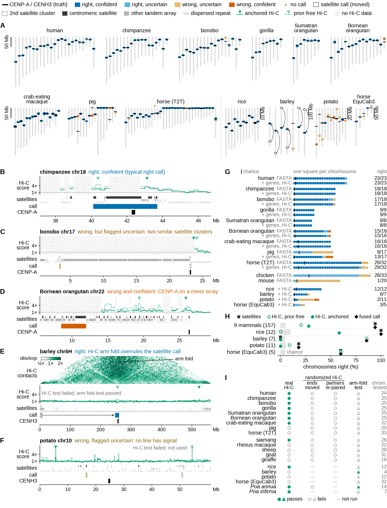
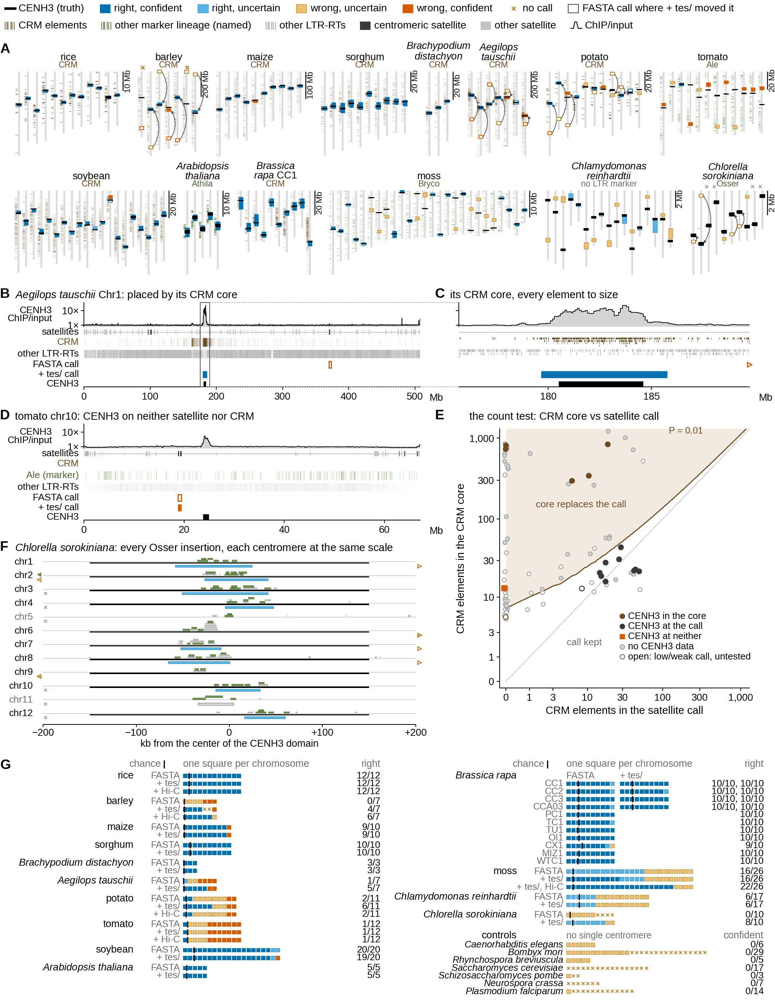
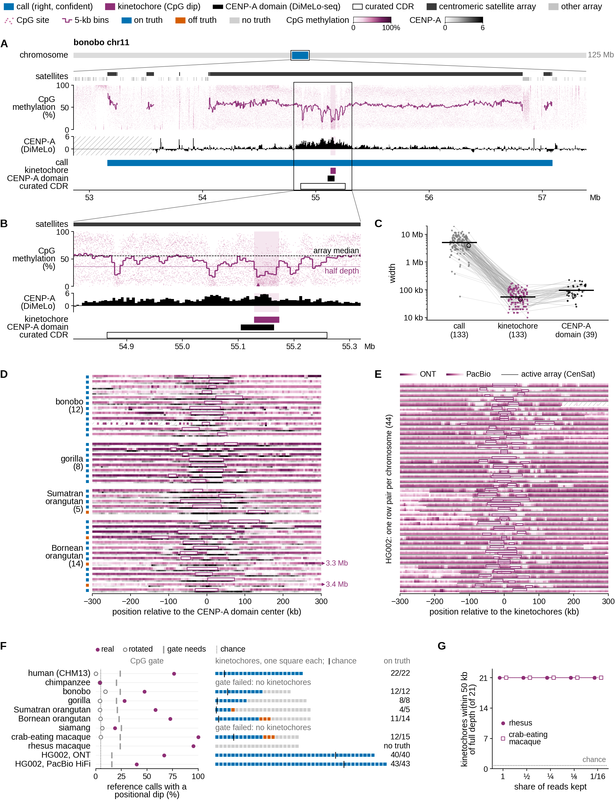

# Benchmarks

Every number here comes from criteria fixed before the run they score: plants 2026-10-16 and -19 (original text:
[`docs/benchmark.md` at 961a23d](https://github.com/cwb14/cenfuse/blob/961a23d/docs/benchmark.md)), mammals
2026-10-21, v4 2026-10-26 (CpG kinetochores, hard genomes, no-harm reruns: sections 6-8; the CpG criteria are
not blind, section 6), v5 2026-10-26 with dated amendments (memory, reproducibility, telomeres, new genomes:
section 9), v6 2026-10-27 (section 10), v7 2026-10-28 (morphology, the call in words, SO-typed GFF3,
dispersed-repeat roles: section 11), v8 2026-10-28 with dated amendments (a from-scratch rerun of every benchmark
arm, new functional truths, a faster search: section 12; where its numbers differ from the sections above, section 12
says so and why). Rules changed after a result was seen are listed in
[section 5](#5-rules-changed-after-seeing-a-result).

**Scoring.**
- *Right*: mammals, the call overlaps the CENP-A domain; plants, the call lies within 4 Hi-C bins of the CENH3
  domain (the method's resolution).
- *Confident* = `high` or `medium`; `low` = cenfuse says it is unsure.
- *P*: Poisson-binomial tail of the right count. A chromosome's chance is (call + truth + tolerance) / chromosome
  length.

## At a glance

Three figures from the v8 rerun (section 12), each with its legends in the PDF. Every genome's own overview page is
in the [gallery](gallery.md).

**Mammals and Hi-C** (sections 1, 2, 4):

*9 T2T mammals with CENP-A truth; rice, barley, potato and horse EquCab3 with ChIP truth ([PDF with
legends](img/benchmark_overview.pdf)). **A** every chromosome with a mapped centromere, all inputs: the call (box,
colored by outcome) against CENP-A/CENH3 (black bar); open boxes and arrows = barley calls moved by Hi-C. **B-F** one
chromosome per kind of outcome: right (B); uncertain, two similar satellite clusters (C); confidently wrong, CENP-A on
a small array (D); moved by the Hi-C arm fold (E, barley, with its contact map); no line has signal (F, potato).
**G** every chromosome as one square, FASTA only vs all inputs (chicken and mouse: FASTA only); black tick = chance.
**H** each evidence line alone vs the fused call. **I** the Hi-C test on real vs randomized Hi-C, and the arm-fold
test, in 14 mammals (5 without functional truth), the 4 ChIP plants and both *Poa* species.*

**Plants and algae with CENH3 truth: satellites, CRM retrotransposons, and where both fail** (sections 2, 7, 9, 10,
12):

*14 plant and algal species with CENH3 ChIP (CUT&Tag in *Chlamydomonas*), FASTA only vs + `tes/` (+ Hi-C), and 7
genomes without a single centromere ([PDF with legends](img/benchmark_plants.pdf)). **A** every chromosome of the
genomes run with `tes/` (*B. rapa*: CC1), each to scale: CENH3 (black), the + `tes/` call colored by outcome, the
FASTA call (open box, arrow) where `tes/` moved it, and every element of the centromeric LTR lineage (CRM, brown;
another named lineage, green). **B** *Ae. tauschii* Chr1, placed by its CRM core: CENH3 ChIP/input, satellite
arrays, every CRM and other LTR retrotransposon, both calls. **C** B's CRM core, every element to size. **D** the
failure: tomato chr10, CENH3 on neither satellite nor CRM. **E** the count test: every conflict between a CRM core
and a satellite call, CRM elements in each, the P = 0.01 boundary, colored by where CENH3 is. **F** *Chlorella*:
every Osser insertion around each centromere. **G** every chromosome as one square per genome and input set (all 11
*B. rapa* accessions), black tick = chance; holocentric and point-centromere controls.*

**Kinetochores from CpG methylation** (sections 6, 10):

*Primates with DiMeLo-seq CENP-A, curated CDRs or CENP-A ChIP, and HG002 ([PDF with legends](img/benchmark_cpg.pdf)).
**A** a typical bonobo centromere: the satellite array, every CpG with cenfuse's 5-kb bins, DiMeLo-seq CENP-A, the
call, the kinetochore (CpG dip), the CENP-A domain and the curated CDR. **B** the dip at single-CpG resolution.
**C** widths of call, kinetochore and CENP-A domain. **D** every ape kinetochore centered on its CENP-A domain:
methylation over CENP-A, one row pair each. **E** HG002 from ONT and PacBio HiFi, one row pair per chromosome. **F**
the CpG gate on real vs rotated methylation, and every kinetochore against truth and chance. **G** rhesus and
crab-eating macaque thinned to 1/16 of their reads.*

## 1. T2T mammals (14 genomes)

- **Truth**: CENP-A CDRs (Logsdon et al. 2024) for human CHM13 and five great apes. CENP-A ChIP for crab-eating
  macaque, pig and horse (pig and horse ChIP from other animals).
- **No functional truth** for siamang, rhesus, sheep, goat and giraffe. They are compared with the satellome locus,
  another sequence caller.
- **Inputs**: FASTA, + genes, + Hi-C (public libraries, 100 M pairs).
- **Controls**: the same Hi-C randomized two ways: ends moved, or partners re-paired with coverage kept.

**Overall (157 chromosomes with CENP-A truth):**

| inputs | right | confidently wrong | wrong, `low` | no call |
|---|---|---|---|---|
| FASTA only | **148** | 5 | 4 | 0 |
| FASTA + genes | 149 | 4 | 3 | 1 |
| FASTA + genes + Hi-C | **149** | 4 | 3 | 1 |
| *previous version (961a23d), FASTA only* | *112* | *19* | *26* | *0* |
| *previous version, all inputs* | *144* | *9* | *3* | *1* |

**Per genome (right / chromosomes; confidently wrong in brackets):**

| genome | truth | FASTA only | + genes + Hi-C | Hi-C test |
|---|---|---|---|---|
| human CHM13 | CENP-A CDR | 23/23 | 23/23 | pass |
| chimpanzee | CENP-A CDR | 18/18 | 18/18 | pass |
| bonobo | CENP-A CDR | 17/18 | 17/18 | pass |
| gorilla | CENP-A CDR | 9/9 | 9/9 | pass |
| Sumatran orangutan | CENP-A CDR | 8/8 | 8/8 | pass |
| Bornean orangutan | CENP-A CDR | 15/16 (1) | 15/16 (1) | pass |
| crab-eating macaque | CENP-A ChIP | 16/16 | 16/16 | pass |
| pig | CENP-A ChIP (other pigs) | 13/17 (4) | 13/17 (3) | fail |
| horse | CENP-A ChIP (other horse) | 29/32 | 30/32 | fail |
| rhesus | satellome locus | 22/22 | 22/22 | fail |
| goat | satellome locus | 30/30 | 30/30 | fail |
| giraffe | satellome locus | 15/15 | 15/15 | fail |
| sheep | satellome locus | 26/28 (1) | 26/28 (1) | fail |
| siamang | satellome locus | 18/26 | 20/26 (4) | pass |

- **Randomized Hi-C (28 runs):** the Hi-C test passed on no chromosome, and no call changed.
- **Arm-fold test:** failed in all 56 mammal Hi-C runs. Mammalian nuclei show no Rabl fold; the fold point hit
  CENP-A on 1/155 chromosomes.

**Pre-registered criteria:**

| criterion | result | numbers |
|---|---|---|
| B1 calls on the CENP-A domain (each ape > 50%, P ≤ 0.01) | PASS | 23/23, 18/18, 17/18, 9/9, 8/8, 15/16 |
| B2 final calls never worse than satellite calls | PASS | equal in all 9 genomes |
| B3 randomized Hi-C never passes the test | PASS | 0 of 28 runs |
| B4 the test passes only where Hi-C peaks lie within 4 bins of CENP-A | FAIL | in gorilla, orangutans and macaque the peaks sit beside the unmappable array, > 4 bins from CENP-A in bp |
| B5 `high` calls right more often than `medium`/`low` (P ≤ 0.01) | FAIL | 119/122 vs 30/34; only 3 `high` calls wrong, too few to test (P 0.25) |
| B6 Hi-C moves: right ≥ wrong | not tested | no call moved |
| B7 at least as good as the satellome caller on CENP-A | PASS | 90 vs 90 of 92 |

**Every miss (all inputs):**

| genome, chromosome | call | why |
|---|---|---|
| pig CM000817.6, CM000822.6, CM000828.6 | wrong, high/high/medium | the truth is weak ChIP from other pigs, with no centromeric-family array within 1 Mb; on the first two, Hi-C also favors the satellite array |
| pig CM001155.3 | wrong, low | same |
| B. orangutan CM054652.2 | wrong, high | CENP-A sits on 4 small alpha-satellite arrays (84 kb in all); cenfuse called the 3.4-Mb array cluster 14 Mb away. Hi-C points weakly to the right place |
| bonobo CM055489.2 | wrong, low | the true array is the reported competing cluster |
| horse CM128059.1 (chr11) | no call | satellite-free centromere; horse Hi-C failed its test, so it cannot place one |
| horse CM128070.1 | wrong, low | |

## 2. Plants and held-out genomes

Truth: CENH3 ChIP (rice: Shang et al. 2023; potato: Pham et al. 2020; barley), CENP-A ChIP (horse EquCab3),
satellome (gorilla). Inputs: FASTA + Hi-C. Each line scored on its own:

| genome | chromosomes | satellite line | prior-free Hi-C | anchored Hi-C | **final** | Hi-C test | fold test |
|---|---|---|---|---|---|---|---|
| rice (T2T-NIP) | 12 | 12 | 0 | 7 | **12** | pass | fail |
| barley (MorexV3) | 7 | 0 | 6 | 0 | **6** | fail | **pass** |
| potato (DM v6.1) | 11 | 2 | 1 | 0 | **2** | fail | fail |
| horse (EquCab3) | 5 | 3 | 3 | 3 | **3** | fail (on its `low` calls) | fail |
| gorilla (mGorGor1) | 25 | 25 | 0 | 19 | **25** | pass | fail |

- **Arm fold point vs CENH3** (exploration, not a criterion): rice 11/12 (500-kb bins), barley 4/7 within 8 Mb
  (its core holds CENH3 on 6/7), potato 0/11.
- **Rice**: the satellite line is right everywhere. Hi-C validates it, so all 12 calls are `high`.
- **Barley**: the satellite calls sit at the chromosome ends (CENH3 is on Cereba retrotransposons). Hi-C's
  prior-free peaks are right, but they can't be checked against wrong satellite calls.
  - The arm fold agrees with those peaks on 6/7 chromosomes (P 2e-5), so the two move 6 calls; all 6 are right.
  - The seventh fell from `high` to `low`.
  - Previous version: 0/7, 3 of them `high`.
- **Potato**: half its centromeres are satellite-free, and its Hi-C carries no centromere signal. Nothing can rescue
  them without `tes/`: 2 calls are confidently wrong, 7 are `low`.
- **Horse EquCab3**: right calls are `low` (no reference-grade call); the Hi-C test, run on those `low` calls, fails
  (4/24 agree), so Hi-C changes nothing; chr11 has no call.

**Poa annua / P. infirma (all four inputs; truth from earlier analyses, no ChIP):**

| criterion | result | numbers |
|---|---|---|
| P1 Pa1A on its functional centromere (167-170 Mb, 21 Mb from its satellite) | PASS | 163.0-169.4 Mb on the CRM core; Hi-C peak 168.0 Mb; `high` |
| P2 the other 20 calls unchanged | PASS | 20/20 |
| P3 Hi-C test passes | PASS | annua 14/14, infirma 7/7 |
| P4 methylation supports ≥ 10/13 annua calls | FAIL | 0/13 now. All 5 methylation plants are other plants, so methylation does not decide (12/13 before the provenance rule) |
| P5 per-plant candidates at Pa1A listed | FAIL | the J10 candidate lies inside the wide call |
| N1 permuted Hi-C: test fails, no change | PASS | 0/14, no change |
| demonstration: start from satellite-only calls | moved | Pa1A moved 20.7 Mb onto the functional centromere (Hi-C + CRM core), `high` |

**Other plant criteria:**

| criterion | result | numbers |
|---|---|---|
| H1 final ≥ satellite line (rice, potato, barley, horse) | PASS | 12 ≥ 12, 2 ≥ 2, 6 ≥ 0, 3 ≥ 3 |
| H2 changed calls: right ≥ wrong | PASS | 6 right, 0 wrong (barley) |
| M1 six imported T2T mammals: final ≥ satellite | PASS | 6/6 |
| M2 anchored Hi-C beats prior-free Hi-C (6 mammals pooled) | PASS | 99 vs 73 of 139, P 9e-7 (73 vs 73 in the previous version) |

**Several plants (P. annua reference + 5 other ONT plants; synthetic genome with planted plants):**

| criterion | result |
|---|---|
| S1-S4 synthetic: provenance, reference calls, planted shift, bad inputs | PASS |
| R1 all five plants recognized as other plants | PASS |
| R2 the five known missing segments found (within 5 Mb) | FAIL as written: all found, but the two Pa2A losses come out in 3 pieces |
| R3 the Hi-C library is `unknown` and decides | PASS |
| R4 reference calls unchanged | PASS |
| R5 no false shifts; P3 and R1 `call_absent` at Pa2A | PASS |

On 300 pure-noise genomes, the between-plant test gave 5.0% of null tests at P < 0.05 and no `shifted` verdict.

## 3. Satellite batch (185 plant and fish genomes, satellite line only)

This is a regression check of the satellite rules, not an accuracy test: only two complexes have CENH3 truth.

| change since the previous version | value |
|---|---|
| calls moved / confidence-only changes | 44 / 51 of 2,140 |
| Ae. geniculata (CENH3) | 10/14 overlapping, unchanged |
| S. verrucosum (CENH3) | 3/12 overlapping (7/11 within 1 Mb), unchanged |
| F. chiloensis D | 6 more chromosomes on the CENH3-validated Type I satellite |

## 4. What the controls show

| control | expected | observed |
|---|---|---|
| randomized Hi-C, ends moved (14 mammals, P. annua) | Hi-C test fails, no change | 0 passes, no change |
| randomized Hi-C, coverage kept (14 mammals) | same | 0 passes, no change |
| arm-fold test on mammals, potato, rice | fails where there is no Rabl fold, or where Hi-C's own peaks are wrong (rice) | fails in all |
| fold test, reverse conflicts (S. orangutan, giraffe: satellites right, prior-free Hi-C wrong) | must not side with Hi-C | 0/25, 0/16 agreement, no change |
| CpG values rotated along each chromosome (8 primates; values from half a chromosome away, on real CpGs) | CpG gate fails | 0/8 genomes |
| CpG positions shifted by half a chromosome (8 primates) | rejected or gate fails | 6/8 rejected as another assembly (rows off CpGs); 0/2 gate passes |

## 5. Rules changed after seeing a result

Each change has a reason independent of the case that prompted it, and was rechecked on cases not used to make it.

| date | change | prompted by | rechecked on |
|---|---|---|---|
| 2026-10-16 | Hi-C peaks in end bins never oppose a call | rice chr4 | potato, barley, horse, gorilla, mammals |
| 2026-10-16 | Hi-C opposes only beyond 4 bins (its resolution) | CHM13 | genomes scored later |
| 2026-10-19 | karyotype: skip only windows > half satellite; compare same-type coverage | P. annua R2 | R1 Pa5B, the Hi-C library |
| 2026-10-23 | satellite rules (tandem test, satellite kinds, acrocentric test, competing clusters); Hi-C in mappable bins; NOR detection; test majority | the previous mammal run | plant benchmark, 185-genome batch |
| 2026-10-24 | arm-fold line; centers only at centromeric index ≥ 12.5% | barley | rice, all mammals, randomized controls |
| 2026-10-26 | CpG line (new): within-call valley, shuffle test, positional gate | designed on the 7 primate tracks it is scored on (not blind) | MMU8 (R10), Arabidopsis, rotated and shifted controls |
| 2026-10-26 | CpG gate: positional (rotation) null instead of dips in other satellite clusters | the rotated control passed in gorilla | the other 7 rotated controls, real tracks |
| 2026-10-26 | telomeres: ≥ 100 bp counts when the array reaches the sequence end | *Neurospora* 0/14, *P. falciparum* 25/28 | 14 T2T mammals and mouse (no end lost or moved), 28 genomes |
| 2026-10-26 | Hi-C gate: `low` calls are references when no call is `high`/`medium` (clean peaks only) | siamang without genes (gate untestable) | 4 randomized Hi-C runs, chicken, EquCab3 |
| 2026-10-27 | acrocentric test: interior rival judged per satellite kind; a second unrelated acrocentric satellite competes with the call | T2T mouse (0/20; the v3 prediction failed) | the 72 earlier satellite runs (goat, the other all-acrocentric genome, among them) and 9 other v5 genomes: no change |
| 2026-10-28 | `short_arm` is `.` when the call spans the chromosome's middle (morphology, no call changes) | CHM13 chr1 (p arm 50 kb longer by sequence) | K1 verdict unchanged; the 30 regression runs |
| 2026-10-28 | the karyotype and the short-arm list count `high`/`medium` calls only | the *C. elegans* report (holocentric; short arms from `low` calls) | 47 breadth reports |
| 2026-10-28 | a family meeting the dispersed-repeat test gets role `dispersed` (no call changes) | bonobo's chromosome-scale loci (tracks L, D) | 72-job replay, 220 genomes: only the 5 interspersed families changed role, calls identical |
| 2026-10-28 | FasTAN runs with address-space randomization off (reproducibility, not a rule) | two fresh moss runs differed (5 call boundaries) | 5 repeated runs of one chunk; two fresh moss runs identical |
| 2026-10-28 | TE core floor: 3 independent insertion sites instead of 5 elements | *Chlorella* NS4-2 (Osser cores below the floor) | 12 crop `tes/` arms, moss, *Chlamydomonas*, *Arabidopsis*, *Brachypodium*, tomato, soybean, sorghum: no call changed; 72-job replay: 2 Sphagnum calls |
| 2026-10-29 | a decisive core replaces a confident distant satellite call only if the clade marks it significantly more (binomial, P <= 0.01) | *B. rapa* CC1/CC2 A09 | held out: *B. rapa* CC3/CCA03, soybean, sorghum, *Ae. tauschii*, tomato `tes/`; crop arms; 72-job replay (3 calls) |
| 2026-10-29 | families only from seed clusters with an array seed (>= 3 copies; speed, no call changes) | T2T sheep's search time | siamang, barley, B. orangutan: calls and roles identical |
| 2026-10-30 | the same head-to-head test for a call beside the core | *Ae. tauschii* Chr2/Chr4 | 21 `tes/` arms (only those 2 changed); 72-job replay (17 calls; with truth, 1 wrong call fixed, none lost) |

## 6. Kinetochores from CpG methylation (v4)

Criteria: `v4/CRITERIA.md` (2026-10-26). **Not blind**: the line was designed on these same primate tracks
(prototypes and rejected rules in `design.md`). Held out from the design: MMU8 and Arabidopsis.

- **Inputs**: public ONT CpG tracks of the assembled individuals. Apes: GenomeArk modkit 5mC-CpG bigWigs (R9, Guppy
  6.3.8; fraction only, as bedGraph). CHM13: nanopolish bigWig. MFA8: nanopolish with read counts (as bedMethyl). MMU8:
  R10 Dorado SUP + modkit bedMethyl. With FASTA + genes + Hi-C, as the mammal FULL arm.
- **Truth**: D = DiMeLo-seq CENP-A (CENP-A-directed 6mA, not CpG calls; 5 apes): domain = half-maximum run around the
  top 5-kb bin of each centromeric region. F = curated CDRs (same ONT data as the input: an implementation check). W =
  MFA8 CENP-A ChIP (testis, another animal; Mb-wide).

| criterion | result | numbers |
|---|---|---|
| C1 gate passes on real tracks (≥ 5/7) | PASS | 6/7: CHM13, bonobo, gorilla, both orangutans, MFA8. Fails: chimpanzee (positional dip in 1/25 references); also siamang (no truth) |
| C2 gate fails on control tracks | PASS | rotated 0/8; shifted: 6/8 rejected by the assembly check, 0/2 pass |
| C3 kinetochore on DiMeLo CENP-A | PASS | within 50 kb 35/39 (overlap 29/39); DiMeLo higher inside than over the call 39/39 (median 5.02 vs 0.81) |
| C4 kinetochore on the curated CDR | PASS | 63/63 |
| C5 MFA8 kinetochore inside the ChIP domain (≥ 90%) | FAIL | 12/15. The 3 others sit in the same array, 1-3 Mb from the domain of another animal's testis ChIP |
| C6 no call changed | PASS | 0 differences from v3 in calls, confidence, relation, support, flags (8 genomes) |
| C7 resolution | PASS | median kinetochore 60 kb vs call 5.1 Mb (85×); 132 kinetochores |

- **Positional dips** (share of tested calls; the gate counts them): CHM13 17/23, B. orangutan 19/25, S. orangutan
  16/25, bonobo 11/24, gorilla 7/25, MFA8 20/21; chimpanzee 1/25 and siamang 4/22 (gate fails). Rotated tracks: 1-2
  per genome (4-9%).
- **MMU8** (held out; R10 with counts; no functional truth): dips in 21/21 calls, positional in 20/21, gate passes,
  21 kinetochores (methylation 0.19-0.34 inside vs 0.52-0.61 over the array).
- **Wrong calls get kinetochores too**: B. orangutan CM054652.2 (the confident miss) gets one inside its inactive
  array (dip 0.15 vs 0.32). The line refines a call; it cannot check it. Tested and not adopted: CpG choosing between
  arrays (design.md).
- **Runtime** (final code): the CpG stage takes 1 min (CHM13 bedGraph) to 3 min (MMU8, 56 M per-strand
  bedMethyl rows), one thread.

## 7. Hard genomes (v4)

### Arabidopsis thaliana Col-CC (held out; criteria fixed before its data were processed)

Inputs: Col-CC (5 chromosomes); same-genotype ONT all-context modBAM (Dorado sup `5mC_5hmC`, ~56×) piled up with
modkit (CG combined, CHG and CHH per strand); `tes/` from LTRquest; no genes, no Hi-C. Truth: CENH3 ChIP of Col-0, by
the held-out plant rule (100-kb bins, half-maximum run, ≥ 4×): 1.3-1.6-Mb domains, 17-19×.

| criterion | result | numbers |
|---|---|---|
| A1 sequence calls on CENH3 (reported) | 5/5 | all `high`, on CEN180 (2.8-Mb calls around 1.4-Mb CENH3 domains); with `tes/` the Athila core supports all 5 |
| A2 CHG line does no harm | PASS | calls identical with and without methylation |
| A3 CHG line supports ≥ 3 right calls | FAIL | 0/5: no methylation signature (leave-one-out signatures on 1/5 chromosomes) |
| A4 CpG line in a plant | PASS | gate fails (positional dips 2/5); no kinetochore reported |
| A5 CpG line does no harm | PASS | CG-only calls identical to FASTA-only |

- **CHG line (first same-plant run with CENH3 truth):** inert. Its expected domain size comes from genome size (D =
  315 kb here), but CEN180 arrays span 2.2-3.5 Mb, so the calibration ring (1.5-4 D from the anchor) lies inside the
  centromeric arrays. A data-derived D is the likely fix; it was not adopted, because this genome prompted it and no
  second same-plant ChIP case exists to recheck it.
- **CpG:** the gate was right to fail. Exploratory: the strongest dips are shallow (0.62-0.74 vs 0.78-0.83 over
  CEN180) and lie off CENH3 on 4/5 chromosomes, so Arabidopsis CENH3 is not marked by a CpG dip in these data.

### Chicken GGswu (FASTA only; birds: 40 chromosomes, 2.5-200 Mb)

Truth: the authors' CENP-A windows on this assembly (Huang et al. 2023; DT40 ChIP of another bird; plotting windows of
0.1-2.6 Mb, 33 chromosomes). Chicken centromeres use chromosome-specific satellites, and chr5, chr27 and Z have none.

| result | numbers |
|---|---|
| calls on the CENP-A window | 28/33 (chance 6.3, P 6e-23); 2 more within 1 Mb (chr32, chr34, beside 0.3-0.8-Mb windows) |
| confidence | all 40 `low`: no satellite family dominates, so the satellite engine caps every call |
| misses (all `low`) | chr2 (a 1.4-kb-unit array 90 Mb from CENP-A), chr3 (3.4 Mb away), chr5 (satellite-free; called near its end) |

All 40 chromosomes, including the 2.5-7-Mb microchromosomes, are analyzed: the chromosome-set rule's only tenfold
drop is at the mitochondrion. The calls are right far more often than `low` suggests (28/33), so confidence is
conservative here. No confident call is wrong.

### Holocentric and CenH3-less genomes (FASTA only)

Any confident single centromere is wrong here.

| genome | why it is hard | calls |
|---|---|---|
| *C. elegans* CGC1 (T2T, 6 chr) | holocentric, no centromeric satellite | 6 `low`, all `no_dominant_satellite` |
| *Bombyx mori* P50T (29 chr) | holocentric; Lepidoptera lost CenH3 | 13 `low`, 16 none |
| *Rhynchospora breviuscula* (5 chr) | holocentric; Tyba arrays along every chromosome | 5 `low` |

0 confident calls in 40 chromosomes, with no code change. A genome-level "holocentric" flag was considered and not
added: `no_dominant_satellite` also marks most calls of monocentric siamang (FASTA only, 25/26) and horse EquCab3
(25/32).

### Telomeres (14 T2T mammals, v3 runs)

First scoring: cenfuse finds a telomere array at 687 of the 688 ends that hold one by the v2 truth rule (≥ 500 bp of
TTAGGG runs in the terminal 10 kb). The miss is sheep CP162267.1 (end). It also reports arrays at 4 ends the rule does
not count (it searches the terminal 100 kb).

## 8. No harm to the earlier benchmarks (v4 code)

Every earlier run was repeated with the v4 code (checkpoints resumed): the 14 T2T mammals with genes and Hi-C and the
16 plant-benchmark runs (rice, potato, barley, horse EquCab3, gorilla, the six imported mammals, P. annua with all
inputs and methylation, P. annua plants, the negative control, the Pa1A demonstration). Calls, loci and summaries are
identical in 30/30 runs; only the new `cpg_*` columns (empty) were added.

## 9. v5: memory, reproducibility, telomeres, TE formats, new lineages

Criteria: `v5/PLAN.md` (2026-10-26, before any v5 edit; dated amendments for tracks added later).

### Memory of the satellite search

Every pyhmmer `nhmmer()` call built a search pipeline that ended in a reference cycle. Its workspace (model length ×
the 256-kb search block: ~1.7 GB for an 1,853-bp model) waited for Python's full garbage collection, which a large
process runs rarely, so memory grew with every search done. One pipeline per thread, reused (as pyhmmer's own workers
do), gives the same hits and holds one workspace per thread.

| genome (threads) | before | after | outputs |
|---|---|---|---|
| chicken GGswu (24) | 277 GB | 58 GB | monomers, arrays, calls, loci identical |
| giraffe T2T (12) | 140 GB | 17 GB | monomers and arrays identical |
| *Arabidopsis* Col-CC (8, run side by side) | 7.8 GB, 23:47 | 4.8 GB, 23:59 | monomers identical |

Tried and not used (dead ends): glibc `malloc_trim` after each search (chicken 229 GB), job order (125 GB), smaller
pyhmmer blocks (hits change).

### Reproducibility of the satellite search

The families stage gave a different model for one *Arabidopsis* family on every run (3 runs, 3 models; one monomer
more or less downstream). MAFFT's multithreaded iterative refinement was the cause (4 runs, 4 alignments). With the
refinement single-threaded (`--threadit 0`), the alignment is the same at 1-32 threads at no time cost. Two
*Arabidopsis* runs from scratch at 16 and 8 threads now give byte-identical outputs (families, monomers, arrays, calls,
loci, summary).

### Telomeres (28 genomes: mammals, a bird, an insect, a nematode, plants, fungi, a protist)

A short array now counts when it reaches the sequence end: *Neurospora* NC12 0 → 13/14 ends (157-207-bp telomeres),
*P. falciparum* 25 → 27/28, horse EquCab3 19 → 27, yeast 0 → 7 (its irregular TG1-3 telomeres, as GGGTGT). The 14 T2T
mammals and mouse are unchanged (no end lost or moved); every added array lies within 98 bp of its end. Remaining
misses: ends without terminal repeats in the assembly (chicken 22), TTAGG broken by TRAS/SART retrotransposons
(*Bombyx* 15), fragmented NOR-arm telomeres (*Arabidopsis* 2).

**Interstitial telomeric arrays (new loci kind).** CHM13: 16 arrays ≥ 300 bp, most within 1 Mb of an end, one at the
2q13 fusion site (chr2 114.03 Mb). Chicken: 50 arrays, 22 of them on or within 100 kb of a CENP-A window (expected 1.4:
the padded windows cover 2.9% of the genome; binomial P 4e-21), holding 63% of all interstitial TTAGGG (up to 210 kb on
one chromosome): the telomere-repeat centromere cores Huang et al. 2023 described, genome-wide.

**NORs.** Every 45S array call that can be checked lies on a known NOR chromosome: *Arabidopsis* chr2/chr4, chicken
chr16, *C. elegans* chrI, pig chr8/chr10, human chr13/14/15/21/22, horse chr1/28/31; barley 1H, 2H, 5H, 6H, 7H (major
5H and 6H plus minor sites); mouse chr12, 15, 16, 18 and 19 (all five NOR chromosomes of the laboratory mouse).

### LTR retrotransposon input

DANTE_LTR GFF3 is read as it is (lineage from `Final_Classification`). *Arabidopsis* with the DANTE_LTR file: the same
5 calls, all `high`, as with LTRquest. DANTE classifies more lineages, so the flags-only marker clade can differ (Tekay
here, cored on 3/5 chromosomes; TE support 2/5 vs 5/5 with LTRquest's Athila). Ranking the marker by chromosomes first
was tested and rejected: over the 185-genome batch it agreed less with the independent satellite calls (te_discordant
111 → 129).

### Hi-C where every sequence call is `low`

When no satellite family dominates, every sequence call is capped `low`, so the Hi-C gate had no reference-grade call
and Hi-C could never act. The low calls are now the references, and only agreements at clean peaks (not at chromosome
ends, hubs or NORs) count.

| genome (inputs) | gate | effect |
|---|---|---|
| siamang (FASTA + Hi-C, no genes) | 0 → 26/26 chromosomes | 20 calls `low` → `medium`, one Hi-C-placed call; against the genes + Hi-C run, the `medium` calls match 18/20 and the remaining `low` ones 4/6 (before: 25 `low`, 21 matching) |
| siamang, randomized Hi-C (both modes) | 0/26, 0/26 | none |
| chicken (FASTA + 40 M Hi-C pairs) | fails on 30/30 | none; 25/30 anchored peaks sit in end windows: chicken Hi-C is dominated by telomere clustering (telomere arrays 4.0×, centromere calls 1.4×) |
| chicken, randomized Hi-C (both modes) | fails on 30/30 | none |
| horse EquCab3 (FASTA + Hi-C) | fails (4/24 agree) | none |

### New genomes

**Small genomes with point, regional or AT-rich centromeres** (FASTA only, seconds each): *S. cerevisiae* R64,
*S. pombe*, *P. falciparum* 3D7, *N. crassa* NC12. No confident call: yeast 0/16 calls (point centromeres), *S. pombe*
1 `low` call on cen3 (a long-unit tandem), *P. falciparum* 1 `low` call on a chromosome 4 var-gene cluster (the gene veto
removes it when genes are given), *Neurospora* 0/7 (RIP-mutated TE-relic centromeres). A genome with an IUPAC code every
5 kb (2,620 in all, inside an inserted 100-kb satellite array too) runs cleanly and finds the array exactly.

**Maize Mo17 T2T** (FASTA only; truth: same-line CENH3 ChIP, PRJNA751841, held-out plant rule). The 180-bp knob repeat
is the largest satellite (23.6 Mb, 20.6 Mb of it on chr8) and is classed `interstitial`; CentC is centromeric on all
10 chromosomes, all calls `high`, none holding any knob repeat. Calls on CENH3 (38-49× domains): 7/10 overlapping,
9/10 within 1 Mb (4 Hi-C bins, the plant rule; chance 0.2, P 1e-14). The misses (chr2 0.3 Mb, chr8 0.7 Mb, chr5 2.0 Mb
away; chr5 confidently wrong) have CENH3 on satellite-free DNA beside the CentC arrays, the case `tes/` (CRM cores) is
for.

**Mouse T2T (mhaESC; all 20 chromosomes acrocentric)** (FASTA only; truth: the minor-satellite array at the start of
each chromosome, 0.48-1.04 Mb, the CENP-A satellite). This tested the prediction that all-acrocentric karyotypes are
called without genes, and the prediction failed: 0/20 calls on the minor satellite, 14 confident calls 1.7-72 Mb
away (9 `high`), 2 chromosomes without a call. The major satellite (162 Mb, the largest satellite, pericentric) and
the minor satellite (16.5 Mb) were both judged subtelomeric. A 58-bp major-satellite subfamily at the inner edge of
the terminal block (beyond the 5% end zone on 10/20 chromosomes) counted as a strong interior rival and blocked the
acrocentric test. Two changes:
- the interior rival is judged per satellite kind (subfamilies pooled, as dominance already is), so the subfamily is
  part of its terminal block;
- both satellites then pass the acrocentric test. They are unrelated by sequence, and which one carries the
  kinetochore is not in the sequence: here the larger one is pericentric. In goat, the two acrocentric satellites are
  related layers and are pooled into one call. A second acrocentric satellite unrelated to the call now competes
  with it: the call is `low`, and that satellite's terminal block is reported (`seq_alt_*`).

Now all 20 calls sit at the centromeric end, on the major-satellite block, each within 45 kb of the minor satellite
(1/20 overlapping it), all `low`; the minor-satellite array is the reported alternative on 20/20. Of the criteria set
before the run, ≥ 15/20 calls overlapping the minor satellite still fails; no confident call off it now passes. Hi-C cannot
choose between the two arrays, because no mappable bins separate them. Telomeres are found at all 40 ends, plus 36
interstitial telomeric arrays.

### No harm (v5 code)

Every earlier run was repeated with the v5 code (checkpoints resumed): the 14 T2T mammals with genes and Hi-C and the
16 plant-benchmark runs. In 29/30 the calls, confidence, relation, support, against, flags and summaries are
identical; new columns (`hic_gate_refs`, `telomere_interstitial`) are added and the loci gain only interstitial
telomeric loci (+1 to +38 per genome; every earlier locus kept, or grown by one). Horse EquCab3: 8 short end telomeres
are found (19 → 27 ends), and its Hi-C gate, untested before (no reference-grade call), now tests the low calls and
fails; no call changed. The satellite search on the same families gives byte-identical monomers, arrays and calls
(chicken, *Arabidopsis*). The two acrocentric changes (mouse) act inside the satellite engine, so its classify and
call stages were replayed on all 72 earlier satellite runs (the 14 T2T mammals with and without genes, 6 plant runs,
38 polyploid complexes of the 185-genome batch: 3,134 chromosomes) and on the other 9 genomes of this round (104
chromosomes): no call, confidence or flag changed.

## 10. v6: the LTR and gene lines on CENH3 crops, 5S rDNA, new lineages

Criteria: `v6/PLAN.md` (2026-10-27, written before any v6 edit or new-input run; dated amendments).

### The LTR-RT and gene lines on crops with CENH3 truth

Before v6 every CENH3 crop row was FASTA (+ Hi-C). `tes/` = LTRquest 1.0.1 with `--detect-args ltr-timeout=300`;
genes = RefSeq (rice), Spud DB (potato), Ensembl Plants (barley), MaizeGDB (maize). Right = within 4 Hi-C bins (1 Mb;
barley 8 Mb). Right / confidently wrong:

| genome | FASTA | + genes | + `tes/` | + `tes/` + genes | + `tes/` + Hi-C | CRM core alone |
|---|---|---|---|---|---|---|
| rice | 12 / 0 | 12 / 0 | 12 / 0 (all `high`) | 12 / 0 | 12 / 0 | 8/8 cores on CENH3 |
| potato | 2 / 2 | 4 / 2 | **6 / 2** | 6 / 2 | 6 / 2 (Hi-C gate fails) | 6/7 |
| maize | 9 / 1 | 9 / 1 | 9 / 1 (all `high`) | 9 / 1 | (no Hi-C) | 10/10 within 1 Mb (9 overlap) |
| barley | 0 / 3 | 0 / **0** | **4 / 1** | 4 / 1 | 6 / 0 (as Hi-C alone) | 4/5 within 8 Mb |

- CRM is the decisive marker in rice (cores on 8/12 chromosomes), potato (7/12), maize (10/10) and barley (5/7), as in
  the batch's *Solanum*. Barley: `tes/` alone takes the FASTA calls from 0 to 4/7 (confidently wrong 3 -> 1); with Hi-C
  the fold already gives 6/7 and `tes/` keeps it. Calibration (`high` calls of the `tes/` arms right) 37/42 = 88%,
  short of the pre-registered 90% (potato 4/8).
- Maize: every call agrees with its CRM core, but the cores are wide (median 3.0 Mb); chr5's (4.8 Mb) spans both the
  CentC call and CENH3 2 Mb away, so the TE line cannot move that call (still the one confident miss).
- Potato: `tes/` places chr10's satellite-free centromere from the CRM core alone; genes move chr01 and chr03 onto
  CENH3 by vetoing gene-rich 178/179-bp families (a third call, chr04, moves and stays wrong).
- The LTRquest cap: uncapped, LTRharvest ran > 20 min on rice's chr3 centromere; capped runs (FastLTR rescue) gave
  CRM cores on 8 rice chromosomes vs 7, and the same calls.

### 5S rDNA arrays (new feature)

Tandem runs of whole 5S genes (Rfam 5S profile HMM). Every array lies on a chromosome known to carry 5S rDNA:

| genome | 5S arrays (copies, unit) | known 5S locus |
|---|---|---|
| CHM13 | chr1 227.7-228.0 Mb (126 x 2.24 kb) | 1q42 (RNA5S1-17) |
| chimp, gorilla, both orangutans, siamang, macaque | chromosome 1 (HSA1) homolog, 84-216 copies | 1q42; 18-26 of the 27 genes beside the human array shared |
| horse, pig | ECA1; SSC14 | at HSA1q42.2 genes (EGLN1, DISC1, TRIM67) / beside HSA1q43 genes (CHRM3, FMN2) |
| mouse | chr8 (87 x 1.7 kb) | chr8 |
| chicken | chr9 (22 x 2.2 kb) | chr9 |
| *Arabidopsis* Col-CC | chr3, chr4, chr5 (+ 3-7 copies on chr1, chr2) | chr3, chr4, chr5 |
| rice; maize; potato | chr11; chr2L; chr01 | chr11; 2L; chr1 |
| barley | 2H, 4H, 7H (+ 3H, 5H small) | 2H, 3H, 4H, 7H |
| *S. pombe*; budding yeast | none (36 dispersed genes); chrXII rDNA | dispersed; inside the rDNA unit |

The satellite engine had tagged 5S only in mouse, maize and *Arabidopsis* (and missed 2 of 3 *Arabidopsis* loci,
merged into centromere loci): 5S units of mammals and birds (2.2 kb) are longer than its 2-kb seeds. CHM13 scan: 24 s.
The overview plot marks 45S (filled) and 5S (open) arrays with green diamonds (CHM13: 45S on the five acrocentrics,
5S at 1q42); the gallery and README images were redrawn from the final regression runs.

### New lineages (functional truth on the same assembly)

| genome | centromeres | truth | FASTA | + `tes/` |
|---|---|---|---|---|
| moss *Physcomitrium patens* V6 | clusters of the Copia RLC5 (Bryco), no satellite | CENH3 ChIP (Bi et al. 2024) | 16/26, all `low` | 16/26; base code: 4 confident wrong; v6: 0 confident wrong, 11 confident right |
| *Chlamydomonas reinhardtii* UL-1690 | ZeppL LINE-1 clusters | CENH3 CUT&Tag (Liu et al. 2025) | 6/17 (P 0.03), all `low` | same (no LTR clade concentrates) |
| *Cryptococcus neoformans* H99, *C. deneoformans* JEC21 | Tcn LTR-rich regional centromeres | CENP-A ChIP (Yadav et al. 2018) | 0/14 and 1/14 (`low`) calls | same: REXdb gives their elements no lineage |

- Moss: Bryco is the only clade concentrated at one locus per chromosome; its cores sit on CENH3 on 25/26 (median
  201 kb), better than the satellite line (16/26), but a non-CRM marker cannot replace a satellite call (lead in
  `v6/dead_ends.md`). With the base code, giving `tes/` made 4 wrong calls confident: a flags-only marker lifted the
  no-dominant cap for calls it contradicted (fixed in v6, below). With Hi-C as well: 22/26 (Input robustness, below).
- *Cryptococcus*: 89% (H99) and 94% (JEC21) of LTRquest's elements lie in the CENP-A domains, but without a lineage.
  Pooling them (with 20-kb TE bins) found JEC21's centromeres (10/14) and the hybrid's D subgenome (10/13, truth carried
  by flank mapping), all `low` and none wrong, but changed calls or flags in 9 fish genomes and *Oryza*, also with a
  guard against tandem-array artifacts and no cap lifting; not adopted (`v6/dead_ends.md`).

### HG002: a diploid T2T assembly, and CpG methylation from PacBio HiFi

HG002 v1.0.1 (both haplotypes in one FASTA, 46 chromosomes): FASTA-only calls overlap the CenSat active array on 46/46
(45 `high`); telomere arrays at 92/92 ends; NORs on the acrocentric haplotypes; one 5S array per haplotype (chr1:
105 and 70 copies). CpG line with the ONT R10 and the PacBio Revio 5mC tracks of the same assembly (no CENP-A data
exist for HG002):

| criterion | ONT | PacBio HiFi |
|---|---|---|
| CpG gate | passes on 46/46 | passes on 46/46 |
| kinetochores | 40 (median 38 kb) | 43 (median 25 kb) |
| inside the active array | 40/40 | 43/43 |
| calls changed | 0 | 0 |

Where both technologies place a kinetochore (39 chromosomes) they lie within 50 kb on 31 (15 overlap); the other 8 are
55-195 kb apart inside the same array. PacBio tracks need no code change: they enter as bedGraphs.

### Input robustness: Hi-C depth and MAPQ floor, CpG depth, LTR annotation (criteria in `v6/PLAN.md`, overnight program)

**Hi-C depth.** Each genome's pairs randomly thinned (nested) and rerun; calls scored against truth. Chromosomes on which
the Hi-C gate passes, by share of the uniquely mapped pairs kept:

| genome | pairs (100%) | 100% | 50% | 25% | 10% | 5% | 2% |
|---|---|---|---|---|---|---|---|
| CHM13 | 71 M | 24 | 24 | 24 | 24 | 24 | 0 |
| chimpanzee | 74 M | 25 | 25 | 25 | 25 | 25 | 0 |
| gorilla | 55 M | 25 | 25 | 25 | 0 | 0 | 0 |
| S. orangutan; B. orangutan | 71 M; 67 M | 25; 25 | 0; 0 | 0; 0 | 0; 0 | 0; 0 | 0; 0 |
| crab-eating macaque | 70 M | 22 | 22 | 22 | 22 | 22 | 22 |
| pig | 54 M | 0 | 0 | 20 | 20 | 0 | 0 |
| horse (T2T); potato | 64 M; 66 M | 0 | 0 | 0 | 0 | 0 | 0 |
| rice | 53 M | 12 | 12 | 0 | 0 | 0 | 0 |
| barley (arm fold) | 9.2 M | pass | fail | fail | fail | fail | fail |

No depth made a call confidently wrong in a mammal, and no right call was lost (the satellite line decides there).
Where Hi-C works only near its threshold it flips with depth: both orangutans fail at half depth (35 M pairs, where the
bin doubles to 500 kb), the pig gate passes only at 25% and 10%, and barley's fold rescue (0 -> 6/7) needs all 9.2 M
pairs (fold P 0.013 at half depth), below which barley returns to its FASTA-only calls (3 confidently wrong).

**Hi-C MAPQ floor.** The same 100 M read pairs remapped with the recipe at pairtools' default floor (`--min-mapq 1`)
instead of 30. With the MAPQ columns kept, cenfuse applies MAPQ >= 30 itself; without them it can only warn. Calls
right (confidently wrong), and Hi-C gate passes or the arm fold:

| genome | pairs, recipe | at MAPQ >= 1 | recipe | MAPQ >= 1, columns kept | MAPQ >= 1, no columns |
|---|---|---|---|---|---|
| CHM13 | 71.3 M | 77.3 M (1.08x) | 23/23 (0), gate 24 | 23/23 (0), 24 | 23/23 (0), 24 |
| Sumatran orangutan | 70.8 M | 77.1 M (1.09x) | 8/8 (0), gate 25 | 8/8 (0), 25 | 8/8 (0), 25 |
| rice | 53.2 M | 64.0 M (1.20x) | 12/12 (0), gate 12 | 12/12 (0), 12 | 12/12 (0), 12 |
| moss, + `tes/`; FASTA only | 46.3 M | 55.4 M (1.19x) | 22/26 (0), gate 26; 16/26 (0), 0 | the same | the same |
| barley | 9.2 M | 17.9 M (1.94x) | 6/7 (0), fold pass | 7/7 (0), pass | 6/7 (0), pass |

No gate or fold result changed and no call became confidently wrong. Without the columns the apes' calls changed only
in relation or confidence (CHM13 7, orangutan 10 chromosomes; 2 confidences up), and barley's extra pairs allowed
1-Mb bins: calls 1-3 Mb wide instead of 6-18 Mb, still 6/7 right (one gained, one lost to a `low` call). With the
columns, cenfuse's filter comes after pairtools' deduplication, so 1-2% fewer pairs survive than with the recipe (barley
7.6%); barley's one changed call moved onto CENH3. The extra pairs did not bring Hi-C into the alpha-satellite arrays
(anchored peak a median 1.8 and 2.1 Mb from CENP-A, 2.3 and 1.7 Mb before): near-identical repeat copies map at MAPQ
0, which pairtools drops at any floor.

**CpG depth.** The two CpG tables with read counts binomially thinned (3 seeds). Kinetochores within 50 kb of the full-depth
ones (of 21), before and after pooling the calls of each bin:

| genome (calls per CpG strand) | 1/2 | 1/4 | 1/8 | 1/16 |
|---|---|---|---|---|
| rhesus MMU8 (~15), per-CpG floor of 3 calls | 21 | 20.7 | 15.3 | 0 (gate fails) |
| rhesus MMU8, pooled calls (v6) | 21 | 21 | 21 | 21 |
| crab-eating MFA8 (~38), per-CpG floor | 21 | 21 | 21 | 14.3 |
| crab-eating MFA8, pooled calls (v6) | 21 | 21 | 21 | 21 |

No call changed at any depth. At full depth pooling gives the same gate (22/22 both), the same kinetochores within 50 kb
(21/21 both) and the same 12/15 MFA8 kinetochores inside its ChIP domain; a bedGraph (no counts) is unchanged.

**LTR annotation.** The TE line on the CENH3 crops with three annotators, and with LTRquest's elements thinned at random
(final code). Right = within 1 Mb of CENH3 (moss 100 kb):

| genome | annotation | marker | TE line alone (right / cores) | calls right (confidently wrong) |
|---|---|---|---|---|
| rice | LTRquest | CRM, decisive | 8/8 | 12/12 (0) |
| rice | EDTA intact + TEsorter | CRM cores on 4 chromosomes | 4/4 | 12/12 (0) |
| rice | DANTE_LTR | Tekay, CRM cores on 2 | 3/8 | 12/12 (0) |
| rice | LTRquest at 50 / 25 / 10 / 5% | CRM cores on 3 / 1 / 1 / 0 | 3/3, 1/1, 1/1, - | 12/12 (0) |
| potato | LTRquest | CRM, decisive (7/12) | 6/7 | 6/11 (2) |
| potato | EDTA intact + TEsorter; DANTE_LTR | CRM cores on 2; on 1 | 2/2; 1/1 | 2/11 (2) |
| potato | LTRquest at 50 / 25% | CRM cores on 3 / 1 | 3/3, 1/1 | 2/11 (2) |
| maize | LTRquest, and at 50 / 25 / 10% | CRM, decisive | 10/10, 10/10, 10/10, 8/8 | 9/10 (1) |
| maize | LTRquest at 5% | CRM cores on 5 | 5/5 | 9/10 (1) |
| moss | LTRquest; at 50% | Bryco | 25/25; 22/22 | 16/26 (0) |

The decisive CRM test counts chromosomes with a significant core and needs most of them: potato's 214 LTRquest CRM
elements give 7/12, exactly a majority, and any less sensitive annotation loses the potato gain from `tes/` (6 -> 2/11).
Every CRM core short of the majority still lay on CENH3 (24/24 over 8 arms of rice, potato, maize and *Brachypodium*;
also 5/5 in the DANTE_LTR rice arm that prompted the rule), every rice Tekay core off it. With DANTE_LTR, elements of
rank D (domains, no LTRs: 195 of potato's 223 CRM) had made CRM decisive with cores up to 15 Mb off CENH3 (6
confidently wrong calls); they are now ignored. EDTA's own `*.LTR.intact.raw.fa` held 7 of 2,533 rice elements: cut
the sequences from the genome before TEsorter. These are the last benchmarks of other annotators: further work on the
LTR line uses LTRquest only ([design.md](design.md#principles)).

**New genomes with CENH3 truth.** Barley `tes/` (LTRquest): 0 -> 4/7 right, confidently wrong 3 -> 1; with Hi-C 6/7, 0
(as Hi-C alone). *Brachypodium distachyon* Bd21 (CENH3 ChIP of the same line; truth on 3/5 chromosomes): 3/3 from the
FASTA (`high`), the same with `tes/` (CRM decisive, cores 3/3 on CENH3). Tomato Heinz 1706: CENH3 ChIP 2.2-3.4x, below
the truth rule (not scored).

**Moss with Hi-C.** The README recipe, unchanged, on the V6 project's own Hi-C (SRR24296040, 99.6 M read pairs) gave
46.3 M pairs (1 h 38 min on 32 threads). FASTA + Hi-C: the gate fails on all 26 chromosomes and the calls stay the
FASTA-only ones (16/26, `low`), with the `hic_sequence_conflict` warning. Every sequence call is `low`, so only
agreements at clean peaks count, and 11 of the 26 CENH3 domains lie within 8 bins (2 Mb) of a chromosome end, where
peaks are flagged `telomeric`. FASTA + `tes/` + Hi-C: the calls the Bryco line raised are the references (9 of 11
agree), the gate passes on 26/26, and 22/26 calls are right (P 4e-26), all `medium` or `high`, none confidently wrong
(`tes/` alone: 16/26, 11 confident). Hi-C chose the competing cluster on 4 chromosomes and moved 2 calls, all onto
CENH3. The 4 misses are telomeric-flagged peaks on CENH3 with the Bryco core there too. Elsewhere the flag is right:
all 10 telomeric-flagged peaks in the other truth genomes (rice 4, barley 4, CHM13 1, Sumatran orangutan 1) are
wrong, and at reduced Hi-C depth plant telomeric peaks were right 0/27 (other peaks 27/120). A narrow exemption (such
a peak counts when the LTR marker's core lies within 4 bins of it) takes moss to 26/26, all confident, and acts in no
other run; moss alone prompted it, so it stays a lead (`v6/dead_ends.md`).

### Fixes

- **Flags-only TE markers and the no-dominant cap.** Before v6 any TE marker lifted the cap for every call; now a
  flags-only marker lifts it only for the calls it supports (`te_concordant`). 72-job replay: 22 genomes, 118 calls,
  all as predicted (66 confident -> `low`); moss: 4 confident wrong -> 0.
- **A weak satellite call beside a decisive core** is replaced by the core (`weak_satellite_beside_core`): potato chr11,
  *S. verrucosum* chr01 and *Ae. geniculata* chr07U move onto CENH3; 72-job replay: 14 calls in 13 CRM genomes, nothing
  else; rice, maize, barley, *Brachypodium*: no case.
- **CRM cores short of a majority** replace the flags-only marker's core on their chromosomes (and are the marker when no
  clade qualifies): rice TE line with DANTE_LTR 1 -> 6/12 right (all ranks), with EDTA 0 -> 4/4, thinned LTRquest 0 ->
  3/3 (50%); replay: 142 chromosomes in 41 genomes, all with a CRM core, one confidence decrease; calls on truth genomes
  unchanged. Giving CRM the whole genome instead (tested, rejected): in TAIR10 one CRM core displaced Athila and two
  right `high` calls fell to `low`.
- **DANTE_LTR rank-D elements** (domains without LTRs) are not counted: DANTE potato 6 -> 2 confidently wrong (5 -> 2
  right); rice, *Arabidopsis*, *Brachypodium* calls unchanged.
- **CpG calls pooled per bin** (bedMethyl): kinetochores at 1/16 of the reads (table above).
- **Inputs:** `.gff`/`.gtf` gene and TE files; GENCODE `gene_type`; GFF3 without `gene` lines (potato); a `tes/` file
  without lineages or with other sequence names is reported with the reason, and so is a gene file whose names match
  only some chromosomes (none of the 23 benchmark gene files triggers it); a Juicer `.hic` or a BAM in `hic/` stops
  with the conversion recipe (rice: `.hic` -> `hictk convert` -> `.mcool` gives the same calls as the pairs).
- **ENCODE-style bedMethyl** (11 columns: coverage, percent methylated; bisulfite pipelines, Megalodon) is read as
  counts by the CpG line and checked against the assembly (13,002 rows of the MFA8 table, all on reference CpGs):
  before, every row counted as malformed and the line ran without data. MFA8 and MMU8 rewritten that way: the same
  gate (22/22), calls unchanged, kinetochores within 50 kb of the modkit table's on 21/21 (41/42 identical). A CHG
  file in that layout, which had stopped the run on a pandas error, is now left out with the reason (the provenance
  test needs modkit's counts of failed and differing calls); an unreadable CG file is named with the formats read.
  modkit tables and bedGraphs read as before (identical runs).
- One chromosome alone runs and gives the whole-genome call (rice chr12).

### No harm (v6 code)

The 30 earlier benchmark runs with the final code: calls, confidence, relation, support, against, flags and summaries
identical to v5 on every shared column; loci gain only 5S rDNA loci or members; overview images change only by the
rDNA markers. The satellite-engine changes (the cap rule, the weak array beside a core) were checked on the 72-job
replay instead (above). Rerun with the final code, the maize, moss and *Chlamydomonas* `tes/` arms give the same calls as
with the code they were scored with; rice and potato were checked by satellite replay (rice identical; potato chr11
moves onto CENH3 by the weak-array rule).

## 11. v7: what the integration says (morphology, completeness, the call in words, a report, SO-typed GFF3, dispersed-repeat roles)

Criteria: `v7/PLAN.md` (2026-10-28, written before any v7 edit or run; dated amendments). Nothing in v7 changes a call.

### Morphology and completeness (track K)

The integrated call (or the CpG kinetochore inside it) fixes each chromosome's arms: centromeric index, arm ratio,
Levan class; with the telomere arrays and assembly gaps, whether the chromosome and its call are completely assembled.

| criterion | result | numbers |
|---|---|---|
| K1 convention check (CHM13, two regression runs) | PASS | chr1, 3, 16, 19, 20 metacentric; chr13, 14, 15 subtelocentric or acrocentric; short arm at the sequence start 23/24 (chr1: its call spans the middle, `.`) |
| K2 acrocentric vs bi-armed, literature karyotypes, right calls (within 1 Mb of truth) | PASS | 118/119: mouse 20/20, goat 30/30, horse T2T 30/30, pig 13/13, sheep 25/26 (OAR26: a `low` call at CI 0.24, on the satellome locus too) |
| K3 gaps | PASS | equal to an independent scan on EquCab3, barley MorexV3 and potato DM (4,084 gaps); gaps in calls equal the satellite engine's |
| K4 telomere ends | PASS | 660/660 chromosomes agree with the telomere stage |
| K5 no harm | PASS | 30 regression runs: every existing column identical to v6 |

By sequence length, human acrocentrics with T2T p arms are not all "acrocentric": chr13-15 come out subtelocentric
(CI 0.15-0.16), chr14 subtelocentric/acrocentric (0.11), chr21 and chr22 submetacentric/subtelocentric (0.25-0.27; 11-15
Mb p arms with the rDNA). The class is a sequence measurement, not the cytogenetic descriptor.

### The call in words and the report (track I)

| criterion | result | numbers |
|---|---|---|
| I1 a sentence test per relation and flag | PASS | 12 unit tests + the synthetic run (moved, contested, placed, gapped calls; plants) |
| I2 report vs tables, every run | PASS | 30/30 regression runs and 47/47 breadth runs: calls line, per-chromosome table, not-high table, satellite-call and block counts, Hi-C gate, karyotype; every support line in `basis`, every opposing line and lowering flag in `caveat` |
| I3 read-through | PASS after fixes | 16 reports read against their tables (CHM13, rice, barley, potato with and without `tes/`, horse EquCab3, pig, *Poa*, gorilla with CpG, *C. elegans*, *Arabidopsis* with CHG/CpG, chicken, yeast, moss with `tes/` and with Hi-C, HG002 ONT); 10 faults fixed before adoption: barley's report said Hi-C changed no call (its arm fold moved 6); mammal caveats suggested `tes/`; the ITS count used loci (15) not arrays (16); one call counted twice ("opposes" and "contests"); a reused variable printed "satellite arrays on 6" for every genome (now checked by I2); C. elegans listed short arms from `low` calls; "1 45S array (NORs)"; failed CpG/CHG tests read as results; a lower call moved with a CRM core did not name the core; the LTR marker's core sitting in the competing cluster was stated as "elsewhere" (moss: on all 5 such chromosomes CENH3 is on that cluster) |
| I4 no harm | PASS | as K5 |

### Sequence Ontology types in GFF3 (track G)

| criterion | result | numbers |
|---|---|---|
| G1 `gt gff3validator -typecheck so` (GenomeTools 1.6.6) | PASS | 64/64 files of the 30 regression runs and 94/94 of the 47 breadth runs (v6: every features.gff3 failed, e.g. type `interstitial_block`) |
| G2 former types kept | PASS | `kind=` on loci, `member=` and `locus=` on members (members are no SO part of a locus, so not `Parent=`) |
| G3 no harm | PASS | TSVs identical |

### Dispersed repeats are dispersed (track R, satellite engine)

The engine's dispersed-repeat test (tandem fraction, whole-unit hits, locus fold) already kept interspersed families
from centromere calls, but the family's role ignored it: a family whose main cluster held most of its bp was
`interstitial`. In five T2T genomes one interspersed family (chimpanzee 719 Mb, bonobo 669, rhesus 519, S. orangutan
277, sheep 215; 2-14% of its bp in tandem repeats) was an "interstitial block" chained along every chromosome, which
merged centromere, telomere and ITS loci into chromosome-scale loci (bonobo: 41 loci > 20 Mb, `centromere` loci a
median 54 Mb long). Now a family meeting the test is `dispersed`.

| criterion | result | numbers |
|---|---|---|
| R1 unit test | PASS | the rule, NaN values left alone, the centromeric classes kept |
| R2 72-job satellite replay (220 genomes) | PASS | calls identical in every genome; roles changed only for those 5 families (each in two runs), all `interstitial` -> `dispersed` |
| R3/R4 the 5 genomes, engine rerun from classify, against the same rerun with the v6 code | PASS (5/5) | calls and summaries identical; the only role change is the interspersed family; loci > 20 Mb: bonobo 41 -> 0 (`centromere` loci median 54 -> 3.0 Mb), chimpanzee 37 -> 0, S. orangutan 50 -> 1 (a 20-Mb centromere call, 98% satellite), rhesus 45 -> 1 (a 22-Mb centromere call, mostly satellite; `centromere` loci median 22.5 -> 11.5 Mb, max 117 -> 22 Mb), sheep 48 -> 0; every changed locus holds that family |

Satellite outputs from earlier engine versions (`--satellite-dir`) keep their roles; the regression runs, which read
them, are therefore unchanged by R.

### Not adopted

- **The centromeric region** (L: the call plus satellite clusters chained through gaps <= 500 kb; a
  `pericentromeric_block` kind). Held out, per set: apes median precision 0.07 (an interspersed 1.5-kb family classed
  `interstitial` chains whole chromosomes in bonobo, chimpanzee and S. orangutan), HG002 median recall 0.60 (0.5-0.7-Mb
  non-satellite stretches stop the chain; CHM13 0.57). Pooled the criterion would pass (1.00 / 0.94); it was not read
  that way. Maize knobs stayed arm blocks (0.3% reclassified).
- **Loci members that are mostly satellite** (D, a fix for a defect found through L: chromosome-scale loci in
  chimpanzee, bonobo, S. orangutan, rhesus and sheep, where one interspersed 0.5-1.9-kb family of 200-650 Mb is classed
  `interstitial`). Splitting sparse clusters into dense runs removed them but added thousands of small loci (chimpanzee
  +5,757); dropping sparse clusters would erase diffuse real satellites (barley subtelomeric: 108/156 clusters).
  Fixed at the root instead (R, above).

### No harm (v7 code)

The 30 regression runs: centromeres, loci and summaries identical to v6 on every shared column; new columns only.
The 47 breadth runs (v4-v6 arms: CpG primates, holocentrics, *Arabidopsis*, chicken, yeasts, *Plasmodium*,
*Neurospora*, moss, *Chlamydomonas*, HG002 ONT/PacBio, *Brachypodium*, tomato, the crop LTR arms) against the same
runs with the v6 code: calls, loci and summaries identical on every shared column (47/47 runs complete). The gap
scan adds about a minute per 3 Gb (checkpointed).

## 12. v8: a from-scratch rerun, new functional truths, a faster satellite search

Criteria and dated amendments: `v8/PLAN.md`; run record `v8/memo.md`; report `v8/REPORT.md`.

### Every benchmark arm from scratch (156 runs, the delivered code)

Earlier versions scored the satellite engine's outputs of the v3 engine through later code. v8 reran every arm from
the FASTA (satellite engine included) with the delivered code. First it found that two fresh runs of the same input
differed: FasTAN 0.8 cuts arrays depending on memory layout (one moss 5-Mb chunk, 5 runs: 17 of 982 arrays cut
differently), so families and some call boundaries varied (moss: 5). FasTAN now runs with address-space randomization
off (`setarch -R`); two fresh moss runs gave 307 output files identical apart from header dates and commands. The
README tables are from this rerun. Every row reproduced except:
- **9 T2T mammals, FASTA only**: 143 right, 1 confidently wrong, 13 low/none (was 148/5/4). All in pig: in this run
  the 73-bp satellite takes the sequence of a former 83-bp subtelomeric family (that family is not formed), becomes
  the largest cluster on pig's 6 acrocentric ends, and with a 50-bp family on 4 more chromosomes the 336-bp family
  loses genome-wide dominance. The related-family preference then lapses and the honesty cap makes every pig call
  `low`: 5 right `medium` calls at the acrocentric ends became `low` calls 0.6-2.0 Mb from CENP-A. How a fresh run
  splits satellites into families decides this; with genes and Hi-C pig is 13/17 as before.
- **+ genes + Hi-C**: 148/4/5 (was 149/4/4): horse T2T CM128050.1, a `low` call 2.7 Mb from CENP-A.
- **CpG kinetochores**: median width 55 kb (was 60); 62/63 on curated CDRs (S. orangutan CM054694.2 now off).
- The moss `tes/` arm reproduces the README (16 right, 11 `high`/`medium`, 0 confidently wrong); the v7 delivered run
  of that arm had read a satellite folder made before rule RT4 and showed 4 confidently wrong calls.

### New functional truths

Same-line CENH3 ChIP mapped and called with the frozen v2 rule (100-kb bins, ChIP/input, 3-bin mean, half-maximum run,
>= 4x); the domains overlap the authors' published centromeres where a table exists (*B. rapa* 89/90, one MIZ1
domain 420 kb away; *Chlorella* 10/10; tomato 12/12). Scores are in the README table: *B. rapa* (11 accessions; TU1
and CX1 with too weak a ChIP, 1.9-2.5x, scored on the published table),
soybean X26, sorghum BTx623 (ChIP of line V9), *Ae. tauschii* AL8/78, *Chlorella sorokiniana* NS4-2, tomato Heinz
1706 (a stronger ChIP than before: 12/12 domains, 6.8-21.5x). What they showed:
- *Chlorella*: centromeres of 2-7 Osser (Copia) insertions (53 of the genome's 54 inside the published CENH3
  centromeres; 2-8 per chromosome), below the TE line's floor of 5 elements; the floor now counts independent
  insertion sites (>= 3): 0 → 8/10 with `tes/` (all `low`).
- *B. rapa* A09 and soybean chr1/chr6 with `tes/`: the densest window of a broad CRM plateau replaced a `high`
  satellite call on CENH3. A core now overrules a confident satellite call only where the clade's elements sit
  significantly more in the core than in the call (binomial at 1/2, P <= 0.01): *B. rapa* 9/10 → 10/10 in 3
  accessions, soybean 17/20 → 19/20; P. annua Pa1A (satellite on a smaller second CRM cluster) unchanged.
- *Ae. tauschii*: satellite arrays beside CRM cores that hold CENH3 on all 7 chromosomes; the same test now applies to
  a non-weak satellite call beside the core: 3/7 → 5/7 with `tes/` (Chr5/Chr7: calls at the core's edge remain).
  Replay: Ae. geniculata chr02M wrong → right.
- tomato: 11/12 CENH3 domains hold no satellite array; the dominant 53-bp satellite and a 181-bp one sit 3-42 Mb
  away; no LTR clade marks the domains, and 43 M Hi-C pairs (Heinz 1706, CRR1296445) gave prior-free peaks 1-37 Mb
  off on all 12. A reported failure.

### A faster satellite search

- A sample screen for dispersed families (each chromosome's end chunks + every 5th chunk; skip a family that the
  sample shows to be dispersed at P <= 0.01 if dropping it changes no other family's arrays) skipped no family on
  sheep, mouse, S. orangutan, moss or *Brachypodium*: dispersed families overlap each other on the same
  retrotransposon copies and touch small families (mouse: the minor and major satellites). Not adopted.
- Seed clusters founded on two-copy duplications only (no array of >= 3 copies) are not families. All 12 such
  families in the 216-genome replay were dispersed or absent. At equal machine load: sheep 11.7x less search CPU,
  siamang 2.0x, B. orangutan 1.3x, barley 1.16x; calls and roles identical (siamang, barley, B. orangutan: one
  reported alternative locus end +106 bp). Mouse's cost is in array-founded L1-like families: unchanged.

